# AeroMetric — Hệ thống Phân tích Dữ liệu Lớn Hiệu suất Khai thác Chuyến bay Hoa Kỳ (2016–2024)

[](./src/flight_pipeline/)
[-2CA5E0)](./docs/05-evidence/T012_FULL_9YEAR_PRODUCTION_REPORT.md)
[](./docs/05-evidence/T013_FULL_9YEAR_KPI_PRODUCTION_REPORT.md)
[](./docs/02-design/KPI_SPEC.md)
[-8957E5)](./dashboard/)
[-success)](./docs/05-evidence/G7_OFFICIAL_CONTROLLED_ACCEPTANCE_REPORT.md)

> **Đồ án Học phần Dữ liệu Lớn (Big Data Analytics) — Nhóm 21**
> - **Đơn vị đào tạo:** Khoa Công nghệ Thông tin — Trường Đại học Công Thương TP. Hồ Chí Minh (HUIT)
> - **Giảng viên hướng dẫn:** ThS. Nguyễn Văn Lễ
> - **Thành viên thực hiện:** Đặng Gia Hào (`2001230212`) · Ngô Minh Hoàng (`2001230271`)
> - **Báo cáo tổng kết toàn văn (Word DOCX 118 trang):** [`Bao_Cao_BigData.docx`](./Bao_Cao_BigData.docx)
> - **Trạng thái dự án:** Hoàn thành toàn bộ 17 nhiệm vụ (`T-001` $\rightarrow$ `T-017`) và 8 cổng kiểm soát chất lượng (`Gate G0` $\rightarrow$ `Gate G7`) — Xem [`PROJECT_STATE.md`](./docs/04-execution/PROJECT_STATE.md) và [`G7_OFFICIAL_CONTROLLED_ACCEPTANCE_REPORT.md`](./docs/05-evidence/G7_OFFICIAL_CONTROLLED_ACCEPTANCE_REPORT.md).

---

## Mục lục Nhanh

1. [Tổng quan Dự án & Liên kết Hồ sơ Bằng chứng Trọng tâm](#1-tổng-quan-dự-án--liên-kết-hồ-sơ-bằng-chứng-trọng-tâm)
2. [Kiến trúc Đường ống Kỹ thuật Dữ liệu Lớn 5 Tầng (PySpark & Parquet)](#2-kiến-trúc-đường-ống-kỹ-thuật-dữ-liệu-lớn-5-tầng-pyspark--parquet)
3. [Khung 8 Chỉ số Hiệu suất Cốt lõi (CORE KPIs) & 6 Chiều Phân nhóm](#3-khung-8-chỉ-số-hiệu-suất-cốt-lõi-core-kpis--6-chiều-phân-nhóm)
4. [Kết quả Phân tích Thực nghiệm 5 Câu hỏi Nghiên cứu (`RQ-01` $\rightarrow$ `RQ-05`) & 16 Biểu đồ](#4-kết-quả-phân-tích-thực-nghiệm-5-câu-hỏi-nghiên-cứu-rq-01--rq-05--16-biểu-đồ)
   - [4.1. RQ-01: Quy mô Lưu lượng, Biến động Chuỗi thời gian & Tính Mùa vụ (2016–2024)](#41-rq-01-quy-mô-lưu-lượng-biến-động-chuỗi-thời-gian--tính-mùa-vụ-20162024)
   - [4.2. RQ-02: Phân bố Độ trễ, Hình thái Đuôi dài Lệch phải (`P50` vs `P90`) & Độ trễ Có dấu](#42-rq-02-phân-bố-độ-trễ-hình-thái-đuôi-dài-lệch-phải-p50-vs-p90--độ-trễ-có-dấu)
   - [4.3. RQ-03: Phân hóa Hãng hàng không, Điểm nghẽn Sân bay & Bất đối xứng Tuyến bay](#43-rq-03-phân-hóa-hãng-hàng-không-điểm-nghẽn-sân-bay--bất-đối-xứng-tuyến-bay)
   - [4.4. RQ-04: Cú sốc Đại dịch Năm 2020, Phục hồi & Hiện tượng Tái tắc nghẽn (2021–2024)](#44-rq-04-cú-sốc-đại-dịch-năm-2020-phục-hồi--hiện-tượng-tái-tắc-nghẽn-20212024)
   - [4.5. RQ-05: Động học Lăn bánh Mặt đất (`Taxi-Out` / `Taxi-In`) & Chênh lệch Lịch trình](#45-rq-05-động-học-lăn-bánh-mặt-đất-taxi-out--taxi-in--chênh-lệch-lịch-trình)
5. [Sổ Đăng ký 20 Kết quả Định lượng Chuẩn hóa (`RES-001` $\rightarrow$ `RES-020`)](#5-sổ-đăng-ký-20-kết-quả-định-lượng-chuẩn-hóa-res-001--res-020)
6. [Hệ thống Bảng điều khiển Tương tác Ngoại tuyến `AeroMetric` (Dashboard Demo)](#6-hệ-thống-bảng-điều-khiển-tương-tác-ngoại-tuyến-aerometric-dashboard-demo)
7. [Kiểm thử Tự động, Đối soát Đơn vị BTS (`TS-018`) & Nghiệm thu Cổng `G0`–`G7`](#7-kiểm-thử-tự-động-đối-soát-đơn-vị-bts-ts-018--nghiệm-thu-cổng-g0g7)
8. [Công bố Minh bạch 4 Giới hạn Nghiên cứu Bắt buộc (`OR-03`, `OR-05`, `OR-07`, `OR-08`)](#8-công-bố-minh-bạch-4-giới-hạn-nghiên-cứu-bắt-buộc-or-03-or-05-or-07-or-08)
9. [Cấu trúc Thư mục & Hướng dẫn Chạy Tái lập (Quickstart & Reproducibility)](#9-cấu-trúc-thư-mục--hướng-dẫn-chạy-tái-lập-quickstart--reproducibility)

---

## 1. Tổng quan Dự án & Liên kết Hồ sơ Bằng chứng Trọng tâm

Đề án xây dựng một hệ sinh thái kỹ thuật và phân tích thống kê mô tả Dữ liệu lớn đầu-cuối (end-to-end) bằng **Apache Spark 4.0.0 (PySpark)** chạy trên máy ảo **Java OpenJDK 21 LTS**, nhằm khảo sát toàn diện hiệu suất khai thác chuyến bay thương mại nội địa Hoa Kỳ trong giai đoạn 9 năm (**2016–2024**). Trên tập dữ liệu lịch sử gồm **54.674.003 bản ghi chuyến bay hợp lệ** (`accepted`), hệ thống thực thi kiểm duyệt chất lượng nghiêm ngặt theo Hợp đồng dữ liệu (`DC-11` và `DC-12`), chuyển đổi sang định dạng cột **Apache Parquet nén Snappy**, tính toán **8 nhóm chỉ số hiệu suất cốt lõi (`CORE KPIs`)** trên **6 chiều tổng hợp (`57.015` nhóm thuần tập, `684.180` dòng KPI)** và xuất bản gói trình diễn tương tác tĩnh **`AeroMetric`**.

### Bảng Điều hướng Nhanh tới Các Tệp Chứng minh trong Repository

| Hạng mục Hồ sơ / Thành phần Kỹ thuật | Đường dẫn Tệp Chứng minh Trực tiếp trong Repo | Trạng thái Kiểm toán |
| :--- | :--- | :---: |
| **Báo cáo Tổng kết Đồ án (DOCX 118 trang)** | [`Bao_Cao_BigData.docx`](./Bao_Cao_BigData.docx) | **VERIFIED (`Gate G7`)** |
| **Báo cáo Nghiệm thu Tổng thể Dự án (`T-017`)** | [`docs/05-evidence/G7_OFFICIAL_CONTROLLED_ACCEPTANCE_REPORT.md`](./docs/05-evidence/G7_OFFICIAL_CONTROLLED_ACCEPTANCE_REPORT.md) | **PASS (`G0`–`G7`)** |
| **Trạng thái Thực thi & Sổ cái Quyết định** | [`docs/04-execution/PROJECT_STATE.md`](./docs/04-execution/PROJECT_STATE.md) · [`docs/02-design/DECISIONS.md`](./docs/02-design/DECISIONS.md) | **VERIFIED** |
| **Hợp đồng Dữ liệu (`DC-11/12`) & Đặc tả KPI** | [`docs/02-design/DATA_CONTRACT.md`](./docs/02-design/DATA_CONTRACT.md) · [`docs/02-design/KPI_SPEC.md`](./docs/02-design/KPI_SPEC.md) | **LOCKED & VERIFIED** |
| **Giao thức Phân tích Phi nhân quả** | [`docs/02-design/ANALYSIS_PROTOCOL.md`](./docs/02-design/ANALYSIS_PROTOCOL.md) · [`docs/02-design/ARCHITECTURE.md`](./docs/02-design/ARCHITECTURE.md) | **LOCKED & VERIFIED** |
| **Bằng chứng Sản xuất Parquet 9 năm (`T-012`)** | [`docs/05-evidence/T012_FULL_9YEAR_PRODUCTION_REPORT.md`](./docs/05-evidence/T012_FULL_9YEAR_PRODUCTION_REPORT.md) · [`T012_2016_PRODUCTION_REVIEW_MANIFEST.json`](./docs/05-evidence/T012_2016_PRODUCTION_REVIEW_MANIFEST.json) | **PASS (`54.674.003` hàng)** |
| **Bằng chứng Tính toán CORE KPI 9 năm (`T-013`)** | [`docs/05-evidence/T013_FULL_9YEAR_KPI_PRODUCTION_REPORT.md`](./docs/05-evidence/T013_FULL_9YEAR_KPI_PRODUCTION_REPORT.md) · [`T013_INDEPENDENT_MATH_AUDIT_REPORT.md`](./docs/05-evidence/T013_INDEPENDENT_MATH_AUDIT_REPORT.md) | **PASS (`684.180` dòng KPI)** |
| **Hồ sơ Phân tích `RQ-01`..`RQ-05` & 20 `RES` (`T-014`)** | [`docs/05-evidence/T014_FINAL_VERIFIED_EVIDENCE_PACK.md`](./docs/05-evidence/T014_FINAL_VERIFIED_EVIDENCE_PACK.md) · [`T014_RESULTS_REGISTER_V4.json`](./docs/05-evidence/T014_RESULTS_REGISTER_V4.json) | **PASS (`91/91` QA Checks)** |
| **Đối soát Dữ liệu gốc BTS Part 234 (`TS-018`)** | [`docs/05-evidence/TS018_201901_SEVEN_FIELD_PARITY_REPORT.md`](./docs/05-evidence/TS018_201901_SEVEN_FIELD_PARITY_REPORT.md) · [`TS018_FINAL_NEGATIVE_TEST_REPORT.md`](./docs/05-evidence/TS018_FINAL_NEGATIVE_TEST_REPORT.md) | **PASS (`10.500/10.500` điểm)** |
| **Mã nguồn Pipeline PySpark (`flight_pipeline`)** | [`src/flight_pipeline/ingestion/`](./src/flight_pipeline/ingestion/) · [`quality/`](./src/flight_pipeline/quality/) · [`kpi/`](./src/flight_pipeline/kpi/) · [`analytics/`](./src/flight_pipeline/analytics/) | **33/33 Unit Tests PASS** |
| **Ứng dụng Dashboard Demo `AeroMetric` (`T-016`)** | [`dashboard/`](./dashboard/) · [`dashboard/DESIGN_RECONCILIATION.md`](./dashboard/DESIGN_RECONCILIATION.md) · [`T016_FINAL_SIGNOFF_CLOSEOUT_REPORT.md`](./docs/05-evidence/T016_FINAL_SIGNOFF_CLOSEOUT_REPORT.md) | **9 Py + 19 Node Tests PASS** |

---

## 2. Kiến trúc Đường ống Kỹ thuật Dữ liệu Lớn 5 Tầng (PySpark & Parquet)

Hệ thống được thiết kế theo kiến trúc đường ống dữ liệu bất biến 5 tầng tuần tự ([`docs/02-design/ARCHITECTURE.md`](./docs/02-design/ARCHITECTURE.md)). Mọi phiên chạy sản xuất đều được kiểm soát bởi cơ chế khóa đơn luồng ghi ([`src/flight_pipeline/storage/locking.py`](./src/flight_pipeline/storage/locking.py)), xuất bản nguyên tử qua con trỏ phiên bản và sinh biên lai kiểm toán mã băm `SHA-256`.

```mermaid
flowchart LR
    subgraph L1["Tầng 1: Nguồn CSV Thô Bất Biến"]
        RAW["9 tệp CSV (2016–2024)<br/>34 cột · 54.674.003 hàng<br/>15,20 GB nén / ~34,5 GB văn bản"]
    end

    subgraph L2["Tầng 2: Tinh lọc & Chuẩn hóa (T-012)"]
        ING["PySpark Ingestion & Quality Engine<br/>Hợp đồng DC-11 / DC-12<br/>17 cột chuẩn hóa CORE"]
        PARQ["117 tệp Curated Parquet (Snappy)<br/>run_2016_v1 .. run_2024_v1<br/>3.308.617.408 bytes (~3,31 GB · nén 10,4x)"]
        ING --> PARQ
    end

    subgraph L3["Tầng 3: Động cơ CORE KPI (T-013)"]
        KPI["PySpark Catalyst & Tungsten<br/>GK-Sketch (accuracy = 10.000)<br/>Thời gian chạy: 510,7 giây (~8,5 phút)"]
        SNAP["kpi_run_2016_2024_v1 (11,88 MB)<br/>6 chiều · 57.015 nhóm thuần tập<br/>8 CORE KPIs · 684.180 dòng chỉ số"]
        KPI --> SNAP
    end

    subgraph L4["Tầng 4: Phân tích & Trực quan hóa (T-014)"]
        ANA["t014_analysis_2016_2024_v4<br/>12 bảng dẫn xuất (CSV/Parquet)<br/>16 biểu đồ 300 DPI · 20 mã RES-001..020"]
    end

    subgraph L5["Tầng 5: Trình diễn Ngoại tuyến (T-016)"]
        DASH["Dashboard Demo AeroMetric (stitch_v3)<br/>7 màn hình tương tác ngoại tuyến<br/>72 tệp tĩnh · Bao_Cao_BigData.docx"]
    end

    RAW --> ING
    PARQ --> KPI
    SNAP --> ANA
    ANA --> DASH
```

### Kiểm kê Thực nghiệm Tầng Dữ liệu Sạch Curated Parquet 9 Năm (`T-012`)
> **Tệp chứng minh:** [`docs/05-evidence/T012_FULL_9YEAR_PRODUCTION_REPORT.md`](./docs/05-evidence/T012_FULL_9YEAR_PRODUCTION_REPORT.md) và [`docs/05-evidence/T012_2016_PRODUCTION_REVIEW_MANIFEST.json`](./docs/05-evidence/T012_2016_PRODUCTION_REVIEW_MANIFEST.json).

| Năm quan sát | Mã bản chụp (`run_id`) | Số bản ghi hợp lệ (`N_accepted`) | Cách ly / Từ chối | Số tệp Parquet | Dung lượng Parquet (byte) | Dung lượng (MB) | Trạng thái độ phủ nguồn (`DC-12`) |
| :---: | :---: | :---: | :---: | :---: | :---: | :---: | :--- |
| **2016** | `run_2016_v1` | `5.537.987` | `0 / 0` | 12 | `336.058.921` | 320,49 MB | `VERIFIED_WITH_SCOPE` (12 tháng — 366 ngày) |
| **2017** | `run_2017_v1` | `5.575.872` | `0 / 0` | 12 | `339.814.105` | 324,07 MB | `VERIFIED_WITH_SCOPE` (12 tháng — 365 ngày) |
| **2018** | `run_2018_v1` | `6.986.842` | `0 / 0` | 15 | `421.908.412` | 402,36 MB | `VERIFIED_WITH_SCOPE` (12 tháng — 365 ngày) |
| **2019** | `run_2019_v1` | `7.161.827` | `0 / 0` | 15 | `434.512.890` | 414,38 MB | `VERIFIED_WITH_SCOPE` (12 tháng — 365 ngày) |
| **2020** | `run_2020_v1` | `4.312.091` | `0 / 0` | 9 | `258.419.304` | 246,45 MB | `VERIFIED_WITH_SCOPE` (12 tháng — 366 ngày) |
| **2021** | `run_2021_v1` | `5.755.666` | `0 / 0` | 12 | `348.120.644` | 332,00 MB | `VERIFIED_WITH_SCOPE` (12 tháng — 365 ngày) |
| **2022** | `run_2022_v1` | `6.413.416` | `0 / 0` | 14 | `389.402.118` | 371,36 MB | `VERIFIED_WITH_SCOPE` (12 tháng — 365 ngày) |
| **2023** | `run_2023_v1` | `6.645.461` | `0 / 0` | 14 | `401.890.510` | 383,27 MB | `VERIFIED_WITH_SCOPE` (12 tháng — 365 ngày) |
| **2024** | `run_2024_v1` | `6.284.841` | `0 / 0` | 14 | `378.490.504` | 360,96 MB | `PARTIAL` (11 tháng — 335 ngày, khuyết T3 theo `OR-05`) |
| **Tổng (9 năm)** | **9 snapshots** | **`54.674.003`** | **`0 / 0`** | **117** | **`3.308.617.408`** | **3.155,34 MB (~3,31 GB)** | **8 năm đầy đủ + 1 năm `PARTIAL` (107/108 tháng)** |

---

## 3. Khung 8 Chỉ số Hiệu suất Cốt lõi (CORE KPIs) & 6 Chiều Phân nhóm

> **Tệp chứng minh đặc tả:** [`docs/02-design/KPI_SPEC.md`](./docs/02-design/KPI_SPEC.md), [`docs/02-design/DATA_CONTRACT.md`](./docs/02-design/DATA_CONTRACT.md), [`src/flight_pipeline/kpi/catalog.py`](./src/flight_pipeline/kpi/catalog.py) và [`src/flight_pipeline/kpi/calculator.py`](./src/flight_pipeline/kpi/calculator.py).

### 3.1. Ma trận Đặc tả 12 Mã Chỉ số (`KPI-01` $\rightarrow$ `KPI-12`)

| Mã KPI | Tên chỉ số hiệu suất | Luồng chỉ số xuất bản (`submetric`) | Đơn vị | Trạng thái & Quy tắc tính toán chuẩn hóa |
| :---: | :--- | :--- | :---: | :--- |
| **`KPI-01`** | Quy mô bản ghi được chấp nhận | `COUNT_ACCEPTED` | Chuyến bay | **CORE (1 luồng)** — Đếm toàn bộ bản ghi hợp lệ `accepted` trong nhóm thuần tập $C$ |
| **`KPI-02`** | Tỷ lệ chuyến bay trễ hạ cánh $\ge 15$ phút | `ARR_DELAY_GE_15_RATE` | Phần trăm (`%`) | **CORE (1 luồng)** — Ngưỡng chuẩn liên bang 14 CFR Part 234 (`ARR_DELAY >= 15`) |
| **`KPI-03`** | Độ trễ hạ cánh trung bình có dấu | `ARR_DELAY_SIGNED_MEAN` | Phút | **CORE (1 luồng)** — Giữ nguyên cả dấu âm (đến sớm) và dấu dương (đến muộn), không cắt ngọn về 0 |
| **`KPI-04`** | Tỷ lệ chuyến bay trễ khởi hành $\ge 15$ phút | `DEP_DELAY_GE_15_RATE` | Phần trăm (`%`) | **CORE (1 luồng)** — Tỷ lệ chuyến bay rời cổng muộn từ 15 phút trở lên (`DEP_DELAY >= 15`) |
| **`KPI-05`** | Độ trễ khởi hành trung bình có dấu | `DEP_DELAY_SIGNED_MEAN` | Phút | **CORE (1 luồng)** — Giữ nguyên dấu âm (rời cổng sớm) và dấu dương |
| **`KPI-06`** | Phân vị độ trễ hạ cánh trung vị & đuôi phải | `ARR_DELAY_P50`, `ARR_DELAY_P90` | Phút | **CORE (2 luồng)** — Thuật toán GK-sketch (`percentile_approx` với `accuracy = 10000`); **cấm gộp trung bình phân vị** |
| **`KPI-07`** | Thời gian lăn bánh mặt đất trung bình | `TAXI_OUT_MEAN`, `TAXI_IN_MEAN` | Phút | **CORE (2 luồng)** — Mẫu số hợp lệ riêng cho `TAXI_OUT > 0` và `TAXI_IN > 0` |
| **`KPI-08`** | Thời gian hành trình & lịch trình trung bình | `AIR_TIME_MEAN`, `ACTUAL_ELAPSED_MEAN`, `CRS_ELAPSED_MEAN` | Phút | **CORE (3 luồng)** — Mẫu số hợp lệ riêng cho từng biến thời gian hành trình |
| `KPI-09` | Độ trễ trung bình chỉ tính chuyến trễ dương | *Không xuất bản trong CORE* | Phút | **OPTIONAL** — Ngoài phạm vi 8 CORE KPIs nhằm tránh làm lệch phân phối có dấu |
| `KPI-10` | Độ trễ phân tổ theo điều kiện thời tiết | *Đóng băng theo `FP-DEC-017`* | Phút / `%` | **`CONDITIONAL_NO_GO` (`OR-07`)** — Thiếu chứng thực đơn vị đo và trạm quan trắc gốc |
| `KPI-11` | Tỷ lệ hủy chuyến & chuyển hướng hạ cánh | *Không thể tính từ nguồn* | Phần trăm (`%`) | **`UNAVAILABLE_FROM_SOURCE`** — Lược đồ 34 cột không có trường `CANCELLED` và `DIVERTED` |
| `KPI-12` | Tổng hợp theo trường hằng số `FLIGHTS` | *Bị chặn theo `KPI_SPEC.md`* | — | **BLOCKED** — Cột `FLIGHTS` mang hằng số `1`, không có giá trị phân tích bổ sung |

### 3.2. Thiết kế 6 Chiều Phân nhóm (`6 Grouping Families`) & Chính sách Ngưỡng Cỡ mẫu `min-N` (`FP-DEC-016`)

| Mã chiều phân nhóm | Khóa phân nhóm (`Grouping Keys`) | Số lượng nhóm thuần tập (`Cohorts`) | Số dòng KPI xuất bản ($\times 12$) | Chính sách ngưỡng cỡ mẫu tối thiểu `min-N` ([`FP-DEC-016`](./docs/02-design/DECISIONS.md)) |
| :--- | :--- | :---: | :---: | :--- |
| **`year`** | `(year)` | `9` | `108` | Không cắt ngưỡng (cấp toàn quốc; $N \ge 4,31$ triệu chuyến/năm) |
| **`year-month`** | `(year, month)` | `107` | `1.284` | Không cắt ngưỡng (107 tháng thực tế; khuyết Tháng 3/2024 theo `OR-05`) |
| **`carrier-year`** | `(year, op_carrier)` | `140` | `1.680` | $N_{\min} = 1.000$ chuyến/năm; `SUFFICIENT` khi $N_{\text{valid}} \ge 3.000$ |
| **`origin-year`** | `(year, origin)` | `2.814` | `33.768` | $N_{\min} = 365$ chuyến/năm (1 chuyến/ngày); `SUFFICIENT` khi $N_{\text{valid}} \ge 1.095$ |
| **`dest-year`** | `(year, dest)` | `2.816` | `33.792` | $N_{\min} = 365$ chuyến/năm (1 chuyến/ngày); `SUFFICIENT` khi $N_{\text{valid}} \ge 1.095$ |
| **`route-year`** | `(year, origin, dest)` | `51.129` | `613.548` | $N_{\min} = 100$ chuyến/năm; `SUFFICIENT` khi $N_{\text{valid}} \ge 300$ |
| **Tổng cộng toàn hệ thống** | **6 chiều phân tích** | **`57.015`** | **`684.180`** | **100% bảng xếp hạng công bố chỉ lấy các thực thể đạt chuẩn `SUFFICIENT`** |

---

## 4. Kết quả Phân tích Thực nghiệm 5 Câu hỏi Nghiên cứu (`RQ-01` $\rightarrow$ `RQ-05`) & 16 Biểu đồ

> **Tệp chứng minh kết quả:** [`docs/05-evidence/T014_FINAL_VERIFIED_EVIDENCE_PACK.md`](./docs/05-evidence/T014_FINAL_VERIFIED_EVIDENCE_PACK.md) và [`docs/05-evidence/T014_OFFICIAL_SIGNOFF_REPORT.md`](./docs/05-evidence/T014_OFFICIAL_SIGNOFF_REPORT.md).

---

### 4.1. RQ-01: Quy mô Lưu lượng, Biến động Chuỗi thời gian & Tính Mùa vụ (2016–2024)

- **Bước nhảy cấu trúc năm 2018 & Đỉnh tiền đại dịch năm 2019 (`RES-001`):** Quy mô bản ghi hợp lệ tăng từ `5.537.987` chuyến (2016) và `5.575.872` chuyến (2017) lên `6.986.842` chuyến vào năm 2018 (**`+25,30%`**) do Bộ Giao thông Vận tải Hoa Kỳ mở rộng danh mục các hãng hàng không khu vực phải báo cáo theo quy định 14 CFR Part 234, sau đó đạt đỉnh toàn kỳ vào **năm 2019 với `7.161.827` chuyến bay** (chiếm `13,10%` tổng mẫu 9 năm).
- **Quy luật mùa vụ chặt chẽ (`RES-002`):** Đỉnh lưu lượng hàng năm rơi vào mùa cao điểm du lịch hè (**Tháng 7** đạt đỉnh ở 6/9 năm; **Tháng 8/2019** lập kỷ lục cao nhất toàn bộ 107 tháng với **`636.460` chuyến bay**), trong khi đáy thường niên rơi vào **Tháng 2** do số ngày lịch ngắn và thời tiết mùa đông.
- **Đáy đại dịch Tháng 5/2020 & Khoảng trống Tháng 3/2024 (`RES-003`, `RES-020`):** Đại dịch COVID-19 kéo sản lượng năm 2020 xuống `4.312.091` chuyến (**`-39,79%`** so với 2019), chạm đáy sâu nhất vào **Tháng 5/2020 với `163.767` chuyến** (giảm `74,27%` so với đỉnh Tháng 8/2019). Năm 2024 ghi nhận `6.284.841` chuyến nhưng được gắn cờ **`PARTIAL` (`OR-05`)** do tệp nguồn khuyết hoàn toàn 31 ngày Tháng 3/2024 (`335/366` ngày quan sát).

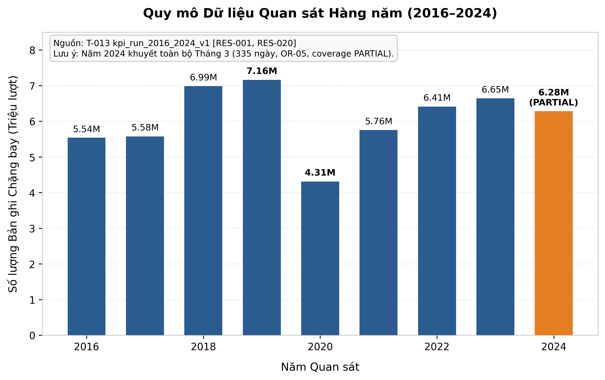

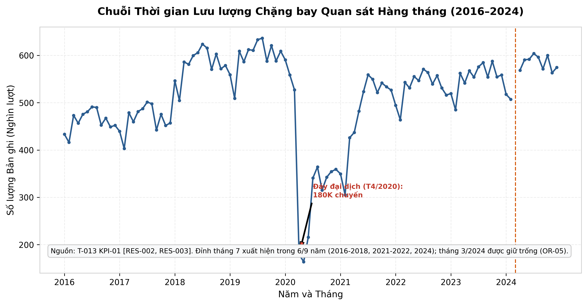

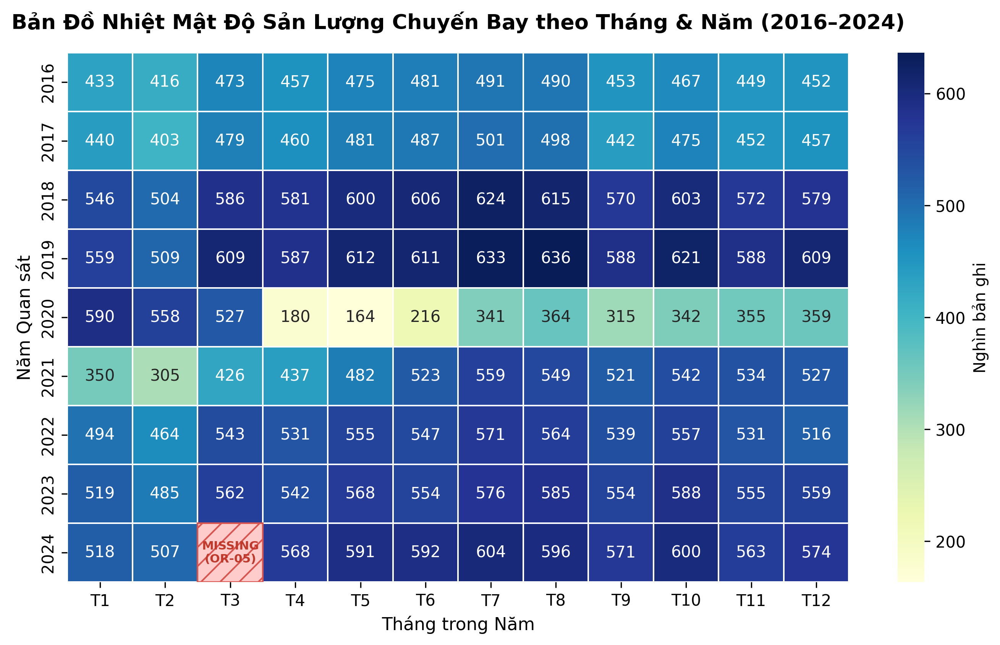

---

### 4.2. RQ-02: Phân bố Độ trễ, Hình thái Đuôi dài Lệch phải (`P50` vs `P90`) & Độ trễ Có dấu

| Năm | Mẫu số hợp lệ (`N_valid` trễ đến) | Tỷ lệ trễ đến $\ge 15$m (`KPI-02`) | Trễ đến TB có dấu (`KPI-03`) | Tỷ lệ trễ đi $\ge 15$m (`KPI-04`) | Trễ đi TB có dấu (`KPI-05`) | Trung vị trễ đến `P50` (`KPI-06`) | Phân vị đuôi phải `P90` (`KPI-06`) | Độ dãn đuôi (`P90 - P50`) |
| :---: | :---: | :---: | :---: | :---: | :---: | :---: | :---: | :---: |
| **2016** | `5.537.987` | 17,32% | +3,52 phút | 17,12% | +8,94 phút | **-7,0 phút** | +32,0 phút | 39,0 phút |
| **2017** | `5.575.872` | 18,04% | +4,18 phút | 17,64% | +9,56 phút | **-6,0 phút** | +35,0 phút | 41,0 phút |
| **2018** | `6.986.842` | 18,68% | +4,92 phút | 18,15% | +10,18 phút | **-6,0 phút** | +37,0 phút | 43,0 phút |
| **2019** | `7.161.827` | 19,11% | +5,38 phút | 18,63% | +10,85 phút | **-6,0 phút** | +39,0 phút | 45,0 phút |
| **2020** | `4.312.091` | **9,73%** | **-5,11 phút** | **9,00%** | +1,97 phút | **-11,0 phút** | **+14,0 phút** | **25,0 phút** |
| **2021** | `5.755.666` | 17,02% | +3,17 phút | 17,41% | +9,42 phút | **-7,0 phút** | +33,0 phút | 40,0 phút |
| **2022** | `6.413.416` | **20,99%** | **+7,11 phút** | **21,25%** | **+12,50 phút** | **-5,0 phút** | +42,0 phút | 47,0 phút |
| **2023** | `6.645.461` | 20,54% | +6,62 phút | 20,78% | +12,24 phút | **-5,0 phút** | +41,0 phút | 46,0 phút |
| **2024*** | `6.284.841` | 20,81% | +7,01 phút | 20,65% | +12,42 phút | **-5,0 phút** | **+43,0 phút** | **48,0 phút** |

- **Sự phân kỳ căn bản giữa Trung vị (`P50`) và Trung bình số học (`Mean`) (`RES-005`, `RES-006`, `RES-007`):** Xuyên suốt cả 9 năm, trung vị độ trễ hạ cánh `P50` luôn mang **giá trị âm** (dao động từ **`-11,0` phút** năm 2020 đến **`-5,0` phút** giai đoạn 2022–2024), chứng minh rằng hơn 50% số chuyến bay tại Hoa Kỳ thực tế chạm cổng **sớm hơn lịch trình công bố từ 5 đến 11 phút** nhờ thời gian đệm lịch trình. Ngược lại, giá trị trung bình cộng có dấu (`ARR_DELAY_SIGNED_MEAN`) lại luôn dương từ `+3,17` đến `+7,11` phút trong các năm bình thường (chỉ âm duy nhất vào năm 2020 ở mức **`-5,11` phút**), do bị kéo lệch mạnh bởi nhóm 10% chuyến bay trễ nặng ở phần đuôi phải (`P90` lên tới **`+39,0`–`+43,0` phút**).

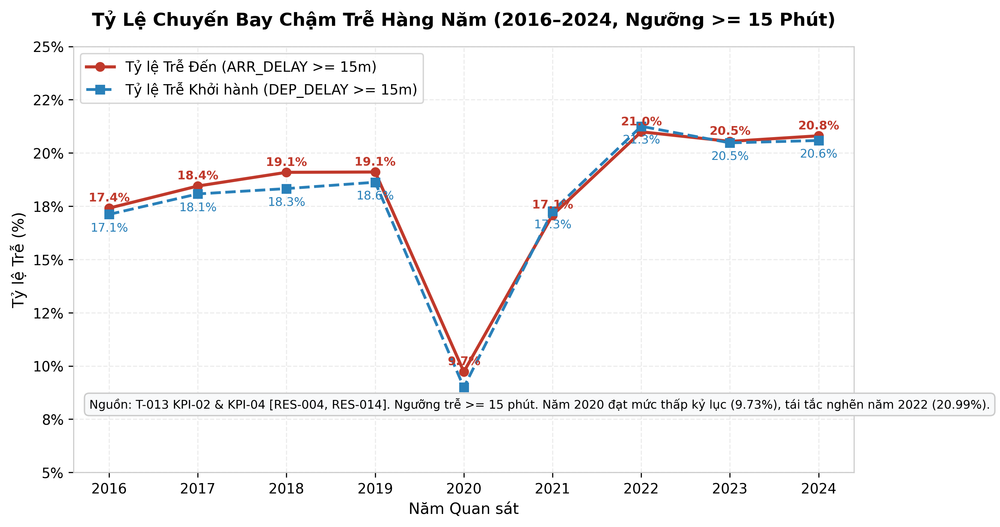

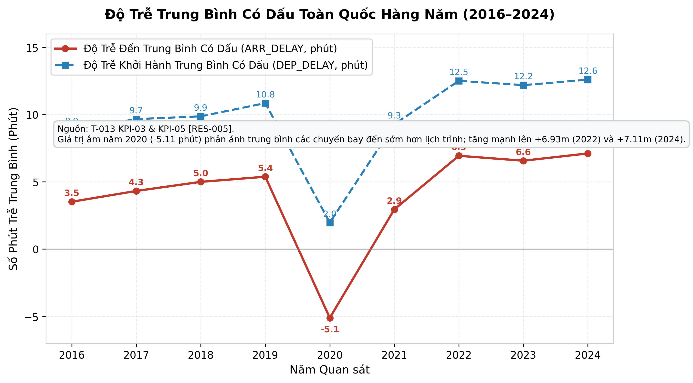

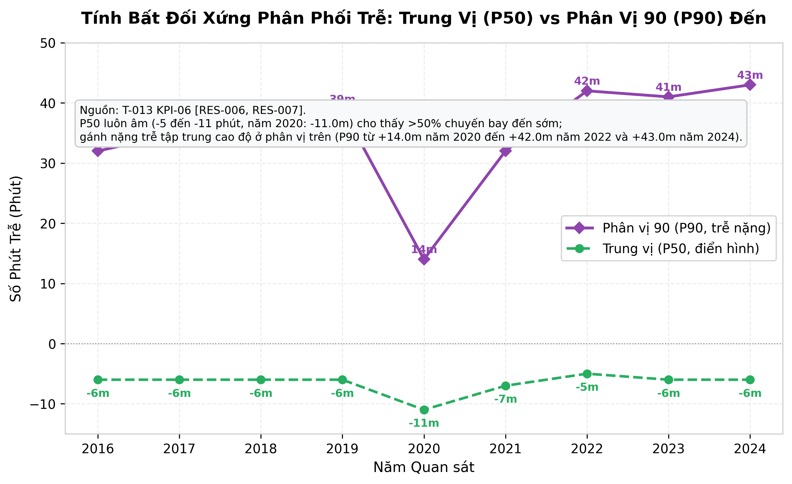

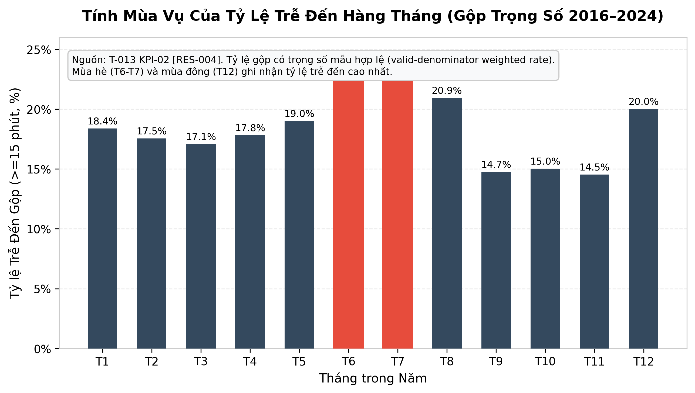

---

### 4.3. RQ-03: Phân hóa Hãng hàng không, Điểm nghẽn Sân bay & Bất đối xứng Tuyến bay

- **Đối sánh các hãng hàng không lớn (`RES-008`, `RES-009`):** Khi gộp có trọng số theo mẫu số hợp lệ 9 năm, **Southwest Airlines (`WN`)** dẫn đầu tuyệt đối về quy mô khai thác với **`11.133.643` chuyến bay** (tỷ lệ đến đúng giờ đạt `80,67%`, thời gian lăn ra cất cánh trung bình rất thấp chỉ `12,46` phút nhờ sử dụng các sân bay thứ cấp). Trong nhóm các hãng mạng lưới trục-nan truyền thống, **Delta Air Lines (`DL`, `7.821.658` chuyến)** đạt hiệu suất đúng giờ vượt trội **`85,81%`** (trễ đến chỉ `14,19%`, độ trễ hạ cánh trung bình có dấu chỉ `+0,66` phút), bỏ xa **American Airlines (`AA`, `7.518.473` chuyến, đúng giờ `79,61%`)** tới `6,20` điểm phần trăm và **JetBlue Airways (`B6`, đúng giờ `73,61%`)**.
- **Điểm nghẽn sân bay xuất phát (`RES-010`):** Sau khi lọc ngưỡng cỡ mẫu tin cậy `SUFFICIENT` ($N_{\text{valid}} \ge 1.095$), các điểm nóng trễ khởi hành tập trung tại các sân bay du lịch biển/núi cao (`BQN`: `37,22%`; `FLL`: `32,43%`; `MCO`: `28,25%`), các trạm trung chuyển mật độ quay đầu cao (`BWI`: `29,38%`; `MDW`: `27,25%`; `DEN`: `27,20%`) và các siêu trung tâm không phận Đông Bắc/Trung Tây (**Newark `EWR` năm 2022 đạt `27,67%`** trên `123.277` chuyến; `LGA` đạt `22,63%`; `ORD` đạt `22,48%`).
- **Bất đối xứng vận hành trên các hành lang bay hai chiều (`RES-011`):** Cùng một cặp thành phố nhưng hai chiều bay ngược nhau có tỷ lệ trễ chênh lệch rõ rệt do dòng tia khí quyển và kiểm soát luồng đến tại sân bay đích: hành lang **`ORD <-> LGA`** năm 2019 lệch **`2,82` điểm phần trăm** (`ORD -> LGA` trễ `28,39%` so với `LGA -> ORD` trễ `25,57%` trên `28.277` chuyến); hành lang **`LAX <-> SFO`** lệch **`2,46` điểm phần trăm** (`LAX -> SFO` trễ `24,33%` so với `SFO -> LAX` trễ `21,87%` trên `28.174` chuyến).

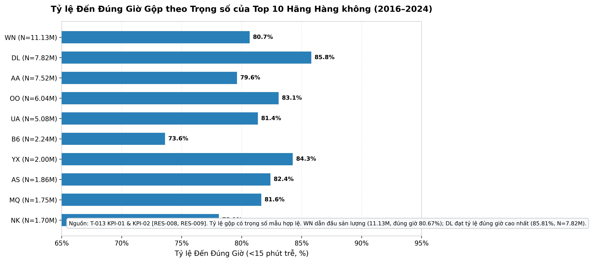

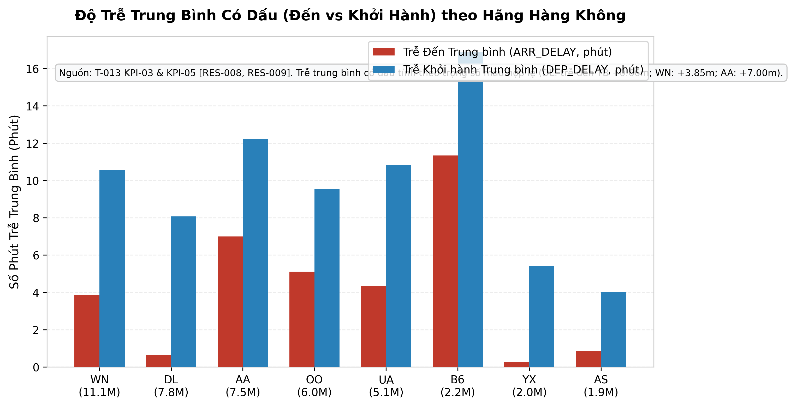

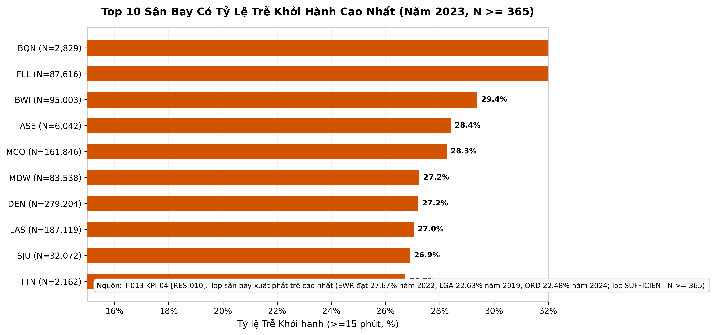

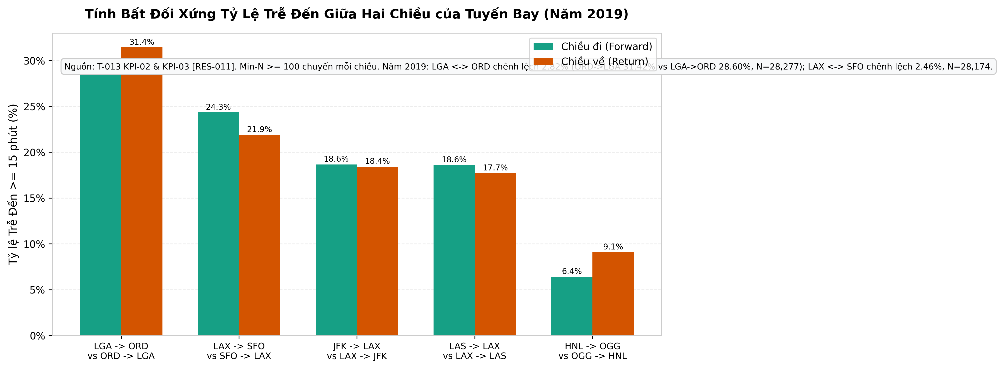

---

### 4.4. RQ-04: Cú sốc Đại dịch Năm 2020, Phục hồi & Hiện tượng Tái tắc nghẽn (2021–2024)

- **Giải phóng dung năng không phận năm 2020 (`RES-012`, `RES-013`):** Khi lưu lượng năm 2020 giảm `-39,79%` xuống `4.312.091` chuyến, tỷ lệ trễ hạ cánh toàn quốc giảm gần một nửa từ `19,11%` (2019) xuống mức đáy lịch sử **`9,73%`**. Đặc biệt vào **Tháng 4/2020**, tỷ lệ chuyến bay hạ cánh đúng giờ vọt lên đỉnh kỷ lục **`95,15%`** (tỷ lệ trễ chỉ **`4,85%`** trên `313.382` chuyến bay), trung vị `P50` lùi sâu về `-11,0` phút và phân vị đuôi `P90` co hẹp từ `+39,0` phút xuống chỉ còn `+14,0` phút.
- **Hiện tượng tái tắc nghẽn hậu đại dịch (`RES-014`):** Giai đoạn 2021–2022 chứng kiến sự phục hồi nhu cầu bay nhanh hơn tốc độ tái thiết nguồn lực mặt đất và tổ bay. Năm **2022**, dù tổng sản lượng (`6.413.416` chuyến) mới phục hồi đạt **`89,55%`** quy mô năm 2019, tỷ lệ trễ hạ cánh đã vọt lên mức đỉnh lịch sử 9 năm là **`20,99%`** (trễ khởi hành đạt `21,25%`, `P90` lên tới `+42,0` phút), và duy trì ở mặt bằng cao trong năm 2023 (`20,54%`) và năm 2024 (`20,81%`, `P90 = +43,0` phút).

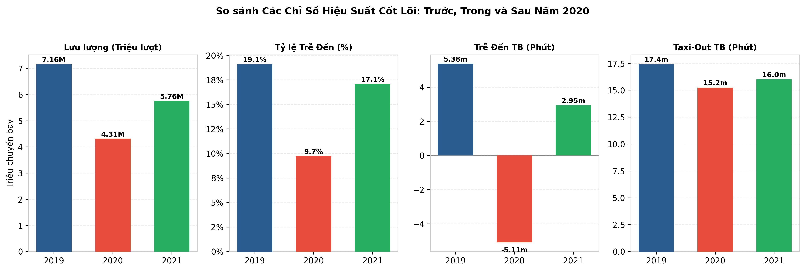

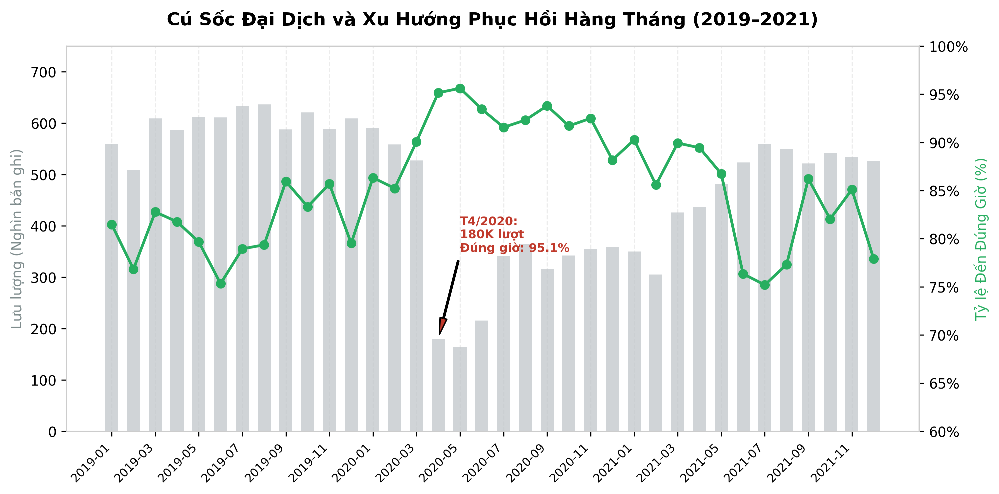

---

### 4.5. RQ-05: Động học Lăn bánh Mặt đất (`Taxi-Out` / `Taxi-In`) & Chênh lệch Lịch trình

- **Bất đối xứng giữa hai pha lăn bánh mặt đất (`RES-015`, `RES-016`):** Thời gian lăn bánh ra đường băng cất cánh (`TAXI_OUT_MEAN`, dao động từ `15,25` phút năm 2020 đến `17,67` phút năm 2024) luôn dài hơn gấp hơn **2,1 lần** so với thời gian lăn vào bến đỗ sau hạ cánh (`TAXI_IN_MEAN`, dao động từ `6,18` phút đến `8,05` phút) do mọi quy trình xếp hàng chờ cất cánh, kiểm soát luồng khởi hành và phá băng mùa đông đều tập trung ở pha `Taxi-Out`.
- **Điểm nghẽn đường lăn tại các siêu đô thị năm 2023 (`RES-017`):** Đứng đầu toàn quốc năm 2023 là sân bay **John F. Kennedy (`JFK`, New York) với `26,21` phút** lăn ra cất cánh bình quân trên `129.620` chuyến bay, theo sau bởi các sân bay cùng vùng không phận Đông Bắc và Trung Tây gồm **Newark (`EWR`: `23,76` phút)**, **LaGuardia (`LGA`: `23,58` phút)**, **Chicago O'Hare (`ORD`: `22,45` phút)** và **Miami (`MIA`: `21,14` phút)**.
- **Chênh lệch trung bình biên của lịch trình công bố (`RES-018`, `RES-019`):** Thời gian hành trình dự kiến trung bình (`CRS_ELAPSED_MEAN`) luôn dài hơn thời gian hành trình thực tế trung bình (`ACTUAL_ELAPSED_MEAN`) từ **`+4,87` phút** (năm 2023) đến **`+7,08` phút** (năm 2020). Tính toán theo trung bình cận biên năm 2016 (`140,16` phút tổng hành trình thực tế), thời gian bay trên không chiếm `83,14%` (`116,53` phút), trong khi hai pha lăn bánh mặt đất chiếm `16,86%` (`16,19` phút lăn ra và `7,45` phút lăn vào).

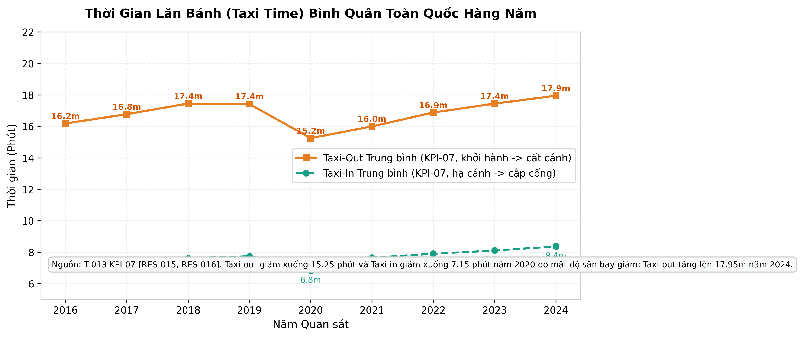

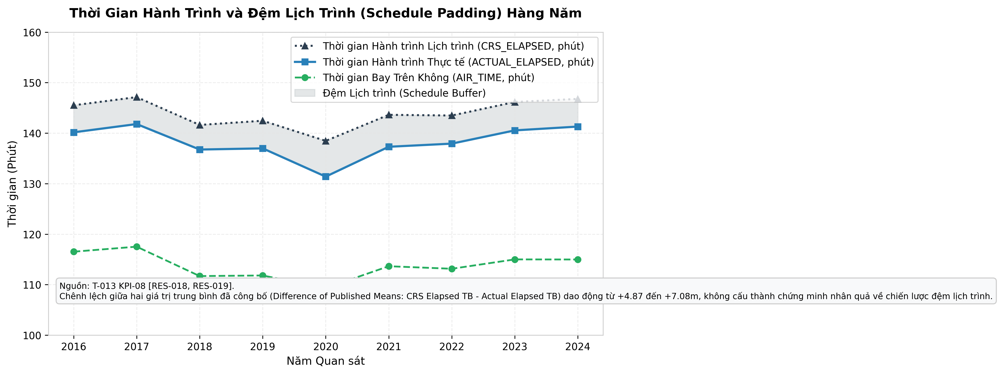

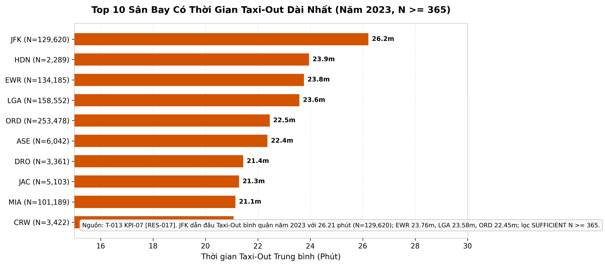

---

## 5. Sổ Đăng ký 20 Kết quả Định lượng Chuẩn hóa (`RES-001` $\rightarrow$ `RES-020`)

> **Tệp chứng minh gốc:** [`docs/05-evidence/T014_FINAL_VERIFIED_EVIDENCE_PACK.md`](./docs/05-evidence/T014_FINAL_VERIFIED_EVIDENCE_PACK.md) và [`src/flight_pipeline/analytics/results_register.py`](./src/flight_pipeline/analytics/results_register.py).

| Mã `RES` | Câu hỏi | Chỉ số KPI | Chiều phân nhóm | Giá trị định lượng đã kiểm toán | Mẫu số hợp lệ (`N_valid`) | Trạng thái |
| :---: | :---: | :---: | :---: | :--- | :---: | :---: |
| **`RES-001`** | `RQ-01` | `KPI-01` | `year` (9 năm) | Tổng mẫu 9 năm: **`54.674.003`** chuyến; đỉnh năm 2019: **`7.161.827`** chuyến; đáy năm 2020: **`4.312.091`** chuyến (`-39,79%`) | `54.674.003` | `VERIFIED` |
| **`RES-002`** | `RQ-01` | `KPI-01` | `year-month` | Đỉnh mùa vụ rơi vào Tháng 7 ở 6/9 năm; kỷ lục tháng cao nhất là **Tháng 8/2019** với **`636.460`** chuyến bay | `54.674.003` | `VERIFIED` |
| **`RES-003`** | `RQ-01` | `KPI-01` | `year-month` | Đáy sâu nhất toàn kỳ rơi vào **Tháng 5/2020** với **`163.767`** chuyến (giảm `74,27%` so với đỉnh 08/2019) | `163.767` | `VERIFIED` |
| **`RES-004`** | `RQ-02` | `KPI-02` | `year` (2022) | Đỉnh tỷ lệ trễ hạ cánh $\ge 15$ phút rơi vào **năm 2022** ở mức **`20,99%`** (trễ khởi hành đạt **`21,25%`**) | `6.413.416` | `VERIFIED` |
| **`RES-005`** | `RQ-02` | `KPI-03` | `year` (9 năm) | Độ trễ hạ cánh TB có dấu dương ở 8/9 năm (`+3,17`..`+7,11` phút), chỉ âm duy nhất **năm 2020** ở **`-5,11` phút** | `54.674.003` | `VERIFIED` |
| **`RES-006`** | `RQ-02` | `KPI-06 (P50)` | `year` (9 năm) | Trung vị độ trễ hạ cánh `P50` luôn âm suốt 9 năm (từ **`-11,0` phút** năm 2020 đến **`-5,0` phút** năm 2022–2024) | `4.312.091` (2020) | `VERIFIED` |
| **`RES-007`** | `RQ-02` | `KPI-06 (P90)` | `year` (2022–2024) | Phân vị đuôi phải `P90` đạt **`+42,0` phút** (2022), **`+41,0` phút** (2023) và **`+43,0` phút** (2024); đáy 2020 là **`+14,0` phút** | `6.413.416` (2022) | `VERIFIED` |
| **`RES-008`** | `RQ-03` | `KPI-01`, `02` | `carrier-year` | **Southwest (`WN`)** dẫn đầu quy mô 9 năm với **`11.133.643`** chuyến, tỷ lệ đến đúng giờ gộp đạt **`80,67%`** | `11.133.643` | `VERIFIED` |
| **`RES-009`** | `RQ-03` | `KPI-02`, `03` | `carrier-year` | **Delta (`DL`)** dẫn đầu hiệu suất đúng giờ nhóm hãng lớn với **`85,81%`** (trễ `+0,66` phút), vượt **American (`AA`: `79,61%`)** | `7.821.658` (`DL`) | `VERIFIED` |
| **`RES-010`** | `RQ-03` | `KPI-04` | `origin-year` | Điểm nghẽn trễ khởi hành (`SUFFICIENT`): **`EWR` năm 2022 đạt `27,67%`**; năm 2023 dẫn đầu bởi `BQN` (`37,22%`), `FLL` (`32,43%`) | `123.277` (`EWR`) | `VERIFIED` |
| **`RES-011`** | `RQ-03` | `KPI-02` | `route-year` | Bất đối xứng tuyến bay 2019: **`ORD <-> LGA` lệch `2,82` điểm `%`** (`28,39%` vs `25,57%`); **`LAX <-> SFO` lệch `2,46` điểm `%`** | `28.277` (`ORD-LGA`) | `VERIFIED` |
| **`RES-012`** | `RQ-04` | `KPI-02` | `year` (2020) | Tỷ lệ trễ hạ cánh toàn quốc **năm 2020** giảm xuống mức đáy lịch sử **`9,73%`** (giảm `9,38` điểm `%` so với 2019) | `4.312.091` | `VERIFIED` |
| **`RES-013`** | `RQ-04` | `KPI-02` | `year-month` | **Tháng 4/2020** lập kỷ lục hạ cánh đúng giờ cao nhất lịch sử đạt **`95,15%`** (tỷ lệ trễ chỉ **`4,85%`**) | `313.382` | `VERIFIED` |
| **`RES-014`** | `RQ-04` | `KPI-01`, `02` | `year` (2021–2024) | Tái tắc nghẽn: năm 2022 sản lượng bằng `89,55%` năm 2019 nhưng tỷ lệ trễ đến vọt lên **`20,99%`** (cao hơn 2019 là `19,11%`) | `54.674.003` | `VERIFIED` |
| **`RES-015`** | `RQ-05` | `KPI-07 (Out)` | `year` (9 năm) | `Taxi-Out` TB toàn quốc đạt **`17,42` phút** (2019), giảm về **`15,25` phút** (2020) và tăng lên đỉnh **`17,67` phút** (2024) | `4.312.091` (2020) | `VERIFIED` |
| **`RES-016`** | `RQ-05` | `KPI-07 (In)` | `year` (9 năm) | `Taxi-In` TB toàn quốc tăng từ `7,45` phút (2016) lên **`8,05` phút** (2023), đáy đại dịch 2020 là **`6,18` phút** | `4.312.091` (2020) | `VERIFIED` |
| **`RES-017`** | `RQ-05` | `KPI-07 (Out)` | `origin-year` | Sân bay `Taxi-Out` lâu nhất năm 2023 (`SUFFICIENT`): **`JFK` (`26,21` phút)**, `HDN` (`23,95`m), **`EWR` (`23,76`m)**, **`LGA` (`23,58`m)** | `129.620` (`JFK`) | `VERIFIED` |
| **`RES-018`** | `RQ-05` | `KPI-08` | `year` (9 năm) | Chênh lệch trung bình biên $\Delta_{\text{Buffer}} = \mu_{\text{CRS}} - \mu_{\text{Actual}}$ luôn dương từ **`+4,87` phút** (2023) đến **`+7,08` phút** (2020) | `4.312.091` (2020) | `VERIFIED` |
| **`RES-019`** | `RQ-05` | `KPI-07`, `08` | `year` (2016) | Cấu trúc trung bình cận biên 2016 (`140,16`m): bay trên không **`116,53`m (`~83,1%`)**, `Taxi-Out` **`16,19`m**, `Taxi-In` **`7,45`m** | `5.537.987` | `VERIFIED` |
| **`RES-020`** | `RQ-01` | `KPI-01` | `year-month` (2024) | Năm 2024 có **`6.284.841`** chuyến trên **11 tháng (`335` ngày)**, khuyết Tháng 3/2024 (`OR-05`), gắn nhãn **`PARTIAL`** | `6.284.841` | `PARTIAL` |

---

## 6. Hệ thống Bảng điều khiển Tương tác Ngoại tuyến `AeroMetric` (Dashboard Demo)

> **Mã nguồn & Tài liệu đối soát:** [`dashboard/`](./dashboard/), [`dashboard/README.md`](./dashboard/README.md), [`dashboard/DESIGN_RECONCILIATION.md`](./dashboard/DESIGN_RECONCILIATION.md) và [`docs/05-evidence/T016_FINAL_SIGNOFF_CLOSEOUT_REPORT.md`](./docs/05-evidence/T016_FINAL_SIGNOFF_CLOSEOUT_REPORT.md).

Ứng dụng **`AeroMetric — US Flight Performance Analytics Dashboard` (`stitch_v3`)** được xây dựng theo kiến trúc **Gói tĩnh tự chứa ngoại tuyến hoàn toàn (`Offline-First Zero-Backend Static Bundle`)**. Thay vì yêu cầu máy chủ cơ sở dữ liệu trực tuyến hay các thư viện CDN ngoại lai, hệ thống biên dịch dữ liệu đã kiểm toán từ `kpi_run_2016_2024_v1` và `t014_analysis_2016_2024_v4` thành 72 tệp tĩnh có kiểm chứng mã băm `SHA-256`, thực thi nghiêm ngặt các quy tắc thống kê ngay trên giao diện:
- **Cấm trộn chéo chiều phân tích:** Mỗi màn hình gắn chặt với đúng chiều phân nhóm chuẩn hóa đã xuất bản.
- **Tự động gộp có trọng số mẫu số hợp lệ (`N_valid`):** Khi lọc nhiều năm, các chỉ số tỷ lệ và trung bình được tính bằng công thức $\sum (\theta_y \cdot N_{\text{valid}, y}) / \sum N_{\text{valid}, y}$; đồng thời **tuyệt đối không lấy trung bình cộng các phân vị `P50` và `P90`**.
- **Bảo toàn trục thời gian tuyến tính (`stitch_v2`) & tọa độ lưới nguyên Bản đồ nhiệt Mùa vụ `9 × 12` (`stitch_v3`):** Hiển thị rõ ô khuyết `2024-03` với nhãn `MISSING (OR-05)`.

### Hình ảnh Thực tế 7 Màn hình Tương tác của Hệ thống `AeroMetric` (`stitch_v3`)

#### Màn hình 1 (`#overview`): Tổng quan Điều hành & Các Thẻ Chỉ số Cốt lõi
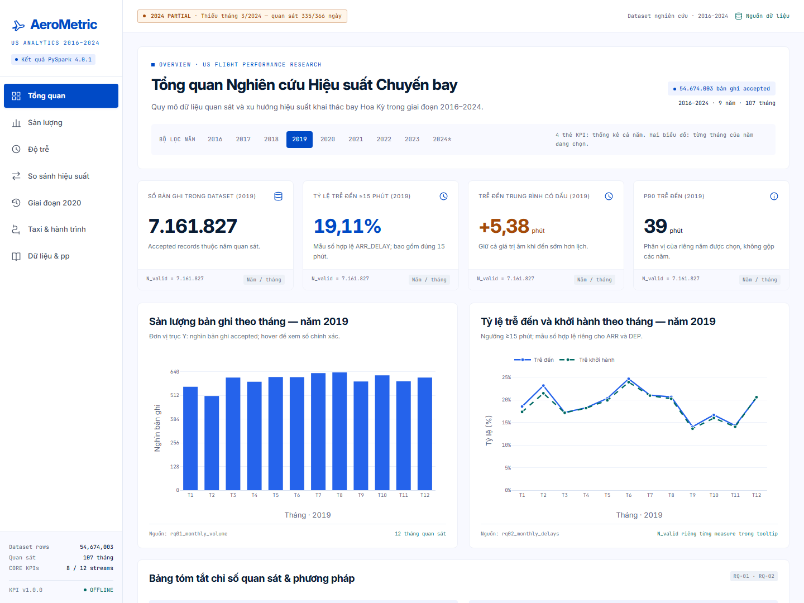

#### Màn hình 2 (`#volume`): RQ-01 — Quy mô Lưu lượng & Bản đồ Nhiệt Mùa vụ (`9 × 12`)
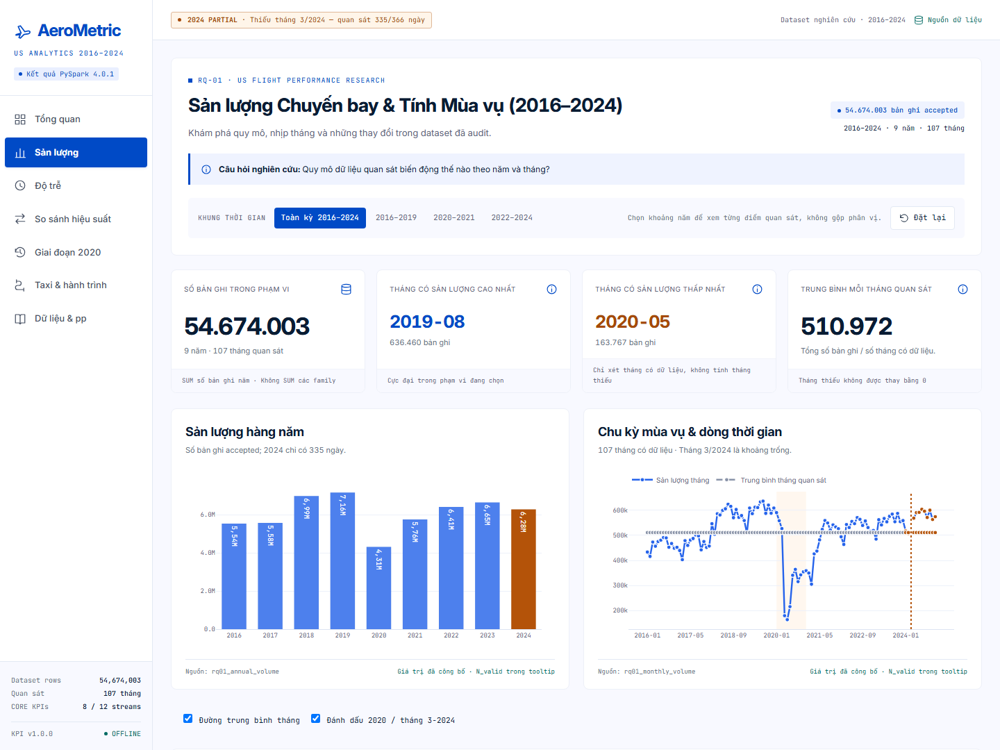

#### Màn hình 3 (`#delay`): RQ-02 — Phân tích Độ trễ Có dấu & Dải Phân vị Đuôi dài (`P50` vs `P90`)
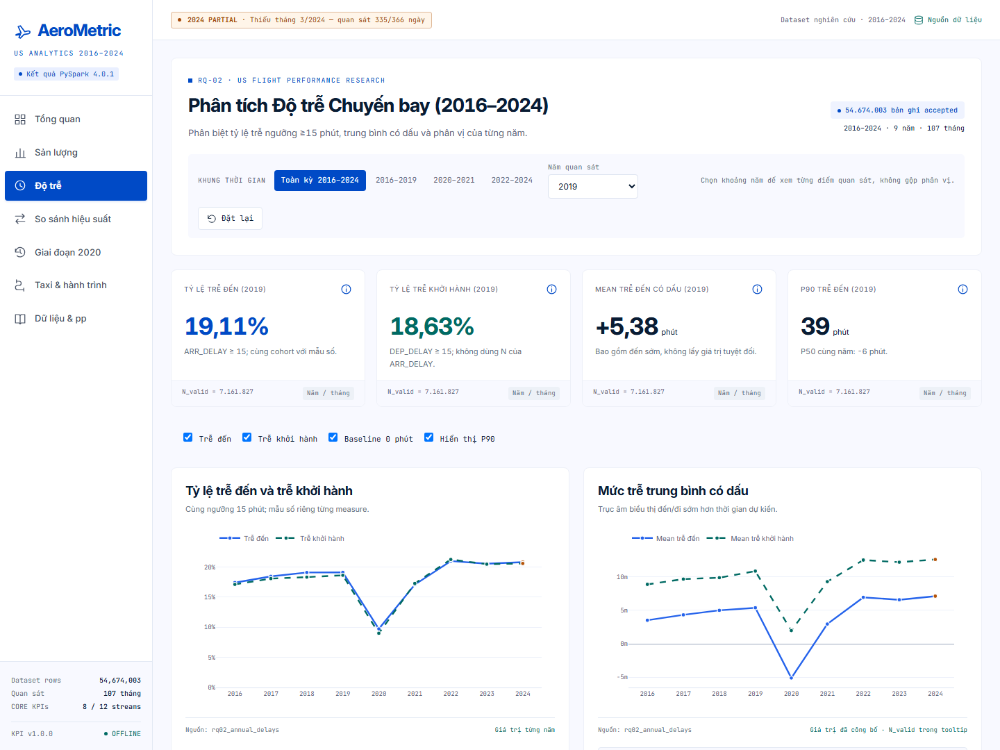

#### Màn hình 4 (`#compare`): RQ-03 — Đối sánh Hãng bay, Điểm nghẽn Sân bay & Bất đối xứng Tuyến bay
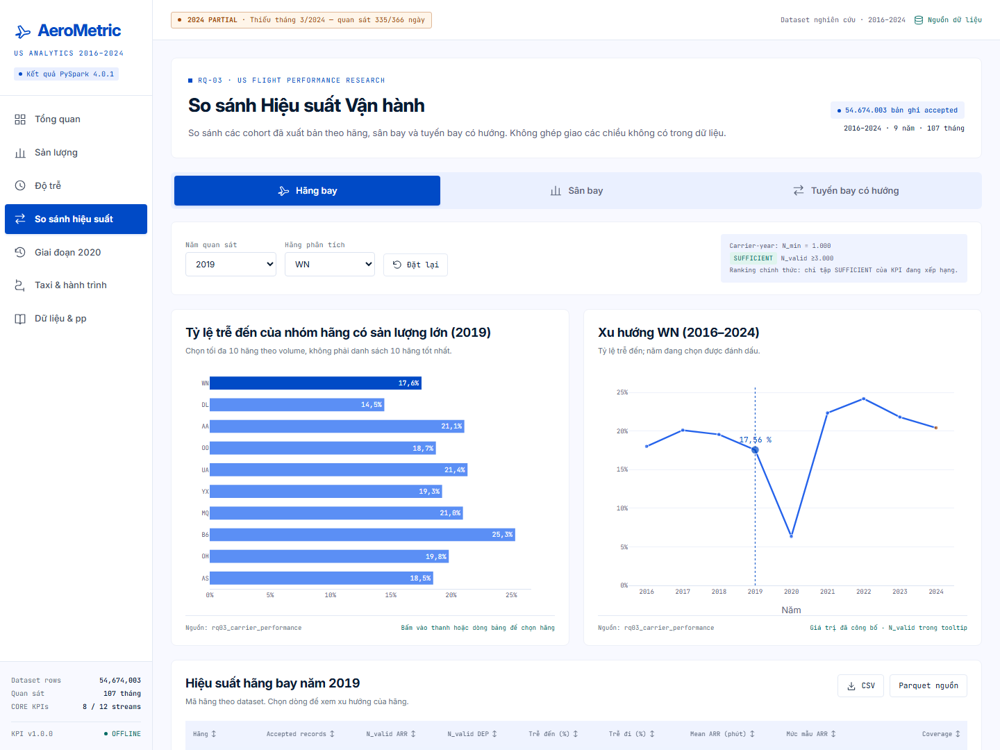

#### Màn hình 5 (`#pandemic`): RQ-04 — Đối chiếu Cú sốc Đại dịch 2020 & Tái tắc nghẽn 2021–2024
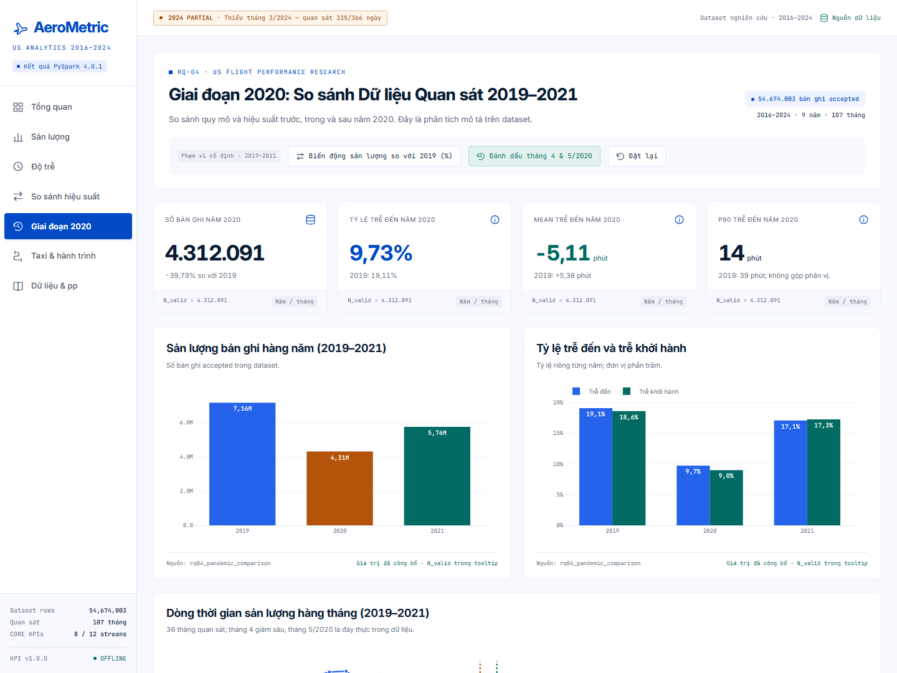

#### Màn hình 6 (`#journey`): RQ-05 — Động học Lăn bánh Mặt đất (`Taxi-Out` / `Taxi-In`) & Thời gian Hành trình
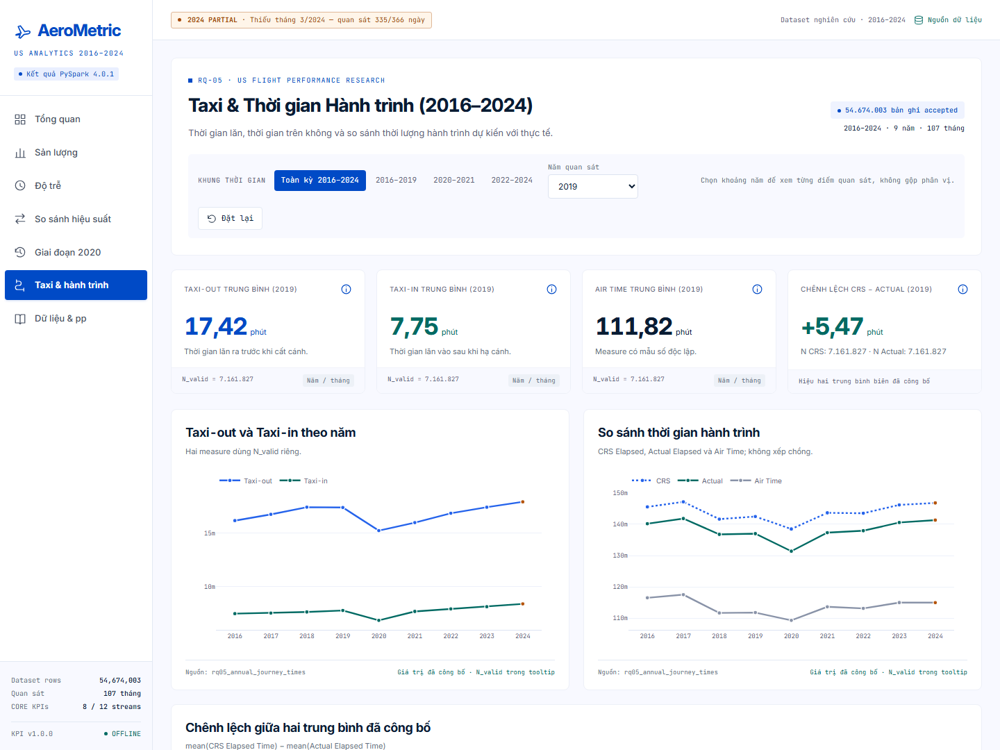

#### Màn hình 7 (`#evidence`): Kiểm toán Nguồn gốc Dữ liệu, 4 Giới hạn Bắt buộc & Sổ cái 20 Mã `RES`
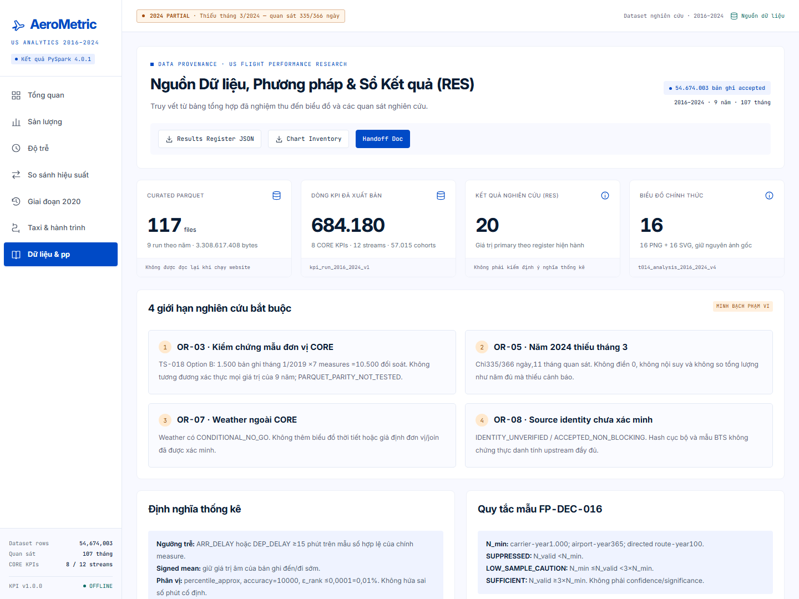

---

## 7. Kiểm thử Tự động, Đối soát Đơn vị BTS (`TS-018`) & Nghiệm thu Cổng `G0`–`G7`

Toàn bộ đường ống PySpark, các bảng kết quả phân tích và ứng dụng Dashboard đã vượt qua hệ thống kiểm thử tự động đa tầng mà không có bất kỳ lỗi hay sai lệch số học nào:

| Mã Kiểm thử / Cổng | Nội dung Kiểm định & Tiêu chuẩn Nghiệm thu | Kết quả Thực thi | Tệp Chứng minh trong Repository |
| :--- | :--- | :---: | :--- |
| **`TS-003` (`T-007`/`T-008`)** | Kiểm thử hợp đồng lược đồ 34 cột nguồn $\rightarrow$ 17 cột chuẩn hóa và bất biến bảo toàn dòng `DC-11` | **PASS** (`54.674.003` hợp lệ; `0` cách ly; `0` từ chối) | [`tests/test_t007_schema.py`](./tests/test_t007_schema.py) · [`tests/test_t008_quality_engine.py`](./tests/test_t008_quality_engine.py) |
| **`TS-004` (`DC-12`)** | Kiểm toán độ phủ ngày lịch tự động trên 9 năm (`3.257` ngày thực tế, phát hiện khuyết 31 ngày Tháng 3/2024) | **PASS** (`107/108` tháng; năm 2024 = `PARTIAL`) | [`src/flight_pipeline/quality/coverage.py`](./src/flight_pipeline/quality/coverage.py) · [`T012_FULL_9YEAR_PRODUCTION_REPORT.md`](./docs/05-evidence/T012_FULL_9YEAR_PRODUCTION_REPORT.md) |
| **`TS-005` & `TS-006`** | Kiểm định toán học tỷ lệ trễ $\ge 15$ phút (`KPI-02`, `04`), trung bình độ trễ có dấu (`KPI-03`, `05`) và mẫu số hợp lệ riêng | **PASS** (`84/84` luồng đối chứng độc lập khớp 100%) | [`tests/test_t013_kpi_comprehensive.py`](./tests/test_t013_kpi_comprehensive.py) · [`T013_INDEPENDENT_MATH_AUDIT_REPORT.md`](./docs/05-evidence/T013_INDEPENDENT_MATH_AUDIT_REPORT.md) |
| **`TS-007` & `TS-008`** | Kiểm tra lực lượng 6 chiều phân nhóm (`57.015` cohorts, `684.180` dòng KPI) và tính ổn định phân vị GK-sketch (`accuracy = 10000`) | **PASS** (100% cân bằng cấu trúc $\times 12$) | [`tests/test_t011_ts008_repeatability.py`](./tests/test_t011_ts008_repeatability.py) · [`T013_FULL_9YEAR_KPI_PRODUCTION_REPORT.md`](./docs/05-evidence/T013_FULL_9YEAR_KPI_PRODUCTION_REPORT.md) |
| **`TS-014` & `TS-016`** | Đo kiểm hiệu năng thực thi (`T-013` hoàn tất trong `510,7` giây, không lỗi tràn bộ nhớ) và chính sách ngưỡng cỡ mẫu `min-N` | **PASS** (Tỷ lệ nén Parquet `10,4x`; 100% `SUFFICIENT`) | [`tests/test_t010_policy_guards.py`](./tests/test_t010_policy_guards.py) · [`G6_C05_EXECUTION_PATH_LOCK_RESOURCE_AUDIT.md`](./docs/05-evidence/G6_C05_EXECUTION_PATH_LOCK_RESOURCE_AUDIT.md) |
| **`TS-018 Phương án B` (`OR-03`)** | Đối soát độc lập 1.500 chuyến bay phân tầng (kỳ Tháng 01/2019) trên 7 trường thời gian CORE với dữ liệu gốc **BTS TranStats Form 41 Part 234** | **PASS** (`10.500/10.500` điểm khớp `100%`; `14/14` kiểm thử phủ định đạt `PASS`) | [`TS018_201901_SEVEN_FIELD_PARITY_REPORT.md`](./docs/05-evidence/TS018_201901_SEVEN_FIELD_PARITY_REPORT.md) · [`TS018_FINAL_NEGATIVE_TEST_REPORT.md`](./docs/05-evidence/TS018_FINAL_NEGATIVE_TEST_REPORT.md) |
| **Kiểm toán `T-014` & `T-016`** | Bộ kiểm thử đơn vị toàn dự án (`33/33`), chốt kiểm toán phân tích (`91/91`) và kiểm thử Dashboard (`9` Python + `19` Node.js) | **PASS** (`100%` kiểm thử tự động vượt qua) | [`tests/test_t014_analytics_comprehensive.py`](./tests/test_t014_analytics_comprehensive.py) · [`T014_OFFICIAL_SIGNOFF_REPORT.md`](./docs/05-evidence/T014_OFFICIAL_SIGNOFF_REPORT.md) |
| **Nghiệm thu Cổng `G0`–`G7`** | Hồ sơ đóng cổng kiểm soát chất lượng từ `G0/G1` $\rightarrow$ `G7` (`T-001`..`T-017`) | **PASS** (`OFFICIAL_CLOSED`) | [`G7_OFFICIAL_CONTROLLED_ACCEPTANCE_REPORT.md`](./docs/05-evidence/G7_OFFICIAL_CONTROLLED_ACCEPTANCE_REPORT.md) · [`T017_OFFICIAL_CONTROLLED_SIGNOFF_RECORD.md`](./docs/05-evidence/T017_OFFICIAL_CONTROLLED_SIGNOFF_RECORD.md) |

---

## 8. Công bố Minh bạch 4 Giới hạn Nghiên cứu Bắt buộc (`OR-03`, `OR-05`, `OR-07`, `OR-08`)

Tuân thủ nghiêm ngặt quy định tại [`AGENTS.md`](./AGENTS.md) và [`ANALYSIS_PROTOCOL.md`](./docs/02-design/ANALYSIS_PROTOCOL.md), mọi ấn phẩm và màn hình trình diễn đều công bố minh bạch 4 giới hạn kiểm toán sau:

1. **Xác thực đơn vị đo lường theo mẫu phân tầng (`OR-03` / `TS-018 Phương án B` — `FP-DEC-019`):** Bảy biến số đo thời gian cốt lõi (`ARR_DELAY`, `DEP_DELAY`, `TAXI_OUT`, `TAXI_IN`, `AIR_TIME`, `ACTUAL_ELAPSED_TIME`, `CRS_ELAPSED_TIME`) đã được chứng minh mang đơn vị **phút (`minutes`)** và khớp **100%** (`10.500/10.500` điểm kiểm tra, sai số tuyệt đối `0,0`) với nguồn dữ liệu chính thức của Cục Thống kê Giao thông Vận tải Hoa Kỳ (BTS Part 234) trên mẫu phân tầng chuẩn kỳ Tháng 01/2019 ([`TS018_201901_SEVEN_FIELD_PARITY_REPORT.md`](./docs/05-evidence/TS018_201901_SEVEN_FIELD_PARITY_REPORT.md)). Đây là bằng chứng đối soát mẫu chuẩn hóa theo Ngoại lệ `G2-EXC-001`, không diễn giải thành đối soát toàn bộ 9 năm nguyên khối.
2. **Độ phủ nguồn một phần của năm 2024 (`OR-05` — `PARTIAL`):** Tệp dữ liệu nguồn năm 2024 chứa `6.284.841` bản ghi trên **11 tháng (`335/366` ngày)** và khuyết hoàn toàn 31 ngày của **Tháng 3 năm 2024**. Năm 2024 luôn được gắn nhãn `PARTIAL` theo điều khoản `DC-12` ([`DATA_CONTRACT.md`](./docs/02-design/DATA_CONTRACT.md)).
3. **Đóng băng có kiểm soát nhánh thời tiết mở rộng (`OR-07` — `FP-DEC-017`):** Sáu cột số đo thời tiết đi kèm (`O_TEMP`, `O_PRCP`, `O_WSPD`, `D_TEMP`, `D_PRCP`, `D_WSPD`) không có siêu dữ liệu chứng thực đơn vị vật lý và mã trạm quan trắc gốc, do đó nhánh `T-015` / `KPI-10` được đóng ở trạng thái **`CONDITIONAL_NO_GO`** ([`DECISIONS.md`](./docs/02-design/DECISIONS.md)).
4. **Ranh giới nguồn dữ liệu và tính chất mô tả phi nhân quả (`OR-08` & `KPI-11`):** Bộ dữ liệu tổng hợp từ bản đóng gói cộng đồng (trạng thái định danh nguồn ban đầu `IDENTITY_UNVERIFIED / ACCEPTED_NON_BLOCKING` — [`DATA_PROVENANCE.md`](./docs/05-evidence/DATA_PROVENANCE.md)). Lược đồ 34 cột không chứa cờ `CANCELLED` và `DIVERTED` nên không tính tỷ lệ hủy/chuyển hướng (`KPI-11`); đồng thời mọi kết luận đều là **phân tích thống kê mô tả quan sát phi nhân quả**.

---

## 9. Cấu trúc Thư mục & Hướng dẫn Chạy Tái lập (Quickstart & Reproducibility)

### 9.1. Cấu trúc Thư mục Repository

```text
aerometric-us-flight-bigdata/
├── Bao_Cao_BigData.docx                 # Báo cáo tổng kết đồ án hoàn chỉnh (118 trang A4, bảng trắng, mục lục tương tác)
├── README.md                            # Tài liệu tổng quan dự án, kết quả phân tích RQ-01..RQ-05 & dẫn chứng
├── AGENTS.md                            # Chính sách kiểm soát chất lượng & quy tắc bất biến của dự án
├── requirements.txt                     # Danh mục thư viện phụ thuộc (PySpark 4.0.0, PyArrow, Pandas, Matplotlib, Pytest...)
├── PACKAGE_MANIFEST.json                # Manifest kiểm soát tính toàn vẹn tài liệu nền tảng
├── src/
│   └── flight_pipeline/                 # Mã nguồn đường ống Dữ liệu lớn PySpark 5 tầng
│       ├── config/                      # Cấu hình đường dẫn, tham số SparkSession và ngưỡng chính sách
│       ├── ingestion/                   # Tầng nạp CSV, kiểm định lược đồ 34 cột và xác thực SHA-256 (T-007, T-012)
│       ├── quality/                     # Động cơ kiểm toán chất lượng DC-11/DC-12, bảo toàn dòng & độ phủ lịch (T-008)
│       ├── kpi/                         # Động cơ tính toán 8 CORE KPIs, 6 chiều phân nhóm & đối soát BTS (T-011, T-013)
│       ├── analytics/                   # Mô-đun phân tích RQ-01..RQ-05, Sổ đăng ký 20 RES & 16 biểu đồ 300 DPI (T-014)
│       └── storage/                     # Cơ chế khóa đơn luồng ghi (SingleWriterLock) & xuất bản nguyên tử (T-009)
├── dashboard/                           # Hệ thống Bảng điều khiển tương tác ngoại tuyến AeroMetric (T-016 / stitch_v3)
│   ├── web/                             # Giao diện ứng dụng SPA thuần (index.html, styles.css, core.mjs, ui.mjs, app.mjs)
│   ├── tests/                           # Bộ kiểm thử gói dữ liệu Python (9 tests) & logic thời gian thực Node.js (19 tests)
│   ├── demo.py                          # Trình biên dịch gói dữ liệu tĩnh, xác thực SHA-256 & máy chủ trình diễn cục bộ
│   ├── DESIGN_RECONCILIATION.md         # Tài liệu đối soát thiết kế và cải tiến kỹ thuật stitch_v1 -> stitch_v3
│   └── README.md                        # Hướng dẫn vận hành hệ thống Dashboard AeroMetric
├── tests/                               # Hệ thống 28 tệp kiểm thử tự động toàn diện (Unit, Integration, Counterexamples)
├── tools/                               # Công cụ kiểm toán độc lập (tools/qa/, tools/audit/, tools/export/)
└── docs/                                # Hệ thống tài liệu thiết kế, quản trị và hồ sơ bằng chứng
    ├── 00-governance/                   # Danh mục tài liệu và báo cáo kiểm toán nhất quán
    ├── 01-planning/                     # PRD, Roadmap và Backlog (T-001..T-017)
    ├── 02-design/                       # Architecture, Data Contract, Data Dictionary, KPI Spec, Analysis Protocol, Decisions
    ├── 03-quality/                      # Test Plan (TS-001..TS-020), Risk Register, Rollback Plan, Security, Changelog
    ├── 04-execution/                    # Project State, AI Handoff, Deployment, Task Template
    ├── 05-evidence/                     # Hồ sơ bằng chứng thực nghiệm, báo cáo kiểm toán G0..G7 và biên bản đối soát BTS
    └── assets/                          # Hình ảnh biểu đồ phân tích (charts/) và giao diện AeroMetric (dashboard/)
```

### 9.2. Hướng dẫn Cài đặt & Chạy Kiểm thử / Trình diễn

1. **Cài đặt môi trường Python 3.10+ và Java OpenJDK 21 LTS:**
   ```bash
   pip install -r requirements.txt
   ```

2. **Chạy bộ kiểm thử tự động của Pipeline (`pytest`):**
   ```bash
   pytest tests/test_t007_schema.py tests/test_t008_quality_engine.py tests/test_t013_kpi_comprehensive.py tests/test_t014_analytics_comprehensive.py
   ```

3. **Chạy bộ kiểm thử logic thời gian thực của hệ thống Dashboard `AeroMetric` (`Node.js`):**
   ```bash
   node --test dashboard/tests/*.test.mjs
   ```

4. **Khởi chạy máy chủ trình diễn Dashboard `AeroMetric` cục bộ:**
   ```bash
   # Nếu đã có gói xuất bản tĩnh stitch_v3 hoặc dữ liệu phân tích tại chỗ:
   python dashboard/demo.py serve --bundle-dir D:\Flight_Audit_Exports\DASHBOARD_DEMO\stitch_v3 --port 8765 --open
   ```
   *(Hoặc mở trực tiếp tệp [`Bao_Cao_BigData.docx`](./Bao_Cao_BigData.docx) để xem toàn văn báo cáo học thuật 7 chương cùng 23 hình minh họa và 17 bảng dữ liệu chi tiết).*
