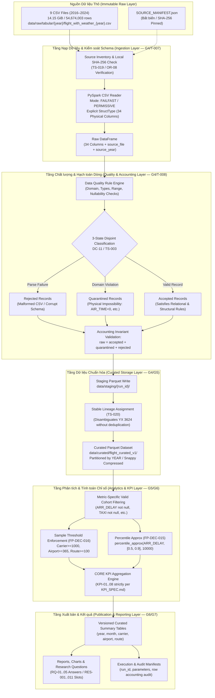

# ARCHITECTURE — Kiến trúc Pipeline Big Data Phân tích Hiệu suất Bay Hoa Kỳ (2016–2024)

**Status:** `PROPOSED_FOR_PROJECT_LEAD_REVIEW` (Hoàn thành thiết kế tại Gate G3 / Nhiệm vụ `T-006`; **chưa phải code đã triển khai**; không viết ingestion production tại G3).  
**Owner:** Group A — System Design ([`DOCUMENT_REGISTER.md`](../00-governance/DOCUMENT_REGISTER.md)).  
**Mục tiêu hệ thống:** Xây dựng kiến trúc pipeline xử lý dữ liệu lớn mang tính mô tả, hồi cứu (*retrospective descriptive analysis*) cho 54.674.003 bản ghi (14,15 GiB raw CSV) trên 9 năm (2016–2024) sử dụng Apache Spark / PySpark và định dạng lưu trữ cột nén Parquet.

---

## 1. Sơ đồ Kiến trúc Tổng thể (End-to-End Pipeline Architecture)



---

## 2. Luồng Dữ liệu Chi tiết (Full Dataflow Specification)

| Bước | Tên bước | Input | Output | Thành phần thực thi | Quy tắc chất lượng & Hợp đồng áp dụng | Gate / Task phụ trách |
| :---: | :--- | :--- | :--- | :--- | :--- | :---: |
| **0** | **Source Preflight** | 9 CSV files | File existence, size, local SHA-256 | Python `hashlib` / OS | Kiểm tra bất biến (`FP-DEC-004`), tính SHA-256 cục bộ (`TS-019`, `OR-08`) | `G4 / T-007` |
| **1** | **Controlled Ingest** | `flight_with_weather_{year}.csv` | `DataFrame[raw_schema]` | PySpark `DataFrameReader` | Explicit `StructType` 34 cột; không infer schema; giữ 6 cột Weather thô (`DC-07`) | `G4 / T-007` |
| **2** | **Row Accounting** | `DataFrame[raw_schema]` | 3 cohorts: `accepted`, `quarantined`, `rejected` | PySpark SQL Expressions | Hạch toán rời nhau 100% (`DC-11`, `TS-003`); cấm loại bỏ dòng CORE chỉ vì thiếu thời tiết (`FP-DEC-017`) | `G4 / T-008` |
| **3** | **Date & Temporal Safety** | `accepted` cohort | Validated temporal fields | PySpark Date/Time functions | Cấm trừ timestamp trực tiếp, cấm cộng +24h (`FP-DEC-007`, `TS-010`); cảnh báo khuyết Tháng 3/2024 (`OR-05`, `TS-004`) | `G4 / T-008` |
| **4** | **Curated Staging** | `accepted` cohort + lineage | Staged Parquet files | PySpark Parquet Writer | Ghi tạm vào `data/staging/{run_id}/`, kiểm tra tính toàn vẹn trước khi publish | `G4 / T-007` |
| **5** | **Atomic Publish** | Staged Parquet | `data/curated/` partitioned by `year` | Staging Promotion & Pointer Update | Cơ chế xuất bản idempotent, phân phiên bản theo `run_id`, bảo vệ chống ghi đè; lưu ý file-locking trên Windows NTFS | `G5 / T-010` |
| **6** | **Cohort Filtering** | Curated Parquet | Filtered DataFrames per metric | PySpark DataFrame filter | Lọc riêng cho từng submetric; mẫu số chuẩn `count_records`, không dùng `FLIGHTS` (`FP-DEC-010`); không lọc CANCELLED/DIVERTED | `G5 / T-011` |
| **7** | **CORE Aggregations** | Filtered DataFrames | Analytical aggregate tables | PySpark SQL `groupBy` + Aggregations | Tính đúng 8 CORE KPIs (`KPI_SPEC.md`; KPI-02/04 late rate >=15, KPI-03/05 signed mean, KPI-06 P50/P90 percentile_approx accuracy=10000 per `FP-DEC-015`) | `G6 / T-013` |
| **8** | **Sample Suppression** | Aggregate tables | Final tables + `min_n_status` | PySpark Conditional expressions | Áp dụng ngưỡng min-N: 1000/365/100 (`FP-DEC-016`); gán `SUFFICIENT`, `LOW_SAMPLE_CAUTION`, `SUPPRESSED` | `G6 / T-013` |
| **9** | **Reporting & Export** | Final tables | Markdown / Plots / Manifests | Python / Reporting scripts | Xuất bản kết quả theo các mã `RES-001..RES-011`; kèm siêu dữ liệu độ phủ (`DC-12`) | `G6 / T-014` |

---

## 3. Ngân sách Tài nguyên & Môi trường Thực thi (Runtime & Resource Budget)

### 3.1. Thông số Phần cứng Đo lường Thực tế trên Máy Chủ (Measured Host Baseline)
* **Hệ điều hành:** Windows 10 Pro (64-bit, 10.0.19045)
* **Bộ vi xử lý:** 8 physical cores, 16 logical cores (AMD64)
* **Bộ nhớ RAM vật lý:** 15.71 GiB (~16 GB); khả dụng thực tế tại thời điểm đo: ~5.72 GiB - 6.5 GiB
* **Ổ đĩa dự án (D:\):** Dung lượng khả dụng: **64.3 GiB** (Dữ liệu raw 9 năm chiếm 14.15 GiB $\implies$ dung lượng trống gấp >4.5 lần dữ liệu thô)
* **Java Runtime:** OpenJDK 21.0.12.1 LTS (Eclipse Adoptium Temurin 64-bit)
* **Python Runtime:** Python 3.10.11 (64-bit)
* **Gói Big Data đã cài đặt:** PySpark `4.0.1`, PyArrow `25.0.1`, pandas `2.3.3`

### 3.2. Đề xuất Công nghệ (Technology Stack Selection)
* **Lựa chọn Chính (Primary Recommendation):**
  * `PySpark 4.0.1` + `OpenJDK 21 LTS` + `Python 3.10` + `PyArrow 25.0.1`.
  * *Lý do:* Spark 4.0 hỗ trợ chính thức Java 21 LTS và Python 3.10+, tối ưu hóa ANSI SQL, cấu hình Spark Connect và tích hợp Arrow 25.
* **Lựa chọn Dự phòng (Alternative Fallback):**
  * `PySpark 3.5.3` + `OpenJDK 17 LTS` + `Python 3.10`.
  * *Lý do:* Phổ biến rộng rãi trong công nghiệp nếu phát sinh lỗi nhị phân Windows native (`winutils.exe`) tại G4.
* **Cách xác nhận tương thích:** Thực thi test bootstrap môi trường `TS-014` tại Gate G4 / Task `T-009`.

### 3.3. Cấu hình Cấp phát Tài nguyên (Resource Allocation Budget)

| Thông số cấu hình Spark | Chế độ Thận trọng (Smoke Run 1 năm — G5/T-010) | Chế độ Đầy đủ (Full Run 9 năm — G6/T-012..013) | Phân loại trạng thái |
| :--- | :---: | :---: | :---: |
| **`spark.master`** | `local[4]` (4 threads) | `local[6]` hoặc `local[8]` | `PROPOSED` |
| **`spark.driver.memory`** | `4g` | `6g` (hoặc `8g` nếu đóng bớt ứng dụng nền) | `ESTIMATED` |
| **`spark.driver.memoryOverhead`**| `1g` | `1g` - `2g` | `ESTIMATED` |
| **`spark.sql.shuffle.partitions`**| `16` | `32` - `64` | `ESTIMATED` |
| **`spark.local.dir`** | `D:/.../staging/tmp_spark` | `D:/.../staging/tmp_spark` (trên Drive D) | `MEASURED` (64.3 GB free) |
| **`spark.sql.parquet.compression`**| `snappy` | `snappy` (hoặc `zstd` level 3) | `PROPOSED` |
| **Chiến lược xử lý 9 năm** | Chạy đơn năm 2016 (1.43 GiB raw) | **Year-by-Year Ingestion Batching** (Từng năm nạp vào partition riêng; giảm áp lực bộ nhớ nhưng không đảm bảo triệt tiêu hoàn toàn OOM; cần đo đạc thực tế tại G4/G5 `TS-014`) | `PROPOSED_ARCHITECTURE` |

---

## 4. Đặc tả Tầng Dữ liệu Chuẩn hóa (Curated Storage Layout)

### 4.1. Cấu trúc Thư mục Định dạng Cột Parquet
```text
data/
  ├── raw/tabular/{year}/flight_with_weather_{year}.csv   [BẤT BIẾN / READ-ONLY]
  ├── staging/
  │     └── {run_id}/
  │           └── tmp_spark/                              [Spark spill/shuffle scratch]
  ├── curated/
  │     └── flight_curated_v1/                            [Parquet production dataset]
  │           ├── _metadata
  │           ├── _common_metadata
  │           ├── year=2016/*.snappy.parquet
  │           ├── year=2017/*.snappy.parquet
  │           ├── ...
  │           └── year=2024/*.snappy.parquet             [Cảnh báo khuyết 31 ngày Tháng 3]
  ├── quarantine/
  │     └── {run_id}/
  │           └── year={year}/*.parquet                   [Bản ghi bị giữ lại kèm lỗi]
  └── aggregates/
        └── {run_id}/
              ├── kpi_01_volume_yearly.parquet
              ├── kpi_02_06_carrier_performance.parquet
              ├── kpi_02_06_airport_performance.parquet
              ├── kpi_02_06_route_performance.parquet
              ├── kpi_07_taxi_times.parquet
              └── kpi_08_duration_decomposition.parquet
```

### 4.2. Đánh giá Chiến lược Phân vùng (Partitioning Evaluation)
* **Phương án lựa chọn:** Phân vùng theo **`YEAR`** (9 partitions).
  * *Ưu điểm:* Kích thước mỗi partition Parquet sau nén Snappy đạt khoảng `250 MB - 350 MB` (chứa 1–2 file Parquet). Tránh hoàn toàn hiện tượng "Small Files Anti-pattern".
  * *So sánh với `YEAR/MONTH`:* Nếu phân vùng theo Year/Month sẽ tạo ra `9 × 12 = 108` partitions, trung bình mỗi partition chỉ đạt ~20–30 MB, gây lãng phí bộ nhớ driver quản lý metadata và giảm hiệu năng đọc song song.
  * *Ràng buộc:* Quyết định phân vùng cuối cùng sẽ được đo đạc thực nghiệm và kiểm chứng benchmark qua `TS-014` tại Gate G5.

---

## 5. Hạch toán Dòng (DC-11) & An toàn Thời gian (FP-DEC-007)

### 5.1. Mô hình Ba Trạng thái Rời nhau Tuyệt đối (Three-State Accounting)
Tuân thủ hợp đồng dữ liệu `DATA_CONTRACT.md` (DC-11) và kiểm thử `TS-003`:
$$\mathbf{raw\_row\_count} = \mathbf{accepted\_row\_count} + \mathbf{quarantined\_row\_count} + \mathbf{rejected\_row\_count}$$
* **`rejected` (Loại bỏ):** Bản ghi hỏng cấu trúc cú pháp CSV không thể parse hoặc không thể khôi phục theo cấu trúc 34 cột (ví dụ: dòng bị rách, sai số lượng cột, dấu ngoặc kép không đóng hợp lệ). Nếu không thể đếm dòng tin cậy: đánh dấu `ACCOUNTING_UNVERIFIED` và dừng xuất bản.
* **`quarantined` (Cách ly):** Bản ghi đọc được cú pháp CSV nhưng vi phạm quy tắc hợp lệ cấp bản ghi cốt lõi (ví dụ: `FL_DATE` không thể parse thành ngày hợp lệ, hoặc thiếu các mốc quan hệ bắt buộc `OP_CARRIER`, `ORIGIN`, `DEST` bị null/rỗng, hoặc `OP_CARRIER_FL_NUM <= 0`).
* **`accepted` (Chấp nhận):** Bản ghi thỏa mãn tính toàn vẹn quan hệ và hợp lệ cấu trúc cốt lõi.
* **Nguyên tắc bảo vệ dòng hợp lệ & phân định Metric Invalidity:**
  1. `ARR_DELAY`, `DEP_DELAY`, `TAXI_OUT`, `TAXI_IN`, `AIR_TIME`, `ELAPSED_TIME` bị null hoặc có giá trị âm/không hợp lý **KHÔNG** làm bản ghi bị rejected hay quarantined. Bản ghi vẫn là `accepted` (đóng góp vào KPI-01) và chỉ bị loại trừ khỏi mẫu số $N_{valid}$ của riêng chỉ số đó.
  2. Dữ liệu thời tiết thiếu/lỗi **KHÔNG** làm cách ly hay loại bỏ bản ghi CORE hợp lệ (tuân thủ `FP-DEC-017`).
  3. Tọa độ sân bay ngoài phạm vi không làm cách ly bản ghi chuyến bay khỏi 8 CORE KPIs.

### 5.2. An toàn Biểu diễn Thời gian (Temporal Safety Rules)
Tuân thủ quyết định `FP-DEC-007` và kiểm thử `TS-010`:
1. **Cấm tuyệt đối trừ timestamp dạng chuỗi:** Không thực hiện phép trừ đại số giữa các cột biểu diễn giờ địa phương (`DEP_TIME`, `ARR_TIME`, `CRS_DEP_TIME`, `CRS_ARR_TIME`).
2. **Cấm tự động cộng 24 giờ:** Đối với các chuyến bay qua đêm (*overnight flights* có `ARR_TIME < DEP_TIME`), không tự ý cộng 1440 phút (+24h) vào `ARR_TIME`. Mọi thời lượng bay thực tế bắt buộc phải sử dụng các trường đo lường sẵn có do BTS công bố: `ACTUAL_ELAPSED_TIME`, `CRS_ELAPSED_TIME`, `AIR_TIME`.
3. **Giá trị 2400:** Giữ nguyên biểu diễn mốc nửa đêm (24:00) theo nguyên tắc chuỗi an toàn, không tự ý chuyển đổi sang ngày hôm sau khi chưa có thông tin múi giờ chính xác.

### 5.3. Xử lý Độ phủ Dữ liệu Năm 2024 (OR-05 Date Coverage)
Tuân thủ rủi ro `OR-05` (`OPEN_QUALITY_DEFECT`) và kiểm thử `TS-004`:
* Năm 2024 chỉ có **335 / 366 ngày** (khuyết toàn bộ 31 ngày Tháng 3/2024; ngày nhuận `2024-02-29` có đủ 18.642 bản ghi).
* **Quy tắc cấm kỵ:** Tuyệt đối **KHÔNG** nội suy dữ liệu các ngày khuyết, không tạo bản ghi giả định 0 chuyến bay (*zero-flight padding*), và không so sánh số lượng tuyệt đối năm 2024 với các năm đủ 365 ngày mà không có chú thích độ phủ.
* **Định danh độ phủ:** Bắt buộc xuất nhãn `source_coverage_status = PARTIAL` trên mọi bảng tổng hợp chứa dữ liệu năm 2024.

---

## 6. Thiết kế Định danh Dòng Ổn định (Stable Lineage — TS-020)

* **Vấn đề kỹ thuật:** Spark CSV reader phân chia tệp CSV thành nhiều partitions dựa trên byte offsets. Hàm `monotonically_increasing_id()` của Spark tạo ra số nguyên 64-bit có chứa partition ID ở 31 bit cao, do đó giá trị định danh này **thay đổi nếu số lượng partition hoặc cấu hình đọc thay đổi** giữa các lần chạy.
* **Yêu cầu bảo toàn cặp `YX 3624`:** Bản ghi chuyến bay `YX 3624` ngày `2018-06-21` (`DEN -> XNA`, dòng 6.384.132 và 6.384.133) trùng toàn bộ business keys nhưng đại diện cho 2 bản ghi vật lý riêng biệt đã audit. Cấm deduplicate tùy tiện!
* **Phương án Đề xuất:** Áp dụng phương pháp đánh số thứ tự vật lý trong tệp nguồn (*physical record ordinal*):
  $$\mathbf{row\_lineage\_id} = \text{concat}(source\_year,\ '\_',\ source\_row\_number)$$
  trong đó `source_row_number` được sinh bằng cơ chế deterministic indexer đảm bảo tính tái lập 100% trên cùng tệp nguồn CSV.
* **Phân loại trạng thái:** Gắn nhãn **`OPEN_DESIGN_VERIFICATION`**; giải pháp cụ thể sẽ được hiện thực hóa và kiểm thử thực nghiệm độc lập tại Gate G4 (`T-007`) và Gate G5 (`T-010`, `T-011`) theo `TS-020`.

---

## 7. Tài liệu Thiết kế Chi tiết Đi kèm (G3 Deliverables Package)

Thiết kế kiến trúc này được đặc tả chi tiết trong các hồ sơ kỹ thuật chuyên biệt thuộc Gate G3.

### 7.1. Hồ sơ Sửa đổi Chuẩn tắc R1 & Phụ lục An toàn Triển khai (Authoritative Deliverables)
Theo kết luận của các đợt kiểm toán `T-006-R1` và `G3-T006-FINAL-CORRECTIONS`, các hồ sơ sau giữ vai trò chuẩn tắc hiện hành cho thiết kế kiến trúc, schema và KPI:
1. **[`docs/05-evidence/T006_FINAL_CORRECTIONS_ADDENDUM.md`](../05-evidence/T006_FINAL_CORRECTIONS_ADDENDUM.md):** Phụ lục an toàn triển khai bổ sung (đặc tả hạch toán dòng DC-11/12, vị từ finite đầy đủ, quy trình xuất bản 7 bước trên Windows NTFS, định dạng ngày neo chặt, và hủy bỏ hướng dẫn rollback xóa file).
2. **[`docs/05-evidence/T006_R1_CANONICAL_SCHEMA_RECONCILIATION.md`](../05-evidence/T006_R1_CANONICAL_SCHEMA_RECONCILIATION.md):** Bảng ánh xạ chuẩn tắc đúng 34 cột CSV thô, loại bỏ 9 cột giả định và khôi phục 9 cột chuẩn tắc theo `DATA_DICTIONARY.md`.
3. **[`docs/05-evidence/T006_R1_KPI_AND_TEST_RECONCILIATION.md`](../05-evidence/T006_R1_KPI_AND_TEST_RECONCILIATION.md):** Khôi phục 8 CORE KPIs (`KPI-01..08`), loại bỏ các bộ lọc giả định `CANCELLED`/`DIVERTED`, chuẩn hóa phân vị và ma trận kiểm thử truy vết `TS-001..TS-020`.
4. **[`docs/05-evidence/T006_R1_ARCHITECTURE_RISK_CORRECTIONS.md`](../05-evidence/T006_R1_ARCHITECTURE_RISK_CORRECTIONS.md):** Hiệu chỉnh các giả định về chứng minh nguồn gốc (`OR-08`), ngân sách bộ nhớ (6–8 GiB là `ESTIMATED`), phân vùng Parquet, tính ổn định dòng (`TS-020`) và xuất bản an toàn trên Windows NTFS.
5. **[`docs/05-evidence/T006_FINAL_CONTRACT_VERIFICATION.md`](../05-evidence/T006_FINAL_CONTRACT_VERIFICATION.md):** Báo cáo nghiệm thu kỹ thuật tổng hợp cuối cùng cho T-006.
6. **[`docs/05-evidence/T006_R1_EXECUTION_MANIFEST.md`](../05-evidence/T006_R1_EXECUTION_MANIFEST.md):** Bảng kê khai chi tiết các tệp giao phẩm và nhật ký kiểm thử.

### 7.2. Hồ sơ Lịch sử Đợt 1 (Historical Initial Deliverables)
Năm tệp giao phẩm ban đầu của T-006 được bảo lưu bất biến làm bằng chứng lịch sử kiểm toán:
1. [`docs/05-evidence/T006_ARCHITECTURE_AND_RUNTIME_DESIGN.md`](../05-evidence/T006_ARCHITECTURE_AND_RUNTIME_DESIGN.md)
2. [`docs/05-evidence/T006_SCHEMA_QUALITY_AND_LINEAGE_DESIGN.md`](../05-evidence/T006_SCHEMA_QUALITY_AND_LINEAGE_DESIGN.md)
3. [`docs/05-evidence/T006_KPI_AND_TEST_BLUEPRINT.md`](../05-evidence/T006_KPI_AND_TEST_BLUEPRINT.md)
4. [`docs/05-evidence/T006_REVIEW_AND_GATE_REPORT.md`](../05-evidence/T006_REVIEW_AND_GATE_REPORT.md)
5. [`docs/05-evidence/T006_EXECUTION_MANIFEST.md`](../05-evidence/T006_EXECUTION_MANIFEST.md)

---

## 8. Quy tắc Thay thế & Kế thừa Chuẩn tắc (Supersession & Governance Precedence)
- Các văn bản sửa đổi bổ sung có giá trị pháp lý thiết kế cao hơn và **thay thế hoàn toàn** các phần sai lệch trong tài liệu cũ:
  1. Danh mục 34 cột CSV thô (loại bỏ hoàn toàn `CANCELLED`, `DIVERTED`, `DISTANCE`, `CANCELLATION_CODE`, 5 cột `*_DELAY` của BTS; giữ đúng 34 cột theo `DATA_DICTIONARY.md`).
  2. Công thức và định nghĩa 8 CORE KPIs (KPI-02 là Late Rate $\ge 15$, KPI-03 là Signed Mean, KPI-04 là Late Rate $\ge 15$, KPI-05 là Signed Mean; KPI-06 không chứa mean; không lọc cancel/divert).
  3. Phân định hạch toán dòng DC-11/12 (Metric Invalidity không làm cách ly toàn bộ dòng; negative taxi/elapsed chỉ loại khỏi mẫu số submetric riêng).
  4. Vị từ số thực hữu hạn đầy đủ (loại trừ cả NaN và Infinity; bảo toàn số âm cho trễ đến/khởi hành).
  5. Quy trình xuất bản an toàn 7 bước trên Windows NTFS và bảo tồn bằng chứng bất biến (cấm xóa file khi rollback).
- Bất kỳ xung đột nào giữa các tài liệu thiết kế đều được giải quyết theo thứ tự ưu tiên:
  $$\mathbf{DATA\_DICTIONARY.md} \equiv \mathbf{KPI\_SPEC.md} \equiv \mathbf{DATA\_CONTRACT.md}$$
  $$> \mathbf{T006\_FINAL\_CORRECTIONS\_ADDENDUM.md} > \mathbf{T006\_R1\_*} > \mathbf{ARCHITECTURE.md} > \mathbf{T006\_(Initial)}$$
