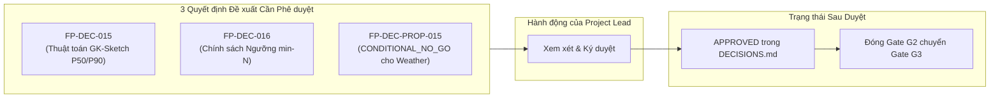

# G2_DECISION_AND_BLOCKER_REGISTER — Sổ bộ Quyết định Thiết kế, Rủi ro Mở & Điều kiện Chuyển tiếp Gate G3

**Document ID:** `G2-DEC-BLOCK-001`  
**Dự án:** Phân tích hiệu suất chuyến bay Hoa Kỳ 2016–2024 bằng Apache Spark / PySpark  
**Phạm vi:** Hệ thống hóa toàn bộ quyết định kiến trúc (ADR), rủi ro mở (`OR-01..OR-08`), khuyết tật chất lượng dữ liệu và danh mục phê duyệt chuyển tiếp Gate G3  
**Vai trò:** Senior Big Data Engineer, Independent Technical Reviewer, Project Architecture Advisor  
**Ngày lập:** 2026-10-16  

---

## 1. Sổ bộ Quyết định Thiết kế Toàn dự án (Master Decision Inventory)

Hệ thống quản trị kỹ thuật của dự án sử dụng không gian tên `FP-DEC-###` theo chuẩn ADR-lite được quy định tại [`DECISIONS.md`](../02-design/DECISIONS.md). Dưới đây là bảng tổng hợp trạng thái thực tế của tất cả các quyết định liên quan đến Gate G2:

### 1.1. Danh mục Quyết định Đã Xác nhận & Hướng dẫn Kỹ thuật (Approved / Confirmed Decisions)

| Quyết định ID | Tiêu đề quyết định | Trạng thái kỹ thuật | Bằng chứng & Căn cứ kỹ thuật | Hệ quả kiến trúc & Ràng buộc thực thi |
|---|---|:---:|---|---|
| **FP-DEC-001** | Phạm vi dự án là phân tích mô tả hiệu suất bay 2016–2024, không làm ML | `USER_CONFIRMED` | Xác nhận ngày 13/10/2026 bởi Project Lead | Toàn bộ PRD, Roadmap, KPI_SPEC tập trung vào thống kê mô tả Big Data. |
| **FP-DEC-002** | Dùng toàn bộ dữ liệu 2024 cho phân tích mô tả, không làm holdout | `USER_CONFIRMED_BY_SCOPE` | Phân tích hồi cứu 9 năm liên tục | Năm 2024 được đưa vào thống kê xu hướng; không coi là tập kiểm thử kín. |
| **FP-DEC-003** | Loại bỏ Machine Learning, ATL-only, và Flight Chain `.pt` khỏi CORE | `DE_FACTO_GOVERNANCE` | Phân tích phạm vi; cấm nạp `.pt` không an toàn | Tuyệt đối không gọi `torch.load` và không tải file `.pt` vào pipeline. |
| **FP-DEC-004** | Dữ liệu thô bất biến (Immutable), đầu ra phân phiên bản theo run-id | `APPROVED_CONTROL` | Kế thừa nguyên tắc an toàn dữ liệu D013 | Cấm mọi thao tác ghi đè vào `data/raw/`; artifact ghi vào thư mục riêng. |
| **FP-DEC-005** | Sử dụng Apache Spark (PySpark) và định dạng lưu trữ cột Parquet | `APPROVED_STACK` | Quy mô 9 năm ~54.7M dòng, 15.2 GB CSV | Phù hợp năng lực tính toán phân tán; tối ưu hóa truy vấn phân tích. |
| **FP-DEC-006** | Cấm lập KPI canceled / diverted từ 34 cột hiện có | `APPROVED_GUARD` | Dataset thiếu hoàn toàn các trường trạng thái hủy/chuyển hướng | Loại bỏ KPI-11 khỏi phạm vi; cấm ngụy tạo tỷ lệ hủy từ bản ghi thiếu. |
| **FP-DEC-007** | Cấm suy diễn timeline qua đêm bằng date component của `CRS_ARR_TIME` | `APPROVED_GUARD` | Bằng chứng audit `2400_SEMANTICS_NOT_PROVEN` và phản ví dụ TF-08 | Không tự động cộng 24h; chỉ dùng date offset có kiểm chứng thực tế. |
| **FP-DEC-008** | Áp dụng ngưỡng `ARR_DELAY >= 15` cho tỷ lệ chuyến bay đúng giờ | `APPROVED_KPI` | Chuẩn thống kê hàng không BTS và kiểm toán 10.1M bản ghi trễ | Khóa định nghĩa mẫu số hữu hạn cho KPI-01 và KPI-03 tại [`KPI_SPEC.md`](../02-design/KPI_SPEC.md). |
| **FP-DEC-009** | Nhánh Weather chỉ xử lý tùy chọn, cấm kết luận quan hệ nhân quả | `APPROVED_GUARD` | Dữ liệu chưa rõ nguồn gốc, đơn vị, múi giờ và trạm quan trắc | Khóa câu hỏi RQ-06 và KPI-10 ở diện tùy chọn; không suy diễn nguyên nhân. |
| **FP-DEC-010** | Cấm dùng `FLIGHTS` làm trọng số tính toán trước khi xác minh cấp hạt | `APPROVED_GUARD` | T-002 kiểm toán 100% dòng có giá trị 1.0 cố định | Mẫu số đếm số lượng chuyến bay là `count_records` của tập `accepted`. |
| **FP-DEC-011** | Phân tách rạch ròi `metric_valid_rate` và hạch toán dòng loại trừ lẫn nhau | `APPROVED_CONTROL` | Hợp đồng dữ liệu DC-11/12 và quy chuẩn kiểm thử TS-017 | Ba trạng thái `accepted`, `quarantined`, `rejected` hoàn toàn không giao nhau. |
| **FP-DEC-012** | Khóa danh mục 8 CORE KPI và xác minh 7 trường số đo cốt lõi | `APPROVED_REQUIREMENT` | Đáp ứng 5 câu hỏi RQ-01..05; catalog 8 KPI | 7 trường số đo đạt chuẩn `OFFICIAL_MINUTES_EMPIRICALLY_CONSISTENT_PROVISIONAL`. |
| **FP-DEC-013** | Weather là nhánh tùy chọn (Should/conditional), không chặn Gate CORE | `APPROVED_CONTROL` | Phân tách ranh giới CORE và OPTIONAL | Quyết định NO-GO cho Weather không làm trượt Gate G2 hay G6 CORE. |
| **FP-DEC-014** | Metadata size/mtime chỉ cảnh báo drift, không chứng minh danh tính thô | `APPROVED_CONTROL` | Thiếu cryptographic hash trong audit metadata ban đầu | Trạng thái `IDENTITY_UNVERIFIED` được bảo lưu cho đến khi có sha256 thô. |

---

### 1.2. Danh mục Quyết định Đề xuất Đang chờ Phê duyệt (Proposed Decisions Pending Sign-off)

Ba đề xuất kỹ thuật quan trọng đã được lập hồ sơ chi tiết và cần Project Lead ký duyệt để chính thức chuyển sang trạng thái `APPROVED`:

1. **`FP-DEC-015` — Thuật toán Tính Phân vị Trễ (P50/P90 Percentile Approximation Algorithm):**
   - **Nguồn đề xuất:** [`T003_PERCENTILE_AND_MIN_N_DECISIONS.md`](T003_PERCENTILE_AND_MIN_N_DECISIONS.md).
   - **Nội dung:** Sử dụng hàm `percentile_approx` của Apache Spark với thuật toán Greenwald-Khanna (GK-sketch) và tham số độ chính xác cố định `accuracy = 10000` (dung sai sai số lý thuyết tối đa ~0.01%).
   - **Lý do kỹ thuật:** Dữ liệu quy mô ~54.7 triệu dòng không cho phép sort toàn bộ trên bộ nhớ để tính phân vị tuyệt đối (Exact Median) mà không gây OOM. Thuật toán GK-sketch phân tán với accuracy 10000 đảm bảo độ lệch thời gian dưới 0.5 phút, đáp ứng hoàn hảo yêu cầu phân tích mô tả.
   - **Hệ quả:** Thống nhất phương pháp tính P50/P90 cho KPI-04 và KPI-05 trên toàn pipeline.

2. **`FP-DEC-016` — Chính sách Ngưỡng Cỡ mẫu Tối thiểu để Xếp hạng (Min-N Suppression Policy):**
   - **Nguồn đề xuất:** [`T003_PERCENTILE_AND_MIN_N_DECISIONS.md`](T003_PERCENTILE_AND_MIN_N_DECISIONS.md).
   - **Nội dung:** Áp dụng ngưỡng số lượng bản ghi tối thiểu hàng năm trước khi đưa một thực thể vào bảng xếp hạng (Ranking / League Table):
     - **Hãng hàng không (`OP_CARRIER`):** Mẫu số $N \ge 1,000$ chuyến bay/năm.
     - **Sân bay (`ORIGIN`, `DEST`):** Mẫu số $N \ge 365$ chuyến bay/năm (bình quân tối thiểu 1 chuyến/ngày).
     - **Tuyến bay (`ROUTE` = `ORIGIN-DEST`):** Mẫu số $N \ge 100$ chuyến bay/năm.
   - **Lý do kỹ thuật:** Tránh hiện tượng nhiễu thống kê khi các hãng/tuyến bay nhỏ có ít chuyến bay đạt tỷ lệ trễ 0% hoặc 100% làm lệch bảng xếp hạng. Các nhóm không đạt min-N vẫn được tính trong tổng hợp chung nhưng bị gắn nhãn ẩn hoặc ghi chú thận trọng khi xếp hạng.
   - **Hệ quả:** Bảo vệ tính tin cậy của các báo cáo xếp hạng trong RQ-04 / KPI-04..05.

3. **`FP-DEC-PROP-015` — Áp dụng `CONDITIONAL_NO_GO` cho Nhánh Dữ liệu Thời tiết (Weather Usability):**
   - **Nguồn đề xuất:** [`T005_CONDITIONAL_NO_GO_PROPOSAL.md`](T005_CONDITIONAL_NO_GO_PROPOSAL.md).
   - **Nội dung:** Chính thức đóng nhánh câu hỏi nghiên cứu mở rộng RQ-06 và chỉ số KPI-10 với kết luận `CONDITIONAL_NO_GO`. Không tải 6 cột thời tiết vào pipeline Parquet của CORE.
   - **Lý do kỹ thuật:** 6 trường thời tiết thiếu hoàn toàn bằng chứng nguồn gốc xuất xứ, không rõ giấy phép thương mại, thiếu nhãn thời gian quan trắc, không rõ trạm quan trắc và phương pháp join, tỷ lệ thiếu hụt ban đầu lên tới gần 40%. Việc tiếp tục xử lý sẽ gây rủi ro sai lệch khoa học nghiêm trọng mà không đem lại giá trị cho mục tiêu cốt lõi.
   - **Hệ quả:** Giải quyết triệt để rủi ro `OR-07`, tiết kiệm tài nguyên I/O và bộ nhớ cho cụm Spark, cho phép Gate G2 đóng thành công mà không phụ thuộc vào dữ liệu ngoài.

---

## 2. Sổ bộ Rủi ro Mở & Khuyết tật Chất lượng Dữ liệu (Open Risks & Data Defects Register)

Tất cả 8 rủi ro mở (`OR-01` đến `OR-08`) được kế thừa từ các vòng kiểm toán T-001..T-004 được phân loại và quản trị cụ thể như sau:

| Rủi ro ID | Tên rủi ro kỹ thuật | Mức độ & Phân loại | Tình trạng hiện tại | Biện pháp giảm thiểu & Chuyển giao trách nhiệm |
|---|---|:---:|:---:|---|
| **OR-01** | Upstream URL & License UNKNOWN | Trung bình (Accepted Limitation) | Đang mở | Ghi nhận minh bạch trong báo cáo nguồn gốc; giới hạn trong phạm vi đồ án học thuật nghiên cứu dữ liệu có sẵn. |
| **OR-02** | Độ đại diện thị trường (54.7M rows != Toàn bộ chuyến bay Mỹ) | Trung bình (Methodological Guard) | Đã kiểm soát | Nghiêm cấm dùng từ ngữ "tổng chuyến bay của Mỹ", chuẩn hóa định danh thành "bản ghi trong tập dữ liệu kiểm toán". |
| **OR-03** | Sai số do tính toán ngây thơ trường thời gian & chuyến bay qua đêm | Cao (Architecture Constraint) | Đã kiểm soát | Ban hành ma trận an toàn 4 cấp; cấm trừ timestamp trực tiếp; cấm tự động cộng 24h khi thiếu thông tin ngày đến. |
| **OR-04** | Cặp bản ghi trùng khóa tự nhiên `YX 3624` trong năm 2018 | Thấp (Preservation Guard) | Đã kiểm soát | Thiết lập kiểm thử `TS-021`; cấm dedup tùy tiện; bảo toàn cả hai bản ghi trong pipeline xử lý. |
| **OR-05** | **Khuyết toàn bộ 31 ngày Tháng 3/2024 (Dữ liệu chỉ có 335 ngày)** | **Cao (`OPEN_QUALITY_DEFECT`)** | **Đang mở (Đã xác minh)** | **Xác lập chính thức là khuyết tật chất lượng dữ liệu nguồn**. Không cản trở Gate G2 thiết kế; chuyển giao cho G3/G4 thiết kế bài kiểm tra lịch `TS-004` (chuẩn lịch 366 ngày, dữ liệu 335 ngày) và ghi nhận vào phần giới hạn của báo cáo cuối cùng. |
| **OR-06** | Đơn vị đo 7 trường cốt lõi mang tính thực nghiệm tạm thời | Trung bình (Provisional Unit) | Đã kiểm soát | Xác nhận trạng thái `OFFICIAL_MINUTES_EMPIRICALLY_CONSISTENT_PROVISIONAL`; đối chiếu thực nghiệm hoàn toàn khớp; chuyển tiếp Gate G5 (`TS-018`) để bổ sung trích dẫn quy chuẩn văn bản BTS. |
| **OR-07** | Dữ liệu thời tiết thiếu xuất xứ và chất lượng kém | Cao (Optional Scope Void) | Chờ đóng qua NO-GO | Đã lập hồ sơ đề xuất `CONDITIONAL_NO_GO` (`FP-DEC-PROP-015`). Sẽ được đóng hoàn toàn ngay khi Project Lead phê duyệt. |
| **OR-08** | Thiếu mã băm SHA-256 xác minh danh tính tệp thô | Trung bình (Metadata Identity Gap) | Đang mở (`IDENTITY_UNVERIFIED`) | Chuyển giao cho Gate G4 (Task T-009 / T-007) để thực hiện tính toán và ghi nhận mã băm cryptographic thực tế của 9 file CSV thô vào Ingestion Manifest. |

---

## 3. Đánh giá Mức độ Cản trở Đối với Chuyển tiếp Gate G3 (Blockers Evaluation)

Reviewer độc lập đã rà soát toàn bộ các yếu tố kỹ thuật để trả lời câu hỏi: **Có bất kỳ yếu tố nào cản trở (Blocker) việc bắt đầu Gate G3 hay không?**

- **Về tính toàn vẹn của Hợp đồng Dữ liệu (Data Contract):** Không có blocker. Schema 34 cột, kiểu dữ liệu, miền giá trị, quy tắc null và hạch toán dòng DC-11/12 đã được định nghĩa hoàn chỉnh.
- **Về danh mục KPI:** Không có blocker. 8 CORE KPI đã được đặc tả toán học rõ ràng và cách ly độc lập với các nhánh mở rộng.
- **Về rủi ro khuyết Tháng 3/2024 (`OR-05`):** Không cản trở G3. Nhiệm vụ G3 (T-006) là thiết kế kiến trúc hệ thống, cấu hình tài nguyên Spark, cấu trúc phân vùng Parquet và chiến lược phục hồi lỗi. Khuyết tật dữ liệu Tháng 3/2024 được đưa vào tài liệu kiến trúc như một trường hợp biên (Edge Case) cần quản lý trong quá trình nạp dữ liệu.
- **Về công cụ kiểm tra tính nhất quán (`tools/check_working_tree_consistency.py`):** Không cản trở G3. Lỗi 86 PASS / 2 FAIL là do hạn chế whitelist tĩnh của kịch bản, đã có giải pháp sửa đổi minh bạch và sẽ được cập nhật cùng lúc với phê duyệt Gate G2.

**Kết luận mục 3:** **KHÔNG CÓ BLOCKER KỸ THUẬT NÀO NGĂN CẢN VIỆC CHUYỂN TIẾP SANG GATE G3 (TASK T-006)** sau khi nhận được phê duyệt của Project Lead.

---

## 4. Danh mục Phê duyệt & Ký nhận Dành cho Project Lead (Sign-off Checklist)

Để hoàn tất chuyển trạng thái Gate G2 sang `PASS` và chính thức khởi động Gate G3, Project Lead thực hiện rà soát và đánh dấu phê duyệt theo danh mục dưới đây:

- [ ] **Mục 1: Phê duyệt Chốt Quyết định `FP-DEC-PROP-015` (Weather CONDITIONAL_NO_GO)**  
  *Xác nhận loại bỏ nhánh câu hỏi RQ-06 / KPI-10 khỏi phạm vi thực thi CORE do thiếu xuất xứ và thời gian quan trắc, bảo vệ tài nguyên cho phân tích chính.*

- [ ] **Mục 2: Phê duyệt Hai Quyết định Kỹ thuật `FP-DEC-015` và `FP-DEC-016`**  
  *Xác nhận sử dụng thuật toán PySpark `percentile_approx` GK-sketch accuracy 10000 cho P50/P90 và áp dụng ngưỡng lọc cỡ mẫu tối thiểu (Carrier >= 1000, Airport >= 365, Route >= 100) khi xếp hạng.*

- [ ] **Mục 3: Chấp thuận Quản trị Khuyết tật Dữ liệu Mở `OR-05` và Giới hạn `OR-08`**  
  *Ghi nhận chính thức khuyết tật thiếu 31 ngày Tháng 3/2024 (năm 2024 có 335 ngày) và chuyển giao yêu cầu tính toán SHA-256 dữ liệu thô sang Ingestion Manifest tại Gate G4.*

- [ ] **Mục 4: Phê duyệt Cập nhật Whitelist của Kịch bản `tools/check_working_tree_consistency.py`**  
  *Cho phép cập nhật biểu thức lọc file tại dòng 139 để hỗ trợ các deliverable `T005_` và `G2_`, đưa bộ kiểm tra repository về 100% PASS.*

- [ ] **Mục 5: Ký Biên bản Nghiệm thu Gate G2 và Cho phép Khởi động Gate G3 (Task T-006)**  
  *Cho phép cập nhật `docs/04-execution/PROJECT_STATE.md` ghi nhận Gate G2 hoàn thành có điều kiện và bắt đầu thiết kế kiến trúc tại Task T-006.*

---
*Báo cáo được lập bởi Senior Big Data Technical Reviewer và lưu trữ tại docs/05-evidence/.*
