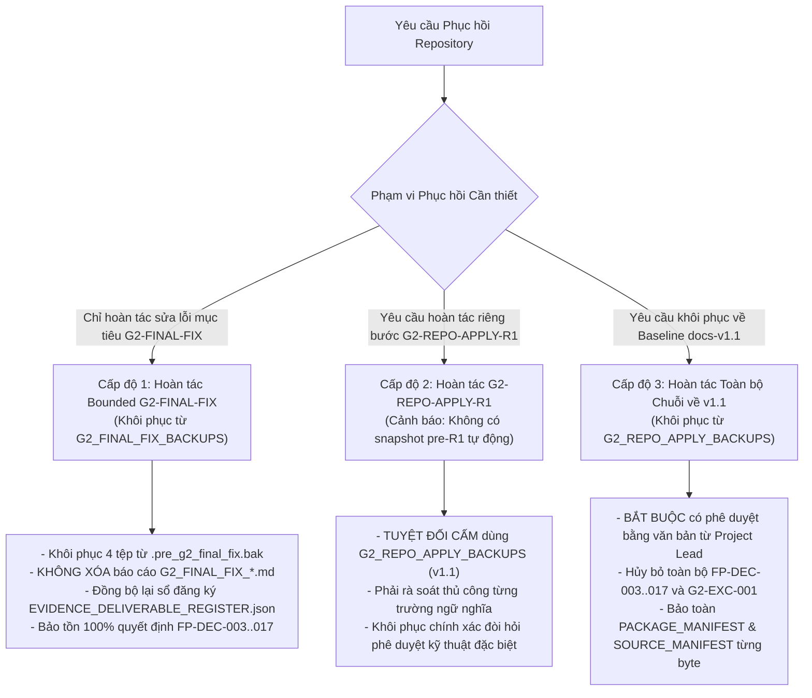

# G2_FINAL_CLOSEOUT_ROLLBACK_ERRATA — Phụ lục Đính chính Hướng dẫn Phục hồi (Rollback Errata) & Ranh giới Khôi phục Repository

**Mã tài liệu:** `G2_FINAL_CLOSEOUT_ROLLBACK_ERRATA`  
**Nhiệm vụ:** `G2-FINAL-CLOSEOUT` (Rollback Errata & Verifiable Evidence Export)  
**Ngày lập:** 2026-10-16  
**Vai trò:** Independent Repository Governance Maintainer  
**Thẩm quyền quyết định:** Bảo toàn toàn bộ các quyết định thiết kế đã được Project Lead phê duyệt chính thức (`FP-DEC-003..017`, `G2-EXC-001`, và chuyển giao rủi ro Nhóm D).  
**Ranh giới kiểm soát cổng:**  
- **Gate G2:** **`IN_PROGRESS / NOT_PASSED`** (`AWAITING_FINAL_HUMAN_GATE_SIGNOFF`).  
- **Nhiệm vụ T-006:** **`NOT_STARTED`** (Bị khóa nghiêm ngặt cho đến khi có quyết định chính thức từ Project Lead).  
**Nguyên tắc cốt lõi:**  
- **KHÔNG thực hiện bất kỳ thao tác phục hồi (rollback) thực tế nào trong nhiệm vụ này.** Repository duy trì tính nhất quán tiến trình (forward-consistent) và vượt qua 100% các bài kiểm thử xác thực.  
- **Bảo tồn tính bất biến:** Không sửa đổi, ghi đè hoặc xóa bỏ bất kỳ báo cáo kiểm toán lịch sử, tệp dữ liệu thô `data/raw/`, hay tệp manifest lịch sử (`PACKAGE_MANIFEST.json`, `SOURCE_MANIFEST.json`) nào.

---

## 1. Bối cảnh & Mục đích Ban hành Phụ lục Đính chính

Trong quá trình rà soát độc lập toàn diện kho lưu trữ sau các nhiệm vụ `G2-REPO-APPLY`, `G2-REPO-APPLY-R1`, và `G2-FINAL-FIX`, đã phát hiện một số điểm không chính xác, mâu thuẫn hoặc không khả thi trong các hướng dẫn phục hồi (rollback procedures) được ghi nhận rải rác tại các tài liệu manifest lịch sử:

1. **Chỉ dẫn xóa bỏ báo cáo kiểm toán lịch sử:** Một số tài liệu manifest trước đây đề xuất xóa các tệp báo cáo `G2_*.md` khi hoàn tác nhiệm vụ. Điều này vi phạm nghiêm ngặt nguyên tắc bất biến của bằng chứng kiểm toán (chứng tích kiểm toán đã xuất bản phải được lưu trữ vĩnh viễn, không được xóa).
2. **Viện dẫn lệnh và commit Git không tồn tại:** Một số tài liệu nhắc đến việc áp dụng "reverse patch thủ công theo commit Git của R1". Tuy nhiên, thực tế kiểm tra cho thấy cây làm việc hiện tại **không phải là một Git repository** (`fatal: not a git repository`). Do đó, không tồn tại lịch sử commit Git hay công cụ `git revert` nội tại.
3. **Đồng nhất sai lệch giữa bản sao lưu v1.1 và snapshot pre-R1:** `G2_REPO_APPLY_R1_EXECUTION_MANIFEST.md` từng hướng dẫn khôi phục từ `docs/05-evidence/G2_REPO_APPLY_BACKUPS/` để hoàn tác riêng bước R1. Thực chất, các tệp sao lưu trong thư mục này được tạo trước bước `G2-REPO-APPLY` (tương ứng với baseline v1.1). Nếu sao chép đè chúng lên tài liệu sống, toàn bộ các quyết định thiết kế đã được Project Lead phê duyệt (`FP-DEC-003..017`) sẽ bị xóa sạch, biến việc hoàn tác R1 thành một sự đảo ngược toàn bộ hệ thống ngoài ý muốn.
4. **Thiếu snapshot pre-R1 độc lập:** Giữa hai bước `G2-REPO-APPLY` và `G2-REPO-APPLY-R1` không có snapshot sao lưu tự động riêng biệt nào được lưu trữ. Do đó, việc hoàn tác tự động riêng R1 là không được bảo đảm nếu không có snapshot pre-R1 xác thực.
5. **Yêu cầu phê duyệt cấp cao cho hoàn tác toàn bộ chuỗi:** Việc hoàn tác toàn bộ chuỗi về baseline v1.1 là hành động có rủi ro quản trị tối cao (xóa bỏ quyết định của Project Lead) và bắt buộc phải có lệnh bằng văn bản riêng từ Project Lead, đồng thời phải tái lập tính toàn vẹn của sổ đăng ký `EVIDENCE_DELIVERABLE_REGISTER.json`.

Tài liệu này được ban hành như một **Phụ lục Đính chính Chuẩn tắc duy nhất**, thay thế và vô hiệu hóa tất cả các hướng dẫn phục hồi mâu thuẫn trước đó, mà không làm thay đổi nội dung các báo cáo lịch sử đã đóng gói.

---

## 2. Hiện trạng Thực tế của Cây Làm Việc (Working-Tree Reality)

### 2.1. Xác nhận Trạng thái Git
Lệnh kiểm tra thực tế trên môi trường thực thi:
```powershell
git status
# Exit Code: 1
# Output: fatal: not a git repository (or any of the parent directories): .git
```
> [!IMPORTANT]
> Cây làm việc của dự án được quản trị và kiểm soát tính toàn vẹn thông qua cơ chế mã băm mật mã học (cryptographic hash integrity) và công cụ Python nội bộ (`check_working_tree_consistency.py`), **không thông qua hệ thống Git version control**.  
> Mọi hướng dẫn phục hồi đề cập đến commit Git, branch Git, hay `git revert` / `git patch` đều **vô hiệu và không thể thực thi**.

### 2.2. Kiểm kê Các Thư mục Sao lưu Hiện hữu
Thực tế kiểm tra hệ thống tệp cho thấy chỉ có hai thư mục sao lưu phục hồi được ghi nhận và kiểm soát:

1. **`docs/05-evidence/G2_REPO_APPLY_BACKUPS/` (Tạo lập trước `G2-REPO-APPLY`):**
   - Chứa 9 tệp `.pre_g2_repo_apply.bak` đại diện cho trạng thái của 8 tài liệu quản trị sống và công cụ checker tại **baseline docs-v1.1** (trước khi áp dụng bất kỳ quyết định nào từ `FP-DEC-003` đến `FP-DEC-017`).
   - Tuyệt đối **không phải là bản sao lưu trước R1**.
2. **`docs/05-evidence/G2_FINAL_FIX_BACKUPS/` (Tạo lập trước `G2-FINAL-FIX`):**
   - Chứa 4 tệp `.pre_g2_final_fix.bak` đại diện cho trạng thái ngay sau khi hoàn thành `G2-REPO-APPLY-R1` của 3 tệp mã nguồn Python và sổ đăng ký giao phẩm:
     - `docs__05-evidence__EVIDENCE_DELIVERABLE_REGISTER.json.pre_g2_final_fix.bak`
     - `tools__check_working_tree_consistency.py.pre_g2_final_fix.bak`
     - `tools__qa__test_working_tree_registry_regression.py.pre_g2_final_fix.bak`
     - `tools__qa__verify_g2_repo_apply_r1_semantic_invariants.py.pre_g2_final_fix.bak`

---

## 3. Chính sách Phục hồi Phân tầng Chuẩn tắc (Authoritative Three-Tier Rollback Policy)

Quy trình phục hồi của toàn bộ repository được phân định nghiêm ngặt thành ba cấp độ độc lập, có điều kiện kích hoạt và ranh giới an toàn rõ ràng:



---

### 3.1. Cấp độ 1 (Tier 1): Hoàn tác Giới hạn `G2-FINAL-FIX` (Targeted Correction Rollback)

- **Mục đích:** Hoàn tác các sửa đổi kỹ thuật của nhiệm vụ `G2-FINAL-FIX`, đưa 3 tệp công cụ Python và sổ đăng ký giao phẩm trở lại trạng thái ngay sau `G2-REPO-APPLY-R1`.
- **Thẩm quyền:** Lead Engineer hoặc Technical Reviewer có thể phê duyệt khi phát hiện sai sót kỹ thuật trong các bản sửa lỗi của `G2-FINAL-FIX`.
- **Điều kiện an toàn:** Toàn bộ các quyết định thiết kế đã được phê duyệt trong `G2-REPO-APPLY` và `G2-REPO-APPLY-R1` được **giữ nguyên vẹn 100%**.
- **Quy trình thực thi:**
  1. **Khôi phục các tệp công cụ và sổ đăng ký từ bản sao lưu pre-FINAL-FIX:**
     - Sao chép đè `docs/05-evidence/G2_FINAL_FIX_BACKUPS/docs__05-evidence__EVIDENCE_DELIVERABLE_REGISTER.json.pre_g2_final_fix.bak` vào `docs/05-evidence/EVIDENCE_DELIVERABLE_REGISTER.json`.
     - Sao chép đè `docs/05-evidence/G2_FINAL_FIX_BACKUPS/tools__check_working_tree_consistency.py.pre_g2_final_fix.bak` vào `tools/check_working_tree_consistency.py`.
     - Sao chép đè `docs/05-evidence/G2_FINAL_FIX_BACKUPS/tools__qa__test_working_tree_registry_regression.py.pre_g2_final_fix.bak` vào `tools/qa/test_working_tree_registry_regression.py`.
     - Sao chép đè `docs/05-evidence/G2_FINAL_FIX_BACKUPS/tools__qa__verify_g2_repo_apply_r1_semantic_invariants.py.pre_g2_final_fix.bak` vào `tools/qa/verify_g2_repo_apply_r1_semantic_invariants.py`.
  2. **Đối soát mã băm:** Kiểm tra mã băm SHA-256 của các tệp vừa khôi phục, bảo đảm trùng khớp chính xác với mã băm đã ghi nhận tại thời điểm kết thúc `G2-REPO-APPLY-R1`.
  3. **Quy tắc cấm xóa chứng tích:** **TUYỆT ĐỐI KHÔNG XÓA** các báo cáo giao phẩm `docs/05-evidence/G2_FINAL_FIX_*.md` và `docs/05-evidence/G2_FINAL_CLOSEOUT_*.md`. Các tệp này là chứng tích kiểm toán lịch sử hợp lệ ghi nhận quá trình đánh giá độc lập.
  4. **Tái đồng bộ Sổ đăng ký:** Nếu các báo cáo `G2_FINAL_FIX_*.md` được giữ lại trên đĩa mà sổ đăng ký phục hồi về pre-FINAL-FIX (chưa chứa các tệp này), công cụ `check_working_tree_consistency.py` sẽ cảnh báo có tệp chưa đăng ký. Khi đó, cần cập nhật trạng thái của chúng trong sổ đăng ký thành `HISTORICAL_RECORD` hoặc ghi chú hoàn tác tương ứng, thay vì xóa tệp trên hệ thống.

---

### 3.2. Cấp độ 2 (Tier 2): Hoàn tác Riêng biệt `G2-REPO-APPLY-R1` (R1-Only Rollback Disclosure)

- **Mục đích:** Hoàn tác các điều chỉnh đính chính ngữ nghĩa của bước R1, giữ lại các sửa đổi nền tảng ban đầu của `G2-REPO-APPLY`.
- **Công bố giới hạn kỹ thuật (Critical Disclosure):**
  > [!WARNING]
  > Trong giai đoạn chuyển giao giữa `G2-REPO-APPLY` và `G2-REPO-APPLY-R1`, hệ thống không tạo một bộ snapshot sao lưu tự động trung gian (`pre_r1.bak`).  
  > Thư mục `docs/05-evidence/G2_REPO_APPLY_BACKUPS/` chứa dữ liệu của **baseline v1.1**, không phải dữ liệu sau `G2-REPO-APPLY`.  
  > Do đó, **việc hoàn tác tự động riêng R1 bằng cách chép đè tệp sao lưu là HOÀN TOÀN KHÔNG THỰC HIỆN ĐƯỢC**.
- **Cấm kỵ kỹ thuật nghiêm ngặt:** **TUYỆT ĐỐI KHÔNG ĐƯỢC** sử dụng các tệp sao lưu `.pre_g2_repo_apply.bak` để phục hồi R1. Hành động này sẽ phá hủy toàn bộ các quyết định `FP-DEC-003..017` đã được áp dụng trước đó.
- **Phương án khả thi duy nhất nếu bắt buộc phải hoàn tác R1:**
  - Thực hiện đối soát thủ công từng đoạn sửa đổi ngữ nghĩa (manual semantic diff) trên các tài liệu sống (`DECISIONS.md`, `KPI_SPEC.md`, `RISK_REGISTER.md`, `AI_HANDOFF.md`, v.v.) dựa theo danh mục thay đổi đã công bố trong `G2_REPO_APPLY_R1_SEMANTIC_ERRATA.md`.
  - Tái tính toán kích thước, mã băm SHA-256 của từng tài liệu và cập nhật thủ công vào `EVIDENCE_DELIVERABLE_REGISTER.json`.
  - Chạy lại toàn bộ 5 bộ kiểm tra nhất quán và hồi quy để bảo đảm không xảy ra lỗi gãy vỡ hệ thống.

---

### 3.3. Cấp độ 3 (Tier 3): Hoàn tác Toàn bộ Chuỗi về Baseline docs-v1.1 (Full-Series Baseline Reversion)

- **Mục đích:** Khôi phục toàn bộ cây làm việc về trạng thái nguyên bản của phiên bản tài liệu `docs-v1.1` (trước ngày 2026-10-16).
- **Mức độ rủi ro quản trị:** **CỰC KỲ CAO (MAXIMUM GOVERNANCE IMPACT)**. Thao tác này sẽ hủy bỏ toàn bộ hiệu lực của việc áp dụng các quyết định thiết kế Nhóm A–D (`FP-DEC-003..017`), ngoại lệ đơn vị [`G2-EXC-001`](../02-design/DECISIONS.md#L41-L58), và đưa Gate G2 trở lại trạng thái chưa xử lý các phát hiện kiểm toán.
- **Điều kiện tiên quyết bắt buộc:** **BẮT BUỘC PHẢI CÓ QUYẾT ĐỊNH PHÊ DUYỆT BẰNG VĂN BẢN TRỰC TIẾP TỪ PROJECT LEAD**. Không một kỹ sư hay Agent nào được quyền tự ý thực hiện cấp độ này.
- **Quy trình thực thi có kiểm soát:**
  1. **Khôi phục 8 tài liệu quản trị sống:** Sao chép 8 tệp `.pre_g2_repo_apply.bak` từ `docs/05-evidence/G2_REPO_APPLY_BACKUPS/` về đúng vị trí trong `docs/01-planning/`, `docs/02-design/`, `docs/03-quality/`, và `docs/04-execution/`.
  2. **Khôi phục công cụ kiểm tra:** Sao chép `tools__check_working_tree_consistency.py.pre_g2_repo_apply.bak` về `tools/check_working_tree_consistency.py`.
  3. **Bảo tồn Manifest lịch sử bất biến:** Kiểm tra và xác nhận hai tệp manifest nền tảng không bị thay đổi dù chỉ 1 byte:
     - `PACKAGE_MANIFEST.json`: đúng `8,354` bytes, mã băm `7c457207a6fefd2a45ad56a4c8ee8e3fb6194b8462f6ee24985f4e9534d61df1`.
     - `docs/05-evidence/inputs/SOURCE_MANIFEST.json`: đúng `2,479` bytes, mã băm `5e11e619790e475260b19c70630d8faef9a902c9d55d2ca641320163c87447fc`.
  4. **Bảo tồn toàn bộ báo cáo bằng chứng:** Không xóa bỏ các thư mục bằng chứng hay báo cáo `G2_*.md` đã sinh ra. Toàn bộ chuỗi báo cáo kiểm toán phản ánh lịch sử đánh giá kỹ thuật và phải được lưu trữ để phục vụ công tác tra cứu, đối soát pháp lý dự án.

---

## 4. Bảng Tổng Hợp So Sánh Các Cấp Độ Phục Hồi

| Tiêu chí Kiểm soát | Cấp độ 1 (Tier 1): Bounded `G2-FINAL-FIX` | Cấp độ 2 (Tier 2): R1-Only Rollback | Cấp độ 3 (Tier 3): Full-Series Baseline v1.1 |
|---|---|---|---|
| **Mục tiêu hoàn tác** | Chỉ hoàn tác 3 tệp mã nguồn Python và sổ đăng ký về sau R1 | Chỉ hoàn tác các thay đổi ngữ nghĩa của R1 | Hoàn tác toàn bộ thay đổi quản trị về baseline v1.1 |
| **Nguồn sao lưu** | `docs/05-evidence/G2_FINAL_FIX_BACKUPS/` | Không có snapshot tự động (rà soát thủ công) | `docs/05-evidence/G2_REPO_APPLY_BACKUPS/` |
| **Thẩm quyền phê duyệt** | Lead Engineer / Technical Reviewer | Lead Data Engineer / Governance Reviewer | **Bắt buộc Project Lead phê duyệt bằng văn bản** |
| **Tác động đến quyết định đã duyệt** | **Không ảnh hưởng** (Bảo lưu 100% `FP-DEC-003..017`) | **Không ảnh hưởng** (Bảo lưu các quyết định gốc) | **Hủy bỏ hoàn toàn** việc áp dụng các quyết định |
| **Trạng thái Gate G2** | Duy trì `IN_PROGRESS / NOT_PASSED` | Duy trì `IN_PROGRESS / NOT_PASSED` | Quay về trạng thái pre-decision của G2 |
| **Bảo tồn chứng tích kiểm toán** | Giữ nguyên 100% tệp `G2_*.md` trên đĩa | Giữ nguyên 100% tệp `G2_*.md` trên đĩa | Giữ nguyên 100% tệp `G2_*.md` trên đĩa |
| **Độ phức tạp & rủi ro** | Rủi ro thấp, khả năng tự động hóa 100% | Rủi ro cao, dễ sai lệch thủ công | Rủi ro quản trị tối cao, tác động diện rộng |

---

## 5. Tuyên Bố Xác Nhận Hiện Trạng Vận Hành (Operational Affirmation)

1. **Không có thao tác rollback nào được thực hiện:** Repository hiện tại đang ở trạng thái chuẩn tắc tiến trình cao nhất, áp dụng đầy đủ các quyết định đã được Project Lead phê duyệt, với bộ công cụ kiểm thử đã được loại bỏ hoàn toàn các lỗi giả mạo (`or True`), và tích hợp các ca kiểm thử đột biến cô lập.
2. **Trạng thái kiểm định kỹ thuật:** Cả 5 bộ kiểm thử chuẩn tắc (`T-003`, `T-004`, `Semantic Invariants`, `Registry Regression`, và `Working-Tree Consistency`) đều đạt 100% chuẩn `PASS` với exit code `0`.
3. **Trạng thái khóa cổng:**
   - **Gate G2:** **`IN_PROGRESS / NOT_PASSED`** (`AWAITING_FINAL_HUMAN_GATE_SIGNOFF`).
   - **Nhiệm vụ T-006:** **`NOT_STARTED`**.
   - Quyền hạn phê duyệt đóng Gate G2 thuộc về thẩm quyền độc quyền của Project Lead.
