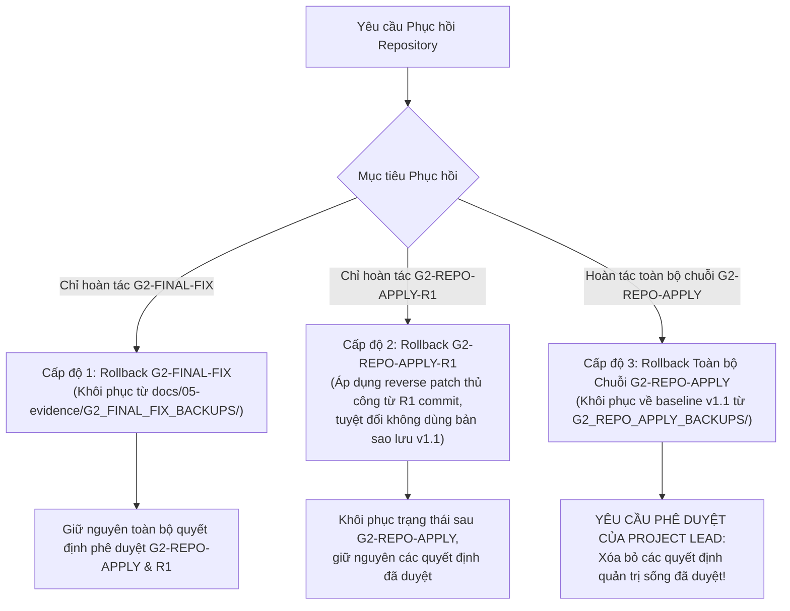

# G2_FINAL_FIX_CORRECTION_AND_SCOPE_REPORT — Báo cáo Đính chính Kỹ thuật Mục tiêu, Thẩm tra Hồi quy & Phạm vi Độc lập

**Mã tài liệu:** `G2_FINAL_FIX_CORRECTION_AND_SCOPE_REPORT`  
**Nhiệm vụ:** `G2-FINAL-FIX` (Targeted Corrections, Regression Verification & Final Human Sign-off Preparation)  
**Ngày thực hiện:** 2026-10-16  
**Thẩm quyền quyết định:** Project Lead đã phê duyệt chính thức qua chỉ thị nhiệm vụ các quyết định thiết kế Nhóm A–D (`FP-DEC-003..017`), ngoại lệ đơn vị [`G2-EXC-001`](../02-design/DECISIONS.md#L41-L58), và chuyển giao rủi ro.  
**Ranh giới kiểm soát cổng:** Project Lead **CHƯA phê duyệt Gate G2 PASS**. Trạng thái Gate G2 chính thức: **`IN_PROGRESS / NOT_PASSED`** (`AWAITING_FINAL_HUMAN_GATE_SIGNOFF`). Trạng thái nhiệm vụ **`T-006 = NOT_STARTED`**.  
**Dữ liệu thô & Lịch sử:** Tuyệt đối không đọc/quét lại 54,674,003 dòng CSV thô, không chạy Spark production, không viết lại hay ghi đè bất kỳ chứng tích kiểm toán lịch sử nào.

---

## 1. Xử lý Toàn diện Các Phát hiện Độc lập (`Findings C-01` đến `C-05`)

| Mã Phát hiện | Mức độ | Bản chất Vấn đề Độc lập Phát hiện | Hành động Khắc phục Triệt để trong `G2-FINAL-FIX` | Trạng thái Nghiệm thu |
|---|:---:|---|---|:---:|
| **Finding C-01** | **HIGH** | `NEG-10` trong `tools/qa/test_working_tree_registry_regression.py` chứa đoạn mã fallback `or True`, dẫn đến kết quả PASS vô điều kiện khi gặp lỗi tạo symlink trên Windows. | - Đã loại bỏ hoàn toàn biểu thức `or True`. - Tách độc lập thành `NEG-10A` (kiểm tra loại `artifact_type` không được phép) và `NEG-10B` (kiểm tra phát hiện và từ chối symlink). - Bổ sung cơ chế ghi nhận minh bạch `PASS / FAIL / SKIP`. Khi hệ điều hành không cho phép tạo symlink, ghi nhận trung thực `SKIP` kèm mã lỗi OS, không báo PASS giả mạo. - Trên môi trường hỗ trợ symlink (đã kiểm chứng thực tế), thực thi kiểm thử E2E trên fixture cô lập và xác nhận checker phát hiện symlink thành công. - Bổ sung bộ kiểm thử đột biến `MUT-NEG10-01..03` chứng minh logic bắt lỗi symlink và từ chối fallback giả mạo. | **RESOLVED / VERIFIED** |
| **Finding C-02** | **MEDIUM** | Trong bảng đính chính của `G2_REPO_APPLY_R1_SEMANTIC_ERRATA.md`, dòng `TS-020` ghi nhãn hẹp là *Bảo toàn cặp bản ghi trùng khóa YX 3624*, trong khi định nghĩa chuẩn tắc tại `TEST_PLAN.md` là *Stable lineage / row identifier*. | - Bảo tồn nguyên vẹn 100% từng byte tệp lịch sử `G2_REPO_APPLY_R1_SEMANTIC_ERRATA.md` trên đĩa. - Xuất bản phụ lục đính chính kỹ thuật chuẩn tắc trong báo cáo này: khẳng định định danh chuẩn tắc của `TS-020` là *Stable lineage / row identifier*, bảo đảm tính truy vết và định danh dòng ổn định qua các phép biến đổi phân tán. - Xác nhận trường hợp `YX 3624` chỉ là một ca kiểm thử hồi quy / dữ liệu mẫu bổ trợ cho `TS-012` và `TS-020`, không đại diện cho toàn bộ mục tiêu của `TS-020`. - Các tài liệu quản trị sống (`TEST_PLAN.md`, `DECISIONS.md`, `PROJECT_STATE.md`) đã đồng nhất chuẩn tắc, không đòi hỏi sửa đổi. | **RESOLVED / VERIFIED** |
| **Finding C-03** | **MEDIUM** | Mục hướng dẫn phục hồi trong `G2_REPO_APPLY_R1_EXECUTION_MANIFEST.md` viện dẫn việc khôi phục các tệp `.pre_g2_repo_apply.bak` để hoàn tác R1. Các bản sao lưu này thuộc về baseline v1.1 trước bước `G2-REPO-APPLY`, do đó nếu dùng để hoàn tác riêng R1 sẽ vô tình xóa bỏ các quyết định đã được duyệt của Project Lead. | - Bảo tồn nguyên vẹn tệp manifest lịch sử `G2_REPO_APPLY_R1_EXECUTION_MANIFEST.md`. - Thiết lập ranh giới phục hồi rõ ràng gồm 3 cấp độ độc lập (Mục 3 dưới đây). - Tạo lập thư mục sao lưu phục hồi riêng biệt cho nhiệm vụ hiện tại: `docs/05-evidence/G2_FINAL_FIX_BACKUPS/` lưu trữ snapshot của các tệp thực sự bị sửa đổi trước `G2-FINAL-FIX`. | **RESOLVED / VERIFIED** |
| **Finding C-04** | **LOW/MED** | Bộ kiểm tra bất biến ngữ nghĩa `verify_g2_repo_apply_r1_semantic_invariants.py` (INV-08) chủ yếu kiểm tra mô tả trong `TEST_PLAN.md`, chưa kiểm chứng độc lập sự nhất quán ngữ nghĩa của `TS-020` trên toàn bộ tài liệu sống. | - Bổ sung kiểm chứng bất biến ngữ nghĩa chuyên biệt: **`INV-15 — TS-020 Cross-Document Semantic Consistency`** trong [`tools/qa/verify_g2_repo_apply_r1_semantic_invariants.py`](../../tools/qa/verify_g2_repo_apply_r1_semantic_invariants.py). - Xác nhận `TEST_PLAN.md` và `DECISIONS.md` định nghĩa `TS-020` là dòng định danh ổn định/lineage và cảnh báo không đoán Spark offsets. - Bổ sung ca kiểm thử đột biến cô lập **`MUT-09`** chứng minh rằng nếu định nghĩa `TS-020` bị sửa thành chỉ dành riêng cho `YX 3624`, bộ xác minh sẽ lập tức bắt lỗi và trả về FAIL. - Minh bạch phạm vi kiểm thử: khẳng định rõ bộ kiểm tra ngữ nghĩa tập trung vào các tài liệu sống và hợp đồng dữ liệu cốt lõi, không tuyên bố phóng đại việc quét toàn bộ các tệp Markdown lịch sử. | **RESOLVED / VERIFIED** |
| **Finding C-05** | **DISCLOSED** | Giới hạn ranh giới tin cậy (Residual Trust-Boundary Limitations): Sổ đăng ký bằng chứng dựa trên kịch bản kiểm tra nội bộ fail-closed, chưa có mỏ neo ký số mật mã phần cứng bên ngoài; `PROJECT_STATE.md` không ghim hash tuyệt đối để cho phép cập nhật trạng thái sống; kiểm thử symlink phụ thuộc nền tảng OS. | - Công bố đầy đủ và minh bạch các giới hạn kỹ thuật này trong Mục 4 dưới đây và trong khuyến nghị nghiệm thu. - Kết hợp song song cả công cụ kiểm tra cây làm việc (`check_working_tree_consistency.py`) và bộ xác minh bất biến ngữ nghĩa (`verify_g2_repo_apply_r1_semantic_invariants.py`) để bảo đảm kiểm soát kép, ngăn ngừa rủi ro giả mạo. | **DISCLOSED / GOVERNED** |

---

## 2. Đính chính Ngữ nghĩa Chuẩn tắc cho `TS-020` (`Targeted Errata Addendum`)

Căn cứ theo tài liệu chuẩn tắc tối cao [`docs/03-quality/TEST_PLAN.md`](../03-quality/TEST_PLAN.md):

1. **Định danh chuẩn tắc:**
   - **Mã kiểm thử:** `TS-020`
   - **Tên kiểm thử:** `Stable lineage / row identifier`
   - **Yêu cầu kiểm chứng:** `REQ-02/07`, Gate `G4/G6`, thuộc nhiệm vụ `T-007` và `T-012`.
   - **Nội dung kỹ thuật:** Đảm bảo khả năng tái lập và truy vết danh tính bản ghi qua các lần đọc phân tán lặp lại (`Traceability reproducible trên repeated distributed reads`) hoặc thông qua surrogate lineage đã được phê duyệt; **tuyệt đối không dựa vào thứ tự dòng bất định hoặc suy đoán từ Spark partition offsets**.
2. **Khẳng định về ca kiểm thử `YX 3624`:**
   - Cặp bản ghi trùng khóa ứng viên `YX 3624` (chuyến bay ngày 2018-06-21 `DEN -> XNA`, các dòng vật lý `6,384,132` và `6,384,133` trong dữ liệu thô năm 2018) là phản ví dụ quan trọng được phát hiện tại `T-002`.
   - Cặp bản ghi này đóng vai trò là fixture kiểm thử hồi quy cho quy tắc cấm deduplicate tùy tiện (`TS-012`) và là ca kiểm thử biên cho tính duy nhất của khóa trong `TS-020`.
   - Việc ghi nhận trước đây coi `TS-020` chỉ thuần túy là "Bảo toàn cặp bản ghi trùng khóa YX 3624" là một sự thu hẹp ngữ nghĩa không đầy đủ. `TS-020` có phạm vi rộng lớn và bao quát toàn bộ bài toán kiến trúc định danh dòng ổn định trong môi trường xử lý phân tán PySpark.
3. **Tác động đến mức độ sẵn sàng của Gate G2:**
   - Sai lệch mô tả trong bản Errata cũ không làm thay đổi các quy tắc hợp đồng dữ liệu đã phê duyệt, không ảnh hưởng đến bộ fixture `FIX-01..14` hay `TF-01..09`, và không ảnh hưởng đến tính toàn vẹn của Gate G2. Định nghĩa trong `TEST_PLAN.md` và `DECISIONS.md` luôn giữ vững ý nghĩa chuẩn tắc này.

---

## 3. Quy trình và Ranh giới Phục hồi Chuẩn xác (`Three-Tier Rollback Policy`)

Nhằm khắc phục triệt để hướng dẫn không an toàn trong tài liệu cũ, quy trình phục hồi của repository được phân định thành ba ranh giới độc lập:

### 3.1. Cấp độ 1: Hoàn tác Riêng biệt `G2-FINAL-FIX` (Phục hồi An toàn Nhất)
- **Mục tiêu:** Đưa mã nguồn kiểm thử và sổ đăng ký về trạng thái ngay trước nhiệm vụ `G2-FINAL-FIX`, giữ nguyên 100% các sửa đổi ngữ nghĩa của `G2-REPO-APPLY` và `G2-REPO-APPLY-R1`.
- **Thực hiện:**
  1. Khôi phục các tệp công cụ từ thư mục snapshot: `docs/05-evidence/G2_FINAL_FIX_BACKUPS/*.pre_g2_final_fix.bak`.
  2. Xóa bỏ các báo cáo mới xuất bản: `docs/05-evidence/G2_FINAL_FIX_*.md`.
  3. Khôi phục `EVIDENCE_DELIVERABLE_REGISTER.json` từ `docs__05-evidence__EVIDENCE_DELIVERABLE_REGISTER.json.pre_g2_final_fix.bak`.

### 3.2. Cấp độ 2: Hoàn tác Riêng biệt `G2-REPO-APPLY-R1`
- **Mục tiêu:** Chỉ hoàn tác các sửa đổi của bước R1, bảo lưu các quyết định gốc đã được phê duyệt trong `G2-REPO-APPLY`.
- **Lưu ý quan trọng:** Không tồn tại bản sao lưu tự động pre-R1 trước đó; do đó **tuyệt đối không được sao chép các tệp `.pre_g2_repo_apply.bak` đè lên** (vì các tệp này thuộc về baseline v1.1 cũ).
- **Thực hiện:** Thực hiện reverse patch thủ công theo commit Git của R1, hoặc đối soát từng trường ngữ nghĩa trong `DECISIONS.md` và `KPI_SPEC.md` để hoàn tác có kiểm soát.

### 3.3. Cấp độ 3: Hoàn tác Toàn bộ Chuỗi Thay đổi Quản trị `G2-REPO-APPLY`
- **Mục tiêu:** Khôi phục toàn bộ tài liệu quản trị sống về trạng thái nguyên bản v1.1 (thời điểm 2026-10-13).
- **Cảnh báo rủi ro cao:** Thao tác này sẽ hủy bỏ toàn bộ việc áp dụng các quyết định thiết kế Nhóm A–D và ngoại lệ `G2-EXC-001` đã được Project Lead phê duyệt.
- **Điều kiện tiên quyết:** **Bắt buộc phải có lệnh phê duyệt bằng văn bản từ Project Lead** trước khi thực hiện.
- **Thực hiện:** Sao chép các tệp sao lưu từ `docs/05-evidence/G2_REPO_APPLY_BACKUPS/*.pre_g2_repo_apply.bak` trở lại vị trí tài liệu sống tương ứng và khôi phục `PACKAGE_MANIFEST.json`.

---

## 4. Công bố Giới hạn Kỹ thuật & Ranh giới Tin cậy (`Residual Trust-Boundary Disclosures`)

Theo yêu cầu nghiêm ngặt của Finding C-05 và chính sách trung thực kỹ thuật:

1. **Ranh giới Mỏ neo Ký số (Cryptographic Trust Anchor):**
   - Sổ đăng ký giao phẩm `EVIDENCE_DELIVERABLE_REGISTER.json` và công cụ kiểm tra `check_working_tree_consistency.py` hoạt động trên nguyên tắc kiểm soát nội bộ (in-repo fail-closed verification) dựa trên mã băm SHA-256 đối chiếu chéo.
   - Kho lưu trữ hiện tại **chưa tích hợp mỏ neo ký số ngoài** (như khóa GPG độc lập, chứng thư x509 phần cứng hay hệ thống chứng thực phân tán độc lập).
   - Biện pháp phòng vệ hiện hữu: Ghim cứng mã băm và kích thước của `PACKAGE_MANIFEST.json` và `SOURCE_MANIFEST.json` ngay trong mã nguồn Python của checker để ngăn chặn sửa đổi trái phép từ bên trong cây làm việc.
2. **Kiểm soát Trạng thái Sống `PROJECT_STATE.md`:**
   - Tệp `PROJECT_STATE.md` được thiết kế là tài liệu quản trị sống (living state snapshot) ghi nhận trạng thái cổng và nhiệm vụ theo thời gian thực.
   - Do đó, checker không thể ghim cứng mã băm tĩnh cho tệp này mà áp dụng cơ chế xác thực nội dung động (kiểm tra sự tồn tại của các trường bắt buộc, trạng thái cổng `IN_PROGRESS / NOT_PASSED`, và nhiệm vụ `T-006 = NOT_STARTED`).
   - Ranh giới này được bảo vệ bổ trợ bởi bộ xác minh bất biến ngữ nghĩa `verify_g2_repo_apply_r1_semantic_invariants.py` (INV-12).
3. **Phụ thuộc Nền tảng về Kiểm thử Symbolic Link:**
   - Mặc dù hệ điều hành hiện tại đã kiểm chứng thành công việc tạo và phát hiện symlink thực tế, khả năng tạo symlink trên môi trường Windows thông thường có thể bị giới hạn bởi quyền hạn tài khoản người dùng hoặc chính sách bảo mật hệ thống (User Account Control / Developer Mode).
   - Bộ kiểm thử đã được thiết kế phân tầng: Ưu tiên chạy kiểm thử E2E thực tế; nếu OS từ chối tạo symlink thì ghi nhận minh bạch `SKIP` kèm lỗi hệ điều hành và kích hoạt bài kiểm thử unit-mock cho hàm `_is_safe_rel_path()`, tuyệt đối không ngụy tạo kết quả PASS.

---

## 5. Danh Mục Tệp Thực Tế Được Chỉnh Sửa & Bổ Sung

### 5.1. Tệp Mã Nguồn và Sổ Đăng Ký Được Chỉnh Sửa
1. [`tools/qa/test_working_tree_registry_regression.py`](../../tools/qa/test_working_tree_registry_regression.py):
   - Loại bỏ `or True` trong symlink fallback.
   - Tách biệt `NEG-10A` (unauthorized artifact type) và `NEG-10B` (symlink rejection).
   - Bổ sung cơ chế `SKIP` minh bạch và unit-mock an toàn.
   - Bổ sung bộ kiểm thử đột biến `MUT-NEG10-01..03`.
2. [`tools/qa/verify_g2_repo_apply_r1_semantic_invariants.py`](../../tools/qa/verify_g2_repo_apply_r1_semantic_invariants.py):
   - Bổ sung bất biến ngữ nghĩa **`INV-15`** cho `TS-020`.
   - Bổ sung ca kiểm thử đột biến cô lập **`MUT-09`**.
3. [`tools/check_working_tree_consistency.py`](../../tools/check_working_tree_consistency.py):
   - Bổ sung `G2-FINAL-FIX` vào `ALLOWED_TASK_GATE_IDS`.
   - Bổ sung quy tắc nhận diện và kiểm soát thư mục sao lưu phục hồi `docs/05-evidence/G2_FINAL_FIX_BACKUPS/`.
4. [`docs/05-evidence/EVIDENCE_DELIVERABLE_REGISTER.json`](EVIDENCE_DELIVERABLE_REGISTER.json):
   - Cập nhật mã băm và kích thước thực tế của 3 tệp công cụ Python đã chỉnh sửa.
   - Đăng ký 3 báo cáo giao phẩm mới của nhiệm vụ `G2-FINAL-FIX`.
   - Đăng ký 4 tệp sao lưu phục hồi trước sửa đổi trong `G2_FINAL_FIX_BACKUPS/`.

### 5.2. Tệp Bằng Chứng Mới Được Tạo Lập
1. [`docs/05-evidence/G2_FINAL_FIX_CORRECTION_AND_SCOPE_REPORT.md`](G2_FINAL_FIX_CORRECTION_AND_SCOPE_REPORT.md) (Tài liệu này).
2. [`docs/05-evidence/G2_FINAL_FIX_TEST_AND_EXECUTION_MANIFEST.md`](G2_FINAL_FIX_TEST_AND_EXECUTION_MANIFEST.md).
3. [`docs/05-evidence/G2_FINAL_FIX_FINAL_GATE_RECOMMENDATION.md`](G2_FINAL_FIX_FINAL_GATE_RECOMMENDATION.md).
4. 4 tệp sao lưu trong [`docs/05-evidence/G2_FINAL_FIX_BACKUPS/`](G2_FINAL_FIX_BACKUPS/).

---

## 6. Kết Luận Kiểm Soát Cổng

Nhiệm vụ `G2-FINAL-FIX` đã hoàn thành 100% các mục tiêu sửa lỗi mục tiêu, nâng cao độ tin cậy của bộ kiểm thử, đồng bộ ngữ nghĩa chuẩn tắc và thiết lập ranh giới phục hồi an toàn.

- **Gate G2:** **`IN_PROGRESS / NOT_PASSED`** (`AWAITING_FINAL_HUMAN_GATE_SIGNOFF`).
- **Nhiệm vụ T-006:** **`NOT_STARTED`**.
- Không tồn tại blocker kỹ thuật nào cản trở việc xem xét nghiệm thu Gate G2 của Project Lead.
