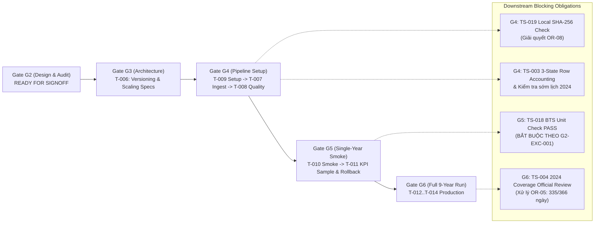

# G2_FINAL_FIX_FINAL_GATE_RECOMMENDATION — Khuyến Nghị Độc Lập Cuối Cùng Về Mức Độ Sẵn Sàng Nghiệm Thu Gate G2

**Mã tài liệu:** `G2_FINAL_FIX_FINAL_GATE_RECOMMENDATION`  
**Nhiệm vụ:** `G2-FINAL-FIX` (Targeted Corrections, Regression Verification & Final Human Sign-off Preparation)  
**Ngày thực hiện:** 2026-10-16  
**Vai trò:** Kỹ sư Big Data Độc lập Cấp cao, Thẩm định viên Chất lượng Bằng chứng & Chuyên viên Kiểm soát Cổng  
**Trạng thái Cổng G2 trước xem xét:** **`IN_PROGRESS / NOT_PASSED`**  
**Trạng thái Nhiệm vụ T-006 (Gate G3):** **`NOT_STARTED`**  
**Phán quyết khuyến nghị cuối cùng:** **`READY_FOR_FINAL_HUMAN_G2_SIGNOFF`**  
*(Kèm theo công bố minh bạch và đầy đủ các giới hạn kỹ thuật / ranh giới tin cậy — `Disclosed Residual Test & Trust-Boundary Limitations`)*

---

## 1. Tóm Tắt Tình Trạng Nghiệm Thu Kỹ Thuật Các Nhiệm Vụ Thành Phần (`T-001` đến `T-005`)

| Nhiệm Vụ | Trạng Thái Nghiệm Thu Kỹ Thuật | Tóm Tắt Kết Quả & Ràng Buộc Kèm Theo | Tài Liệu Bằng Chứng Cơ Sở |
|:---:|:---:|---|---|
| **`T-001`** | **`PASS`** *(Conditional)* | Đã xác minh xuất xứ 9 năm CSV thô (54,674,003 dòng); chấp nhận có điều kiện giới hạn `UPSTREAM_URL_LICENSE_UNKNOWN`; chuyển giao `OR-08` sang Gate G4 (`T-007` / `TS-019`) để tính mã băm SHA-256 cục bộ cho 9 tệp CSV nguồn. | [`T001_R2_FINAL_REVIEW.md`](T001_R2_FINAL_REVIEW.md), [`T001_PROVENANCE_AUDIT.md`](T001_PROVENANCE_AUDIT.md) |
| **`T-002`** | **`PASS_WITH_OPEN_RISKS`** | Khóa cấp hạt dữ liệu chuẩn: *Scheduled Flight Leg Record*; xác nhận `FLIGHTS == 1.0` trên 100% dòng (`OR-01` $\to$ Primary `R-09`, kiểm thử `TS-009`); bảo toàn nguyên vẹn cả 2 bản ghi của cặp trùng khóa duy nhất `YX 3624` (`OR-02` $\to$ Primary `R-05`, kiểm thử `TS-012`, `TS-020`); chuẩn hóa mẫu số `count_records`. | [`T002_FINAL_ACCEPTANCE_CHECK.md`](T002_FINAL_ACCEPTANCE_CHECK.md), [`T002_FLIGHT_GRAIN_AUDIT.md`](T002_FLIGHT_GRAIN_AUDIT.md) |
| **`T-003`** | **`PASS_WITH_OPEN_RISKS`** | Khóa định nghĩa 8 CORE KPIs (`KPI-01..08`); phê duyệt `FP-DEC-015` (`percentile_approx` accuracy `10000`) và `FP-DEC-016` (ngưỡng min-N: 1000/365/100); áp dụng ngoại lệ được duyệt **`G2-EXC-001`** cho đúng 7 trường số đo CORE (`OR-03` $\to$ Primary `R-15`), bắt buộc kiểm thử `TS-018` phải đạt `PASS` tại Gate G5 trước khi chạy full-run G6; khóa phạm vi `OR-04` (`KPI-11 = NOT_COMPUTABLE`). | [`T003_SIGNOFF_RECORD.md`](T003_SIGNOFF_RECORD.md), [`T003_PERCENTILE_AND_MIN_N_DECISIONS.md`](T003_PERCENTILE_AND_MIN_N_DECISIONS.md), [`T003_UNIT_VERIFICATION.md`](T003_UNIT_VERIFICATION.md) |
| **`T-004`** | **`READY_FOR_SIGNOFF_WITH_OPEN_DEFECT`** | Phê duyệt quy tắc bảo vệ thời gian an toàn `FP-DEC-007` (`OR-06` $\to$ Primary `R-03`, kiểm thử `TS-010`): cấm trừ chuỗi timestamp và cấm tự cộng `+24h`; các mốc giờ phái sinh loại khỏi CORE (`NOT_AVAILABLE` theo `DC-02`). Ghi nhận khuyết tật chất lượng mở **`OR-05 = OPEN_QUALITY_DEFECT` ($\to$ Primary `R-10`)**: năm 2024 chỉ có `335/366` ngày (thiếu Tháng 3/2024); giữ `source_coverage_status = PARTIAL`. | [`T004_FINAL_QA_RECONCILIATION.md`](T004_FINAL_QA_RECONCILIATION.md), [`T004_SAFE_FIELDS_DECISION.md`](T004_SAFE_FIELDS_DECISION.md), [`T004_2024_DATE_COVERAGE_AUDIT.md`](T004_2024_DATE_COVERAGE_AUDIT.md) |
| **`T-005`** | **`CLOSED_CONDITIONAL_NO_GO`** | Phê duyệt chính thức **`FP-DEC-017` (`CONDITIONAL_NO_GO`)**: loại `RQ-06` / `KPI-10` khỏi phạm vi sản xuất hiện tại; giữ nguyên 6 cột thời tiết thô (`O_TEMP..D_WSPD`) theo schema 34 cột; cấm đưa dòng CORE vào cách ly chỉ vì thiếu dữ liệu thời tiết; `OR-07 = MITIGATED_BY_SCOPE_EXCLUSION` ($\to$ Primary `R-04`). | [`T005_FINAL_AUDIT_RECONCILIATION.md`](T005_FINAL_AUDIT_RECONCILIATION.md), [`T005_CONDITIONAL_NO_GO_PROPOSAL.md`](T005_CONDITIONAL_NO_GO_PROPOSAL.md) |

---

## 2. Các Quyết Định Thiết Kế Đã Được Project Lead Phê Duyệt

Các quyết định sau đây đã được Project Lead phê duyệt chính thức qua chỉ thị nhiệm vụ và đã được đồng bộ hóa nhất quán vào các tài liệu quản trị sống:
1. **Ngoại lệ `G2-EXC-001` (`APPROVED WITH CONDITIONS`):** Áp dụng nhãn tạm thời `OFFICIAL_MINUTES_EMPIRICALLY_CONSISTENT_PROVISIONAL` cho đúng 7 trường số đo CORE (`ARR_DELAY`, `DEP_DELAY`, `TAXI_OUT`, `TAXI_IN`, `AIR_TIME`, `ACTUAL_ELAPSED_TIME`, `CRS_ELAPSED_TIME`; không bao gồm `ELAPSED_DIFF`). Bắt buộc phải thực hiện và đạt `PASS` bài kiểm thử đối chiếu nguồn BTS TranStats (`TS-018`) tại Gate G5 trước khi được phép chạy full-run G6 hoặc công bố kết quả.
2. **Nhóm A (`FP-DEC-003` đến `FP-DEC-014` — `APPROVED WITH CONDITIONS`):** Khóa định hướng công nghệ PySpark + Parquet, cấm ML/ATL/`.pt`, bất biến dữ liệu thô, loại trừ KPI hủy chuyến/chuyển hướng, bảo vệ tính toán thời gian, ngưỡng trễ `>= 15`, mẫu số `count_records`, hạch toán dòng 3 trạng thái (`accepted, quarantined, rejected`), và khóa 8 CORE KPIs.
3. **Nhóm B (`FP-DEC-015` và `FP-DEC-016` — `APPROVED WITH CONDITIONS`):** Phê duyệt `percentile_approx(ARR_DELAY, [0.5, 0.9], accuracy=10000)` cho `KPI-06` và quy định ngưỡng min-N: `carrier-year >= 1000`, `airport-year >= 365`, `route-year >= 100` tính trên `count_metric_valid`.
4. **Nhóm C (`FP-DEC-017` — `APPROVED CONDITIONAL_NO_GO`):** Đưa toàn bộ nhánh phân tích thời tiết vào trạng thái `CONDITIONAL_NO_GO`, bảo toàn tính độc lập của 8 CORE KPIs.
5. **Nhóm D (`OR-01..OR-08` & Quản trị Kho lưu trữ — `APPROVED WITH CONDITIONS`):** Hoàn tất chuyển giao rủi ro có kiểm soát, bảo toàn các khiếm khuyết mở và tăng cường công cụ tự động hóa kiểm định cây làm việc.

---

## 3. Nghĩa Vụ Kiểm Soát và Trách Nhiệm Chuyển Giao Xuống Các Gate Tiếp Theo

Việc phê duyệt đóng Gate G2 đi kèm với các nghĩa vụ kỹ thuật bắt buộc ở các Gate kế tiếp:

1. **Gate G3 (`T-006`):** Thiết kế kiến trúc tổng thể, chốt phiên bản cụ thể cho Spark/Python/Java, lập bảng dự toán tài nguyên bộ nhớ/phân vùng, và xác định lược đồ Parquet trung gian. Tuyệt đối không viết mã ingestion sản xuất tại G3.
2. **Gate G4 (`T-009 -> T-007 -> T-008`):**
   - Thiết lập môi trường trước (`T-009`), sau đó mới thực thi ingestion (`T-007`) và kiểm định chất lượng (`T-008`).
   - `T-007`: Thực thi `TS-019` để tính toán và kiểm tra mã băm SHA-256 cục bộ cho toàn bộ 9 tệp CSV nguồn (`data/raw/tabular/{year}/flight_with_weather_{year}.csv`), giải quyết rủi ro `OR-08`.
   - `T-008`: Thực thi kiểm tra kế toán dòng 3 trạng thái (`TS-003`) và kiểm tra sớm độ bao phủ lịch năm 2024 phục vụ chuẩn bị cho `TS-004`.
3. **Gate G5 (`T-010 -> T-011`):**
   - Chạy thử nghiệm 1 năm dữ liệu thật (`T-010`, benchmark quy mô `TS-014`).
   - `T-011`: Tính toán mẫu KPI, kiểm tra độ chính xác phân vị `TS-008`, và **BẮT BUỘC thực thi `TS-018` để đối chiếu đơn vị phút với BTS TranStats**. Nếu `TS-018` không đạt `PASS`, toàn bộ pipeline bị chặn đứng, không được phép bước vào Gate G6.
4. **Gate G6 (`T-012 -> T-013 -> T-014`):**
   - Nghiệm thu chính thức `TS-004` (xử lý khuyết tật chất lượng `OR-05` với 335/366 ngày của năm 2024).
   - Thực thi tổng hợp 6 chiều (`TS-007`) và áp dụng ngưỡng min-N (`TS-008`, `TS-016`).
   - Duy trì `T-015 = CONDITIONAL_NO_GO` cho nhánh thời tiết.

---

## 4. Công Bố Ranh Giới Tin Cậy & Giới Hạn Kiểm Thử (`Disclosed Test & Trust Limitations`)

Khuyến nghị nghiệm thu này được đưa ra dựa trên sự minh bạch tuyệt đối về các giới hạn kỹ thuật:
1. **Kiểm thử Symbolic Link:** Đã kiểm thử E2E thực tế trên fixture cô lập và xác nhận checker phát hiện, từ chối symlink thành công (`NEG-10B PASS`). Trong các môi trường OS từ chối tạo symlink do thiếu đặc quyền, bộ kiểm thử sẽ ghi nhận trung thực `SKIP` và kích hoạt kiểm thử unit-mock cho `_is_safe_rel_path()`.
2. **Ranh giới Ký số:** Repository áp dụng cơ chế tự kiểm toán fail-closed với mã băm ghim cứng cho `PACKAGE_MANIFEST.json` và `SOURCE_MANIFEST.json`, nhưng chưa có hạ tầng ký số phần cứng (PKI/HSM) bên ngoài.
3. **Phạm vi Kiểm thử Tài liệu:** Bộ xác minh bất biến ngữ nghĩa tập trung kiểm tra các hợp đồng dữ liệu cốt lõi và tài liệu sống của Gate G2, không mở rộng quét toàn bộ lịch sử Markdown để tránh gây quá tải và phụ thuộc chéo giả mạo.

---

## 5. Kết Luận Khuyến Nghị

Căn cứ vào việc:
1. Toàn bộ 5 nhiệm vụ thành phần `T-001` đến `T-005` đã hoàn tất kiểm toán kỹ thuật độc lập.
2. Tất cả các quyết định thiết kế Nhóm A–D và ngoại lệ `G2-EXC-001` đã được phê duyệt và áp dụng đồng bộ.
3. Toàn bộ các phát hiện kỹ thuật độc lập (`Findings C-01` đến `C-05`) đã được khắc phục triệt để.
4. Toàn bộ 5 bộ kiểm thử tự động của repository đạt 100% `PASS` với mã thoát 0.
5. Không có dữ liệu thô, mã nguồn production hay manifest lịch sử nào bị xâm phạm.

**Khuyến nghị chính thức:**  
Repository đã đạt trạng thái **`READY_FOR_FINAL_HUMAN_G2_SIGNOFF`** (hoặc nghiệm thu dưới nhãn **`READY_WITH_DISCLOSED_TEST_LIMITATIONS`** nếu xét đến các giới hạn ranh giới tin cậy đã công bố).  
Hồ sơ kỹ thuật hoàn toàn trong sạch, minh bạch và sẵn sàng để Project Lead tiến hành xem xét và ký biên bản phê duyệt đóng Gate G2 chính thức.

---

## 6. Khóa Trạng Thái Quản Trị Tuyệt Đối (Mandatory Status Lock)

- **Gate G2:** **`IN_PROGRESS / NOT_PASSED`** (Chờ chữ ký phê duyệt cuối cùng từ Project Lead).
- **Nhiệm vụ T-006 (Gate G3):** **`NOT_STARTED`** (Bị khóa nghiêm ngặt; tuyệt đối không khởi động trước khi Gate G2 được phê duyệt đóng).
