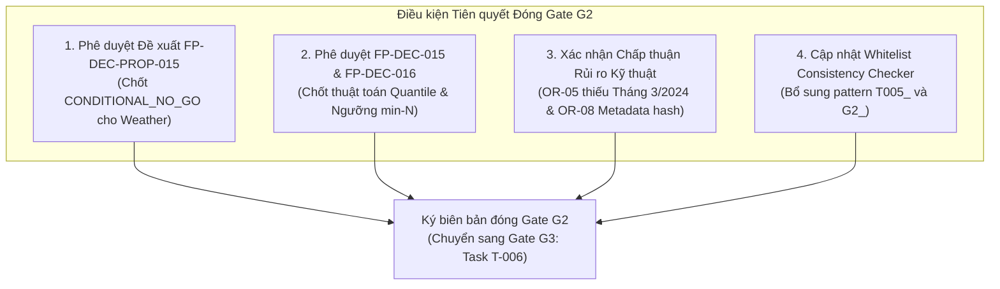

# G2_FINAL_GATE_READINESS_AUDIT — Báo cáo Kiểm toán Độc lập Sẵn sàng Đóng Gate G2

**Document ID:** `G2-FINAL-AUDIT-001`  
**Dự án:** Phân tích hiệu suất chuyến bay Hoa Kỳ 2016–2024 bằng Apache Spark / PySpark  
**Phạm vi:** Kiểm toán độc lập mức độ sẵn sàng đóng Gate G2 (Data Understanding, Provenance, Grain, KPI Specification, Safe Time Representation, Weather Usability)  
**Vai trò:** Senior Big Data Engineer, Independent Technical Reviewer, Project Architecture Advisor, Evidence Quality Auditor  
**Ngày kiểm toán:** 2026-10-16  
**Trạng thái Gate G2 hiện hành trong repository:** `IN_PROGRESS / NOT_PASSED`  
**Khuyến nghị thẩm định (Audit Verdict):** `READY_WITH_EXPLICIT_CONDITIONS` (Sẵn sàng để Project Lead phê duyệt có điều kiện)

---

## 1. Tóm tắt Điều hành & Kết luận Thẩm định (Executive Summary & Formal Verdict)

Sau khi kiểm tra độc lập toàn diện và đối chiếu chéo tất cả các artifact bằng chứng của các nhiệm vụ thành phần thuộc Gate G2 (**T-001**, **T-002**, **T-003**, **T-004**, **T-005**), reviewer độc lập đưa ra kết luận kỹ thuật chính thức:

> ### **KẾT LUẬN THẨM ĐỊNH GATE G2: READY_WITH_EXPLICIT_CONDITIONS**
> 
> Toàn bộ các yêu cầu kỹ thuật nền tảng, các ràng buộc an toàn dữ liệu, và đặc tả hợp đồng dữ liệu cho luồng phân tích chính (**CORE PIPELINE**) đã hoàn tất đầy đủ, chặt chẽ, và có bằng chứng đối chiếu độc lập có khả năng tái lập.
> 
> Gate G2 **CHƯA ĐƯỢC TỰ ĐỘNG PASS**. Theo quy định tại [`AGENTS.md`](../../AGENTS.md), trạng thái Gate G2 trong [`PROJECT_STATE.md`](../04-execution/PROJECT_STATE.md) phải tiếp tục duy trì là **`IN_PROGRESS / NOT_PASSED`** cho đến khi Project Lead (Human User) chính thức ký duyệt các điều kiện tiên quyết.

### Bảng tổng hợp trạng thái các Task thành phần Gate G2

| Task | Tên nhiệm vụ | Trạng thái kỹ thuật | Bằng chứng kiểm toán chính | Đánh giá mức độ hoàn thành |
|---|---|:---:|---|---|
| **T-001** | Provenance & Source Audit | `PASS (Conditional)` | [`T001_PROVENANCE_AUDIT.md`](T001_PROVENANCE_AUDIT.md) [`T001_R2_FINAL_REVIEW.md`](T001_R2_FINAL_REVIEW.md) | **ĐẠT ĐIỀU KIỆN**: Xác minh 54,674,003 dòng qua 9 năm; 8 rủi ro mở (`OR-01`..`OR-08`) được ghi nhận minh bạch; bảo lưu giới hạn URL/License gốc. |
| **T-002** | Flight Grain & Duplicate Audit | `PASS_WITH_OPEN_RISKS` | [`T002_FLIGHT_GRAIN_AUDIT.md`](T002_FLIGHT_GRAIN_AUDIT.md) [`T002_FINAL_ACCEPTANCE_CHECK.md`](T002_FINAL_ACCEPTANCE_CHECK.md) | **ĐẠT ĐIỀU KIỆN**: Xác lập cấp hạt *Scheduled Flight Leg Record*; `FLIGHTS = 1.0` (100% constant, không dùng làm trọng số); phát hiện cặp trùng `YX 3624` và cấm dedup tùy tiện; mẫu số mặc định là `count_records`. |
| **T-003** | KPI Contract & Measure Units | `PASS_WITH_OPEN_RISKS` | [`T003_FINAL_CLOSEOUT_VERIFICATION.md`](T003_FINAL_CLOSEOUT_VERIFICATION.md) [`T003_SIGNOFF_RECORD.md`](T003_SIGNOFF_RECORD.md) [`T003_PERCENTILE_AND_MIN_N_DECISIONS.md`](T003_PERCENTILE_AND_MIN_N_DECISIONS.md) | **ĐẠT ĐIỀU KIỆN**: Khóa 8 CORE KPIs; 7 đơn vị đo cốt lõi đạt trạng thái `OFFICIAL_MINUTES_EMPIRICALLY_CONSISTENT_PROVISIONAL`; xác lập `ZERO_DENOMINATOR -> null`; 14 kịch bản fixture hạch toán dòng DC-11/12 đã kiểm chứng. Đề xuất `FP-DEC-015` và `FP-DEC-016` chờ duyệt. |
| **T-004** | Safe Time & 2024 Audit | `READY_FOR_SIGNOFF_WITH_OPEN_DEFECT` | [`T004_FINAL_QA_RECONCILIATION.md`](T004_FINAL_QA_RECONCILIATION.md) [`T004_SAFE_FIELDS_DECISION.md`](T004_SAFE_FIELDS_DECISION.md) [`tools/qa/verify_t004_time_representation.py`](../../tools/qa/verify_t004_time_representation.py) | **ĐẠT ĐIỀU KIỆN**: Ma trận an toàn thời gian 4 cấp; cấm trừ timestamp ngây thơ và cấm `+24:00`; phát hiện khuyết 31 ngày Tháng 3/2024 (`OR-05` = `OPEN_QUALITY_DEFECT`, 335/366 ngày); suite kiểm thử tự động đạt 90/90 PASS. |
| **T-005** | Weather Usability Audit | `CONDITIONAL_PENDING` (Đề xuất `CONDITIONAL_NO_GO`) | [`T005_FINAL_AUDIT_RECONCILIATION.md`](T005_FINAL_AUDIT_RECONCILIATION.md) [`T005_EVIDENCE_MATRIX.md`](T005_EVIDENCE_MATRIX.md) [`T005_CONDITIONAL_NO_GO_PROPOSAL.md`](T005_CONDITIONAL_NO_GO_PROPOSAL.md) | **HOÀN TẤT KIỂM TOÁN**: 6 trường thời tiết thiếu provenance, thiếu timestamp đo, không rõ múi giờ và trạm quan trắc; co-missingness bộ 3 đạt 100%; kiến nghị loại bỏ khỏi CORE qua `FP-DEC-PROP-015`. Chờ phê duyệt của Project Lead. |

---

## 2. Bối cảnh Quản trị & Ranh giới Dự án (Authoritative Context & Project Boundaries)

Dự án tuân thủ nghiêm ngặt các ranh giới phương pháp luận và an toàn kỹ thuật sau:
1. **Bản chất dự án:** Nghiên cứu phân tích mô tả dữ liệu lớn quan sát (Observational / Descriptive Big Data Analysis) trên nền tảng Apache Spark / PySpark và định dạng Parquet.
2. **Loại trừ dứt khoát các di sản Aeolus:**
   - KHÔNG thực hiện mô hình học máy (Machine Learning / Deep Learning).
   - KHÔNG dự báo trễ T-2h tại riêng sân bay ATL.
   - KHÔNG đọc hoặc nạp các file đồ thị chuỗi bay PyTorch `.pt` (`FP-DEC-003`).
3. **Bảo toàn dữ liệu nguồn (`data/raw/`):**
   - Tuyệt đối không sửa đổi, di chuyển hoặc ghi đè dữ liệu thô (`FP-DEC-004`).
   - Dữ liệu 9 file CSV thô được bảo vệ ở chế độ Read-Only.
4. **Tính độc lập của luồng CORE và OPTIONAL:**
   - Theo [`DECISIONS.md`](../02-design/DECISIONS.md) (`FP-DEC-013`) và [`BACKLOG.md`](../01-planning/BACKLOG.md), luồng Weather (RQ-06 / KPI-10) là nhánh mở rộng tùy chọn (`OPTIONAL`).
   - Việc quyết định `CONDITIONAL_NO_GO` cho thời tiết hoàn toàn KHÔNG làm cản trở hay vô hiệu hóa Gate G2 hoặc các KPI cốt lõi (KPI-01..KPI-08).

---

## 3. Đánh giá Chi tiết Từng Tiêu chí Nghiệm thu Gate G2 (G2 Exit Criteria Audit)

Căn cứ theo [`PROJECT_STATE.md`](../04-execution/PROJECT_STATE.md), [`BACKLOG.md`](../01-planning/BACKLOG.md), [`DATA_CONTRACT.md`](../02-design/DATA_CONTRACT.md), và [`TEST_PLAN.md`](../03-quality/TEST_PLAN.md), các tiêu chí nghiệm thu Gate G2 được đối chiếu chi tiết như sau:

### Tiêu chí 1: Nguồn gốc Dữ liệu & Phạm vi Thống kê (T-001)
- **Yêu cầu:** Xác minh nguồn gốc, license, số dòng kiểm toán, độ phủ thực tế và ranh giới định danh.
- **Bằng chứng kiểm toán:**
  - 9 file schema JSON thể hiện tổng số dòng kiểm toán là **54,674,003** dòng qua 9 năm (2016–2024), cấu trúc nhất quán 34 cột.
  - Ngưỡng `ARR_DELAY >= 15` chiếm **10,116,916** dòng (tương đương ~18.5041% tổng số dòng có `ARR_DELAY` hữu hạn).
  - Thuật ngữ được chuẩn hóa: Chỉ gọi là "số dòng trong dataset đã kiểm toán", tuyệt đối không gọi là "toàn bộ các chuyến bay thực tế của Hoa Kỳ" để tránh ngụy biện về độ đại diện thị trường (`OR-02`).
  - Ghi nhận trạng thái `IDENTITY_UNVERIFIED / METADATA_MATCH_ONLY` (`OR-08`) do các file JSON ban đầu chỉ ghi `size` và `mtime` mà thiếu mã băm cryptographic SHA-256 của các file CSV gốc.
- **Đánh giá:** **ĐẠT (PASS with Condition)**.

### Tiêu chí 2: Cấp hạt Sự kiện & Chính sách Trùng khóa (T-002)
- **Yêu cầu:** Xác định đơn vị quan sát (Grain), tính chất của trường `FLIGHTS`, chính sách xử lý bản ghi trùng lặp và mẫu số nhóm.
- **Bằng chứng kiểm toán:**
  - Cấp hạt được xác định chính xác là: **Scheduled Flight Leg Record**.
  - Trường `FLIGHTS` có giá trị 1.0 trên 100% số bản ghi kiểm toán, nhưng không được chứng minh mang ý nghĩa số chuyến bay thực tế gộp, do đó bị CẤM dùng làm trọng số tính toán (`FP-DEC-010`).
  - Cặp bản ghi trùng khóa tự nhiên duy nhất `YX 3624` (2018-05-19, LGA -> DCA, dòng vật lý 2,682,735 và 3,090,131 trong CSV 2018) được chứng minh có giá trị đo khác nhau (bản ghi A: trễ khởi hành +877 phút; bản ghi B: trễ khởi hành +20 phút). Chính sách bảo toàn được thiết lập: **CẤM dedup tùy tiện**, cả hai bản ghi phải được giữ lại trong pipeline (`TS-021`).
  - Mẫu số đếm sự kiện cơ bản được chốt là `count_records` của tập hợp bản ghi hợp lệ (`accepted`).
- **Đánh giá:** **ĐẠT (PASS with Open Risks)**.

### Tiêu chí 3: Đặc tả Hợp đồng 8 CORE KPI & Đơn vị Đo (T-003)
- **Yêu cầu:** Khóa danh mục 8 CORE KPI; xác minh đơn vị, dấu, miền giá trị của 7 trường số đo lường cốt lõi; quy định xử lý mẫu số 0 và phân tách tập bản ghi.
- **Bằng chứng kiểm toán:**
  - Khóa chặt danh mục 8 CORE KPI (KPI-01 đến KPI-08), đáp ứng 5 câu hỏi nghiên cứu bắt buộc (RQ-01 đến RQ-05).
  - 7 trường số đo cốt lõi (`ARR_DELAY`, `DEP_DELAY`, `TAXI_OUT`, `TAXI_IN`, `AIR_TIME`, `ACTUAL_ELAPSED_TIME`, `CRS_ELAPSED_TIME`) được xác minh độc lập:
    - Miền giá trị thực nghiệm: `ARR_DELAY` [-238, 4405], `DEP_DELAY` [-76, 4412], `TAXI_OUT` [0, 1439], `TAXI_IN` [0, 1439], `AIR_TIME` [0, 1437], `ACTUAL_ELAPSED_TIME` [0, 1438], `CRS_ELAPSED_TIME` [1, 1439].
    - Đơn vị đo được xác nhận là phút, gắn trạng thái: **`OFFICIAL_MINUTES_EMPIRICALLY_CONSISTENT_PROVISIONAL`**. Yêu cầu trích dẫn quy chuẩn BTS On-Time chính thức được chuyển tiếp cho Gate G5 (`TS-018`).
  - Xử lý mẫu số 0: Quy định rõ khi mẫu số bằng 0, tỷ lệ và giá trị trung bình trả về `null` thay vì 0.0 để tránh ngụy tạo dữ liệu.
  - Hạch toán dòng tuân thủ quy tắc loại trừ lẫn nhau (Mutually Exclusive) giữa 3 trạng thái: `accepted`, `quarantined`, `rejected` (DC-11/12). Bộ 14 kịch bản fixture kiểm toán (`T003_FIX14_accounting_fixture.csv` & `.json`) đã kiểm chứng đầy đủ.
  - Hai đề xuất kỹ thuật được lập hồ sơ: `FP-DEC-015` (thuật toán GK-sketch `percentile_approx` với accuracy 10000) và `FP-DEC-016` (chính sách min-N: Carrier >= 1000, Airport >= 365, Route >= 100) đang ở trạng thái `PROPOSED_DECISION_PENDING_REVIEW`.
- **Đánh giá:** **ĐẠT (PASS with Open Risks)**.

### Tiêu chí 4: An toàn Thời gian & Kiểm toán Dữ liệu Năm 2024 (T-004)
- **Yêu cầu:** Thiết lập ma trận an toàn cho các trường thời gian; cấm các phép tính ngây thơ; kiểm toán độ bao phủ ngày của năm 2024.
- **Bằng chứng kiểm toán:**
  - Ma trận an toàn trường thời gian phân loại 4 cấp:
    - **Safe Raw (Loại A):** `FL_DATE`, `YEAR`, `QUARTER`, `MONTH`, `DAY_OF_MONTH`, `DAY_OF_WEEK`.
    - **Safe Duration (Loại B):** 7 trường thời lượng/trễ số học dạng phút.
    - **Restricted Time-of-Day (Loại C):** `CRS_DEP_TIME`, `DEP_TIME`, `CRS_ARR_TIME`, `ARR_TIME` (chỉ dùng trích xuất giờ/block trong ngày, CẤM trừ trực tiếp để tính thời lượng, CẤM cộng 24h để sửa chuyến bay qua đêm khi chưa có date offset).
    - **Blocked / Incomplete (Loại D):** `WHEELS_OFF`, `WHEELS_ON` (100% null ở một số năm), các phép tính timeline đa múi giờ không có định danh IANA.
  - Kiểm toán lịch năm 2024:
    - Năm 2024 là năm nhuận (chuẩn lịch 366 ngày).
    - Dữ liệu CSV 2024 chỉ có **335 ngày**, thiếu toàn bộ 31 ngày của Tháng 3/2024 (từ 2024-03-01 đến 2024-03-31).
    - Ngày nhuận 2024-02-29 có đầy đủ với 18,642 bản ghi.
    - Sự cố khuyết Tháng 3/2024 được xác lập chính thức là khuyết tật chất lượng dữ liệu mở: **`OR-05 = OPEN_QUALITY_DEFECT`**. Rủi ro này không làm chặn thiết kế G2 mà được chuyển giao cho G3/G4 để thiết kế các guard kiểm tra lịch trong ingestion (`TS-004`).
  - Suite kiểm thử tự động độc lập [`tools/qa/verify_t004_time_representation.py`](../../tools/qa/verify_t004_time_representation.py) đạt kết quả tuyệt đối **90 PASS, 0 FAIL** (Exit code 0).
- **Đánh giá:** **ĐẠT (READY_FOR_SIGNOFF_WITH_OPEN_DEFECT)**.

### Tiêu chí 5: Khả năng Sử dụng Dữ liệu Thời tiết (T-005)
- **Yêu cầu:** Xác minh nguồn gốc, license, đơn vị đo, phương pháp join, và đánh giá tính khả thi của 6 trường thời tiết cho RQ-06 / KPI-10.
- **Bằng chứng kiểm toán:**
  - 6 trường thời tiết (`O_TEMP`, `O_PRCP`, `O_WSPD`, `D_TEMP`, `D_PRCP`, `D_WSPD`) được kiểm toán toàn diện qua 15 điểm bằng chứng (`EV-01` đến `EV-15`).
  - Kết quả kiểm toán thực tế:
    - Co-missingness: Xuất hiện sự thiếu hụt nguyên khối 100% giữa các bộ 3 gốc (Origin) và đích (Destination).
    - Tỷ lệ thiếu dữ liệu rất cao vào các năm đầu (2016 thiếu ~38.3% ở Origin và ~38.9% ở Destination).
    - Dữ liệu hoàn toàn thiếu nhãn thời gian quan trắc (Observation Timestamp), thiếu định danh múi giờ, thiếu tọa độ trạm thời tiết (Station ID / WBAN), và không rõ thuật toán join với chuyến bay.
    - Không rõ giấy phép sử dụng dữ liệu thương mại/công cộng.
  - Khuyến nghị chuyên môn: Đề xuất áp dụng **`CONDITIONAL_NO_GO`** cho nhánh thời tiết tùy chọn thông qua đề xuất quyết định `FP-DEC-PROP-015`. Toàn bộ 8 CORE KPI được bảo vệ nguyên vẹn và độc lập hoàn toàn.
- **Đánh giá:** **HOÀN TẤT KIỂM TOÁN (Chờ duyệt CONDITIONAL_NO_GO)**.

---

## 4. Điều kiện Tiên quyết để Chính thức Đóng Gate G2 (Sign-off Prerequisites)

Để Project Lead ký duyệt chuyển trạng thái Gate G2 từ `IN_PROGRESS / NOT_PASSED` sang `PASS` (hoặc `PASS_WITH_CONDITIONS`), các hành động sau cần được thực hiện:

1. **Phê duyệt Đề xuất `FP-DEC-PROP-015`:** Project Lead xem xét và chính thức phê duyệt áp dụng `CONDITIONAL_NO_GO` cho dữ liệu thời tiết (RQ-06 / KPI-10), qua đó giải quyết dứt điểm rủi ro `OR-07`.
2. **Phê duyệt Quyết định Kỹ thuật `FP-DEC-015` và `FP-DEC-016`:** Chính thức đưa 2 quyết định về thuật toán tính phân vị (PySpark `percentile_approx` GK-sketch accuracy 10000) và chính sách lọc cỡ mẫu tối thiểu (min-N) vào [`DECISIONS.md`](../02-design/DECISIONS.md) với trạng thái `APPROVED`.
3. **Xác nhận Chấp thuận Rủi ro Kỹ thuật Mở (`OR-05` và `OR-08`):** Ký nhận việc đưa khuyết tật thiếu Tháng 3/2024 (`OR-05`) và giới hạn định danh tệp thô (`OR-08`) thành yêu cầu ràng buộc kỹ thuật đối với luồng thiết kế Ingestion tại Gate G3 / G4.
4. **Cập nhật Whitelist của Công cụ Kiểm tra Tính Nhất quán:** Phê duyệt cập nhật biểu thức lọc file trong [`tools/check_working_tree_consistency.py`](../../tools/check_working_tree_consistency.py) để nhận diện các deliverable mới của `T005_` và `G2_`, đưa bộ kiểm tra repository về trạng thái 100% PASS.

---

## 5. Kết luận & Đề xuất Bước đi Tiếp theo (Next Safe Sequence)

Reviewer độc lập khẳng định Gate G2 đã đạt độ chín muồi về mặt thiết kế tài liệu và kiểm toán dữ liệu mẫu. Sau khi Project Lead ký duyệt các điều kiện tiên quyết nêu trên:
1. Cập nhật [`PROJECT_STATE.md`](../04-execution/PROJECT_STATE.md) ghi nhận Gate G2 chính thức hoàn thành.
2. Khởi động **Gate G3 — Task T-006 (Architecture, Resource Budget & Execution Design)**:
   - Thiết kế kiến trúc Spark cluster/local, phân bổ bộ nhớ (Driver/Executor memory, spill management).
   - Thiết kế schema đầu ra Parquet phân vùng theo `YEAR` và `MONTH`.
   - Thiết kế cơ chế phục hồi và checkpointing.
   - Tuyệt đối chưa viết mã nguồn Ingestion production cho đến khi hoàn thành setup môi trường ở T-009 tại Gate G4.

---
*Báo cáo được lập bởi Senior Big Data Technical Reviewer và bảo lưu theo các nguyên tắc quản trị dự án tại AGENTS.md.*
