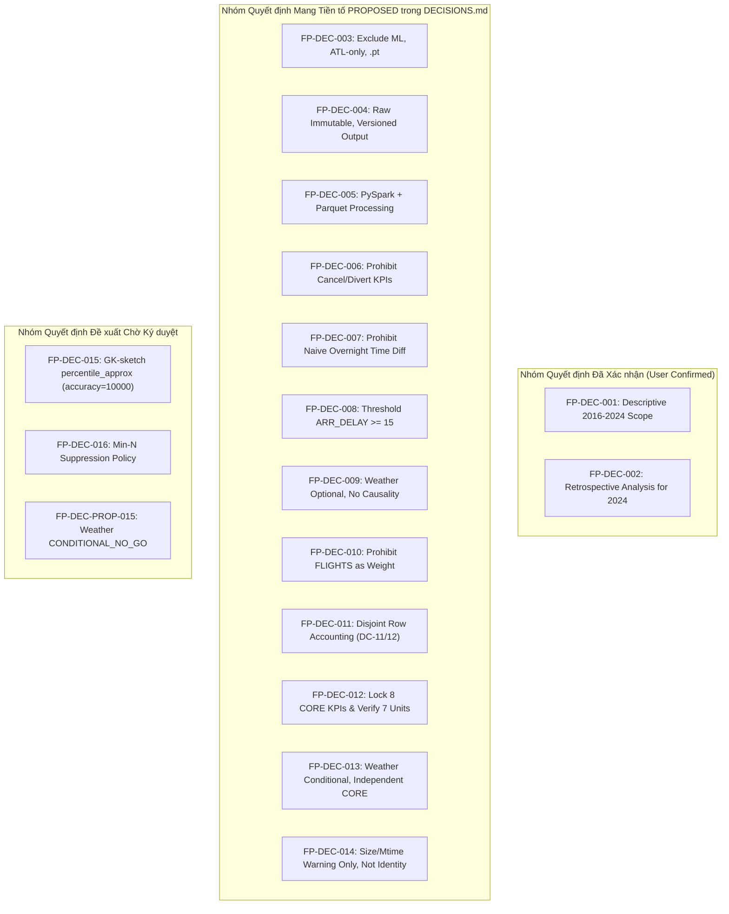

# G2_R1_CORRECTED_GATE_READINESS — Báo cáo Thay thế Đánh giá Mức độ Sẵn sàng Đóng Gate G2

**Document ID:** `G2-R1-READY-001`  
**Dự án:** Phân tích hiệu suất chuyến bay Hoa Kỳ 2016–2024 bằng Apache Spark / PySpark  
**Phạm vi:** Báo cáo thẩm định chính thức thay thế (superseding) các kết luận của văn bản G2 trước đó, cung cấp ma trận nghiệm thu chuẩn hóa, trạng thái quyết định trung thực và phán quyết điều kiện tiên quyết  
**Vai trò:** Independent Senior Big Data Engineer, Technical Audit Lead, Project Architecture Advisor  
**Ngày lập:** 2026-10-16  
**Trạng thái Gate G2 trong repository:** **`IN_PROGRESS / NOT_PASSED`**  
**Phán quyết Thẩm định Chính thức:** **`READY_WITH_EXPLICIT_CONDITIONS`**  

---

## 1. PHẠM VI QUẢN TRỊ & RANH GIỚI BẤT KHẢ XÂM PHẠM (GOVERNANCE BOUNDARIES)

Báo cáo này thay thế hoàn toàn các nhận định chưa chuẩn xác trong [`G2_FINAL_GATE_READINESS_AUDIT.md`](G2_FINAL_GATE_READINESS_AUDIT.md) mà không xóa bỏ lịch sử tài liệu, tuân thủ nghiêm ngặt các nguyên tắc quản trị tại [`AGENTS.md`](../../AGENTS.md):
1. **Bản chất khoa học:** Dự án là nghiên cứu phân tích mô tả dữ liệu lớn quan sát (Observational Big Data Analysis) giai đoạn 2016–2024 sử dụng Apache Spark / PySpark và Parquet.
2. **Loại trừ di sản:** Không có học máy (Machine Learning), không dự báo trễ T-2h tại riêng sân bay ATL, và cấm tuyệt đối việc nạp đồ thị chuỗi bay PyTorch `.pt` (`FP-DEC-003`).
3. **Bất biến dữ liệu thô:** Dữ liệu 9 file CSV thô (~15.2 GB) trong `data/raw/` được bảo vệ ở chế độ Read-Only, cấm mọi thao tác ghi đè hoặc chỉnh sửa (`FP-DEC-004`).
4. **Không nhảy cóc Gate:** Gate G2 chỉ là cổng nghiệm thu thiết kế, hợp đồng dữ liệu và kiểm toán chất lượng. Mọi phân tích full-run 9 năm phân tán trên Spark chỉ được thực thi tại Gate G5 và G6.

---

## 2. MA TRẬN TỔNG HỢP NHIỆM VỤ THÀNH PHẦN GATE G2 (CORRECTED TASK MATRIX)

Toàn bộ 5 nhiệm vụ thành phần của Gate G2 được rà soát và hiệu chỉnh như sau:

| Task | Tên nhiệm vụ | Trạng thái kỹ thuật thẩm quyền | Bằng chứng kiểm toán gốc | Kết quả thẩm định độc lập & Ranh giới kỹ thuật |
|---|---|:---:|---|---|
| **T-001** | Data Provenance & Upstream Audit | `PASS (Conditional)` | [`T001_PROVENANCE_AUDIT.md`](T001_PROVENANCE_AUDIT.md) [`T001_R2_FINAL_REVIEW.md`](T001_R2_FINAL_REVIEW.md) | **ĐẠT CÓ ĐIỀU KIỆN**: Xác minh 54,674,003 dòng qua 9 năm, cấu trúc 34 cột. Nhận diện rủi ro thiếu URL/License nguồn gốc (`OR-01` trong phạm vi nghiên cứu học thuật) và trạng thái `IDENTITY_UNVERIFIED` của tệp thô (`OR-08`). |
| **T-002** | Flight Grain & Duplicate Policy | `PASS_WITH_OPEN_RISKS` | [`T002_FLIGHT_GRAIN_AUDIT.md`](T002_FLIGHT_GRAIN_AUDIT.md) [`T002_DUPLICATE_ANALYSIS.md`](T002_DUPLICATE_ANALYSIS.md) [`T002_FINAL_ACCEPTANCE_CHECK.md`](T002_FINAL_ACCEPTANCE_CHECK.md) | **ĐẠT CÓ RỦI RO**: Cấp hạt chuẩn xác là *Scheduled Flight Leg Record*. `FLIGHTS` bằng 1.0 cố định (`OR-01`). Duy nhất 1 cặp trùng khóa tự nhiên: **`YX 3624` ngày 2018-06-21 chặng `DEN -> XNA` tại dòng 6,384,132 và 6,384,133**. Ban hành chính sách cấm dedup tùy tiện (`TS-021`). Mẫu số là `count_records`. |
| **T-003** | KPI Contract & Measure Units | `PASS_WITH_OPEN_RISKS` | [`T003_FINAL_CLOSEOUT_VERIFICATION.md`](T003_FINAL_CLOSEOUT_VERIFICATION.md) [`T003_SIGNOFF_RECORD.md`](T003_SIGNOFF_RECORD.md) [`T003_PERCENTILE_AND_MIN_N_DECISIONS.md`](T003_PERCENTILE_AND_MIN_N_DECISIONS.md) | **ĐẠT CÓ RỦI RO**: Khóa chặt 8 CORE KPIs. 7 trường số đo đạt chuẩn `OFFICIAL_MINUTES_EMPIRICALLY_CONSISTENT_PROVISIONAL` (`OR-03`, đối chiếu BTS chính thức chuyển G5/`TS-018`). Mẫu số 0 trả về `null`. Kiểm chứng 14 kịch bản fixture hạch toán dòng DC-11/12. Đề xuất `FP-DEC-015` và `FP-DEC-016` chờ duyệt. |
| **T-004** | Safe Time & 2024 Date Audit | `READY_FOR_SIGNOFF_WITH_OPEN_DEFECT` | [`T004_FINAL_QA_RECONCILIATION.md`](T004_FINAL_QA_RECONCILIATION.md) [`T004_SAFE_FIELDS_DECISION.md`](T004_SAFE_FIELDS_DECISION.md) [`tools/qa/verify_t004_time_representation.py`](../../tools/qa/verify_t004_time_representation.py) | **ĐẠT CÓ KHUYẾT TẬT MỞ**: Ban hành ma trận an toàn 4 cấp; cấm trừ timestamp trực tiếp và cấm `+24h` rollover. Năm 2024 có 335 ngày, khuyết 31 ngày Tháng 3/2024 (**`OR-05: OPEN_QUALITY_DEFECT`**, chuyển giao kiểm tra lịch `TS-004` cho G3/G4). Suite kiểm thử đạt **90/90 PASS**. |
| **T-005** | Weather Usability Audit | `CONDITIONAL_PENDING` | [`T005_FINAL_AUDIT_RECONCILIATION.md`](T005_FINAL_AUDIT_RECONCILIATION.md) [`T005_EVIDENCE_MATRIX.md`](T005_EVIDENCE_MATRIX.md) [`T005_CONDITIONAL_NO_GO_PROPOSAL.md`](T005_CONDITIONAL_NO_GO_PROPOSAL.md) | **HOÀN TẤT KIỂM TOÁN**: Tỷ lệ khuyết thời tiết 2016 là ~0.1624% (Origin) và ~0.1639% (Destination). Bộ 3 trường có số lượng null cận biên bằng nhau. Thiếu mốc giờ quan trắc, múi giờ và trạm đo. Đề xuất chính thức `CONDITIONAL_NO_GO` (`FP-DEC-PROP-015`) để bảo vệ luồng CORE. |

---

## 3. HIỆU CHỈNH TRẠNG THÁI CÁC QUYẾT ĐỊNH THIẾT KẾ (DECISIONS STATUS RECONCILIATION)

Báo cáo này phân định rạch ròi trạng thái thực tế của các quyết định kiến trúc tại [`docs/02-design/DECISIONS.md`](../02-design/DECISIONS.md):

### 3.1. Các Quyết định Đã Xác nhận (Confirmed)
- **`FP-DEC-001` (`USER_CONFIRMED`):** Phân tích hiệu suất bay mô tả 2016–2024.
- **`FP-DEC-002` (`USER_CONFIRMED_BY_SCOPE`):** Sử dụng toàn bộ 2024 cho phân tích hồi cứu.

### 3.2. Các Quyết định Mang Tiền tố PROPOSED trong `DECISIONS.md`
- **`FP-DEC-003` đến `FP-DEC-014`:** Toàn bộ đều mang trạng thái `PROPOSED` (`PROPOSED_IMPLEMENTATION`, `PROPOSED_CONTROL`, `PROPOSED_GUARD`, `PROPOSED_KPI`, `PROPOSED_REQUIREMENT`). Chúng là các chuẩn mực kỹ thuật đã được kiểm toán và tuân thủ trên thực tế, nhưng **chưa từng có phiên ký duyệt chính thức để chuyển thành `APPROVED`**.

### 3.3. Các Đề xuất Kỹ thuật Chờ Phê duyệt (Pending Sign-off)
1. **`FP-DEC-015` (Thuật toán Tính Phân vị Trễ):**
   - Đề xuất dùng PySpark `percentile_approx` với thuật toán Greenwald-Khanna (accuracy = 10000).
   - **Đính chính toán học:** Tham số accuracy 10000 giới hạn **sai số tương đối về thứ hạng phân vị $\epsilon \le 0.01\%$**, **không đảm bảo sai số tuyệt đối dưới 0.5 phút**.
2. **`FP-DEC-016` (Chính sách Ngưỡng Lọc Cỡ mẫu min-N):**
   - Ngưỡng lọc bảng xếp hạng: Hãng $\ge 1,000$ chuyến/năm, Sân bay $\ge 365$ chuyến/năm, Tuyến bay $\ge 100$ chuyến/năm.
3. **`FP-DEC-PROP-015` (Áp dụng `CONDITIONAL_NO_GO` cho Dữ liệu Thời tiết):**
   - Loại bỏ nhánh RQ-06 / KPI-10 khỏi phạm vi tính toán CORE do thiếu nguồn gốc và mốc giờ quan trắc.

---

## 4. PHẢ HỆ QUẢN TRỊ RỦI RO MỞ CHUẨN TẮC (TASK OPEN RISKS OR-01..OR-08)

Reviewer độc lập khôi phục và chuẩn hóa định nghĩa gốc của 8 rủi ro mở (`OR-01` đến `OR-08`), xóa bỏ hoàn toàn sự xáo trộn định danh trong báo cáo trước:

| Mã Rủi ro | Định nghĩa Chuẩn tắc Thẩm quyền | Trạng thái Hiện tại | Biện pháp Quản trị & Kế hoạch Tiếp nhận |
|:---:|---|:---:|---|
| **`OR-01`** | Trường `FLIGHTS` đồng nhất bằng 1.0 trên 100% dòng (54.67M). | Đã khóa thiết kế | Cấm dùng làm trọng số chuyến bay. Mẫu số chuẩn hóa `count_records`. Chuyển G4/G5 kiểm thử Spark. |
| **`OR-02`** | Nguy cơ mất trễ cực đoan nếu deduplicate tùy tiện (ca YX 3624). | Đã khóa thiết kế | Bảo toàn cặp YX 3624 (dòng 6,384,132 & 6,384,133). Áp dụng quy tắc Zero Arbitrary Dedup và `TS-021`. |
| **`OR-03`** | Đơn vị 7 trường trễ/thời lượng giữ nhãn tạm thời `PROVISIONAL`. | Bảo lưu rủi ro | Trạng thái `OFFICIAL_MINUTES_EMPIRICALLY_CONSISTENT_PROVISIONAL`. Đối chiếu văn bản BTS chuyển sang Gate G5 (`TS-018`). |
| **`OR-04`** | Thiếu trường `CANCELLED` và `DIVERTED` trong 34 cột raw CSV. | Đã đóng phạm vi | Khóa KPI-11 ngoài 8 CORE KPIs. Cấm ngụy tạo tỷ lệ hủy chuyến. |
| **`OR-05`** | **Khuyết toàn bộ 31 ngày Tháng 3/2024 (năm 2024 có 335/366 ngày).** | **`OPEN_QUALITY_DEFECT`** | **Xác lập chính thức là khuyết tật chất lượng dữ liệu nguồn**. Giữ tham chiếu lịch 366 ngày cho `TS-004`; chuyển giao G3/G4 thiết kế bài kiểm tra lịch ingestion. |
| **`OR-06`** | Rollover mốc giờ thực tế (`ARR_TIME`, `DEP_TIME`) và bản chất YX 3624. | Đã giải tỏa | Ban hành ma trận an toàn thời gian 4 cấp tại T-004, cấm trừ timestamp, cấm cộng 24h (`TS-010`). |
| **`OR-07`** | Dữ liệu thời tiết thiếu trạm đo, mốc thời gian và đơn vị đo. | Chờ đóng qua NO-GO | Đã lập đề xuất `CONDITIONAL_NO_GO` (`FP-DEC-PROP-015`). Sẽ đóng hoàn toàn khi Project Lead ký duyệt. |
| **`OR-08`** | Chưa có SHA-256 tham chiếu từ cổng phát hành gốc của bên thứ ba. | `METADATA_MATCH_ONLY` | Giữ trạng thái `IDENTITY_UNVERIFIED`. Chuyển giao G4 (T-007) tính toán mã băm tệp thô khi tạo Ingestion Manifest. |

---

## 5. ĐIỀU KIỆN TIÊN QUYẾT ĐỂ ĐÓNG GATE G2 (EXPLICIT CONDITIONS PRECEDENT)

Để Project Lead chính thức phê duyệt đóng Gate G2 và cho phép khởi động Gate G3, **bắt buộc phải thực hiện 5 điều kiện tiên quyết sau**:

1. **Điều kiện 1 (Phê duyệt Weather NO-GO):** Project Lead ký duyệt đề xuất `FP-DEC-PROP-015`, chính thức áp dụng `CONDITIONAL_NO_GO` cho dữ liệu thời tiết (RQ-06 / KPI-10), giải tỏa dứt điểm rủi ro `OR-07`.
2. **Điều kiện 2 (Phê duyệt Quyết định Phân vị & min-N):** Project Lead ký duyệt `FP-DEC-015` (thuật toán GK-sketch `percentile_approx` accuracy 10000) và `FP-DEC-016` (chính sách min-N: Carrier 1000, Airport 365, Route 100).
3. **Điều kiện 3 (Chấp nhận Khuyết tật Dữ liệu Tháng 3/2024):** Ký nhận khuyết tật dữ liệu mở **`OR-05: OPEN_QUALITY_DEFECT`** (năm 2024 có 335 ngày, khuyết 31 ngày Tháng 3/2024) và chuyển giao yêu cầu kiểm tra lịch cho Gate G3 / G4 (`TS-004`).
4. **Điều kiện 4 (Chấp nhận Bảo lưu Đơn vị Đo & Danh tính Nguồn):** Ký nhận trạng thái tạm thời của 7 trường số đo (`OR-03`, đối chiếu BTS tại G5/`TS-018`) và trạng thái chưa xác minh danh tính tệp thô (`OR-08`, tính SHA-256 tại G4/`TS-019`).
5. **Điều kiện 5 (Phê duyệt Cập nhật Whitelist Consistency Checker):** Cho phép cập nhật biểu thức lọc an toàn tại dòng 139 của [`tools/check_working_tree_consistency.py`](../../tools/check_working_tree_consistency.py) để nhận diện các deliverable hợp thức của `T005_` và `G2_`.

---

## 6. PHÁN QUYẾT CUỐI CÙNG & DỪNG THỰC THI (STOP CONDITION)

> ### **PHÁN QUYẾT THẨM ĐỊNH CHÍNH THỨC: `READY_WITH_EXPLICIT_CONDITIONS`**
> 
> *   Trạng thái Gate G2 trong [`docs/04-execution/PROJECT_STATE.md`](../04-execution/PROJECT_STATE.md) **tiếp tục giữ nguyên là `IN_PROGRESS / NOT_PASSED`**.
> *   **TUYỆT ĐỐI KHÔNG KHỞI ĐỘNG GATE G3 HOẶC TASK T-006** cho đến khi Project Lead ký duyệt đầy đủ 5 điều kiện tiên quyết nêu trên.

---
*Báo cáo được lập bởi Technical Audit Lead và lưu trữ độc lập tại docs/05-evidence/.*
