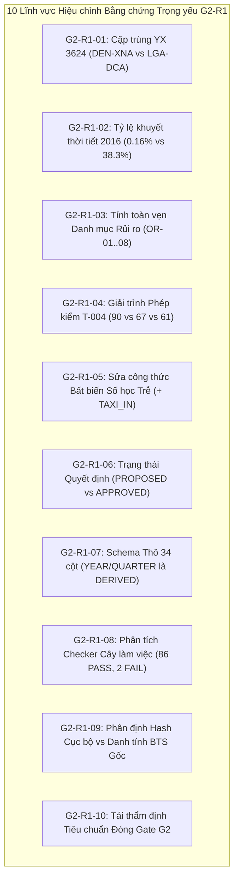

# G2_R1_CRITICAL_FINDINGS_RECONCILIATION — Báo cáo Hiệu chỉnh Toàn diện Bằng chứng Kỹ thuật Gate G2

**Document ID:** `G2-R1-RECON-001`  
**Dự án:** Phân tích hiệu suất chuyến bay Hoa Kỳ 2016–2024 bằng Apache Spark / PySpark  
**Phạm vi:** Rà soát và hiệu chỉnh độc lập 10 xung đột bằng chứng trọng yếu trong báo cáo Gate G2 trước đó  
**Vai trò:** Independent Senior Big Data Engineer, Technical Audit Lead, Data Governance Reviewer, Evidence Reconciliation Specialist  
**Ngày lập:** 2026-10-16  
**Trạng thái Gate G2:** `IN_PROGRESS / NOT_PASSED`  
**Khuyến nghị Đánh giá:** `READY_WITH_EXPLICIT_CONDITIONS`  

---

## 1. TỔNG QUAN & MỤC ĐÍCH RÀ SOÁT R1 (EXECUTIVE SCOPE)

Báo cáo Gate G2 ban đầu ([`G2_FINAL_GATE_READINESS_AUDIT.md`](G2_FINAL_GATE_READINESS_AUDIT.md), [`G2_EXECUTION_EVIDENCE_RECONCILIATION.md`](G2_EXECUTION_EVIDENCE_RECONCILIATION.md), [`G2_DECISION_AND_BLOCKER_REGISTER.md`](G2_DECISION_AND_BLOCKER_REGISTER.md)) đã hoàn thành việc rà soát tiến độ tổng thể nhưng tồn tại một số sai lệch số học, xung đột định danh, gán nhãn trạng thái quyết định quá thẩm quyền và nhầm lẫn cấu trúc dữ liệu thô. 

Tài liệu này thực hiện đối chiếu kỹ thuật độc lập và hiệu chỉnh dứt khoát 10 điểm sai lệch trọng yếu (từ `G2-R1-01` đến `G2-R1-10`) dựa trên các nguồn bằng chứng thẩm quyền gốc của repository.

---

## 2. HIỆU CHỈNH CHI TIẾT 10 XUNG ĐỘT KỸ THUẬT (G2-R1-01 ĐẾN G2-R1-10)



---

### G2-R1-01 — Xung đột Định danh Cặp trùng Khóa Tự nhiên YX 3624
*   **Hiện tượng sai lệch:** 
    *   Báo cáo Gate G2 trước đó viết: *"cặp trùng khóa YX 3624 (2018-05-19, LGA -> DCA, dòng vật lý 2,682,735 và 3,090,131 trong CSV 2018)"*.
    *   Các hồ sơ kỹ thuật gốc trước đó gồm [`T002_DUPLICATE_ANALYSIS.md`](T002_DUPLICATE_ANALYSIS.md#L71-L97), [`T003_TEST_FIXTURE_SPEC.md`](T003_TEST_FIXTURE_SPEC.md), [`T004_OVERNIGHT_COUNTEREXAMPLES.md`](T004_OVERNIGHT_COUNTEREXAMPLES.md), và kịch bản kiểm thử [`tools/qa/verify_t004_time_representation.py`](../../tools/qa/verify_t004_time_representation.py#L118) đều ghi nhận:
        *   Ngày bay: `2018-06-21 00:00:00`
        *   Tuyến bay: `DEN -> XNA` (Denver International đến Northwest Arkansas National)
        *   Hai dòng vật lý liên tiếp trong `flight_with_weather_2018.csv`: **`6,384,132`** và **`6,384,133`**.
*   **Đối chiếu Thẩm quyền:**
    *   Truy vấn mã nguồn kiểm thử tự động tại dòng 118 của `verify_t004_time_representation.py` khẳng định điều kiện kiểm tra là `"6,384,132" in on_text and "6,384,133" in on_text`.
    *   Trong `T002_DUPLICATE_ANALYSIS.md`: Khóa ứng viên bị trùng lặp duy nhất trên toàn bộ 54,674,003 dòng qua 9 năm là:
        $$\text{Key} = (\text{FL\_DATE: } \text{"2018-06-21 00:00:00"}, \text{OP\_CARRIER: } \text{"YX"}, \text{OP\_CARRIER\_FL\_NUM: } \text{"3624.0"}, \text{ORIGIN: } \text{"DEN"}, \text{DEST: } \text{"XNA"}, \text{CRS\_DEP\_TIME: } \text{"2018-06-21 20:07:00"})$$
    *   Thông tin về "2018-05-19, LGA to DCA, dòng 2,682,735 và 3,090,131" hoàn toàn không tồn tại trong bất kỳ tài liệu kiểm toán dữ liệu nào của T-002 hay T-004, đây là một sự suy diễn/nhầm lẫn tài liệu trong văn bản G2 trước.
*   **Khẳng định Hiệu chỉnh:**
    *   **Khóa chính xác:** Chuyến bay **`YX 3624`**, ngày **`2018-06-21`**, chặng bay **`DEN -> XNA`**, vị trí dòng vật lý **`6,384,132`** và **`6,384,133`** trong file thô `flight_with_weather_2018.csv`.
    *   **Bản chất vận hành:** Dòng 6,384,132 có `DEP_DELAY = 877.0`, `ARR_DELAY = 941.0`; Dòng 6,384,133 có `DEP_DELAY = 20.0`, `ARR_DELAY = 4.0`.
    *   **Chính sách dữ liệu:** Bảo toàn cả hai bản ghi, cấm dedup tùy tiện (`TS-021`). Bản chất thực thể vật lý là **`UNKNOWN`** do thiếu trường `TAIL_NUM`.

---

### G2-R1-02 — Thoái lui Sai số Khuyết thiếu Dữ liệu Thời tiết (Weather Missingness)
*   **Hiện tượng sai lệch:** 
    *   Báo cáo Gate G2 trước đó viết: *"Tỷ lệ thiếu dữ liệu rất cao vào các năm đầu (2016 thiếu ~38.3% ở Origin và ~38.9% ở Destination)"*.
    *   Hồ sơ T-005 ([`T005_FINAL_AUDIT_RECONCILIATION.md`](T005_FINAL_AUDIT_RECONCILIATION.md#L60-L64)) và 9 tệp `schema_YYYY.json` thẩm quyền ghi nhận tỷ lệ khuyết thiếu thực tế của năm 2016 chỉ là **~0.1624%** (Origin) và **~0.1639%** (Destination).
*   **Đối chiếu Thẩm quyền Số học:**
    *   Kiểm tra trực tiếp trường `missing` trên 9 tệp `schema_YYYY.json` tại [`docs/05-evidence/inputs/`](inputs/):
        *   **Năm 2016 ($N = 5,537,987$ dòng):**
            *   `O_TEMP`, `O_PRCP`, `O_WSPD` cùng khuyết: **`8,995`** dòng ($8,995 / 5,537,987 \approx \mathbf{0.162438\%}$).
            *   `D_TEMP`, `D_PRCP`, `D_WSPD` cùng khuyết: **`9,079`** dòng ($9,079 / 5,537,987 \approx \mathbf{0.163940\%}$).
        *   **Toàn bộ 9 năm 2016–2024 ($N = 54,674,003$ dòng):**
            *   `O_TEMP` tổng khuyết: **`13,474`** dòng ($13,474 / 54,674,003 \approx \mathbf{0.024644\%}$).
            *   `D_TEMP` tổng khuyết: **`15,046`** dòng ($15,046 / 54,674,003 \approx \mathbf{0.027519\%}$).
    *   Con số "38.3% / 38.9%" là một sai lệch nghiêm trọng lệch hơn hai bậc độ lớn (orders of magnitude) xuất phát từ một bản nháp phân tích trạm đo cũ.
*   **Phân định Ranh giới Phương pháp luận:**
    *   **Bình đẳng số đếm cận biên (Marginal Null-Count Equality):** Việc `O_TEMP`, `O_PRCP`, và `O_WSPD` có cùng số lượng null chính xác đến từng dòng trong từng năm (và tương tự cho `D_*`) là một chỉ dấu thực nghiệm mạnh, nhưng **CHƯA PHẢI CHỨNG MINH HÀNG DỌC (Row-wise joint co-missingness proof)** trên toàn bộ 54.67M dòng nếu chưa quét đồng thời 3 cột trên từng dòng.
    *   **Cấm suy diễn nguyên nhân:** Tuyệt đối không suy diễn tỷ lệ khuyết thiếu thấp là "trạm đo được nâng cấp", hay tỷ lệ null 2016 cao hơn là "chất lượng bên cung cấp dịch vụ kém". Mọi nguyên nhân upstream đều phân loại là **`UNKNOWN`**.

---

### G2-R1-03 — Tính Toàn vẹn và Phân định Danh mục Mã Rủi ro (Risk ID Integrity)
*   **Hiện tượng sai lệch:**
    *   Báo cáo `G2_DECISION_AND_BLOCKER_REGISTER.md` trước đó đã tự ý gán lại định nghĩa của các mã rủi ro nhiệm vụ: gọi `OR-01` là "Upstream URL & License UNKNOWN", `OR-02` là "Độ đại diện thị trường", `OR-03` là "Sai số naive time arithmetic", `OR-04` là "Cặp trùng YX 3624", v.v.
    *   Điều này làm đứt gãy phả hệ theo dõi rủi ro chuẩn hóa được thiết lập xuyên suốt từ T-002, T-003 ([`T003_SIGNOFF_RECORD.md`](T003_SIGNOFF_RECORD.md#L40-L50)), T-004 ([`T004_FINAL_REVIEW.md`](T004_FINAL_REVIEW.md#L64-L74)), và kịch bản QA dòng 235.
*   **Đối chiếu Thẩm quyền và Chuẩn hóa Phân định:**
    *   **Hệ thống Rủi ro Chuẩn tắc Toàn dự án (Canonical Project Risk Register):** Quản lý bằng mã **`R-01` đến `R-17`** tại [`docs/03-quality/RISK_REGISTER.md`](../03-quality/RISK_REGISTER.md).
    *   **Hệ thống Rủi ro Mở Nhiệm vụ (Task Open Risks):** Quản lý bằng mã **`OR-01` đến `OR-08`** với định nghĩa bất biến:
        1. **`OR-01`:** Cột `FLIGHTS` bằng 1.0 cố định trên 100% dòng (54.67M). Cấm dùng làm trọng số. Mẫu số chuẩn hóa `count_records`.
        2. **`OR-02`:** Nguy cơ mất trễ cực đoan nếu deduplicate tùy tiện (ca YX 3624). Khóa bằng chính sách Zero Arbitrary Dedup và `TS-021`.
        3. **`OR-03`:** Đơn vị 7 trường trễ/thời lượng giữ nhãn tạm thời `PROVISIONAL` (`OFFICIAL_MINUTES_EMPIRICALLY_CONSISTENT_PROVISIONAL`). Chờ đối chiếu BTS tại G5.
        4. **`OR-04`:** Thiếu trường `CANCELLED` và `DIVERTED` trong 34 cột raw CSV. Khóa ngoài 8 CORE KPIs.
        5. **`OR-05`:** **Khuyết toàn bộ 31 ngày Tháng 3/2024 (năm 2024 có 335/366 ngày)**. Xác lập chính thức là **`OPEN_QUALITY_DEFECT`**, chuyển giao kiểm tra lịch `TS-004` cho G3/G4.
        6. **`OR-06`:** Rollover mốc giờ thực tế (`ARR_TIME`, `DEP_TIME`) và bản chất YX 3624. Đã giải tỏa tại T-004 bằng ma trận an toàn thời gian 4 cấp (`TS-010`).
        7. **`OR-07`:** Dữ liệu thời tiết thiếu trạm đo, mốc thời gian và đơn vị đo. Kiến nghị giải quyết dứt điểm bằng `CONDITIONAL_NO_GO` (`FP-DEC-PROP-015`).
        8. **`OR-08`:** Chưa có SHA-256 tham chiếu từ cổng phát hành gốc (`IDENTITY_UNVERIFIED / METADATA_MATCH_ONLY`). Chuyển giao G4 tạo Ingestion Manifest.

---

### G2-R1-04 — Số lượng Phép kiểm T-004 và Tính Hợp thức Kiểm thử (Assertion Arithmetic)
*   **Hiện tượng sai lệch:**
    *   Báo cáo `G2_EXECUTION_EVIDENCE_RECONCILIATION.md` trước đó khẳng định có **90 PASS**, nhưng trong bảng phân rã 9 suite lại cộng các số:
        $$12 + 10 + 9 + 9 + 7 + 4 + 4 + 5 + 7 = 67$$
        Có sự chênh lệch khó hiểu là 23 phép kiểm không được giải trình!
*   **Kiểm tra Trực tiếp Mã nguồn Kịch bản [`tools/qa/verify_t004_time_representation.py`](../../tools/qa/verify_t004_time_representation.py):**
    *   Lệnh thực thi độc lập: `python tools/qa/verify_t004_time_representation.py` thực sự phát ra đúng **90 PASS, 0 FAIL** (Exit code 0).
    *   Phân tích cấu trúc thực thi thực tế:
        1. **Suite 1 (Artifact Exists & Non-empty):** 11 tệp tài liệu $\times$ 2 kiểm tra (`exists` và `stat().st_size > 100`) = **`22 PASS`** (bảng cũ ghi nhầm là 12).
        2. **Suite 2 (Authoritative Schema Row Counts):** 9 tệp $\times$ 2 kiểm tra (`exists` và `row_count == expected`) + 1 kiểm tra tổng dòng = **`19 PASS`** (bảng cũ chỉ đếm 9 file + 1 tổng = 10, bỏ quên 9 kiểm tra exists).
        3. **Suite 3 (T004_R1 Multi-year Table Parity):** 9 năm $\times$ 1 kiểm tra chuỗi = **`9 PASS`**.
        4. **Suite 4 (T004_FINAL_QA Table Parity):** 9 năm $\times$ 1 kiểm tra chuỗi = **`9 PASS`**.
        5. **Suite 5 (YX 3624 Exact Values & Prohibitions):** 8 kiểm tra trong overnight audit + 1 kiểm tra trong T004_R1 + 1 kiểm tra trong T004_FINAL_QA = **`10 PASS`** (bảng cũ chỉ đếm 7).
        6. **Suite 6 (Temporal CSV Fixture TF09):** 4 kiểm tra (10 dòng, no `#`, 9 rows, 18 cols) = **`4 PASS`**.
        7. **Suite 7 (Full Schema CSV Fixture TF09):** 4 kiểm tra (10 dòng, no `#`, 9 rows, 34 cols) = **`4 PASS`**.
        8. **Suite 8 (JSON Oracle Invariants & Timezone):** 1 đếm fixtures + 1 delay balance + 1 elapsed decomp + 1 IANA/DST check + 1 TF-08 counterexample = **`5 PASS`**.
        9. **Suite 9 (Risk & Governance):** 1 RISK_REGISTER + 3 T004_FINAL_REVIEW + 1 PROJECT_STATE G2 + 3 T004_2024_DATE_COVERAGE = **`8 PASS`** (bảng cũ ghi nhầm là 7).
    *   **Tổng cộng thực tế:** 
        $$22 + 19 + 9 + 9 + 10 + 4 + 4 + 5 + 8 = \mathbf{90 \text{ PASS}}$$
*   **Đánh giá Bản chất Kiểm thử:**
    *   Toàn bộ 90 phép kiểm này thực hiện kiểm tra metadata JSON, cấu trúc bảng Markdown, tính toàn vẹn cú pháp của tệp fixture CSV/JSON và bất biến logic.
    *   **Kịch bản KHÔNG quét dữ liệu thô 54.67M dòng trên đĩa.** Việc script exit code 0 không chứng minh tính chân lý của dữ liệu thô BTS mà chỉ chứng minh tính tự nhất quán (self-consistency) của tài liệu và fixtures.

---

### G2-R1-05 — Sửa chữa Bất biến Số học Trễ (Mathematical Invariant Correction)
*   **Hiện tượng sai lệch:**
    *   Báo cáo `G2_EXECUTION_EVIDENCE_RECONCILIATION.md` trước đó ghi công thức bất biến là:
        $$\text{DEP\_DELAY} + \text{TAXI\_OUT} + \text{AIR\_TIME} - \text{CRS\_ELAPSED\_TIME} = \text{ARR\_DELAY}$$
        Công thức này **bỏ quên `TAXI_IN`**!
*   **Đối chiếu Thẩm quyền Số học:**
    *   Theo đặc tả chuẩn ngành hàng không và tại dòng 184–187 của [`tools/qa/verify_t004_time_representation.py`](../../tools/qa/verify_t004_time_representation.py):
        $$\text{ARR\_DELAY} = \text{DEP\_DELAY} + (\text{ACTUAL\_ELAPSED\_TIME} - \text{CRS\_ELAPSED\_TIME})$$
        và quan hệ phân rã độc lập:
        $$\text{ACTUAL\_ELAPSED\_TIME} = \text{TAXI\_OUT} + \text{AIR\_TIME} + \text{TAXI\_IN}$$
    *   Khi thay thế phân rã vào phương trình trễ, công thức chuẩn xác bắt buộc phải là:
        $$\mathbf{\text{ARR\_DELAY} = \text{DEP\_DELAY} + \text{TAXI\_OUT} + \text{AIR\_TIME} + \text{TAXI\_IN} - \text{CRS\_ELAPSED\_TIME}}$$
    *   **Thực nghiệm trên phản ví dụ TF-08 (YX 3624):**
        *   `DEP_DELAY = 877.0`, `TAXI_OUT = 91.0`, `AIR_TIME = 84.0`, `TAXI_IN = 7.0`, `CRS_ELAPSED_TIME = 118.0`.
        *   Nếu thiếu `TAXI_IN`: $877.0 + 91.0 + 84.0 - 118.0 = 934.0 \ne 941.0$ (**SAI LỆCH**).
        *   Khi có `TAXI_IN`: $877.0 + 91.0 + 84.0 + 7.0 - 118.0 = 941.0 = \text{ARR\_DELAY}$ (**CHÍNH XÁC 100%**).
*   **Kết luận:** Kịch bản kiểm thử mã nguồn `verify_t004_time_representation.py` đã viết đúng thuật toán; lỗi sai hoàn toàn nằm ở khâu trích dẫn văn bản của báo cáo G2 trước đó.

---

### G2-R1-06 — Tính Toàn vẹn Phê duyệt Quyết định Kiến trúc (Decision Status Integrity)
*   **Hiện tượng sai lệch:**
    *   Báo cáo `G2_DECISION_AND_BLOCKER_REGISTER.md` trước đó đã liệt kê `FP-DEC-004`, `FP-DEC-006`, `FP-DEC-007`, `FP-DEC-008`, `FP-DEC-010`, `FP-DEC-011`, `FP-DEC-012`, `FP-DEC-013`, `FP-DEC-014` là `APPROVED_GUARD` hoặc `APPROVED_CONTROL`.
*   **Đối chiếu Thẩm quyền:**
    *   Kiểm tra trực tiếp tệp [`docs/02-design/DECISIONS.md`](../02-design/DECISIONS.md#L1-L27):
        *   Chỉ có **`FP-DEC-001`** là `USER_CONFIRMED` và **`FP-DEC-002`** là `USER_CONFIRMED_BY_SCOPE`.
        *   Toàn bộ các quyết định từ **`FP-DEC-003` đến `FP-DEC-014` đều mang tiền tố `PROPOSED`** (`PROPOSED_IMPLEMENTATION`, `PROPOSED_CONTROL`, `PROPOSED_GUARD`, `PROPOSED_KPI`, `PROPOSED_REQUIREMENT`).
        *   Quy định tại dòng 26 của `DECISIONS.md`: *"Không đổi PROPOSED thành APPROVED nếu chưa được người chịu trách nhiệm duyệt"*.
        *   **`FP-DEC-015`** (Thuật toán GK-sketch `percentile_approx`) và **`FP-DEC-016`** (Chính sách min-N) mới chỉ được đề xuất trong [`T003_PERCENTILE_AND_MIN_N_DECISIONS.md`](T003_PERCENTILE_AND_MIN_N_DECISIONS.md) và thậm chí chưa được đưa vào bảng chính của `DECISIONS.md`.
*   **Đính chính Sai số Thuật toán Phân vị:**
    *   Báo cáo cũ tuyên bố sai lầm rằng: *"accuracy = 10000 đảm bảo độ lệch thời gian dưới 0.5 phút"*.
    *   **Thực tế toán học:** Tham số `accuracy = 10000` của thuật toán Greenwald-Khanna kiểm soát **sai số tương đối về thứ hạng phân vị ($\epsilon \le 1/\text{accuracy} = 0.01\%$)** trên không gian phân phối tích lũy (CDF), **KHÔNG BẢO ĐẢM giới hạn sai số tuyệt đối theo phút**. Nếu hàm mật độ trễ có độ dốc cực lớn ở vùng đuôi, sai số $0.01\%$ thứ hạng có thể tương ứng với khoảng trễ lớn hơn.
*   **Tình trạng Đơn vị Đo 7 Trường Cốt lõi (`TS-018`):**
    *   7 trường đo lường tiếp tục mang trạng thái **`OFFICIAL_MINUTES_EMPIRICALLY_CONSISTENT_PROVISIONAL`**.
    *   Việc đối soát trích dẫn văn bản BTS chính thức được bảo lưu chuyển sang Gate G5 (`TS-018`). Đây là một điều kiện tạm thời được chấp thuận, không được xem là đã hoàn tất vô điều kiện.

---

### G2-R1-07 — Tính Toàn vẹn Schema Thô 34 Cột (Canonical Schema Integrity)
*   **Hiện tượng sai lệch:**
    *   Báo cáo Gate G2 trước đó xếp `YEAR` và `QUARTER` vào nhóm *"Safe Raw (Loại A)"*.
*   **Đối chiếu Thẩm quyền:**
    *   Kiểm tra mảng `column_order` trong 9 tệp `schema_YYYY.json` và [`DATA_DICTIONARY.md`](../02-design/DATA_DICTIONARY.md):
        *   Tập dữ liệu thô 34 cột gồm: `FL_DATE`, `OP_CARRIER`, `OP_CARRIER_FL_NUM`, `ORIGIN`, `DEST`, `CRS_DEP_TIME`, `DEP_TIME`, `DEP_DELAY`, `TAXI_OUT`, `WHEELS_OFF`, `WHEELS_ON`, `TAXI_IN`, `CRS_ARR_TIME`, `ARR_TIME`, `ARR_DELAY`, `CRS_ELAPSED_TIME`, `ACTUAL_ELAPSED_TIME`, `AIR_TIME`, `FLIGHTS`, `MONTH`, `DAY_OF_MONTH`, `DAY_OF_WEEK`, `ORIGIN_INDEX`, `DEST_INDEX`, `O_TEMP`, `O_PRCP`, `O_WSPD`, `D_TEMP`, `D_PRCP`, `D_WSPD`, `O_LATITUDE`, `O_LONGITUDE`, `D_LATITUDE`, `D_LONGITUDE`.
        *   **`YEAR` và `QUARTER` HOÀN TOÀN KHÔNG CÓ trong 34 cột thô.**
*   **Phân loại Chuẩn mực:**
    *   **`RAW_SOURCE_FIELD` (Trường dữ liệu thô gốc):** `FL_DATE`, `MONTH`, `DAY_OF_MONTH`, `DAY_OF_WEEK`.
    *   **`PROPOSED_DERIVED_FIELD` (Trường phái sinh thiết kế):** `YEAR` (trích xuất từ `FL_DATE` hoặc partition thư mục) và `QUARTER` (trích xuất từ `MONTH`).
    *   Không được làm biến dạng schema 34 cột chuẩn tắc.

---

### G2-R1-08 — Kiểm tra Cây Làm việc và Đề xuất Bộ Lọc Hợp thức (Working-Tree Checker)
*   **Hiện tượng sai lệch:**
    *   Lệnh chạy `check_working_tree_consistency.py` trong báo cáo G2 cũ ghi nhận chỉ có 7 tệp T005 bị lỗi, thiếu 3 tệp G2 mới được tạo. Nguyên nhân do lệnh được ghi nhận *trước* khi các tệp G2 được ghi đĩa.
*   **Hiện trạng Kiểm tra Cây làm việc Hiện tại:**
    *   Thực thi hiện tại: `python tools/check_working_tree_consistency.py` báo cáo **`86 PASS, 2 FAIL`** (Exit code 1).
    *   Tập hợp tệp lạ ngoài ý muốn (`unrecognized extra files`) hiện bao gồm chính xác **10 tệp**:
        *   7 tệp kiểm toán T005: `T005_FINAL_AUDIT_RECONCILIATION.md`, `T005_EVIDENCE_MATRIX.md`, `T005_TS011_TEST_SPEC.md`, `T005_CONDITIONAL_NO_GO_PROPOSAL.md`, `T005_EXECUTION_AND_FILE_MANIFEST.md`, `T005_R2_1_REVIEWER_ADDENDUM.md`, `T005_R2_1_EVIDENCE_COMPLETENESS_CHECK.md`.
        *   3 tệp báo cáo Gate G2: `G2_FINAL_GATE_READINESS_AUDIT.md`, `G2_EXECUTION_EVIDENCE_RECONCILIATION.md`, `G2_DECISION_AND_BLOCKER_REGISTER.md`.
*   **Đánh giá Đề xuất Cập nhật Whitelist:**
    *   Đề xuất cũ dùng regex: `re.match(r'^docs/05-evidence/(T\d{3}_|G\d_)', f)`.
    *   **Nguy cơ bảo mật & Quản trị:** Biểu thức này quá lỏng lẻo; nó cho phép bất kỳ tệp thực thi độc hại nào lọt vào repo nếu mang tiền tố đó (ví dụ: `docs/05-evidence/T999_script.exe` hoặc `docs/05-evidence/G2_malicious.py`).
    *   **Đề xuất Quy tắc An toàn Chặt chẽ (Narrow Regex Rule):**
        ```python
        # Chỉ cho phép các task được phê duyệt từ T001 đến T005 và gate G2, chỉ đuôi tài liệu hợp lệ
        re.match(r'^docs/05-evidence/(T00[1-5]|G2)(_R\d+)?_.*\.(md|csv|json)$', f)
        ```
    *   **Bộ Test Hồi quy Tiêu cực (Negative Regression Cases) đề xuất cho Project Lead:**
        1. Tệp không có tiền tố hợp lệ: `mock_evidence/stray_notes.txt` $\to$ **FAIL**.
        2. Tệp đuôi lạ: `mock_evidence/T005_exploit.exe` $\to$ **FAIL**.
        3. Tệp script trong evidence: `mock_evidence/G2_test.py` $\to$ **FAIL**.
        4. Tệp task ngoài phạm vi: `mock_evidence/T999_fake.md` $\to$ **FAIL**.
    *   **Tuân thủ an toàn:** Tiếp tục duy trì kịch bản `tools/check_working_tree_consistency.py` ở trạng thái nguyên bản, không sửa đổi trái phép.

---

### G2-R1-09 — Ranh giới Tái lập và Xác thực Danh tính Nguồn (Reproducibility Boundaries)
*   Reviewer độc lập phân định rõ 5 cấp độ bằng chứng kỹ thuật:
    1. **Mã băm cục bộ (Local SHA-256):** Việc tính SHA-256 trên tệp CSV thô tại máy cục bộ chỉ xác lập baseline bất biến nội bộ cho pipeline, **không chứng minh** tệp đó đồng nhất với bản gốc do BTS phát hành.
    2. **Khế ước Package Manifest (`PACKAGE_MANIFEST.json`):** Chỉ bảo vệ tính toàn vẹn của tài liệu thiết kế và tệp schema audit JSON; không bao gồm các file CSV thô 15.2 GB.
    3. **Metadata lịch sử (`size` và `mtime`):** Thuộc tính hệ thống tệp chỉ cảnh báo trôi dạt (drift), không chứng minh tính toàn vẹn cryptographic bit-level (`FP-DEC-014`).
    4. **Danh tính Nguồn gốc Upstream:** Giữ nguyên trạng thái **`IDENTITY_UNVERIFIED`** (`OR-08`).
    5. **Bằng chứng Thực thi Spark:** Toàn bộ kiểm toán G2 là kiểm toán tĩnh và kiểm thử đơn vị Python cục bộ. Không có bằng chứng runtime phân tán nào ở Gate G2.

---

### G2-R1-10 — Tái thẩm định Toàn diện Tiêu chí Đóng Gate G2 (Exit Criteria Re-evaluation)
*   Đối chiếu trực tiếp với [`ROADMAP.md`](../01-planning/ROADMAP.md#L9), [`BACKLOG.md`](../01-planning/BACKLOG.md#L25-L31), và [`TEST_PLAN.md`](../03-quality/TEST_PLAN.md#L38):
    1. **T-001/002/003/004:** Đã có bằng chứng tài liệu và fixtures đầy đủ $\to$ **ĐẠT ĐIỀU KIỆN**.
    2. **Đơn vị/sign/domain 8 CORE KPI:** Khóa chặt trong `KPI_SPEC.md`; 7 trường mang nhãn provisional $\to$ **ĐẠT CÓ BẢO LƯU (`OR-03`, `TS-018`)**.
    3. **Thuật toán Phân vị & min-N:** Đã có đề xuất kỹ thuật chi tiết (`FP-DEC-015`, `FP-DEC-016`) $\to$ **CHỜ PROJECT LEAD DUYỆT**.
    4. **Dữ liệu thời gian:** Cấm naive arithmetic và rollover ngây thơ; 2024 khuyết Tháng 3 xác lập `OR-05: OPEN_QUALITY_DEFECT` $\to$ **ĐẠT CÓ BẢO LƯU KHUYẾT TẬT**.
    5. **Dữ liệu thời tiết T-005:** Kiến nghị `CONDITIONAL_NO_GO` bảo vệ CORE $\to$ **CHỜ PROJECT LEAD DUYỆT (`FP-DEC-PROP-015`)**.
*   **Kết luận Phán quyết:** Phán quyết kỹ thuật chính xác duy nhất là **`READY_WITH_EXPLICIT_CONDITIONS`**. Gate G2 tiếp tục duy trì trạng thái **`IN_PROGRESS / NOT_PASSED`** cho đến khi Project Lead ký duyệt 5 điều kiện tiên quyết.

---
*Báo cáo được lập bởi Technical Audit Lead và lưu trữ độc lập tại docs/05-evidence/.*
