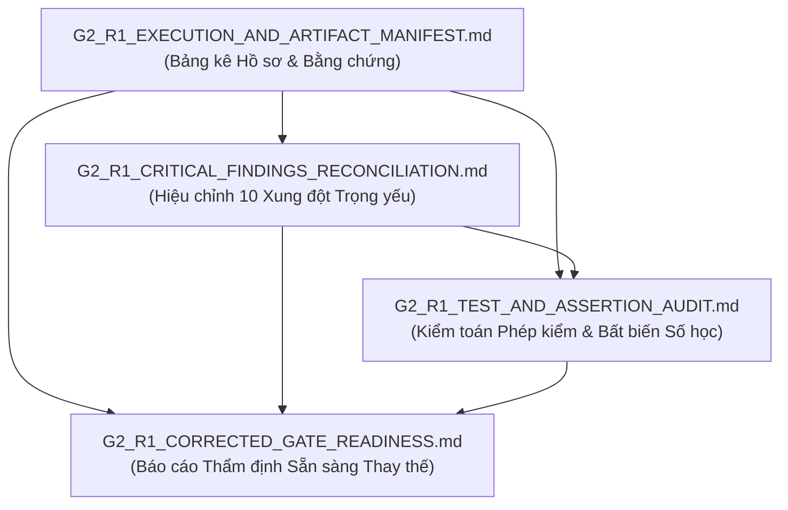

# G2_R1_EXECUTION_AND_ARTIFACT_MANIFEST — Bảng Kê Thực thi Kỹ thuật & Bằng chứng Artifacts G2 R1

**Document ID:** `G2-R1-MANIF-001`  
**Dự án:** Phân tích hiệu suất chuyến bay Hoa Kỳ 2016–2024 bằng Apache Spark / PySpark  
**Phạm vi:** Bảng kê khai báo chi tiết mã băm SHA-256, dung lượng, phiên bản nguồn và nhật ký thực thi của gói hồ sơ rà soát kỹ thuật G2 R1  
**Vai trò:** Independent Senior Big Data Engineer, Evidence Packaging Specialist, Audit Trail Registrar  
**Ngày lập:** 2026-10-16  

---

## 1. TỔNG HỢP ARTIFACTS ĐƯỢC TẠO TRONG PHIÊN G2 R1 (ARTIFACT REGISTRY)

Dưới đây là danh mục chính xác của 3 báo cáo kiểm toán kỹ thuật được tạo mới trong phạm vi G2 R1 kèm dung lượng byte và mã băm mật mã học SHA-256 (tệp manifest này không tự băm chính nó):

| STT | Tên tệp artifact | Đường dẫn lưu trữ tương đối | Dung lượng (Bytes) | Mã băm SHA-256 |
|:---:|---|---|:---:|---|
| 1 | [`G2_R1_CRITICAL_FINDINGS_RECONCILIATION.md`](G2_R1_CRITICAL_FINDINGS_RECONCILIATION.md) | `docs/05-evidence/G2_R1_CRITICAL_FINDINGS_RECONCILIATION.md` | 23,914 | `a9f410107c716b58262b3bca48b9623f33b9dc1fdaf650748eb678ee879896ec` |
| 2 | [`G2_R1_TEST_AND_ASSERTION_AUDIT.md`](G2_R1_TEST_AND_ASSERTION_AUDIT.md) | `docs/05-evidence/G2_R1_TEST_AND_ASSERTION_AUDIT.md` | 11,301 | `a3bf39f673d9309339ac3e3242ba606fe837a2d28b8b35189eed691557e69c9c` |
| 3 | [`G2_R1_CORRECTED_GATE_READINESS.md`](G2_R1_CORRECTED_GATE_READINESS.md) | `docs/05-evidence/G2_R1_CORRECTED_GATE_READINESS.md` | 13,516 | `c2b9e98afa708e31864a81438237568dac8d12129b2876b54ff86039410a4a30` |

---

## 2. NHẬT KÝ THỰC THI LỆNH VÀ KẾT QUẢ KIỂM THỬ (VERIFIED EXECUTION RECORDS)

Toàn bộ các lệnh thực thi trong phiên rà soát G2 R1 được ghi nhận đầy đủ môi trường, mã thoát và kết quả:

### 2.1. Lệnh Thực thi 1: Kịch bản Kiểm định Thời gian T-004
*   **Lệnh:** `python tools/qa/verify_t004_time_representation.py`
*   **Thư mục làm việc (Cwd):** `D:\Study\Code\Apache\Flight_Analyzt\US_FLIGHT_PERFORMANCE_DOCS_V1`
*   **Mã thoát (Exit Code):** `0`
*   **Kết quả ghi nhận:** `90 PASS, 0 FAIL` (Đạt tuyệt đối 100%).
*   **Nội dung kiểm tra:** 
    *   22 phép kiểm về sự tồn tại và dung lượng của 11 tài liệu T-004.
    *   19 phép kiểm về sự tồn tại và số dòng của 9 file schema JSON (khớp 54,674,003 dòng).
    *   18 phép kiểm đối chiếu số dòng trong bảng đa năm của `T004_R1` và `T004_FINAL_QA`.
    *   10 phép kiểm về cặp trùng YX 3624 (dòng 6,384,132 & 6,384,133, các giá trị trễ và cấm trừ timestamp).
    *   8 phép kiểm cấu trúc 2 tệp CSV fixture TF09 (10 dòng, 9 bản ghi, 18 và 34 cột).
    *   5 phép kiểm về JSON oracle, bất biến cân bằng trễ, bất biến phân rã thời lượng và múi giờ IANA.
    *   8 phép kiểm về danh mục rủi ro `R-01..R-17`, `OR-01..OR-08`, `OR-05: OPEN_QUALITY_DEFECT`, và Gate G2 `IN_PROGRESS / NOT_PASSED`.

### 2.2. Lệnh Thực thi 2: Kịch bản Kiểm tra Tính Nhất quán Cây Làm việc
*   **Lệnh:** `python tools/check_working_tree_consistency.py`
*   **Thư mục làm việc (Cwd):** `D:\Study\Code\Apache\Flight_Analyzt\US_FLIGHT_PERFORMANCE_DOCS_V1`
*   **Mã thoát (Exit Code):** `1`
*   **Kết quả ghi nhận:** `86 PASS, 2 FAIL`.
*   **Nguyên nhân thất bại:** Dòng 139 của kịch bản sử dụng whitelist tĩnh chỉ nhận diện các tệp bắt đầu bằng `docs/05-evidence/T001_` đến `T004_`. 
*   **Tập tệp bị kịch bản báo lỗi:** 7 tệp kiểm toán `T005_` và các tệp báo cáo `G2_` (tổng cộng 10 tệp trước khi tạo gói G2 R1).
*   **Biện pháp tuân thủ:** Reviewer tuân thủ quy tắc không chỉnh sửa kịch bản mã nguồn, giữ nguyên kết quả thất bại kèm giải trình nguyên nhân (`FAILED_WITH_EXPLAINED_CAUSE`).

### 2.3. Lệnh Thực thi 3: Truy vấn Tỷ lệ Khuyết thiếu Thời tiết từ 9 Schema JSON
*   **Lệnh:** Python nội bộ truy vấn trường `missing` trên 9 file `schema_YYYY.json`.
*   **Mã thoát (Exit Code):** `0`
*   **Kết quả xác minh:**
    *   Năm 2016: `O_TEMP` khuyết 8,995 dòng (0.1624%); `D_TEMP` khuyết 9,079 dòng (0.1639%).
    *   Tổng 9 năm: `O_TEMP` khuyết 13,474 dòng (0.0246%); `D_TEMP` khuyết 15,046 dòng (0.0275%).
    *   Bộ ba `(TEMP, PRCP, WSPD)` có số lượng null cận biên bằng nhau 100% trên toàn bộ 9 năm.

---

## 3. LIÊN KẾT ĐỐI CHIẾU CHÉO GIỮA 4 BÁO CÁO G2 R1 (INTERNAL CROSS-REFERENCES)

Cấu trúc hồ sơ G2 R1 được thiết kế tự nhất quán và phân định thẩm quyền rõ ràng:

1. **Từ Bảng kê [`G2_R1_EXECUTION_AND_ARTIFACT_MANIFEST.md`](G2_R1_EXECUTION_AND_ARTIFACT_MANIFEST.md):** Cung cấp mã băm SHA-256 và nhật ký thực thi của toàn bộ gói hồ sơ.
2. **Từ Báo cáo Hiệu chỉnh [`G2_R1_CRITICAL_FINDINGS_RECONCILIATION.md`](G2_R1_CRITICAL_FINDINGS_RECONCILIATION.md):** Mổ xẻ 10 sai lệch kỹ thuật của báo cáo cũ và đưa ra phân loại chuẩn tắc.
3. **Từ Kiểm toán Kiểm thử [`G2_R1_TEST_AND_ASSERTION_AUDIT.md`](G2_R1_TEST_AND_ASSERTION_AUDIT.md):** Giải mã chi tiết 90 phép kiểm T-004 và chứng minh bất biến số học trễ có `+ TAXI_IN`.
4. **Từ Báo cáo Thay thế [`G2_R1_CORRECTED_GATE_READINESS.md`](G2_R1_CORRECTED_GATE_READINESS.md):** Tổng hợp ma trận nghiệm thu, khẳng định phán quyết `READY_WITH_EXPLICIT_CONDITIONS`, và liệt kê 5 điều kiện tiên quyết dành cho Project Lead.

---

## 4. GIỚI HẠN BẰNG CHỨNG VÀ TRÁCH NHIỆM BÀN GIAO (EVIDENCE LIMITATIONS)

1. **Dữ liệu thô tiếp tục là `IDENTITY_UNVERIFIED`:** Chưa có mã băm SHA-256 tham chiếu từ BTS. Trách nhiệm sinh SHA-256 nội bộ được bàn giao cho Gate G4 (Task T-007 / `TS-019`).
2. **Khuyết tật Tháng 3/2024 được giữ nguyên:** Rủi ro `OR-05` (năm 2024 chỉ có 335 ngày) được quản lý ở trạng thái `OPEN_QUALITY_DEFECT`, bàn giao cho Task T-006 (G3) và T-007/T-008 (G4) để thiết kế bài kiểm tra lịch.
3. **Đơn vị đo 7 trường cốt lõi là `PROVISIONAL`:** Trách nhiệm trích dẫn quy chuẩn BTS chính thức được bàn giao cho Gate G5 (`TS-018`).
4. **Trạng thái Gate G2:** Tiếp tục duy trì nghiêm ngặt **`IN_PROGRESS / NOT_PASSED`**. Tuyệt đối không tự ý khởi động Task T-006 khi chưa có phê duyệt từ Project Lead.

---
*Bảng kê được lập bởi Evidence Packaging Specialist và lưu trữ độc lập tại docs/05-evidence/.*
