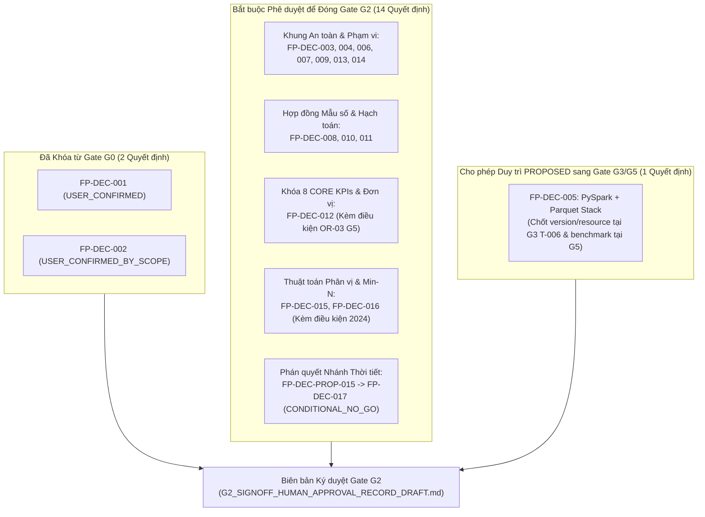

# G2_SIGNOFF_DECISION_APPROVAL_MATRIX — Ma trận Thẩm định và Phê duyệt Quyết định Kiến trúc Gate G2

**Document ID:** `G2-SIGNOFF-DAM-001`  
**Dự án:** Phân tích hiệu suất chuyến bay Hoa Kỳ 2016–2024 bằng Apache Spark / PySpark  
**Gate kiểm soát:** `Gate G2` (Data Understanding, Cohort, Units, Time Safety & Weather Usability Contracts)  
**Phạm vi:** Đánh giá chi tiết từng quyết định kiến trúc (`FP-DEC-001` đến `FP-DEC-016` và `FP-DEC-PROP-015`) phục vụ phê duyệt của Project Lead  
**Trạng thái tài liệu:** `GOVERNANCE_PREPARATION_PACKAGE / PENDING_HUMAN_APPROVAL`  
**Trạng thái Gate G2 hiện hành:** `IN_PROGRESS / NOT_PASSED`  
**Ngày lập:** 2026-10-16  

---

## 1. MỤC ĐÍCH & NGUYÊN TẮC QUẢN TRỊ (GOVERNANCE PRINCIPLES)

Tài liệu này cung cấp hồ sơ thẩm định đầy đủ cho **17 quyết định thiết kế và kiểm soát kỹ thuật** liên quan đến Gate G2, tuân thủ nghiêm ngặt [`AGENTS.md`](../../AGENTS.md), [`DECISIONS.md`](../02-design/DECISIONS.md), [`DATA_CONTRACT.md`](../02-design/DATA_CONTRACT.md), [`KPI_SPEC.md`](../02-design/KPI_SPEC.md), [`ROADMAP.md`](../01-planning/ROADMAP.md) và [`BACKLOG.md`](../01-planning/BACKLOG.md):

1. **Không tự động nâng cấp trạng thái (`No Silent Promotion`):** Trong [`DECISIONS.md`](../02-design/DECISIONS.md), chỉ có `FP-DEC-001` (`USER_CONFIRMED`) và `FP-DEC-002` (`USER_CONFIRMED_BY_SCOPE`) đã được người dùng xác nhận. Toàn bộ `FP-DEC-003` đến `FP-DEC-014` hiện đang ở trạng thái `PROPOSED_*`, và 3 đề xuất mới từ T-003 / T-005 đang ở trạng thái `PROPOSED_DECISION_PENDING_REVIEW`. Không một quyết định `PROPOSED` nào được xem là `APPROVED` khi chưa có chữ ký phê duyệt của Project Lead.
2. **Giải quyết xung đột mã định danh (`ID Collision Resolution`):**
   - Hồ sơ T-003 ([`T003_PERCENTILE_AND_MIN_N_DECISIONS.md`](T003_PERCENTILE_AND_MIN_N_DECISIONS.md)) đề xuất `FP-DEC-015` (Thuật toán phân vị P50/P90) và `FP-DEC-016` (Chính sách ngưỡng min-N).
   - Hồ sơ T-005 ([`T005_CONDITIONAL_NO_GO_PROPOSAL.md`](T005_CONDITIONAL_NO_GO_PROPOSAL.md)) dùng mã đề xuất `FP-DEC-PROP-015` ở phần đầu nhưng lại ghi `FP-DEC-015` tại mẫu chữ ký mục 6, gây trùng mã với quyết định phân vị của T-003.
   - **Quy tắc chuẩn hóa trình duyệt:** Giữ nguyên `FP-DEC-015` cho Thuật toán Phân vị (T-003), `FP-DEC-016` cho Chính sách min-N (T-003), và cấp mã chính thức **`FP-DEC-017`** cho Quyết định `CONDITIONAL_NO_GO` của Nhánh Thời tiết (`FP-DEC-PROP-015`) khi Project Lead phê duyệt đưa vào [`DECISIONS.md`](../02-design/DECISIONS.md).
3. **Phân nhóm bắt buộc trước khi đóng Gate G2 vs. cho phép hoãn có điều kiện:**
   - **Nhóm A (Đã xác nhận ở G0 — Giữ nguyên hiệu lực):** `FP-DEC-001`, `FP-DEC-002`.
   - **Nhóm B (Bắt buộc phê duyệt trước khi đóng Gate G2 — Mandatory Before G2 Closeout):** `FP-DEC-003`, `FP-DEC-004`, `FP-DEC-006`, `FP-DEC-007`, `FP-DEC-008`, `FP-DEC-009`, `FP-DEC-010`, `FP-DEC-011`, `FP-DEC-012` *(kèm điều kiện bảo lưu đơn vị đo G5)*, `FP-DEC-013`, `FP-DEC-014`, `FP-DEC-015` *(khóa hợp đồng thuật toán ở G2, kiểm chuẩn thực nghiệm ở G5)*, `FP-DEC-016` *(kèm quy tắc chú giải năm thiếu tháng 2024)*, và `FP-DEC-PROP-015` / `FP-DEC-017`.
   - **Nhóm C (Cho phép duy trì `PROPOSED` qua G2 và khóa chính thức tại Gate G3/G5 — Deferrable With Explicit Restrictions):** `FP-DEC-005` (Chọn PySpark + Parquet làm engine xử lý chính; phiên bản Spark cụ thể, cấu hình bộ nhớ và benchmark thực tế thuộc phạm vi thiết kế `T-006` tại Gate G3 và kiểm chứng `TS-014` tại Gate G5).

---

## 2. BẢNG TỔNG HỢP PHÂN LOẠI 17 QUYẾT ĐỊNH KIẾN TRÚC (SUMMARY OVERVIEW)

| ID hiện hành | Mã chuẩn hóa đề xuất | Trạng thái hiện tại trong Repo | Chủ đề kỹ thuật | Nguồn thẩm quyền | Phân loại đối với Gate G2 | Khuyến nghị phê duyệt |
|---|---|---|---|---|---|---|
| `FP-DEC-001` | `FP-DEC-001` | `USER_CONFIRMED` | Phạm vi phân tích mô tả 2016–2024 (không tập trung ML) | [`DECISIONS.md`](../02-design/DECISIONS.md#L7) | Đã chốt ở G0 (Nền tảng G2) | Duy trì `USER_CONFIRMED` |
| `FP-DEC-002` | `FP-DEC-002` | `USER_CONFIRMED_BY_SCOPE` | Sử dụng năm 2024 cho phân tích mô tả hồi cứu | [`DECISIONS.md`](../02-design/DECISIONS.md#L8) | Đã chốt ở G0 (Nền tảng G2) | Duy trì `USER_CONFIRMED_BY_SCOPE` |
| `FP-DEC-003` | `FP-DEC-003` | `PROPOSED_IMPLEMENTATION` | Loại trừ ML, ATL-only, Flight Chain `.pt` khỏi CORE | [`DECISIONS.md`](../02-design/DECISIONS.md#L9) | **Bắt buộc trước G2** | Phê duyệt `APPROVED` |
| `FP-DEC-004` | `FP-DEC-004` | `PROPOSED_CONTROL` | Raw immutable & output phân phiên bản theo `run_id` | [`DECISIONS.md`](../02-design/DECISIONS.md#L10) | **Bắt buộc trước G2** | Phê duyệt `APPROVED` |
| `FP-DEC-005` | `FP-DEC-005` | `PROPOSED` | Sử dụng PySpark + Parquet cho xử lý chính | [`DECISIONS.md`](../02-design/DECISIONS.md#L11) | **Cho phép hoãn sang G3/G5** | Duy trì `PROPOSED` (Khóa thiết kế ở G3 `T-006`) |
| `FP-DEC-006` | `FP-DEC-006` | `PROPOSED_GUARD` | Cấm tính KPI canceled/diverted từ 34 cột hiện hữu | [`DECISIONS.md`](../02-design/DECISIONS.md#L12) | **Bắt buộc trước G2** | Phê duyệt `APPROVED` |
| `FP-DEC-007` | `FP-DEC-007` | `PROPOSED_GUARD` | Cấm suy diễn timeline qua đêm từ date của `CRS_ARR_TIME` | [`DECISIONS.md`](../02-design/DECISIONS.md#L13) | **Bắt buộc trước G2** | Phê duyệt `APPROVED` |
| `FP-DEC-008` | `FP-DEC-008` | `PROPOSED_KPI` | Ngưỡng `ARR_DELAY >= 15` trên mẫu số hữu hạn | [`DECISIONS.md`](../02-design/DECISIONS.md#L14) | **Bắt buộc trước G2** | Phê duyệt `APPROVED` |
| `FP-DEC-009` | `FP-DEC-009` | `PROPOSED` | Weather mở rộng có điều kiện, cấm suy diễn nhân quả | [`DECISIONS.md`](../02-design/DECISIONS.md#L15) | **Bắt buộc trước G2** | Phê duyệt `APPROVED` |
| `FP-DEC-010` | `FP-DEC-010` | `PROPOSED_GUARD` | Cấm dùng `FLIGHTS` làm trọng số; mẫu số `count_records` | [`DECISIONS.md`](../02-design/DECISIONS.md#L16) | **Bắt buộc trước G2** | Phê duyệt `APPROVED` |
| `FP-DEC-011` | `FP-DEC-011` | `PROPOSED_CONTROL` | Phân biệt `metric_valid_rate` vs `source_coverage_status`; hạch toán 3 trạng thái dòng loại trừ nhau | [`DECISIONS.md`](../02-design/DECISIONS.md#L17) | **Bắt buộc trước G2** | Phê duyệt `APPROVED` |
| `FP-DEC-012` | `FP-DEC-012` | `PROPOSED_REQUIREMENT` | Khóa 8 CORE KPIs & xác minh đơn vị/dấu/miền của 7 trường đo | [`DECISIONS.md`](../02-design/DECISIONS.md#L18) | **Bắt buộc trước G2** *(kèm bảo lưu G5)* | Phê duyệt `APPROVED_WITH_CONDITION` |
| `FP-DEC-013` | `FP-DEC-013` | `PROPOSED_CONTROL` | Weather là `Should/conditional`: `GO` hoặc `CONDITIONAL_NO_GO`, không chặn CORE | [`DECISIONS.md`](../02-design/DECISIONS.md#L19) | **Bắt buộc trước G2** | Phê duyệt `APPROVED` |
| `FP-DEC-014` | `FP-DEC-014` | `PROPOSED_CONTROL` | `size/mtime` chỉ cảnh báo drift, không chứng minh danh tính nội dung thô | [`DECISIONS.md`](../02-design/DECISIONS.md#L20) | **Bắt buộc trước G2** | Phê duyệt `APPROVED` |
| `FP-DEC-015` | `FP-DEC-015` | `PROPOSED_DECISION_PENDING_REVIEW` | Thuật toán phân vị P50/P90 (`percentile_approx` GK-sketch `accuracy=10000`) | [`T003_PERCENTILE_AND_MIN_N_DECISIONS.md`](T003_PERCENTILE_AND_MIN_N_DECISIONS.md#L60-L84) | **Bắt buộc trước G2** *(khóa spec, G5 benchmark)* | Phê duyệt `APPROVED_WITH_G5_BENCHMARK` |
| `FP-DEC-016` | `FP-DEC-016` | `PROPOSED_DECISION_PENDING_REVIEW` | Chính sách ngưỡng cỡ mẫu tối thiểu min-N (`1000 / 365 / 100`) | [`T003_PERCENTILE_AND_MIN_N_DECISIONS.md`](T003_PERCENTILE_AND_MIN_N_DECISIONS.md#L115-L136) | **Bắt buộc trước G2** | Phê duyệt `APPROVED_WITH_2024_CAVEAT` |
| `FP-DEC-PROP-015` | `FP-DEC-017` | `PROPOSAL_PENDING_REVIEW` | Ban hành `CONDITIONAL_NO_GO` cho nhánh thời tiết tùy chọn (`RQ-06`/`KPI-10`) | [`T005_CONDITIONAL_NO_GO_PROPOSAL.md`](T005_CONDITIONAL_NO_GO_PROPOSAL.md#L9-L15) | **Bắt buộc trước G2** | Phê duyệt `APPROVED` (`CONDITIONAL_NO_GO`) |

---

## 3. ĐÁNH GIÁ CHI TIẾT TỪNG QUYẾT ĐỊNH (DECISION-BY-DECISION ASSESSMENT)

### 3.1. `FP-DEC-001` — Phạm vi Đồ án Phân tích Hiệu suất Chuyến bay Hoa Kỳ 2016–2024
- **Decision ID:** `FP-DEC-001`
- **Exact Current Status:** `USER_CONFIRMED` (xác nhận ngày 2026-10-13)
- **Technical Subject:** Định hướng đồ án là phân tích mô tả dữ liệu lớn quan sát (observational/descriptive study) giai đoạn 2016–2024, không tập trung vào mô hình học máy dự báo.
- **Authoritative Source:** [`docs/02-design/DECISIONS.md`](../02-design/DECISIONS.md#L7), [`docs/01-planning/PRD.md`](../01-planning/PRD.md).
- **Evidence Supporting the Proposal:** Xác nhận trực tiếp của người dùng; báo cáo rà soát [`docs/03-quality/G0_G1_REVIEW.md`](../03-quality/G0_G1_REVIEW.md).
- **Impact on CORE KPIs and Gate G2:** Định hình toàn bộ hệ thống câu hỏi nghiên cứu `RQ-01..RQ-05` và danh mục `KPI-01..KPI-08`.
- **Required Approval Authority:** Project Lead / User (Đã xác nhận).
- **Mandatory Before G2 vs. Deferrable:** Đã hoàn tất từ Gate G0; là tiền đề bất biến cho Gate G2.
- **Recommended Disposition and Rationale:** **Duy trì `USER_CONFIRMED`**. Không cần phê duyệt lại.
- **Consequence of Rejection:** Phá vỡ toàn bộ kiến trúc tài liệu `docs-v1.1` và buộc tái thiết kế từ Gate G0.
- **Residual Risk:** `R-14` (Rubric chấm điểm và yêu cầu chi tiết của giảng viên vẫn cần đối chiếu khi trình bày báo cáo ở G7).

### 3.2. `FP-DEC-002` — Sử dụng Dữ liệu Năm 2024 cho Phân tích Mô tả Toàn kỳ
- **Decision ID:** `FP-DEC-002`
- **Exact Current Status:** `USER_CONFIRMED_BY_SCOPE`
- **Technical Subject:** Đưa năm 2024 vào phạm vi thống kê mô tả 9 năm (2016–2024), bãi bỏ quy tắc coi 2024 là tập kiểm thử kín (*sealed ML holdout*) của đề tài dự báo Aeolus cũ.
- **Authoritative Source:** [`docs/02-design/DECISIONS.md`](../02-design/DECISIONS.md#L8), [`docs/02-design/ANALYSIS_PROTOCOL.md`](../02-design/ANALYSIS_PROTOCOL.md).
- **Evidence Supporting the Proposal:** Yêu cầu phạm vi của người dùng; kiểm toán độ bao phủ ngày năm 2024 tại [`T004_2024_DATE_COVERAGE_AUDIT.md`](T004_2024_DATE_COVERAGE_AUDIT.md).
- **Impact on CORE KPIs and Gate G2:** Cho phép tính toán `KPI-01..KPI-08` trên năm 2024; đồng thời phát sinh yêu cầu quản trị khuyết tật thiếu 31 ngày Tháng 3/2024 (`OR-05`, 335/366 ngày).
- **Required Approval Authority:** Project Lead / User (Đã xác nhận phạm vi; cần ký nhận thêm điều kiện khuyết tật `OR-05` ở G2).
- **Mandatory Before G2 vs. Deferrable:** Đã xác nhận từ G0; điều kiện đi kèm về biên lịch năm 2024 bắt buộc gắn vào biên bản đóng G2.
- **Recommended Disposition and Rationale:** **Duy trì `USER_CONFIRMED_BY_SCOPE`**, bổ sung ràng buộc công bố rõ năm 2024 là năm khuyết Tháng 3 (`335/366` ngày) trong mọi bảng tổng hợp.
- **Consequence of Rejection:** Nếu loại bỏ năm 2024, đồ án chỉ còn giai đoạn 2016–2023, trái với mục tiêu đề tài 2016–2024.
- **Residual Risk:** `OR-05` (`OPEN_QUALITY_DEFECT` — thiếu toàn bộ Tháng 3/2024 làm lệch tính thời vụ mùa xuân và tổng sản lượng năm 2024 nếu so sánh ngang bằng không có chú thích).

### 3.3. `FP-DEC-003` — Loại trừ Machine Learning, ATL-only và Flight Chain `.pt` khỏi CORE
- **Decision ID:** `FP-DEC-003`
- **Exact Current Status:** `PROPOSED_IMPLEMENTATION`
- **Technical Subject:** Đặt Machine Learning, bài toán dự báo riêng sân bay ATL, các tệp đồ thị chuỗi bay PyTorch `.pt` và Flight Network ra ngoài phạm vi CORE; nghiêm cấm gọi `torch.load` trên các tệp `.pt` không rõ nguồn gốc.
- **Authoritative Source:** [`docs/02-design/DECISIONS.md`](../02-design/DECISIONS.md#L9), [`docs/03-quality/SECURITY.md`](../03-quality/SECURITY.md), [`AGENTS.md`](../../AGENTS.md).
- **Evidence Supporting the Proposal:** Báo cáo kiểm toán lịch sử cho thấy tệp `.pt` mang trạng thái `NO_GO` và chứa nguy cơ thực thi mã tùy ý (*arbitrary code execution* qua `pickle` trong `torch.load`).
- **Impact on CORE KPIs and Gate G2:** Giữ cho luồng CORE KPI hoàn toàn dựa trên dữ liệu bảng CSV/Parquet an toàn; loại bỏ rủi ro bảo mật `R-11`.
- **Required Approval Authority:** Project Lead.
- **Mandatory Before G2 vs. Deferrable:** **Bắt buộc phê duyệt trước khi đóng Gate G2** để khóa phạm vi thiết kế kiến trúc G3 (`T-006`).
- **Recommended Disposition and Rationale:** **Phê duyệt chuyển sang `APPROVED`**. Đây là hàng rào an ninh và phạm vi cốt tử của đồ án.
- **Consequence of Rejection:** Mở lại nguy cơ mất an toàn bảo mật (`R-11`) và làm chệch hướng đồ án sang ML lịch sử.
- **Residual Risk:** Thấp (được kiểm soát hoàn toàn nếu duy trì lệnh cấm đọc `.pt` trong CI/CD ở G4).

### 3.4. `FP-DEC-004` — Bất biến Dữ liệu Thô (`Raw Immutable`) và Đầu ra Phân Phiên bản theo `run_id`
- **Decision ID:** `FP-DEC-004`
- **Exact Current Status:** `PROPOSED_CONTROL`
- **Technical Subject:** Bảo vệ tuyệt đối thư mục `data/raw/` ở chế độ chỉ đọc (Read-Only); mọi kết quả xử lý của pipeline phải được ghi vào thư mục đầu ra bất biến phân theo `run_id`, chỉ cập nhật con trỏ `latest` sau khi vượt qua kiểm thử.
- **Authoritative Source:** [`docs/02-design/DECISIONS.md`](../02-design/DECISIONS.md#L10), [`docs/03-quality/ROLLBACK_PLAN.md`](../03-quality/ROLLBACK_PLAN.md), [`AGENTS.md`](../../AGENTS.md).
- **Evidence Supporting the Proposal:** Kế thừa nguyên tắc an toàn dữ liệu D013 lịch sử; quy định tại [`DATA_CONTRACT.md`](../02-design/DATA_CONTRACT.md#L5-L10).
- **Impact on CORE KPIs and Gate G2:** Đảm bảo tính khả lập (reproducibility) của 8 CORE KPIs và khả năng rollback tức thời (`TS-012`, `TS-013`).
- **Required Approval Authority:** Project Lead.
- **Mandatory Before G2 vs. Deferrable:** **Bắt buộc phê duyệt trước khi đóng Gate G2** vì trực tiếp quy định thiết kế schema lưu trữ và cơ chế phục hồi tại Gate G3 (`T-006`).
- **Recommended Disposition and Rationale:** **Phê duyệt chuyển sang `APPROVED`**.
- **Consequence of Rejection:** Nguy cơ ghi đè làm hỏng 15.2 GB dữ liệu CSV gốc (`R-08`) và không thể đối chiếu kết quả giữa các lần chạy (`R-12`).
- **Residual Risk:** `R-08` (Cần kiểm tra quyền hệ thống tệp và cấu hình `.gitignore` tại `T-009` / `T-007`).

### 3.5. `FP-DEC-005` — Sử dụng PySpark và Parquet cho Xử lý Chính
- **Decision ID:** `FP-DEC-005`
- **Exact Current Status:** `PROPOSED`
- **Technical Subject:** Lựa chọn Apache Spark (PySpark) và định dạng lưu trữ cột Apache Parquet làm công nghệ xử lý chính cho 9 tệp CSV (~15.2 GB, 54,674,003 hàng).
- **Authoritative Source:** [`docs/02-design/DECISIONS.md`](../02-design/DECISIONS.md#L11), [`docs/02-design/ARCHITECTURE.md`](../02-design/ARCHITECTURE.md).
- **Evidence Supporting the Proposal:** Quy mô dữ liệu 54.67M dòng vượt ngưỡng xử lý tối ưu trong bộ nhớ đơn lẻ của Pandas thông thường khi thực hiện nhiều phép gom nhóm đa chiều và tính phân vị.
- **Impact on CORE KPIs and Gate G2:** Định hướng công nghệ cho các hợp đồng tính toán (như hàm `percentile_approx` trong `FP-DEC-015`), nhưng chưa yêu cầu bằng chứng chạy Spark tại Gate G2.
- **Required Approval Authority:** Project Lead.
- **Mandatory Before G2 vs. Deferrable:** **Cho phép duy trì trạng thái `PROPOSED` (hoặc `APPROVED_DIRECTION_PENDING_G3_SPEC`) khi đóng Gate G2**, và bắt buộc khóa thông số phiên bản Spark/Python/Java, ngân sách bộ nhớ tại Gate G3 (`T-006`) cùng kiểm chuẩn thực tế tại Gate G5 (`TS-014`).
- **Recommended Disposition and Rationale:** **Giữ `PROPOSED` với phạm vi định hướng kiến trúc, giao `T-006` (G3) lập đặc tả môi trường/phiên bản và `T-010` (G5) đo benchmark thực nghiệm**. Điều này hoàn toàn trung thực với thực tế là chưa có runtime Spark nào được chạy ở G2.
- **Consequence of Rejection:** Đồ án không đáp ứng yêu cầu môn học xử lý dữ liệu lớn bằng Apache Spark.
- **Residual Risk:** `R-06` (Nguy cơ tràn bộ nhớ OOM hoặc spill đĩa lớn nếu cấu hình partition/shuffle không phù hợp ở G4/G5).

### 3.6. `FP-DEC-006` — Cấm Lập KPI Canceled / Diverted từ 34 Trường Hiện có
- **Decision ID:** `FP-DEC-006`
- **Exact Current Status:** `PROPOSED_GUARD`
- **Technical Subject:** Cấm tính toán hoặc báo cáo tỷ lệ hủy chuyến (`Cancelled Rate`) và chuyển hướng (`Diverted Rate`) từ 34 cột hiện hữu; khóa trạng thái `KPI-11 = NOT_COMPUTABLE`.
- **Authoritative Source:** [`docs/02-design/DECISIONS.md`](../02-design/DECISIONS.md#L12), [`docs/02-design/DATA_CONTRACT.md`](../02-design/DATA_CONTRACT.md#L48), [`docs/02-design/KPI_SPEC.md`](../02-design/KPI_SPEC.md#L24).
- **Evidence Supporting the Proposal:** Kiểm toán [`T001_PROVENANCE_AUDIT.md`](T001_PROVENANCE_AUDIT.md) và 9 tệp `schema_YYYY.json` chứng minh (`VERIFIED`) bộ dữ liệu không có trường `CANCELLED`, `CANCELLATION_CODE` hay `DIVERTED`, và 100% số dòng đều có giá trị `ARR_DELAY` hữu hạn (`missing_count = 0`).
- **Impact on CORE KPIs and Gate G2:** Bảo vệ 8 CORE KPIs khỏi sai lầm ngụy tạo mẫu số toàn bộ chuyến bay dự kiến; đóng phạm vi rủi ro `OR-04` và `R-01`.
- **Required Approval Authority:** Project Lead.
- **Mandatory Before G2 vs. Deferrable:** **Bắt buộc phê duyệt trước khi đóng Gate G2** (`TS-009`).
- **Recommended Disposition and Rationale:** **Phê duyệt chuyển sang `APPROVED`**.
- **Consequence of Rejection:** Vi phạm nghiêm trọng tính chính xác thống kê (`R-01`) vì không tồn tại dữ liệu hủy/chuyển hướng trong nguồn hiện tại.
- **Residual Risk:** Đã được triệt tiêu trong phạm vi 34 cột nếu tuân thủ guard `TS-009`.

### 3.7. `FP-DEC-007` — Cấm Tính Timeline Qua Đêm bằng Date Component của `CRS_ARR_TIME`
- **Decision ID:** `FP-DEC-007`
- **Exact Current Status:** `PROPOSED_GUARD`
- **Technical Subject:** Cấm sử dụng thành phần ngày (date component) của chuỗi `CRS_ARR_TIME` hoặc các trường timestamp thực tế (`DEP_TIME`, `ARR_TIME`, `WHEELS_OFF`, `WHEELS_ON`) để trừ trực tiếp tính thời lượng bay hoặc tự động cộng `+24h` sửa lỗi qua đêm.
- **Authoritative Source:** [`docs/02-design/DECISIONS.md`](../02-design/DECISIONS.md#L13), [`docs/02-design/DATA_CONTRACT.md`](../02-design/DATA_CONTRACT.md#L16) (`DC-02`).
- **Evidence Supporting the Proposal:** Báo cáo [`T004_TIME_REPRESENTATION_AUDIT.md`](T004_TIME_REPRESENTATION_AUDIT.md), [`T004_OVERNIGHT_COUNTEREXAMPLES.md`](T004_OVERNIGHT_COUNTEREXAMPLES.md) và [`T004_SAFE_FIELDS_DECISION.md`](T004_SAFE_FIELDS_DECISION.md) chứng minh (`VERIFIED`) upstream ETL đã gán cứng ngày của `FL_DATE` vào mọi trường giờ địa phương. Phép trừ trực tiếp hoặc cộng 24h ngây thơ gây sai số $\pm 1,440$ phút trên các chuyến bay red-eye và ca trễ qua đêm (như phản ví dụ `YX 3624` / `TF-08`).
- **Impact on CORE KPIs and Gate G2:** Giữ cho toàn bộ 8 CORE KPIs sử dụng trực tiếp các cột thời lượng/độ trễ số học đã có sẵn (`ARR_DELAY`, `DEP_DELAY`, `TAXI_OUT`, `TAXI_IN`, `AIR_TIME`, `ACTUAL_ELAPSED_TIME`, `CRS_ELAPSED_TIME`), loại bỏ hoàn toàn các phép suy diễn timestamp không an toàn khỏi CORE (`TS-010`).
- **Required Approval Authority:** Project Lead.
- **Mandatory Before G2 vs. Deferrable:** **Bắt buộc phê duyệt trước khi đóng Gate G2** (Tiêu chí đóng T-004 và G2 tại [`ROADMAP.md`](../01-planning/ROADMAP.md#L9)).
- **Recommended Disposition and Rationale:** **Phê duyệt chuyển sang `APPROVED`**, kèm theo hiệu lực của Ma trận Trường Thời gian An toàn 4 cấp tại [`T004_SAFE_FIELDS_DECISION.md`](T004_SAFE_FIELDS_DECISION.md).
- **Consequence of Rejection:** Gây sai số hàng loạt 24 giờ trên tất cả các chuyến bay qua nửa đêm và xuyên múi giờ (`R-03`).
- **Residual Risk:** Thấp (được bảo vệ bởi bộ 9 kịch bản kiểm thử `TF-01..TF-09` trong `TS-010`).

### 3.8. `FP-DEC-008` — Sử dụng Ngưỡng `ARR_DELAY >= 15` cho KPI Trễ Đến trên Mẫu số Hữu hạn
- **Decision ID:** `FP-DEC-008`
- **Exact Current Status:** `PROPOSED_KPI`
- **Technical Subject:** Định nghĩa chuyến bay trễ đến trong `KPI-02` là bản ghi `accepted` có `ARR_DELAY >= 15.0` (bao gồm đúng 15.0), chia cho mẫu số `N_valid(ARR_DELAY, C)` là tổng số bản ghi `accepted` có `ARR_DELAY` hữu hạn trong cohort `C` (tương tự cho `DEP_DELAY >= 15.0` ở `KPI-04`).
- **Authoritative Source:** [`docs/02-design/DECISIONS.md`](../02-design/DECISIONS.md#L14), [`docs/02-design/KPI_SPEC.md`](../02-design/KPI_SPEC.md#L15-L17).
- **Evidence Supporting the Proposal:** Chuẩn thống kê On-Time Performance của US DOT/BTS (14 CFR Part 234 quy định chậm $\ge 15$ phút so với lịch trình); báo cáo kiểm toán [`T003_KPI_CONTRACT_REVIEW.md`](T003_KPI_CONTRACT_REVIEW.md) xác nhận tổng số bản ghi `ARR_DELAY >= 15` trên 9 năm là `10,116,916 / 54,674,003` ($\approx 18.5041\%$).
- **Impact on CORE KPIs and Gate G2:** Khóa công thức toán học cho `KPI-02` và `KPI-04` (`TS-005`).
- **Required Approval Authority:** Project Lead.
- **Mandatory Before G2 vs. Deferrable:** **Bắt buộc phê duyệt trước khi đóng Gate G2**.
- **Recommended Disposition and Rationale:** **Phê duyệt chuyển sang `APPROVED`**.
- **Consequence of Rejection:** Không thể khóa đặc tả `KPI-02` và `KPI-04`, làm chặn hoàn toàn Gate G2.
- **Residual Risk:** Không có rủi ro toán học (biên `14.999 / 15.0 / 15.001` và mẫu số 0 đã được thiết kế kiểm thử tại `TS-005`).

### 3.9. `FP-DEC-009` — Nhánh Thời tiết Chỉ Mở rộng Có Điều kiện và Cấm Kết luận Nhân quả
- **Decision ID:** `FP-DEC-009`
- **Exact Current Status:** `PROPOSED`
- **Technical Subject:** Quy định nhánh phân tích thời tiết (`RQ-06` / `KPI-10`) là tùy chọn có điều kiện, chỉ được phép thực hiện nếu chứng minh được đơn vị đo, mốc giờ quan trắc và quy tắc ghép nối; trong mọi trường hợp cấm suy diễn tương quan thời tiết thành nguyên nhân gây trễ.
- **Authoritative Source:** [`docs/02-design/DECISIONS.md`](../02-design/DECISIONS.md#L15), [`docs/02-design/ANALYSIS_PROTOCOL.md`](../02-design/ANALYSIS_PROTOCOL.md), [`docs/02-design/DATA_CONTRACT.md`](../02-design/DATA_CONTRACT.md#L21) (`DC-07`).
- **Evidence Supporting the Proposal:** Kết quả kiểm toán [`T005_FINAL_AUDIT_RECONCILIATION.md`](T005_FINAL_AUDIT_RECONCILIATION.md) và [`T005_EVIDENCE_MATRIX.md`](T005_EVIDENCE_MATRIX.md) (`EV-01..EV-15`).
- **Impact on CORE KPIs and Gate G2:** Ngăn chặn việc đưa dữ liệu thời tiết thiếu kiểm chứng vào làm ô nhiễm 8 CORE KPIs (`R-04`).
- **Required Approval Authority:** Project Lead.
- **Mandatory Before G2 vs. Deferrable:** **Bắt buộc phê duyệt trước khi đóng Gate G2**.
- **Recommended Disposition and Rationale:** **Phê duyệt chuyển sang `APPROVED`** (làm cơ sở pháp lý trực tiếp để ban hành quyết định `CONDITIONAL_NO_GO` tại `FP-DEC-PROP-015` / `FP-DEC-017`).
- **Consequence of Rejection:** Nguy cơ vi phạm phương pháp luận khoa học (`R-04`) và làm đình trệ Gate G2 vì những thiếu hụt của dữ liệu bên thứ ba.
- **Residual Risk:** Được kiểm soát hoàn toàn khi kết hợp với `FP-DEC-013` và `FP-DEC-017`.

### 3.10. `FP-DEC-010` — Cấm Dùng `FLIGHTS` Làm Trọng số; Mẫu số Chuẩn hóa là `count_records`
- **Decision ID:** `FP-DEC-010`
- **Exact Current Status:** `PROPOSED_GUARD`
- **Technical Subject:** Cấm sử dụng cột `FLIGHTS` làm trọng số cộng tổng; khóa `KPI-12 = BLOCKED`; xác lập mẫu số chuẩn cho mọi cohort `C` là `count_records(C) = accepted_row_count(C)` trên cấp hạt *Scheduled Flight Leg Record*.
- **Authoritative Source:** [`docs/02-design/DECISIONS.md`](../02-design/DECISIONS.md#L16), [`docs/02-design/DATA_CONTRACT.md`](../02-design/DATA_CONTRACT.md#L20) (`DC-06`, `DC-11`, `DC-12`).
- **Evidence Supporting the Proposal:** Báo cáo [`T002_FLIGHT_GRAIN_AUDIT.md`](T002_FLIGHT_GRAIN_AUDIT.md) và [`T002_DENOMINATOR_RECOMMENDATION.md`](T002_DENOMINATOR_RECOMMENDATION.md) chứng minh (`VERIFIED`) trường `FLIGHTS` mang hằng số `1.0` trên toàn bộ 54,674,003 bản ghi (`min = 1.0, max = 1.0, std = 0.0, null = 0`).
- **Impact on CORE KPIs and Gate G2:** Khóa định nghĩa mẫu số cho toàn bộ `KPI-01..KPI-08` và giải quyết rủi ro `OR-01` / `R-09`.
- **Required Approval Authority:** Project Lead.
- **Mandatory Before G2 vs. Deferrable:** **Bắt buộc phê duyệt trước khi đóng Gate G2** (Tiêu chí hoàn thành T-002 và `TS-009`).
- **Recommended Disposition and Rationale:** **Phê duyệt chuyển sang `APPROVED`**.
- **Consequence of Rejection:** Mơ hồ về đơn vị đếm sự kiện và mẫu số của toàn bộ hệ thống KPI.
- **Residual Risk:** `OR-01` (Đã khóa thiết kế ở G2; sẽ được kiểm tra tự động bằng assertion trong pipeline ingestion tại Gate G4/G5).

### 3.11. `FP-DEC-011` — Phân biệt `metric_valid_rate` với `source_coverage_status` & Hạch toán Dòng Loại trừ Lẫn nhau
- **Decision ID:** `FP-DEC-011`
- **Exact Current Status:** `PROPOSED_CONTROL`
- **Technical Subject:** Bắt buộc hạch toán toàn bộ bản ghi đầu vào mỗi năm vào đúng 3 tập hợp rời nhau (`raw_row_count = accepted_row_count + quarantined_row_count + rejected_row_count`); phân biệt rõ tỷ lệ bản ghi hợp lệ của từng chỉ số (`metric_valid_rate`), tỷ lệ chấp nhận nạp (`ingest_acceptance_rate`) và trạng thái bao phủ nguồn (`source_coverage_status`); trả về `null` kèm cờ `ZERO_DENOMINATOR` khi mẫu số bằng 0.
- **Authoritative Source:** [`docs/02-design/DECISIONS.md`](../02-design/DECISIONS.md#L17), [`docs/02-design/DATA_CONTRACT.md`](../02-design/DATA_CONTRACT.md#L26-L45) (`DC-11`, `DC-12`).
- **Evidence Supporting the Proposal:** Báo cáo [`T003_KPI_CONTRACT_REVIEW.md`](T003_KPI_CONTRACT_REVIEW.md) và bộ dữ liệu kiểm thử chuẩn [`T003_FIX14_accounting_fixture.csv`](T003_FIX14_accounting_fixture.csv) / [`T003_FIX14_accounting_fixture.json`](T003_FIX14_accounting_fixture.json) (`TS-003`, `TS-017`).
- **Impact on CORE KPIs and Gate G2:** Bảo đảm không mất dòng im lặng, không dùng nhầm mẫu số chung cho các submetric có số lượng null khác nhau ở `KPI-07` và `KPI-08` (`R-05`, `R-17`).
- **Required Approval Authority:** Project Lead.
- **Mandatory Before G2 vs. Deferrable:** **Bắt buộc phê duyệt trước khi đóng Gate G2** (`TS-017`).
- **Recommended Disposition and Rationale:** **Phê duyệt chuyển sang `APPROVED`**.
- **Consequence of Rejection:** Sai lệch mẫu số khi có bản ghi thiếu giá trị cục bộ hoặc bản ghi lỗi định dạng (`R-05`, `R-17`).
- **Residual Risk:** Thấp (đã có oracle kiểm thử `FIX-14` để triển khai unit test tại `T-008` ở Gate G4).

### 3.12. `FP-DEC-012` — Khóa 8 CORE KPIs và Xác minh Đơn vị / Dấu / Miền Giá trị của 7 Trường Đo Cốt lõi
- **Decision ID:** `FP-DEC-012`
- **Exact Current Status:** `PROPOSED_REQUIREMENT`
- **Technical Subject:** Khóa danh mục 8 CORE KPIs (`KPI-01..KPI-08`) phục vụ `RQ-01..RQ-05` và yêu cầu xác minh đơn vị đo, quy ước dấu, miền giá trị của 7 trường số đo (`ARR_DELAY`, `DEP_DELAY`, `TAXI_OUT`, `TAXI_IN`, `AIR_TIME`, `ACTUAL_ELAPSED_TIME`, `CRS_ELAPSED_TIME`) trước khi đóng Gate G2.
- **Authoritative Source:** [`docs/02-design/DECISIONS.md`](../02-design/DECISIONS.md#L18), [`docs/02-design/KPI_SPEC.md`](../02-design/KPI_SPEC.md#L27-L31), [`docs/03-quality/TEST_PLAN.md`](../03-quality/TEST_PLAN.md#L24) (`TS-018`).
- **Evidence Supporting the Proposal:** Báo cáo [`T003_UNIT_VERIFICATION.md`](T003_UNIT_VERIFICATION.md) và [`T003_FINAL_CLOSEOUT_VERIFICATION.md`](T003_FINAL_CLOSEOUT_VERIFICATION.md) đã chứng minh tính nhất quán thực nghiệm của 7 trường với định nghĩa số phút của US DOT/BTS (qua hai đẳng thức vật lý trễ và thời lượng bay), nhưng do thiếu tệp từ điển gốc đi kèm bản xuất của bên thứ ba nên gán nhãn chuẩn xác là **`OFFICIAL_MINUTES_EMPIRICALLY_CONSISTENT_PROVISIONAL`**.
- **Impact on CORE KPIs and Gate G2:** Là điều kiện trung tâm của Gate G2. Vì việc đối chiếu bản ghi thực tế với tập dữ liệu BTS TranStats gốc (`bounded record match`) cần quy trình thực thi ở Gate G5 (`OR-03`), quyết định này cần được phê duyệt kèm điều kiện bảo lưu rõ ràng.
- **Required Approval Authority:** Project Lead.
- **Mandatory Before G2 vs. Deferrable:** **Bắt buộc phê duyệt trước khi đóng Gate G2**, với điều kiện chuyển giao phần đối chiếu mẫu BTS thực nghiệm (`OR-03`) sang Gate G5.
- **Recommended Disposition and Rationale:** **Phê duyệt `APPROVED_WITH_CONDITION`**: Chấp thuận khóa 8 CORE KPIs và cho phép sử dụng nhãn `unit_status = "OFFICIAL_MINUTES_EMPIRICALLY_CONSISTENT_PROVISIONAL"` trong thiết kế G3/G4, bắt buộc hoàn tất đối chiếu BTS tại Gate G5 trước khi công bố kết quả cuối cùng.
- **Consequence of Rejection:** Nếu không chấp thuận trạng thái provisional có điều kiện này, Gate G2 sẽ bị `BLOCKED` cho đến khi tải thêm dữ liệu đối chiếu ngoài từ cổng BTS TranStats.
- **Residual Risk:** `OR-03` / `R-15` (Được kiểm soát bằng trường siêu dữ liệu `unit_status` bắt buộc trên mọi dòng kết quả KPI).

### 3.13. `FP-DEC-013` — Nhánh Thời tiết là `Should/Conditional`: `GO` hoặc `CONDITIONAL_NO_GO` Không Chặn CORE
- **Decision ID:** `FP-DEC-013`
- **Exact Current Status:** `PROPOSED_CONTROL`
- **Technical Subject:** Xác lập cơ chế cổng điều kiện cho câu hỏi `RQ-06` (`Should-have`): Task `T-005` và `T-015` kết thúc hợp lệ bằng phán quyết `GO` (nếu đủ bằng chứng) hoặc `CONDITIONAL_NO_GO` (nếu thiếu bằng chứng), tuyệt đối không làm chặn Gate G2 hoặc Gate G6 của luồng CORE.
- **Authoritative Source:** [`docs/02-design/DECISIONS.md`](../02-design/DECISIONS.md#L19), [`docs/01-planning/BACKLOG.md`](../01-planning/BACKLOG.md#L11), [`docs/01-planning/ROADMAP.md`](../01-planning/ROADMAP.md#L20).
- **Evidence Supporting the Proposal:** Thiết kế phân tách kiến trúc giữa CORE (`RQ-01..RQ-05`) và OPTIONAL (`RQ-06`).
- **Impact on CORE KPIs and Gate G2:** Cho phép đóng Gate G2 một cách hợp lệ ngay sau khi Project Lead phê duyệt `CONDITIONAL_NO_GO` cho `T-005`.
- **Required Approval Authority:** Project Lead.
- **Mandatory Before G2 vs. Deferrable:** **Bắt buộc phê duyệt trước khi đóng Gate G2**.
- **Recommended Disposition and Rationale:** **Phê duyệt chuyển sang `APPROVED`**.
- **Consequence of Rejection:** Luồng CORE bị khóa cứng bởi các khiếm khuyết không thể khắc phục của dữ liệu thời tiết bên thứ ba.
- **Residual Risk:** Không có rủi ro đối với luồng CORE.

### 3.14. `FP-DEC-014` — `source_signature` (`size/mtime`) Chỉ Cảnh báo Drift, Không Chứng minh Danh tính Nội dung Thô
- **Decision ID:** `FP-DEC-014`
- **Exact Current Status:** `PROPOSED_CONTROL`
- **Technical Subject:** Quy định việc khớp kích thước byte (`size`) và thời gian sửa đổi (`mtime`) trong 9 tệp `schema_YYYY.json` chỉ được ghi nhận là `METADATA_MATCH_ONLY`, không được gọi là `CONTENT_VERIFIED`; khi chưa có mã băm SHA-256 từ nguồn phát hành gốc, danh tính dữ liệu thô phải giữ nhãn `IDENTITY_UNVERIFIED`.
- **Authoritative Source:** [`docs/02-design/DECISIONS.md`](../02-design/DECISIONS.md#L20), [`docs/02-design/DATA_CONTRACT.md`](../02-design/DATA_CONTRACT.md#L7-L9).
- **Evidence Supporting the Proposal:** Báo cáo [`T001_PROVENANCE_AUDIT.md`](T001_PROVENANCE_AUDIT.md) xác nhận `SOURCE_MANIFEST.json` chỉ chứa SHA-256 của 13 tệp tài liệu kiểm toán MD/JSON, không có SHA-256 của 9 tệp CSV thô (`OR-08`).
- **Impact on CORE KPIs and Gate G2:** Đặt ra yêu cầu bắt buộc cho `T-007` / `TS-019` tại Gate G4 phải tính toán và khóa mã băm SHA-256 cục bộ của 9 tệp CSV thô vào Ingestion Manifest trước khi chạy pipeline.
- **Required Approval Authority:** Project Lead.
- **Mandatory Before G2 vs. Deferrable:** **Bắt buộc phê duyệt trước khi đóng Gate G2**.
- **Recommended Disposition and Rationale:** **Phê duyệt chuyển sang `APPROVED`**.
- **Consequence of Rejection:** Nguy cơ ngộ nhận tính toàn vẹn dữ liệu thô (`R-16`) hoặc làm hỏng dữ liệu giữa các lần chạy mà không phát hiện được.
- **Residual Risk:** `OR-08` / `R-16` (Bàn giao cho Gate G4 `T-007` và `TS-019`).

### 3.15. `FP-DEC-015` — Hợp đồng Thuật toán Phân vị P50/P90 (`percentile_approx` GK-Sketch `accuracy = 10000`)
- **Decision ID:** `FP-DEC-015`
- **Exact Current Status:** `PROPOSED_DECISION_PENDING_REVIEW` (tại [`T003_PERCENTILE_AND_MIN_N_DECISIONS.md`](T003_PERCENTILE_AND_MIN_N_DECISIONS.md#L60-L84); chưa được ghi vào [`DECISIONS.md`](../02-design/DECISIONS.md)).
- **Technical Subject:** Chuẩn hóa phương pháp tính phân vị P50 và P90 của `ARR_DELAY` cho `KPI-06` bằng hàm phân tán `percentile_approx(col("ARR_DELAY"), array(lit(0.5), lit(0.9)), accuracy=10000)` trên thuật toán Greenwald-Khanna (GK-sketch), xuất kèm 5 trường siêu dữ liệu bắt buộc (`percentile_algorithm`, `sketch_accuracy`, `rank_error_bound`, `interpolation_mode`, `validation_status`).
- **Authoritative Source:** [`docs/05-evidence/T003_PERCENTILE_AND_MIN_N_DECISIONS.md`](T003_PERCENTILE_AND_MIN_N_DECISIONS.md#L12-L84), [`docs/02-design/KPI_SPEC.md`](../02-design/KPI_SPEC.md#L19), [`docs/03-quality/TEST_PLAN.md`](../03-quality/TEST_PLAN.md#L14) (`TS-008`).
- **Evidence Supporting the Proposal:**
  - **Sự phân biệt toán học bắt buộc:** Tham số `accuracy = 10000` chỉ bảo đảm chặn trên cho **sai số thứ hạng tương đối** ($\epsilon_{\text{rank}} \le 1/\text{accuracy} = 0.0001 = 0.01\%$), tuyệt đối **không bảo đảm chặn trên cho sai số giá trị tuyệt đối tính bằng phút** ($\Delta y \approx \Delta\text{rank} / f(y)$) trên các phân phối có đuôi dày hoặc khoảng trống lớn.
  - Hàm `percentile_approx` trả về giá trị quan sát rời rạc trong tập dữ liệu (`discrete_observed_value`), khác với phép nội suy tuyến tính liên tục Type-7 (NumPy/SciPy).
- **Impact on CORE KPIs and Gate G2:** Hoàn tất yêu cầu khóa phương pháp tính và dung sai của `KPI-06` tại Gate G2 (`T-003` / `TS-008`), đồng thời thiết lập giao thức kiểm chuẩn thực nghiệm tại Gate G5 (`PENDING_G5_VALIDATION`).
- **Required Approval Authority:** Project Lead.
- **Mandatory Before G2 vs. Deferrable:** **Bắt buộc phê duyệt đặc tả thuật toán trước khi đóng Gate G2** (theo yêu cầu `BACKLOG.md` dòng 9 và `ROADMAP.md` dòng 9); phần đo đạc benchmark bộ nhớ và độ lệch phút thực tế trên dữ liệu thật được thực hiện tại Gate G5 (`T-011` / `TS-008`).
- **Recommended Disposition and Rationale:** **Phê duyệt `APPROVED_WITH_G5_BENCHMARK` và ghi nhận chính thức vào `DECISIONS.md` dưới mã `FP-DEC-015`**.
- **Consequence of Rejection:** `KPI-06` không có thuật toán tính được duyệt, làm chặn Gate G2 (`BACKLOG.md`: *"thiếu evidence => BLOCKED G2"*); hoặc nếu ép tính exact continuous percentile bằng global sort trên 54.67M dòng sẽ gây nguy cơ tràn bộ nhớ OOM nghiêm trọng (`R-06`).
- **Residual Risk:** Sai số giá trị ở các nhóm mẫu rất nhỏ hoặc cực lệch (được giảm thiểu khi kết hợp với chính sách ngưỡng cỡ mẫu tối thiểu `FP-DEC-016` và đối chiếu mẫu tại Gate G5).

### 3.16. `FP-DEC-016` — Chính sách Ngưỡng Cỡ Mẫu Tối thiểu Phân tầng (`min-N Policy`) & Tác động Năm 2024
- **Decision ID:** `FP-DEC-016`
- **Exact Current Status:** `PROPOSED_DECISION_PENDING_REVIEW` (tại [`T003_PERCENTILE_AND_MIN_N_DECISIONS.md`](T003_PERCENTILE_AND_MIN_N_DECISIONS.md#L87-L136); chưa được ghi vào [`DECISIONS.md`](../02-design/DECISIONS.md)).
- **Technical Subject:** Thiết lập ngưỡng cỡ mẫu hợp lệ tối thiểu $N_{\text{valid}} = \text{count\_metric\_valid}(m, C)$ cho các bảng xếp hạng (Ranking / League Tables):
  - `carrier-year`: $N_{\min} = 1,000$ (Cảnh báo `LOW_SAMPLE_CAUTION`: $1,000 \le N_{\text{valid}} < 3,000$; Ẩn thứ hạng `SUPPRESSED`: $N_{\text{valid}} < 1,000$).
  - `airport-year` (`origin-year`, `dest-year`): $N_{\min} = 365$ (Cảnh báo: $365 \le N_{\text{valid}} < 1,095$; Ẩn thứ hạng: $N_{\text{valid}} < 365$).
  - `route-year` (`ORIGIN -> DEST`): $N_{\min} = 100$ (Cảnh báo: $100 \le N_{\text{valid}} < 300$; Ẩn thứ hạng: $N_{\text{valid}} < 100$).
- **Authoritative Source:** [`docs/05-evidence/T003_PERCENTILE_AND_MIN_N_DECISIONS.md`](T003_PERCENTILE_AND_MIN_N_DECISIONS.md#L115-L136), [`docs/02-design/KPI_SPEC.md`](../02-design/KPI_SPEC.md#L30), [`docs/03-quality/TEST_PLAN.md`](../03-quality/TEST_PLAN.md#L14) (`TS-008`, `TS-016`).
- **Evidence Supporting the Proposal & Partial-Year 2024 Cohort Review:**
  - Ở tỷ lệ trễ chuẩn $p \approx 0.185$, biên sai số nhị thức 95% tại $N=1,000$ là $\pm 2.41\%$, tại $N=365$ là $\pm 3.98\%$, và tại $N=100$ là $\pm 7.61\%$. Các ngưỡng này là ngưỡng thực hành kỹ thuật (*heuristic operational minimums*), không phải mẫu ngẫu nhiên độc lập i.i.d.
  - **Đánh giá tương thích với độ bao phủ năm 2024 khuyết Tháng 3 (`OR-05`):** Năm 2024 chỉ có `335/366` ngày (khuyết 31 ngày Tháng 3/2024, tương đương hụt $\approx 8.47\%$ số ngày lịch). Đối với các hãng hàng không (`carrier-year`), hãng nhỏ nhất trong bộ dữ liệu vẫn có hàng chục nghìn chuyến/năm nên ngưỡng $1,000$ hoàn toàn không bị ảnh hưởng. Tuy nhiên, đối với các sân bay địa phương nhỏ có tần suất đúng $1$ chuyến/ngày (tối đa $335$ chuyến trong dữ liệu 2024) hoặc các tuyến bay mùa xuân hoạt động mạnh vào Tháng 3, số lượng bản ghi năm 2024 có thể rơi xuống dưới ngưỡng $N_{\min} = 365$ (hoặc $100$) do **lỗi khuyết dữ liệu nguồn Tháng 3/2024** chứ không phải do sụt giảm khai thác thực tế.
  - **Nguyên tắc giữ nguyên ngưỡng:** Không tự ý hạ ngưỡng $365$ hay $100$ cho riêng năm 2024 khi chưa có ủy quyền; thay vào đó, bắt buộc gắn cờ `source_coverage_status = "PARTIAL_YEAR_2024_MISSING_MARCH_335_OF_366_DAYS"` và yêu cầu thực hiện phân tích độ nhạy (sensitivity check) tại `T-013` / `TS-016` (Gate G6).
- **Impact on CORE KPIs and Gate G2:** Khóa quy tắc công bố bảng xếp hạng cho `RQ-02`, `RQ-03`, `RQ-04` (`TS-008`, `TS-016`). Lưu ý: Các nhóm `SUPPRESSED` chỉ bị ẩn thứ hạng (`rank = null`) trong bảng xếp hạng Top/Bottom, **vẫn được giữ nguyên 100% trong các phép tính tổng hợp toàn cục**.
- **Required Approval Authority:** Project Lead.
- **Mandatory Before G2 vs. Deferrable:** **Bắt buộc phê duyệt trước khi đóng Gate G2**.
- **Recommended Disposition and Rationale:** **Phê duyệt `APPROVED_WITH_2024_CAVEAT` và ghi nhận chính thức vào `DECISIONS.md` dưới mã `FP-DEC-016`**.
- **Consequence of Rejection:** Không được phép xuất bản bất kỳ bảng xếp hạng hãng/sân bay/tuyến bay nào theo lệnh cấm tại [`KPI_SPEC.md`](../02-design/KPI_SPEC.md#L30) (*"khi chưa khóa min-N, không công bố ranking"*).
- **Residual Risk:** `R-10` & `OR-05` (Nguy cơ lệch bảng xếp hạng năm 2024 do thiếu Tháng 3 và biến động COVID năm 2020; được kiểm soát bằng cờ `min_n_status`, `source_coverage_status` và bài kiểm thử `TS-016`).

### 3.17. `FP-DEC-PROP-015` (Đề xuất cấp mã `FP-DEC-017`) — Ban hành `CONDITIONAL_NO_GO` cho Nhánh Thời tiết Tùy chọn
- **Decision ID:** `FP-DEC-PROP-015` (Khuyến nghị cấp mã chính thức **`FP-DEC-017`** trong `DECISIONS.md` để không trùng với `FP-DEC-015` của T-003).
- **Exact Current Status:** `PROPOSAL_PENDING_REVIEW` (tại [`T005_CONDITIONAL_NO_GO_PROPOSAL.md`](T005_CONDITIONAL_NO_GO_PROPOSAL.md)).
- **Technical Subject:** Ban hành phán quyết `CONDITIONAL_NO_GO` cho `T-005` và `T-015`; chính thức loại bỏ câu hỏi nghiên cứu tùy chọn `RQ-06` và chỉ số `KPI-10` (*Weather-conditioned delay*) ra khỏi phạm vi phân tích sản xuất của đồ án.
- **Authoritative Source:** [`docs/05-evidence/T005_CONDITIONAL_NO_GO_PROPOSAL.md`](T005_CONDITIONAL_NO_GO_PROPOSAL.md), [`docs/05-evidence/T005_FINAL_AUDIT_RECONCILIATION.md`](T005_FINAL_AUDIT_RECONCILIATION.md), [`docs/05-evidence/T005_R2_1_REVIEWER_ADDENDUM.md`](T005_R2_1_REVIEWER_ADDENDUM.md), [`docs/02-design/DATA_CONTRACT.md`](../02-design/DATA_CONTRACT.md#L21) (`DC-07`).
- **Evidence Supporting the Proposal & Crucial Methodological Clarifications:**
  1. **Bản chất của phán quyết `CONDITIONAL_NO_GO`:** Đây là **quyết định giới hạn phạm vi sử dụng (Scope / Usability Disposition)** do thiếu siêu dữ liệu nguồn gốc, thiếu bản quyền phân phối, thiếu mã trạm quan trắc (`STATION_ID`), và thiếu hoàn toàn mốc thời gian quan trắc khí tượng (`OBSERVATION_TIME`). Phán quyết này **KHÔNG PHẢI là bằng chứng kết luận các giá trị đo thời tiết trong CSV gốc là sai lệch vật lý**. (Ví dụ: việc hai bản ghi `YX 3624` có cùng giá trị thời tiết chỉ được phân loại là `OBSERVED_IN_RAW_SAMPLE`, còn tính đại diện thời gian và thuật toán join của upstream là `UNKNOWN / UNVERIFIED`).
  2. **Tính tương thích tuyệt đối với `DATA_CONTRACT.md DC-07` và Schema 34 cột:**
     - Theo [`DC-07`](../02-design/DATA_CONTRACT.md#L21): *"Giữ raw + null flags; không gán units, valid time hoặc bin từ tên cột | RQ-06 CONDITIONAL_NO_GO nếu thiếu provenance"*.
     - Việc hủy chọn `RQ-06` / `KPI-10` **TUYỆT ĐỐI KHÔNG cho phép xóa 6 cột thời tiết khỏi các tệp CSV thô hay tự ý sửa đổi hợp đồng Schema 34 cột chuẩn tắc (`DATA_DICTIONARY.md`, `TS-001`)**.
     - Ở tầng Ingestion (`T-007`), trình đọc schema bắt buộc vẫn phải kiểm tra đủ 34 cột theo đúng thứ tự của `DATA_DICTIONARY.md` và bảo toàn các cột raw/null flags theo đúng hợp đồng `DC-07`; việc loại trừ chỉ có nghĩa là **không kích hoạt luồng tính toán thống kê phân tầng `KPI-10` / `T-015` và không xuất bản biểu đồ thời tiết**.
- **Impact on CORE KPIs and Gate G2:**
  - **Tác động lên 8 CORE KPIs (`KPI-01..KPI-08`):** Bằng 0 (`ZERO_IMPACT`). Mẫu số và công thức của 8 CORE KPIs hoàn toàn độc lập với 6 trường thời tiết. Also, theo hiệu chỉnh `R2-04` tại [`T005_TS011_TEST_SPEC.md`](T005_TS011_TEST_SPEC.md), bản ghi có dữ liệu vận hành bay hợp lệ nhưng thiếu/lỗi thời tiết vẫn bắt buộc thuộc tập `accepted` của CORE, tuyệt đối không bị đưa vào `quarantined_row_count`.
  - **Tác động lên Gate G2:** Giải quyết dứt điểm điều kiện mở của `T-005` theo đúng [`FP-DEC-013`](../02-design/DECISIONS.md#L19) và [`ROADMAP.md`](../01-planning/ROADMAP.md#L9).
- **Required Approval Authority:** Project Lead.
- **Mandatory Before G2 vs. Deferrable:** **Bắt buộc phê duyệt trước khi đóng Gate G2** (trừ khi Project Lead muốn giữ `T-005` ở trạng thái treo hoặc yêu cầu điều tra bổ sung nguồn ngoài).
- **Recommended Disposition and Rationale:** **Phê duyệt `APPROVED` (`CONDITIONAL_NO_GO`) dưới mã chính thức `FP-DEC-017`**, giữ nguyên schema ingestion 34 cột theo `DC-07` và đóng nhánh `RQ-06` / `KPI-10` (`T-015 = CONDITIONAL_NO_GO`).
- **Consequence of Rejection:** Nếu bác bỏ `CONDITIONAL_NO_GO` mà không cung cấp được tài liệu bản quyền, bảng ánh xạ trạm đo và mốc giờ quan trắc chuẩn xác từ tác giả bộ dữ liệu gốc, `T-005` sẽ bị kẹt ở trạng thái `BLOCKED` / `CONDITIONAL_PENDING`, ngăn cản việc đóng hoàn chỉnh Gate G2.
- **Residual Risk:** `OR-07` chuyển sang trạng thái **`MITIGATED_BY_SCOPE_EXCLUSION`** (được giảm thiểu bằng cách loại khỏi phạm vi phân tích, không tuyên bố đã sửa chữa được provenance gốc).

---

## 4. TỔNG HỢP PHÂN LOẠI PHÊ DUYỆT DÀNH CHO PROJECT LEAD

---
*Tài liệu này là hồ sơ chuẩn bị phê duyệt quản trị (Governance Sign-off Preparation). Mọi quyết định trên vẫn giữ nguyên trạng thái hiện hành trong repository cho đến khi Project Lead ký duyệt chính thức.*
