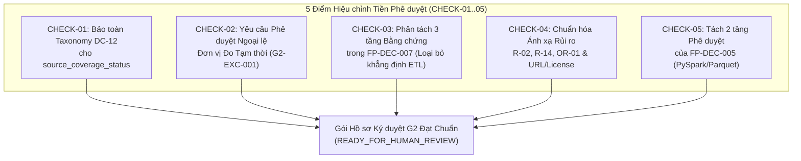

# G2_SIGNOFF_FINAL_PRECHECK_ADDENDUM — Phụ lục Hiệu chỉnh Tiền Phê duyệt Gói Hồ sơ Ký duyệt Gate G2

**Document ID:** `G2-SIGNOFF-PRECHECK-ADD-001`  
**Dự án:** Phân tích hiệu suất chuyến bay Hoa Kỳ 2016–2024 bằng Apache Spark / PySpark  
**Gate kiểm soát:** `Gate G2` (Data Understanding, Cohort, Units, Time Safety & Weather Usability Contracts)  
**Phạm vi:** Hiệu chỉnh có mục tiêu 5 điểm chính xác hợp đồng và quản trị (`CHECK-01` đến `CHECK-05`) đối với gói hồ sơ `G2-SIGNOFF-PREP` trước khi trình Project Lead ký duyệt  
**Vai trò:** Independent Senior Big Data Engineer, Data Contract Reviewer & Governance Sign-off Advisor  
**Trạng thái tài liệu:** `PRECHECK_ADDENDUM / PENDING_HUMAN_APPROVAL`  
**Trạng thái Gate G2 hiện hành:** `IN_PROGRESS / NOT_PASSED`  
**Trạng thái Nhiệm vụ `T-006` hiện hành:** `NOT_STARTED`  
**Ngày lập:** 2026-10-16  

---

## 1. MỤC ĐÍCH VÀ RANH GIỚI HIỆU LỰC (PURPOSE & GOVERNANCE SCOPE)

Phụ lục này thực hiện rà soát tiền phê duyệt (*Targeted Pre-Approval Check*) đối với gói 4 tài liệu `G2-SIGNOFF-PREP` ([`G2_SIGNOFF_DECISION_APPROVAL_MATRIX.md`](G2_SIGNOFF_DECISION_APPROVAL_MATRIX.md), [`G2_SIGNOFF_RESIDUAL_RISK_AND_CHANGE_PLAN.md`](G2_SIGNOFF_RESIDUAL_RISK_AND_CHANGE_PLAN.md), [`G2_SIGNOFF_HUMAN_APPROVAL_RECORD_DRAFT.md`](G2_SIGNOFF_HUMAN_APPROVAL_RECORD_DRAFT.md), [`G2_SIGNOFF_EXECUTION_AND_ARTIFACT_MANIFEST.md`](G2_SIGNOFF_EXECUTION_AND_ARTIFACT_MANIFEST.md)).

1. **Bảo toàn tuyệt đối tài liệu gốc:** Không ghi đè các tệp `G2_SIGNOFF_*` đã xuất, không chỉnh sửa [`DECISIONS.md`](../02-design/DECISIONS.md), [`PROJECT_STATE.md`](../04-execution/PROJECT_STATE.md), [`DATA_CONTRACT.md`](../02-design/DATA_CONTRACT.md), [`KPI_SPEC.md`](../02-design/KPI_SPEC.md), [`RISK_REGISTER.md`](../03-quality/RISK_REGISTER.md) hay bất kỳ mã nguồn/dữ liệu thô nào.
2. **Thứ tự ưu tiên khi Project Lead ký duyệt:** Các nội dung hiệu chỉnh `CHECK-01..CHECK-05` và các khối văn bản thay thế trong phụ lục này **được ưu tiên áp dụng (supersede)** tại những mục tương ứng của gói `G2-SIGNOFF-PREP`.
3. **Không hàm ý đã phê duyệt:** Phụ lục này không thay thế chữ ký của Project Lead; Gate G2 vẫn giữ nguyên trạng thái `IN_PROGRESS / NOT_PASSED`.

---

## 2. KẾT QUẢ RÀ SOÁT VÀ HIỆU CHỈNH 5 ĐIỂM TRỌNG YẾU (`CHECK-01` ĐẾN `CHECK-05`)



---

### 2.1. `CHECK-01` — Tuân thủ Hợp đồng `source_coverage_status` (`DATA_CONTRACT.md DC-12`)

- **Tham chiếu hợp đồng gốc:**
  - [`docs/02-design/DATA_CONTRACT.md`](../02-design/DATA_CONTRACT.md#L42) (`DC-12`):
    > ``- `source_coverage_status` = `UNKNOWN/PARTIAL/VERIFIED_WITH_SCOPE` + provenance; **không phải** tỷ lệ số chuyến của Mỹ khi không có known external population denominator.``
  - [`docs/02-design/KPI_SPEC.md`](../02-design/KPI_SPEC.md#L8): Mọi dòng kết quả xuất kèm trường `source_coverage_status` và `provenance_reference`.
- **Điểm chưa chuẩn trong `G2-SIGNOFF-PREP`:**
  - Tại Mục 3.16 của [`G2_SIGNOFF_DECISION_APPROVAL_MATRIX.md`](G2_SIGNOFF_DECISION_APPROVAL_MATRIX.md#L230), Mục 2.1 của [`G2_SIGNOFF_RESIDUAL_RISK_AND_CHANGE_PLAN.md`](G2_SIGNOFF_RESIDUAL_RISK_AND_CHANGE_PLAN.md#L76) và Mục 4.5 của [`G2_SIGNOFF_HUMAN_APPROVAL_RECORD_DRAFT.md`](G2_SIGNOFF_HUMAN_APPROVAL_RECORD_DRAFT.md#L117), văn bản đã đề xuất gán trực tiếp chuỗi `"PARTIAL_YEAR_2024_MISSING_MARCH_335_OF_366_DAYS"` (hoặc `"PARTIAL_YEAR_2024_MISSING_MARCH"`) vào trường `source_coverage_status`.
  - Việc đưa chuỗi mô tả chi tiết vào thẳng giá trị enum của `source_coverage_status` làm thay đổi ngầm danh mục giá trị hợp lệ (`UNKNOWN`, `PARTIAL`, `VERIFIED_WITH_SCOPE`) đã khóa tại `DC-12`.
- **Kết luận Hiệu chỉnh (`CHECK-01 Resolution`):**
  1. **Giữ nguyên 100% tập giá trị chuẩn (Allowed Taxonomy) của `source_coverage_status` theo `DC-12`:** Chỉ được nhận một trong ba giá trị gốc:
     - `'UNKNOWN'`
     - `'PARTIAL'`
     - `'VERIFIED_WITH_SCOPE'`
     *(Đối với các cohort năm 2024 hoặc tổng hợp đa năm bao gồm năm 2024 bị khuyết 31 ngày Tháng 3/2024, giá trị hợp lệ của `source_coverage_status` là **`'PARTIAL'`** — kèm theo mô tả phạm vi tại trường `provenance_reference` đã có sẵn trong hợp đồng [`KPI_SPEC.md`](../02-design/KPI_SPEC.md#L8)).*
  2. **Đề xuất bổ sung trường siêu dữ liệu mô tả lý do riêng biệt (Không tự động sửa hợp đồng):** Nếu Project Lead muốn có một trường mã hóa máy đọc riêng biệt cho các khiếm khuyết lịch năm, đề xuất phê duyệt bổ sung trường tùy chọn **`source_coverage_reason`** (hoặc ghi vào `provenance_reference` hiện hữu) mang giá trị `"OR05_2024_MISSING_MARCH_335_OF_366_DAYS"`, tuyệt đối không thay đổi định nghĩa của `source_coverage_status` trong `DATA_CONTRACT.md DC-12`.

---

### 2.2. `CHECK-02` — Yêu cầu Phê duyệt Ngoại lệ Chính thức cho Đơn vị Đo 7 Trường CORE (`G2-EXC-001`)

- **Đánh giá tính tuân thủ tiêu chí đóng Gate G2:**
  - Các văn bản quy phạm hiện hành quy định rất nghiêm ngặt:
    - [`AGENTS.md`](../../AGENTS.md#L29): *"G2 phải được review và đủ bằng chứng units cho 7 measures trước khi lập code production CORE"*.
    - [`docs/01-planning/BACKLOG.md`](../01-planning/BACKLOG.md#L9) (`T-003`): *"Mọi CORE KPI có units & denominator được duyệt ... thiếu evidence ⇒ BLOCKED G2"*.
    - [`docs/02-design/DATA_DICTIONARY.md`](../02-design/DATA_DICTIONARY.md#L5): *"các đơn vị của 7 trường đo delay/taxi/elapsed/air chưa được chứng minh từ nguồn upstream, phải được T-003 + TS-018 xác minh trước G2 PASS. Không gắn nhãn phút đã VERIFIED chỉ từ thông lệ đặt tên."*
    - [`docs/02-design/KPI_SPEC.md`](../02-design/KPI_SPEC.md#L28): *"T-003 phải ghi bằng chứng xác nhận cho tất cả 7 measures ... trước khi G2 PASS; không được gắn 'minutes' như fact đã kiểm chứng trong output."*
    - [`docs/03-quality/TEST_PLAN.md`](../03-quality/TEST_PLAN.md#L24) (`TS-018`): *"Verify seven CORE measure units/sign/domain từ source | G2 document gate | Citation/source/protocol cho cả 7 trường hoặc G2 BLOCKED"*.
  - **Kết luận kiểm toán:** Việc chấp nhận trạng thái đơn vị đo tạm thời (`OFFICIAL_MINUTES_EMPIRICALLY_CONSISTENT_PROVISIONAL`) tại Gate G2 và hoãn việc đối chiếu mẫu trực tiếp với dữ liệu BTS TranStats gốc (`OR-03`) sang Gate G5 **LÀ MỘT NGOẠI LỆ / MIỄN TRỪ CÓ ĐIỀU KIỆN ĐỐI VỚI TIÊU CHÍ ĐÓNG GATE G2 (`Conditional Gate Exit Exception / Waiver — G2-EXC-001`)**. Tuyệt đối không được diễn đạt như thể tiêu chí `TS-018` đã được hoàn tất vô điều kiện.

- **Hồ sơ Yêu cầu Phê duyệt Ngoại lệ Trình Project Lead (`Human Decision Request: G2-EXC-001`):**

| Hạng mục bắt buộc | Nội dung chi tiết trình Project Lead xem xét |
|---|---|
| **1. Yêu cầu gốc (`Original Requirement`)** | Cả 7 trường số đo cốt lõi (`ARR_DELAY`, `DEP_DELAY`, `TAXI_OUT`, `TAXI_IN`, `AIR_TIME`, `ACTUAL_ELAPSED_TIME`, `CRS_ELAPSED_TIME`) phải có bằng chứng nguồn gốc xác nhận đơn vị đo, quy ước dấu và miền giá trị (`TS-018`) trước khi Gate G2 được phép `PASS`; nếu thiếu bằng chứng thì Gate G2 bị `BLOCKED`. |
| **2. Bằng chứng hiện có (`Available Evidence`)** | (a) Đã trích dẫn chuẩn quy định pháp lý hàng không Hoa Kỳ **14 CFR Part 234** và từ điển **BTS On-Time Performance** quy định 7 trường này tính bằng phút ([`T003_UNIT_VERIFICATION.md`](T003_UNIT_VERIFICATION.md)).<br>(b) Đã kiểm chứng tính nhất quán toán học nội tại trên 54,674,003 dòng và bộ fixture `TF-01..09`: đẳng thức `ACTUAL_ELAPSED_TIME = TAXI_OUT + AIR_TIME + TAXI_IN`, đẳng thức `ARR_DELAY = DEP_DELAY + ACTUAL_ELAPSED_TIME - CRS_ELAPSED_TIME`, và đối chiếu khoảng cách giờ lịch trình `CRS_DEP_TIME` $\to$ `CRS_ARR_TIME` khớp với số phút của `CRS_ELAPSED_TIME`. |
| **3. Khoảng trống chưa giải quyết (`Exact Unresolved Gap — OR-03 / R-15`)** | (a) Không có tệp codebook/manifest gốc của tác giả bên thứ ba đóng gói bộ CSV `flight_with_weather_{year}.csv` để chứng minh họ không biến đổi các cột BTS gốc.<br>(b) Chưa thực hiện đối chiếu bản ghi thực tế (*bounded record-level match*) giữa tệp CSV hiện tại với bản tải trực tiếp từ cổng BTS TranStats. |
| **4. Hệ quả nếu phê duyệt ngoại lệ (`Consequences of Approving Exception`)** | Cho phép mở khóa Gate G2 (`PASS_WITH_EXPLICIT_CONDITIONS`) để tiến hành thiết kế kiến trúc G3 (`T-006`) và viết code G4 (`T-009/007/008`) mà không bị đình trệ bởi việc chờ tải dữ liệu đối chiếu ngoài; bảo lưu rủi ro `OR-03` làm điều kiện bắt buộc tại Gate G5. |
| **5. Kiểm thử bắt buộc ở Gate sau (`Mandatory Later-Gate Test`)** | Bắt buộc thực thi **`TS-018` (Runtime Bounded Record Match / External Reference Verification)** tại **Gate G5 (`T-011`)** trước khi được phép chuyển sang chạy toàn bộ 9 năm ở Gate G6 (`T-012/013`). |
| **6. Hệ quả nếu từ chối ngoại lệ (`Consequences of Rejection`)** | Theo đúng quy tắc tại [`BACKLOG.md`](../01-planning/BACKLOG.md#L9) và [`TEST_PLAN.md`](../03-quality/TEST_PLAN.md#L24), **Gate G2 bắt buộc giữ trạng thái `BLOCKED`**, và toàn bộ công việc của Gate G3 (`T-006`) bị dừng lại cho đến khi nhóm thực hiện thu thập được dữ liệu mẫu từ BTS TranStats và hoàn tất đối chiếu ngay trong giai đoạn G2. |
| **7. Hạn chế xuất bản bắt buộc (`Publication Restrictions`)** | Tuân thủ [`KPI_SPEC.md`](../02-design/KPI_SPEC.md#L8) và dòng 28: Mọi dòng kết quả KPI phải ghi rõ `unit_status = "OFFICIAL_MINUTES_EMPIRICALLY_CONSISTENT_PROVISIONAL"`; **nghiêm cấm ghi nhãn `'minutes'` như một sự thật đã xác minh tuyệt đối (`VERIFIED`)** trong bất kỳ bảng kết quả, biểu đồ hay báo cáo nào cho đến khi hoàn tất kiểm chứng `TS-018`. |

---

### 2.3. `CHECK-03` — Phân tách 3 Tầng Bằng chứng trong `FP-DEC-007` (Loại bỏ Khẳng định Quá mức về Upstream ETL)

- **Điểm chưa chuẩn trong `G2-SIGNOFF-PREP`:**
  - Tại Mục 3.7 của [`G2_SIGNOFF_DECISION_APPROVAL_MATRIX.md`](G2_SIGNOFF_DECISION_APPROVAL_MATRIX.md#L117) và Mục 2.1 (hàng `OR-06`) của [`G2_SIGNOFF_RESIDUAL_RISK_AND_CHANGE_PLAN.md`](G2_SIGNOFF_RESIDUAL_RISK_AND_CHANGE_PLAN.md#L77), văn bản viết: *"chứng minh (`VERIFIED`) upstream ETL đã gán cứng ngày của `FL_DATE` vào mọi trường giờ địa phương"*.
  - Cách viết này đã gộp chung **hiện tượng quan sát được trong tệp dữ liệu** (`VERIFIED`) với **cơ chế mã nguồn ETL của bên thứ ba** (`UNKNOWN / UPSTREAM_CODE_UNKNOWN`).
- **Kết luận Hiệu chỉnh (`CHECK-03 Resolution`):**
  Bắt buộc phân tách nghiêm ngặt thành **3 tầng bằng chứng độc lập** (đúng theo chuẩn đã thiết lập tại [`T001_R2_FINAL_REVIEW.md`](T001_R2_FINAL_REVIEW.md#L39-L44) và [`T004_R1_INDEPENDENT_RECONCILIATION.md`](T004_R1_INDEPENDENT_RECONCILIATION.md)):
  1. **Quan sát Dữ liệu Lưu trữ (`VERIFIED_STORAGE_OBSERVATION`):** Trong các tệp dữ liệu được kiểm toán (48.39 triệu dòng 2016–2023 đối với `CRS_DEP_TIME`/`CRS_ARR_TIME` và các bản ghi mẫu/phản ví dụ 2016–2024 bao gồm `YX 3624`), thành phần ngày (`YYYY-MM-DD`) của các chuỗi giờ địa phương trùng khớp với ngày của `FL_DATE` ngay cả trên các chuyến bay qua nửa đêm; ngữ nghĩa của mốc `2400` không được chứng minh (`2400_SEMANTICS_NOT_PROVEN`).
  2. **Cơ chế Biến đổi của Upstream ETL (`UNKNOWN / UPSTREAM_CODE_UNKNOWN`, với giả thuyết `INFERRED`):** Do hoàn toàn không có mã nguồn hay nhật ký xử lý của bên thứ ba tạo ra bộ CSV, cơ chế kỹ thuật cụ thể phía upstream dẫn đến định dạng chuỗi timestamp này được phân loại là **`UNKNOWN`** (với giả thuyết suy luận `INFERRED` là phép ghép chuỗi ngày `FL_DATE` với giờ `HHMM`). Tuyệt đối không gắn nhãn `VERIFIED` cho hành vi của upstream ETL.
  3. **Quy tắc Phòng vệ Thiết kế (`PROPOSED_DESIGN_GUARD` tại `FP-DEC-007` & `T004_SAFE_FIELDS_DECISION.md`):** Vì thành phần ngày trong các chuỗi giờ địa phương không phản ánh ngày thực tế của sự kiện qua đêm, pipeline bị **cấm tuyệt đối** việc trừ trực tiếp hai trường timestamp để tính thời lượng và **cấm tự động cộng `+24h`** để sửa rollover; toàn bộ 8 CORE KPIs chỉ được dùng các trường độ trễ/thời lượng số học có sẵn.

---

### 2.4. `CHECK-04` — Chuẩn hóa Ánh xạ Rủi ro Nguồn gốc (`R-02`, `R-14`, `OR-01` và `UPSTREAM_URL_LICENSE_UNKNOWN`)

- **Tham chiếu [`docs/03-quality/RISK_REGISTER.md`](../03-quality/RISK_REGISTER.md):**
  - Dòng 8 (`R-02`): *"54.7m rows không đại diện toàn bộ chuyến bay Mỹ | Trigger: Báo cáo dùng 'all flights' | Mitigation: Xác minh selection bias, flight grain, carrier coverage | Residual/Gate: G2/G7"*.
  - Dòng 20 (`R-14`): *"Chưa biết rubric/thời hạn/môi trường | Trigger: Đầu ra không khớp giảng viên | Mitigation: G0 scope note, giữ deliverables linh hoạt | Residual/Gate: G7"*.
  - Dòng 15 (`R-09`): *"Không rõ ý nghĩa `FLIGHTS`, `OP_CARRIER_FL_NUM` | Trigger: weighted flight count | Mitigation: Không dùng weight/key trước evidence | Residual/Gate: G2"*.
- **Điểm chưa chuẩn trong `G2-SIGNOFF-PREP`:**
  - Tại Mục 1.1 và Mục 2.1/2.2 của [`G2_SIGNOFF_RESIDUAL_RISK_AND_CHANGE_PLAN.md`](G2_SIGNOFF_RESIDUAL_RISK_AND_CHANGE_PLAN.md#L21), tài liệu đã đính chính đúng việc giữ độc quyền `OR-01` cho hằng số `FLIGHTS == 1.0`, nhưng lại gắn giới hạn `UPSTREAM_URL_LICENSE_UNKNOWN` (và `OR-05`) vào mã rủi ro `R-02` và `R-14`.
  - Đối chiếu với `RISK_REGISTER.md`, `R-02` chỉ mô tả rủi ro đánh đồng 54.7M dòng với toàn bộ chuyến bay Hoa Kỳ (*population representativeness*), và `R-14` chỉ mô tả việc chưa rõ tiêu chí chấm điểm/thời hạn/môi trường của giảng viên (*academic rubric/deadline/environment*). Không mã nào trong hai mã này mô tả việc thiếu đường dẫn tải xuống (Upstream URL) hay giấy phép (License) của bản đóng gói CSV.
- **Kết luận Hiệu chỉnh (`CHECK-04 Resolution`):**
  1. **Bảo toàn nguyên nghĩa của `OR-01` và `R-09`:** `OR-01` độc quyền mô tả trường `FLIGHTS == 1.0` trên toàn bộ 54,674,003 dòng, ánh xạ duy nhất tới **`R-09`**.
  2. **Bảo toàn nguyên nghĩa của `R-02`:** `R-02` độc quyền mô tả rủi ro 54.7 triệu dòng không đại diện cho toàn bộ chuyến bay của Hoa Kỳ (do phạm vi hãng báo cáo Part 234 và việc thiếu dữ liệu chuyến bay hủy/chuyển hướng).
  3. **Bảo toàn nguyên nghĩa của `R-14`:** `R-14` độc quyền mô tả rủi ro chưa biết rubric chấm điểm, thời hạn nộp bài và môi trường chạy đích của giảng viên.
  4. **Phân loại chính xác cho `UPSTREAM_URL_LICENSE_UNKNOWN` và `OR-05`:**
     - **`UPSTREAM_URL_LICENSE_UNKNOWN`** được phân loại là **Giới hạn Xuất xứ Cấp Nhiệm vụ `T-001` Chưa Có Mã `R-##` Riêng trong `RISK_REGISTER.md` v1.1 (`UNMAPPED_PROVENANCE_LIMITATION_IN_V1_1_RISK_REGISTER`)**, được theo dõi trực tiếp tại [`DATA_PROVENANCE.md`](DATA_PROVENANCE.md) và [`T001_R2_FINAL_REVIEW.md`](T001_R2_FINAL_REVIEW.md#L88) (và giao cho nhánh thời tiết qua `OR-07` / `R-04` đối với rủi ro bản quyền dữ liệu thời tiết ghép nối). Nếu Project Lead muốn quản lý trong `RISK_REGISTER.md`, đề xuất mở thêm mã mới **`R-18` (*Upstream package download URL and redistribution license unknown*)** sau khi ký duyệt, tuyệt đối không nhồi ghép vào `R-02` hay `R-14`.
     - **`OR-05`** (Khuyết 31 ngày Tháng 3/2024, `335/366` ngày) ánh xạ chính xác tới **`R-10`** (*So sánh theo năm gây lệch do 2020 & coverage*), không gán ép vào `R-02`.

---

### 2.5. `CHECK-05` — Phân tách Hai Tầng Phê duyệt của Quyết định Công nghệ `FP-DEC-005` (PySpark + Parquet)

- **Tham chiếu nguồn thẩm quyền:**
  - [`README.md`](../../README.md) & [`ROADMAP.md`](../01-planning/ROADMAP.md): Định danh đề tài là phân tích hiệu suất chuyến bay Hoa Kỳ 2016–2024 bằng Apache Spark / PySpark.
  - [`docs/02-design/DECISIONS.md`](../02-design/DECISIONS.md#L11):
    > `FP-DEC-005 | Dùng PySpark + Parquet cho xử lý chính | PROPOSED | Quy mô 9 CSV ~15.2 GB, phù hợp Big Data | Benchmark, version chưa chốt`
  - [`docs/01-planning/BACKLOG.md`](../01-planning/BACKLOG.md#L12) (`T-006`, Gate G3): *"Thiết kế Spark version/environment/resource budget/fixtures, output schema và recovery"*.
- **Điểm chưa chuẩn trong `G2-SIGNOFF-PREP`:**
  - Trong [`G2_SIGNOFF_DECISION_APPROVAL_MATRIX.md`](G2_SIGNOFF_DECISION_APPROVAL_MATRIX.md#L101) (Mục 3.5) và [`G2_SIGNOFF_HUMAN_APPROVAL_RECORD_DRAFT.md`](G2_SIGNOFF_HUMAN_APPROVAL_RECORD_DRAFT.md#L98) (Mục 4.2), toàn bộ `FP-DEC-005` được xếp vào diện "hoãn phê duyệt sang G3/G5".
  - Cách phân loại gộp này chưa tách bạch giữa **(1) Quyết định lựa chọn hướng công nghệ cốt lõi (PySpark + Parquet)** — vốn phải được chốt ở Gate G2 để làm cơ sở cho `FP-DEC-015` (hàm `percentile_approx` của PySpark) và làm đầu vào cho thiết kế kiến trúc G3 — với **(2) Thông số phiên bản runtime, cấu hình môi trường và benchmark hiệu năng** — vốn thuộc phạm vi của `T-006` (G3), `T-009` (G4) và `T-010`/`TS-014` (G5).
- **Kết luận Hiệu chỉnh (`CHECK-05 Resolution`):**
  Tách quyết định `FP-DEC-005` thành **2 cấu phần phê duyệt rạch ròi** trong biên bản trình Project Lead:
  - **`FP-DEC-005A` (Hướng Công nghệ Kiến trúc — Bắt buộc Phê duyệt tại Gate G2):** Phê duyệt chính thức việc sử dụng **Apache Spark (PySpark) và định dạng cột Apache Parquet** làm công nghệ xử lý và lưu trữ phân tích chính của đồ án (giữ nguyên phạm vi đề tài).
  - **`FP-DEC-005B` (Thông số Phiên bản, Cấu hình Tài nguyên & Benchmark — Chuyển giao Có Kiểm soát sang G3/G4/G5):** Hoãn việc khóa phiên bản cụ thể của Spark/Python/Java, cấu hình bộ nhớ Driver/Executor, chiến lược phân vùng (partitioning) và kiểm chuẩn tài nguyên thực tế sang **Gate G3 (`T-006` thiết kế), Gate G4 (`T-009` khởi tạo) và Gate G5 (`T-010` / `TS-014` đo đạc runtime)**.

---

## 3. VĂN BẢN THAY THẾ ĐÍNH CHÍNH CHO HỒ SƠ KÝ DUYỆT (`REPLACEMENT TEXT FOR SIGN-OFF PACKAGE`)

Khi Project Lead xem xét và ký duyệt tại [`G2_SIGNOFF_HUMAN_APPROVAL_RECORD_DRAFT.md`](G2_SIGNOFF_HUMAN_APPROVAL_RECORD_DRAFT.md), các mục **4.1, 4.2, 4.3, 4.5 và 5** được hiểu và áp dụng theo văn bản chuẩn hóa dưới đây (vẫn để trống hoàn toàn các ô `[ ]` để Project Lead trực tiếp quyết định):

```markdown
### [CHUẨN HÓA MỤC 4.1 — RIÊNG ĐỐI VỚI FP-DEC-007]
- FP-DEC-007: Căn cứ quan sát thực nghiệm trên dữ liệu lưu trữ (`VERIFIED` thành phần ngày của chuỗi giờ địa phương trùng với `FL_DATE` và `2400_SEMANTICS_NOT_PROVEN`), trong khi cơ chế mã nguồn ETL bên thứ ba giữ phân loại `UNKNOWN / UPSTREAM_CODE_UNKNOWN`, phê duyệt quy tắc phòng vệ (`PROPOSED_GUARD` -> `APPROVED`): Cấm trừ trực tiếp các trường timestamp để tính thời lượng bay và cấm tự động cộng `+24h` sửa lỗi qua đêm.

### [CHUẨN HÓA MỤC 4.2 — QUYẾT ĐỊNH CÔNG NGHỆ FP-DEC-005 (TÁCH 2 TẦNG 005A & 005B)]
- [ ] APPROVE FP-DEC-005A (TECHNOLOGY DIRECTION AT G2) & DEFER FP-DEC-005B (VERSION / RESOURCE / BENCHMARK PARAMETERS TO G3 T-006, G4 T-009 & G5 TS-014)
      (Chốt chính thức PySpark + Parquet làm nền tảng xử lý/lưu trữ chính tại Gate G2; giao T-006 thiết kế phiên bản/ngân sách bộ nhớ tại G3 và T-010/TS-014 đo đạc thực nghiệm tại G5).
- [ ] REQUIRE FULL RUNTIME VERSION & BENCHMARK SPECIFICATION BEFORE G2 CLOSEOUT
- [ ] REJECT / REQUEST_CHANGES

### [CHUẨN HÓA MỤC 4.3 — QUYẾT ĐỊNH FP-DEC-012 & NGOẠI LỆ ĐƠN VỊ ĐO G2-EXC-001 (OR-03 / TS-018)]
- [ ] APPROVE FP-DEC-012 & GRANT CONDITIONAL GATE EXIT EXCEPTION G2-EXC-001
      (Khóa 8 CORE KPIs; chấp thuận ngoại lệ cho phép đóng Gate G2 với trạng thái đơn vị đo tạm thời `OFFICIAL_MINUTES_EMPIRICALLY_CONSISTENT_PROVISIONAL` cho 7 trường cốt lõi; bắt buộc thực thi đối chiếu mẫu BTS TranStats `TS-018` tại Gate G5 `T-011`; bắt buộc xuất kèm trường `unit_status` và cấm gắn nhãn `'minutes'` như sự thật đã xác minh tuyệt đối trước khi vượt qua `TS-018`).
- [ ] REJECT EXCEPTION G2-EXC-001 AND KEEP GATE G2 BLOCKED UNTIL EXTERNAL BTS TRANSTATS MATCH IS COMPLETED
- [ ] REQUEST_CHANGES

### [CHUẨN HÓA MỤC 4.5 — QUYẾT ĐỊNH FP-DEC-016 & BẢO TOÀN TAXONOMY DC-12 CHO NĂM 2024]
- [ ] APPROVE FP-DEC-016 (MIN-N THRESHOLDS: CARRIER >= 1,000; AIRPORT >= 365; ROUTE >= 100) WITH CANONICAL DC-12 COVERAGE STATUS
      (Giữ nguyên tập giá trị chuẩn của `DATA_CONTRACT.md DC-12` là `source_coverage_status = 'PARTIAL'` cho các nhóm năm 2024 bị khuyết 31 ngày Tháng 3/2024, đồng thời ghi rõ lý do `"OR05_2024_MISSING_MARCH_335_OF_366_DAYS"` vào trường `provenance_reference` hoặc trường lý do phụ trợ mà không làm biến đổi taxonomy `DC-12`).
- [ ] APPROVE WITH MODIFIED THRESHOLDS: _____________________________
- [ ] DEFER / REJECT

### [CHUẨN HÓA MỤC 5 — ÁNH XẠ RỦI RO CHUẨN TẮC]
- Giữ nguyên định nghĩa gốc của `OR-01..OR-08` và `R-01..R-17`:
  + `OR-01` (Hằng số `FLIGHTS == 1.0`) <-> `R-09`.
  + `OR-03` (Đơn vị đo tạm thời 7 trường CORE) <-> `R-15` (Quản lý qua ngoại lệ `G2-EXC-001`).
  + `OR-05` (Khuyết 31 ngày Tháng 3/2024, `335/366` ngày) <-> `R-10`.
  + `OR-07` (Thiếu provenance thời tiết) <-> `R-04` (Chuyển sang `MITIGATED_BY_SCOPE_EXCLUSION` nếu duyệt `CONDITIONAL_NO_GO`).
  + `UPSTREAM_URL_LICENSE_UNKNOWN` (Không rõ URL/License bản đóng gói CSV của bên thứ ba): Quản lý như giới hạn xuất xứ độc lập của `T-001` (không gán nhầm vào `OR-01`, `R-02` hay `R-14`).
  - [ ]Optional: Cho phép bổ sung mã rủi ro mới `R-18` (Upstream package URL and redistribution license unknown) vào `RISK_REGISTER.md` trong đợt cập nhật tài liệu hậu ký duyệt.
```

---

## 4. TỔNG HỢP CÁC QUYẾT ĐỊNH CẦN PROJECT LEAD PHÊ DUYỆT & ĐỘ KHÔNG CHẮC CHẮN CÒN LẠI (`RESIDUAL UNCERTAINTY`)

### 4.1. Danh sách 7 Quyết định Quản trị Cần Con người Phê duyệt (`Required Human Decisions`)
1. **Nghiệm thu 5 nhiệm vụ `T-001..T-005`** (Mục 3 của Biên bản dự thảo).
2. **Phê duyệt 11 quyết định khung và hợp đồng cốt lõi** (`FP-DEC-003, 004, 006, 007, 008, 009, 010, 011, 013, 014` và `FP-DEC-005A` hướng công nghệ PySpark/Parquet), đồng thời hoãn `FP-DEC-005B` (phiên bản/cấu hình/benchmark) sang G3/G4/G5.
3. **Phê duyệt `FP-DEC-012` và Ngoại lệ Đơn vị Đo `G2-EXC-001`** (`OR-03` / `TS-018`), cho phép dùng nhãn `OFFICIAL_MINUTES_EMPIRICALLY_CONSISTENT_PROVISIONAL` qua G2 và bắt buộc đối chiếu BTS tại Gate G5.
4. **Phê duyệt `FP-DEC-015` (Thuật toán `percentile_approx` GK-sketch `accuracy = 10000`)** với cam kết sai số thứ hạng $\epsilon_{\text{rank}} \le 0.01\%$ và benchmark tại Gate G5 (`TS-008`).
5. **Phê duyệt `FP-DEC-016` (Ngưỡng xếp hạng `min-N = 1000 / 365 / 100`)** với giá trị chuẩn `source_coverage_status = 'PARTIAL'` (`DC-12`) và ghi chú lý do khuyết Tháng 3/2024 tại `provenance_reference`.
6. **Phê duyệt `FP-DEC-PROP-015` dưới mã `FP-DEC-017` (`CONDITIONAL_NO_GO` cho `RQ-06` / `KPI-10`)**, phân loại `OR-07` là `MITIGATED_BY_SCOPE_EXCLUSION` và bảo toàn nguyên vẹn 34 cột raw theo `DC-07`.
7. **Chấp thuận chế độ quản trị cho `OR-05` (khuyết 31 ngày Tháng 3/2024), `OR-08` (tính SHA-256 nội bộ tại G4 `TS-019`), ủy quyền cập nhật công cụ kiểm tra cây làm việc sau ký duyệt, và quyết định cho phép hay chưa cho phép khởi động `T-006` (Gate G3)**.

### 4.2. Các Độ Không Chắc chắn Còn Lại (`Residual Uncertainty`)
- **Danh tính bit-level của 9 tệp CSV thô so với bản gốc của BTS (`OR-08`):** Vẫn là `IDENTITY_UNVERIFIED` (chỉ khớp kích thước và thời gian sửa đổi `METADATA_MATCH_ONLY` với 9 tệp JSON kiểm toán).
- **Nguyên nhân gốc rễ việc thiếu 31 ngày Tháng 3/2024 (`OR-05`) và cơ chế mã nguồn ETL của bên thứ ba (`UPSTREAM_CODE_UNKNOWN`):** Vẫn là `UNKNOWN` do không có quyền truy cập vào pipeline đóng gói dữ liệu ban đầu.
- **Đơn vị đo của 7 trường số cốt lõi (`OR-03`):** Vẫn ở mức `OFFICIAL_MINUTES_EMPIRICALLY_CONSISTENT_PROVISIONAL` cho đến khi thực hiện đối chiếu bản ghi mẫu với BTS TranStats tại Gate G5 (`TS-018`).
- **Trạng thái công cụ `check_working_tree_consistency.py`:** Hiện trả về `86 PASS, 2 FAIL` (Exit Code `1`) do 20 tệp bằng chứng phát sinh sau T-004 (`7 T005_ + 3 G2_ + 4 G2_R1_ + 6 G2_SIGNOFF_`) chưa nằm trong bộ lọc cứng `T001_..T004_` tại dòng 139.

---

## 5. KẾT LUẬN ĐÁNH GIÁ CUỐI CÙNG (`FINAL PRECHECK RECOMMENDATION`)

- **Kết luận thẩm định gói hồ sơ ký duyệt:** **`READY_FOR_HUMAN_REVIEW`**.
- **Trạng thái Gate G2 hiện tại:** **`IN_PROGRESS / NOT_PASSED`**.
- **Trạng thái Nhiệm vụ `T-006` (Gate G3):** **`NOT_STARTED`**.

---
*Phụ lục này hoàn tất việc hiệu chỉnh tiền phê duyệt mà không thay đổi bất kỳ tệp quản trị hay dữ liệu gốc nào. Dừng thực thi để chờ quyết định của Project Lead.*
