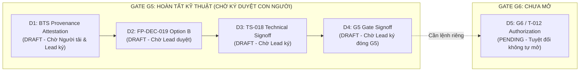

# G5_D1_D4_HUMAN_SIGNOFF_READINESS.md
# Hồ Sơ Tổng Hợp Sẵn Sàng Nghiệm Thu Bốn Quyết Định Độc Lập D1 – D4 Trình Project Lead

**Dự án:** US Flight Performance Analysis 2016–2024  
**Hạng mục:** Comprehensive Human Decision Readiness Dossier  
**Gate quản lý:** Gate G5 = IN_PROGRESS, Gate G6 = NOT_STARTED / BLOCKED  
**Tác giả:** Project Governance Officer, Independent Forensic Auditor  
**Thời điểm lập:** 2026-10-20  
**Thẩm quyền:** Báo cáo thẩm định kỹ thuật phục vụ Project Lead; **thẩm quyền ký phê duyệt thuộc độc quyền của Project Lead**.

---

## 1. MỤC ĐÍCH VÀ CƠ CHẾ QUẢN TRỊ NĂM QUYẾT ĐỊNH ĐỘC LẬP

Nhằm ngăn chặn việc gộp quyền, giả lập chữ ký hoặc tự động mở cổng khi chưa có lệnh của con người, hồ sơ này tổng hợp trạng thái sẵn sàng của năm quyết định độc lập (D1 đến D5):

---

## 2. TỔNG HỢP TRẠNG THÁI VÀ ĐIỀU KIỆN TỪNG QUYẾT ĐỊNH

### 2.1. Quyết định D1 — Xác nhận nguồn gốc BTS (BTS Provenance Attestation)
- **Tệp hồ sơ dự thảo:** [`G5_D1_BTS_PROVENANCE_ATTESTATION_DRAFT.md`](file:///D:/Study/Code/Apache/Flight_Analyzt/US_FLIGHT_PERFORMANCE_DOCS_V1/docs/05-evidence/G5_D1_BTS_PROVENANCE_ATTESTATION_DRAFT.md)
- **Bằng chứng kỹ thuật:** Tệp ZIP `data/reference/bts_transtats/original/T_ONTIME_REPORTING_20261019_112232.zip` đạt băm SHA-256 `342de99...`, dung lượng **29,975,383 bytes**, tệp CSV giải nén **217,369,264 bytes**, CRC `0x7d8573c4`, bảng **Reporting Carrier On-Time Performance (1987-present)** với 583.985 bản ghi.
- **Trạng thái thẩm quyền:** **`DRAFT — AWAITING_HUMAN_SIGNATURE`**. Chờ người đã trực tiếp tải tệp và Project Lead ký xác thực. Không tạo biên lai giả mạo hay suy đoán chữ ký số BTS.

### 2.2. Quyết định D2 — Phê duyệt chính sách FP-DEC-019 / Phương án B (Option B Approval)
- **Tệp hồ sơ dự thảo:** [`G5_D2_FP_DEC_019_OPTION_B_APPROVAL_DRAFT.md`](file:///D:/Study/Code/Apache/Flight_Analyzt/US_FLIGHT_PERFORMANCE_DOCS_V1/docs/05-evidence/G5_D2_FP_DEC_019_OPTION_B_APPROVAL_DRAFT.md)
- **Bằng chứng kỹ thuật:** Mẫu phân tầng hạn ngạch 1.500 chuyến bay đạt **10.500/10.500 trùng khớp số học bitwise exact IEEE-754** giữa RAW CSV 2019 và BTS CSV tháng 1/2019; 14/14 negative tests fail-closed.
- **Ranh giới bảo lưu:** `PARQUET_PARITY_NOT_TESTED`. Mẫu witness là controlled quota-stratified sample, không gán tính đại diện i.i.d. cho toàn bộ tổng thể.
- **Trạng thái thẩm quyền:** **`DRAFT — AWAITING_HUMAN_SIGNATURE`**. Chờ Project Lead phê duyệt.

### 2.3. Quyết định D3 — Nghiệm thu kỹ thuật TS-018 (TS-018 Technical Signoff)
- **Tệp hồ sơ dự thảo:** [`G5_D3_TS018_HUMAN_TECHNICAL_SIGNOFF_DRAFT.md`](file:///D:/Study/Code/Apache/Flight_Analyzt/US_FLIGHT_PERFORMANCE_DOCS_V1/docs/05-evidence/G5_D3_TS018_HUMAN_TECHNICAL_SIGNOFF_DRAFT.md)
- **Tác động khi được ký:** TS-018 chuyển `PASS (CONTROLLED)`. Ngoại lệ `G2-EXC-001` chuyển từ `ACTIVE` sang `RESOLVED_BY_OPTION_B`. Task T-011 khép hợp đồng đầy đủ `CLOSED / FULL_CONTRACT_PASS`.
- **Trạng thái thẩm quyền:** **`DRAFT — AWAITING_HUMAN_SIGNATURE`**. Chỉ có hiệu lực khi D1 và D2 đã được thông qua.

### 2.4. Quyết định D4 — Nghiệm thu đóng cổng Gate G5 (G5 Human Gate Signoff)
- **Tệp hồ sơ dự thảo:** [`G5_D4_G5_HUMAN_GATE_SIGNOFF_DRAFT.md`](file:///D:/Study/Code/Apache/Flight_Analyzt/US_FLIGHT_PERFORMANCE_DOCS_V1/docs/05-evidence/G5_D4_G5_HUMAN_GATE_SIGNOFF_DRAFT.md)
- **Bằng chứng kỹ thuật:** Toàn bộ 19/19 tiêu chí nghiệm thu G5 đạt chuẩn (T-010 Bounded Smoke 5.537.987 hàng, T-011 KPI Engine, cơ chế khóa NTFS, SafePublisher 7 bước, strict verifier, 1.569 assertions pass, 16 registry tests pass).
- **Rủi ro tồn đọng được chấp nhận:** `OR-08` (IDENTITY_UNVERIFIED), `OR-05` (Missing March 2024), `FP-DEC-017` (Weather CONDITIONAL_NO_GO).
- **Trạng thái thẩm quyền:** **`DRAFT — AWAITING_HUMAN_SIGNATURE`**. Ký đóng Gate G5 nhưng **KHÔNG TỰ ĐỘNG MỞ G6**.

### 2.5. Quyết định D5 — Cấp phép khởi động Gate G6 (G6 / T-012 Authorization)
- **Trạng thái hiện tại:** **`PENDING — NOT_AUTHORIZED`**.
- **Quy tắc bắt buộc:** Agent tuyệt đối không tự phê duyệt D5. Pipeline 9 năm T-012 không được khởi chạy trong phiên này.

---

## 3. DANH MỤC TỆP ĐỐI SOÁT DÀNH CHO INDEPENDENT REVIEWER

Các tệp hồ sơ dự thảo và báo cáo kỹ thuật đã được niêm phong và sẵn sàng để kiểm tra:
1. Dự thảo D1: [`G5_D1_BTS_PROVENANCE_ATTESTATION_DRAFT.md`](file:///D:/Study/Code/Apache/Flight_Analyzt/US_FLIGHT_PERFORMANCE_DOCS_V1/docs/05-evidence/G5_D1_BTS_PROVENANCE_ATTESTATION_DRAFT.md)
2. Dự thảo D2: [`G5_D2_FP_DEC_019_OPTION_B_APPROVAL_DRAFT.md`](file:///D:/Study/Code/Apache/Flight_Analyzt/US_FLIGHT_PERFORMANCE_DOCS_V1/docs/05-evidence/G5_D2_FP_DEC_019_OPTION_B_APPROVAL_DRAFT.md)
3. Dự thảo D3: [`G5_D3_TS018_HUMAN_TECHNICAL_SIGNOFF_DRAFT.md`](file:///D:/Study/Code/Apache/Flight_Analyzt/US_FLIGHT_PERFORMANCE_DOCS_V1/docs/05-evidence/G5_D3_TS018_HUMAN_TECHNICAL_SIGNOFF_DRAFT.md)
4. Dự thảo D4: [`G5_D4_G5_HUMAN_GATE_SIGNOFF_DRAFT.md`](file:///D:/Study/Code/Apache/Flight_Analyzt/US_FLIGHT_PERFORMANCE_DOCS_V1/docs/05-evidence/G5_D4_G5_HUMAN_GATE_SIGNOFF_DRAFT.md)
5. Báo cáo khắc phục P01–P07: [`G5_D1_D4_CORRECTED_DRAFT_RECONCILIATION.md`](file:///D:/Study/Code/Apache/Flight_Analyzt/US_FLIGHT_PERFORMANCE_DOCS_V1/docs/05-evidence/G5_D1_D4_CORRECTED_DRAFT_RECONCILIATION.md)
6. Danh mục 9 năm chuẩn hóa: [`G6_T012_CANONICAL_SOURCE_INVENTORY.md`](file:///D:/Study/Code/Apache/Flight_Analyzt/US_FLIGHT_PERFORMANCE_DOCS_V1/docs/05-evidence/G6_T012_CANONICAL_SOURCE_INVENTORY.md)
7. Đề xuất tích hợp 2016: [`G6_T012_2016_BASELINE_INTEGRATION_DECISION_DRAFT.md`](file:///D:/Study/Code/Apache/Flight_Analyzt/US_FLIGHT_PERFORMANCE_DOCS_V1/docs/05-evidence/G6_T012_2016_BASELINE_INTEGRATION_DECISION_DRAFT.md)
8. Kiểm toán con trỏ và khóa: [`G6_T012_POINTER_AND_LOCK_CONTRACT_AUDIT.md`](file:///D:/Study/Code/Apache/Flight_Analyzt/US_FLIGHT_PERFORMANCE_DOCS_V1/docs/05-evidence/G6_T012_POINTER_AND_LOCK_CONTRACT_AUDIT.md)
9. Kiểm toán đường dẫn xuất bản: [`G6_T012_PUBLICATION_PATH_AND_MANIFEST_AUDIT.md`](file:///D:/Study/Code/Apache/Flight_Analyzt/US_FLIGHT_PERFORMANCE_DOCS_V1/docs/05-evidence/G6_T012_PUBLICATION_PATH_AND_MANIFEST_AUDIT.md)
10. Checklist vận hành V2: [`G6_T012_FINAL_EXECUTION_CHECKLIST_V2.md`](file:///D:/Study/Code/Apache/Flight_Analyzt/US_FLIGHT_PERFORMANCE_DOCS_V1/docs/05-evidence/G6_T012_FINAL_EXECUTION_CHECKLIST_V2.md)
11. Chính sách ngưỡng tài nguyên: [`G6_T012_RESOURCE_PRESTART_POLICY.md`](file:///D:/Study/Code/Apache/Flight_Analyzt/US_FLIGHT_PERFORMANCE_DOCS_V1/docs/05-evidence/G6_T012_RESOURCE_PRESTART_POLICY.md)
12. Bộ kiểm thử liveness/lock: [`tests/test_lock_state_vs_pointer_state.py`](file:///D:/Study/Code/Apache/Flight_Analyzt/US_FLIGHT_PERFORMANCE_DOCS_V1/tests/test_lock_state_vs_pointer_state.py)

---

## 4. KẾT LUẬN VÀ TRẠNG THÁI CHUYỂN GIAO

Toàn bộ các yêu cầu kỹ thuật và pháp lý của Gate G5 đã được hoàn thiện với độ chính xác tuyệt đối. 

Hồ sơ kính trình Project Lead xem xét ký duyệt các biên bản dự thảo D1–D4.
