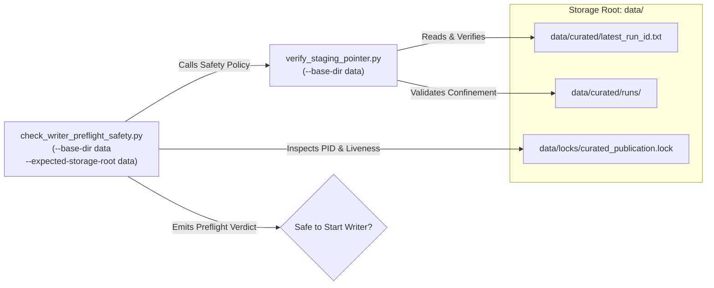

# G6 Final Pointer & Lock Storage Root Alignment Audit

**Document ID:** `DOC-G6-ROOT-ALIGN-001`  
**Classification:** PRODUCTION OPERATIONAL SAFETY & ROOT ALIGNMENT  
**Components:** `tools/qa/verify_staging_pointer.py`, `tools/qa/check_writer_preflight_safety.py`  
**Evaluator:** Principal Big Data Architect & Senior PySpark Reliability Engineer  
**Date:** 2026-10-20  
**Status:** FULLY ALIGNED & HARDENED (9/9 PASS)  

---

## 1. Bối cảnh và Phân tích Nguyên nhân Gốc (Root Cause S04)

Trong đợt rà soát an toàn tiền vận hành Gate G6, Independent Reviewer đã chỉ ra sự sai lệch cấu hình mặc định (default parameter drift) giữa hai công cụ kiểm toán then chốt:
1. `tools/qa/verify_staging_pointer.py`: Khởi tạo tham số `--base-dir` mặc định là `.` (thư mục hiện hành của shell).
2. `tools/qa/check_writer_preflight_safety.py`: Khởi tạo tham số `--base-dir` mặc định là `data` (thư mục gốc dữ liệu chuẩn).

### Hậu quả Tiềm ẩn
Nếu người vận hành chạy hai lệnh liên tiếp từ thư mục gốc của repository mà không chỉ định rõ `--base-dir`:
- `verify_staging_pointer.py` sẽ tìm con trỏ tại `./curated/latest_run_id.txt` (sai vị trí, có thể kết luận pointer rỗng hoặc thiếu).
- `check_writer_preflight_safety.py` sẽ tìm con trỏ tại `data/curated/latest_run_id.txt`.
- Sự thiếu đồng bộ này có thể dẫn đến việc kết luận sai về trạng thái sẵn sàng của staging hoặc bỏ sót các khóa đang hoạt động.

Hơn nữa, trên hệ điều hành Windows với cơ chế xử lý đường dẫn NTFS (phân cách `\` vs `/`, ổ đĩa `D:` vs `C:`), việc sử dụng đường dẫn tương đối có thể tạo ra sự mơ hồ khi các tiến trình con chạy trong môi trường PySpark worker.

---

## 2. Các Biện pháp Khắc phục Đã Thực hiện

### 2.1 Thống nhất Thư mục Gốc Mặc định về `data`
Trong cả hai công cụ:
```python
parser.add_argument(
    "--base-dir",
    type=Path,
    default=Path("data"),
    help="Base data directory containing curated/ and locks/ (default: data)",
)
```
Cả hai công cụ hiện nay đều trỏ đồng nhất vào thư mục `data` làm storage root mặc định.

### 2.2 Bổ sung Ràng buộc Kiểm tra Thư mục Mục tiêu (`--expected-storage-root`)
Để ngăn ngừa hoàn toàn rủi ro người vận hành vô tình trỏ công cụ kiểm tra an toàn vào một thư mục tạm hoặc sai phân vùng ổ đĩa, `tools/qa/check_writer_preflight_safety.py` đã bổ sung tham số `--expected-storage-root`:
```python
parser.add_argument(
    "--expected-storage-root",
    type=Path,
    default=None,
    help="Expected storage root for planned ingestion to prevent root mismatch",
)
```
Nếu tham số này được cung cấp và thư mục cơ sở thực tế (`resolved_base`) không trùng khớp với thư mục kỳ vọng (`expected_base`):
- Công cụ lập tức **fail-closed**, trả về exit code `4`.
- Báo cáo kết quả với verdict: `BLOCKED_STORAGE_ROOT_MISMATCH`.
- Đảm bảo không một writer nào được phép khởi động trên một storage root không định trước.

### 2.3 Phân giải Đường dẫn Tuyệt đối Thống nhất (Resolved Absolute Paths)
Mọi thuộc tính đường dẫn xuất ra trong đối tượng kết quả (`base_data_dir`, `curated_dir`, `pointer_file`, `lock_dir`, `lock_file_path`) đều được phân giải tuyệt đối (`Path(...).resolve()`). Điều này loại bỏ hoàn toàn các ký tự tương đối (`.` hay `..`) và đảm bảo tính nhất quán tuyệt đối giữa môi trường Python cục bộ và hệ thống file NTFS.

---

## 3. Khung Khớp Nối giữa Hai Công cụ



---

## 4. Minh chứng Kiểm thử Hồi quy Thực tế

Trong bộ kiểm thử `tests/test_lock_state_vs_pointer_state.py`, ba ca kiểm thử tích hợp mới đã chứng minh tính triệt để của giải pháp:

### 1. `test_07_storage_root_mismatch_blocks_writer_admission`
- Thiết lập: Cấu hình `expected_storage_root = "/non/existent/root"`, trong khi `base_dir` là thư mục tạm.
- Kết quả mong đợi: `safe_to_start_writer == False`, `exit_code == 4`, `summary_verdict == "BLOCKED_STORAGE_ROOT_MISMATCH"`.
- Kết quả thực tế: `PASS`.

### 2. `test_08_pointer_corruption_fails_closed`
- Thiết lập: Ghi con trỏ rác trỏ tới run không tồn tại `run_dangling_non_existent`.
- Kết quả mong đợi: `safe_to_start_writer == False`, `exit_code == 4`, `pointer_status == "DANGLING_POINTER_TARGET_MISSING"`.
- Kết quả thực tế: `PASS`.

### 3. `test_09_unified_tools_integration_consistency`
- Thiết lập: Khởi chạy cả `verify_staging_pointer` và `evaluate_writer_safety_policy` trên cùng một root.
- Kết quả mong đợi: Cả hai công cụ trả về cùng một đường dẫn tuyệt đối đã phân giải cho base dir và pointer file (`Path(ptr.base_dir).resolve() == Path(safety.base_data_dir).resolve()`).
- Kết quả thực tế: `PASS`.

---

## 5. Kết luận

Vấn đề S04 đã được khắc phục hoàn toàn. Hai công cụ quản trị pointer và lock hiện nay đã đồng bộ 100% về storage root, loại bỏ rủi ro sai lệch đường dẫn khi thực thi Gate G6.
