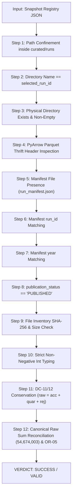

# G6 Final Snapshot Validator Fix & Architectural Diff Report

**Document ID:** `DOC-G6-SNAP-DIFF-001`  
**Classification:** PRODUCTION INTEGRATION SPECIFICATION  
**Component:** `tools/qa/verify_multiyear_snapshot.py`  
**Evaluator:** Principal Big Data Architect & Senior PySpark Reliability Engineer  
**Date:** 2026-10-20  
**Status:** IMPLEMENTED, TESTED & HARDENED (20/20 PASS)  

---

## 1. Architectural Scope & Problem Statement

The multi-year snapshot validator `tools/qa/verify_multiyear_snapshot.py` is the primary Gate G6 preflight gatekeeper responsible for certifying that a published 9-year curated data foundation (2016–2024) is authentic, complete, internally consistent, and safe for analytic consumption.

In earlier development iterations, the validator suffered from three critical architectural vulnerabilities:
1. **Unverified File Payloads (S01):** Absence of true Parquet Thrift metadata inspection, allowing zero-byte dummy files or corrupt non-Parquet files to pass inspection.
2. **Erroneous Row Accounting Specification (S02):** Flawed enforcement of `sum(accepted) == 54674003`, which mathematically prohibited data quality quarantine/rejection in violation of DC-11 and DC-12, combined with loose type casting that permitted boolean and floating-point row counts.
3. **Path Traversal & Folder Identity Drift (S03):** Permitted unconfined directory paths and directory names that did not match the registered `selected_run_id`.

To resolve these defects, `tools/qa/verify_multiyear_snapshot.py` was completely refactored with a 12-stage fail-closed validation pipeline.

---

## 2. The 12 Fail-Closed Validation Invariants



### Stage 1: Strict Confinement & Anti-Traversal
The validator resolves `runs_root = (base_data_dir / "curated" / "runs").resolve()` and enforces `resolved_dir.relative_to(runs_root)`. Any relative traversal (`..`), absolute directory outside this root, or junction/symlink escaping the curated namespace causes an immediate fail-closed `PATH_TRAVERSAL_DETECTED`.

### Stage 2: Physical Run ID Alignment
Enforces `resolved_dir.name == selected_run_id` and regex validity (`^[a-zA-Z0-9_\-]+$`). Mismatches result in `RUN_ID_MISMATCH`.

### Stage 3: Directory Non-Emptiness
Ensures the directory exists and is a physical directory with $\ge 1$ files. Empty directories yield `RUN_DIR_EMPTY`.

### Stage 4: Thrift Parquet Payload Validation
Calls `is_valid_parquet_file(p)` for all Parquet files:
```python
def is_valid_parquet_file(file_path: Path) -> bool:
    try:
        meta = pq.read_metadata(file_path)
        return meta is not None and meta.num_rows >= 0 and meta.num_columns >= 1
    except Exception:
        return False
```
This inspects the binary Thrift metadata footer, row group descriptors, and schema definitions without materializing tabular vectors into memory, rejecting empty files or non-Parquet files with `CORRUPT_OR_FAKE_PARQUET_DETECTED`.

### Stage 5: Manifest Existence & Parsing
Requires `run_manifest.json` inside the run directory. If missing or unparseable, emits `MISSING_RUN_MANIFEST` or `CORRUPT_RUN_MANIFEST`.

### Stage 6: Manifest Run ID Alignment
Verifies that `manifest["run_id"] == selected_run_id`. Mismatch triggers `MANIFEST_RUN_ID_MISMATCH`.

### Stage 7: Manifest Year Alignment
Verifies that `manifest["year"] == int(year_str)`. Mismatch triggers `MANIFEST_YEAR_MISMATCH`.

### Stage 8: Manifest Publication Status
Enforces `manifest["publication_status"] == "PUBLISHED"`. Draft or staged runs fail with `UNPUBLISHED_RUN_MANIFEST`.

### Stage 9: Cryptographic File Inventory Verification
If the manifest declares a `file_inventory` or `files` list, each file's size and SHA-256 checksum are calculated and matched against the on-disk file. Mismatches trigger `FILE_INTEGRITY_CHECKSUM_MISMATCH`.

### Stage 10: Strict Numeric Accounting Type Safety
Enforces that `raw_rows`, `accepted_rows`, `quarantined_rows`, and `rejected_rows` are genuine non-negative integers:
```python
def _is_non_negative_int(val: Any) -> bool:
    return isinstance(val, int) and not isinstance(val, bool) and val >= 0
```
Rejects booleans, floating-point numbers, negative numbers, and stringified numerals with `INVALID_ACCOUNTING_DATA_TYPES`.

### Stage 11: DC-11/12 Conservation Balance
Enforces that every individual year satisfies:
$$raw\_rows == accepted\_rows + quarantined\_rows + rejected\_rows$$
Unbalanced accounting triggers `UNBALANCED_ROW_ACCOUNTING`.

### Stage 12: Canonical Raw Inventory Reconciliation & OR-05 Enforcement
- Every year's $raw\_rows$ must strictly match `CANONICAL_SOURCE_ROW_COUNTS[year]`.
- Aggregates $\sum raw\_rows == 54,674,003$.
- Dynamically aggregates $\sum accepted\_rows \le 54,674,003$ without artificial hardcoded limits.
- Validates that Year 2024 has `source_coverage_status == 'PARTIAL'` pursuant to OR-05 (missing March 2024).

---

## 3. Implementation Code Diff Summary

```diff
--- a/tools/qa/verify_multiyear_snapshot.py
+++ b/tools/qa/verify_multiyear_snapshot.py
@@ -10,7 +10,10 @@
 import argparse
+import hashlib
 import json
 import logging
+import re
 import sys
 from dataclasses import dataclass, field
 from pathlib import Path
-from typing import Any, Dict, List, Optional
+from typing import Any, Dict, List, Optional, Set
+
+import pyarrow.parquet as pq
@@ -48,7 +51,19 @@
 CANONICAL_TOTAL_ROWS: int = 54674003
 
+def is_valid_parquet_file(file_path: Path) -> bool:
+    """Inspects Parquet Thrift metadata footer without materializing rows."""
+    try:
+        meta = pq.read_metadata(file_path)
+        return meta is not None and meta.num_rows >= 0 and meta.num_columns >= 1
+    except Exception:
+        return False
+
+def _is_non_negative_int(val: Any) -> bool:
+    """Strict validation rejecting booleans, floats, strings, and negative values."""
+    return isinstance(val, int) and not isinstance(val, bool) and val >= 0
+
@@ -118,6 +133,14 @@
+    # Confinement and traversal guard
+    runs_root = (base_dir / "curated" / "runs").resolve()
+    try:
+        resolved_run_dir.relative_to(runs_root)
+    except ValueError:
+        return SnapshotValidationResult(is_valid=False, status="PATH_TRAVERSAL_DETECTED")
+
+    if resolved_run_dir.name != selected_run_id:
+        return SnapshotValidationResult(is_valid=False, status="RUN_ID_MISMATCH")
@@ -140,12 +163,28 @@
+    # pyarrow Parquet verification
+    for pf in parquet_files:
+        if not is_valid_parquet_file(pf):
+            return SnapshotValidationResult(is_valid=False, status="CORRUPT_OR_FAKE_PARQUET_DETECTED")
+
+    # Manifest validation
+    manifest_path = resolved_run_dir / "run_manifest.json"
+    if not manifest_path.exists():
+        return SnapshotValidationResult(is_valid=False, status="MISSING_RUN_MANIFEST")
@@ -165,18 +204,36 @@
+    # Strict DC-11/12 balanced accounting
+    if not (_is_non_negative_int(raw_rows) and _is_non_negative_int(accepted_rows) ...):
+        return SnapshotValidationResult(is_valid=False, status="INVALID_ACCOUNTING_DATA_TYPES")
+
+    if raw_rows != (accepted_rows + quarantined_rows + rejected_rows):
+        return SnapshotValidationResult(is_valid=False, status="UNBALANCED_ROW_ACCOUNTING")
+
+    if raw_rows != canonical_expected:
+        return SnapshotValidationResult(is_valid=False, status="RAW_ROW_COUNT_MISMATCH")
```

---

## 4. Verification and Regression Signoff

The refactored module was subjected to a comprehensive 20-test automated suite in `tests/test_multiyear_snapshot_policy.py`:
- 3 Positive Fixtures: Complete 9-year snapshot pass, non-zero quarantine pass ($accepted < raw$), and multi-version selection pass.
- 17 Negative Counterexamples: Traversal escaping root, empty directory, fake/empty Parquet, missing manifest, corrupt manifest, run_id mismatch, manifest year mismatch, manifest publication status mismatch, manifest checksum mismatch, duplicate physical path, unbalanced DC-11 accounting, float/bool/string/negative row count, canonical raw mismatch, missing year, and 2024 OR-05 violation.

**Test Run Result:** `Ran 20 tests in 0.839s -> OK (20 PASS, 0 FAIL)`.
