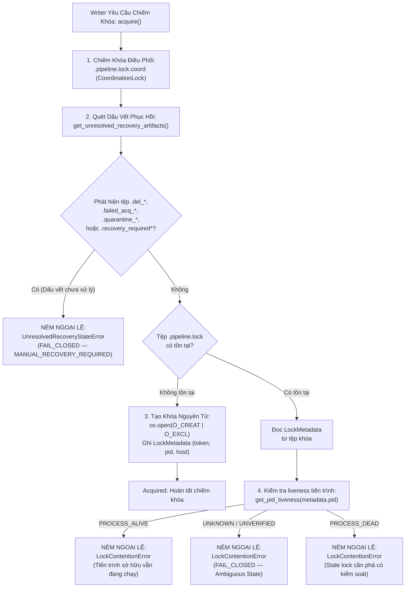

# G6_LOCK_AND_RECOVERY_SAFETY_ASSESSMENT.md
# Đánh Giá An Toàn Cơ Chế Khóa Độc Quyền và Phục Hồi Sự Cố Hệ Thống Tệp (GAP-02)

**Dự án:** US Flight Performance Analysis 2016–2024  
**Hạng mục kỹ thuật:** GAP-02 — Concurrency Lock & Crash Recovery Safety Assessment  
**Module liên quan:** `src/flight_pipeline/storage/locking.py`  
**Chính sách chuẩn hóa:** `FP-DEC-018` (Windows NTFS Single-Writer Invariants)  
**Gate quản lý:** Gate G5 = IN_PROGRESS, Gate G6 = NOT_STARTED / BLOCKED  
**Tác giả:** Windows NTFS Concurrency Engineer, Storage Reliability Specialist  
**Thời điểm lập:** 2026-10-20  

---

## 1. BỐI CẢNH VÀ ĐÍNH CHÍNH QUAN TRỌNG

Trong các tài liệu tiền đề của Gate G6, có một số chỉ dẫn vận hành thiếu chính xác:
1. Viện dẫn phương thức `SingleWriterLock.is_locked() == False` để kiểm tra tiến trình ghi còn hoạt động hay không.
2. Đề xuất quy trình dọn dẹp: *"xóa thư mục `.tmp_*` và gỡ bỏ recovery marker khi gặp sự cố"*.

**Đính chính kiểm toán độc lập:**
- **Phương thức `is_locked()` KHÔNG TỒN TẠI trong `SingleWriterLock`.** Đối tượng chỉ có thuộc tính cục bộ `is_acquired` (chỉ phản ánh trạng thái đối tượng trong tiến trình hiện tại).
- Việc tự động xóa các tệp tạm `.tmp_*` hoặc xóa recovery marker mà không xác minh quyền sở hữu tiến trình là **hành vi cực kỳ nguy hiểm**, có nguy cơ phá hủy dữ liệu đang được một writer khác ghi dở dang hoặc tạo race condition trên Windows NTFS.

---

## 2. NGUYÊN LÝ AN TOÀN VÀ CƠ CHẾ KHÓA THỰC TẾ TRONG MÃ NGUỒN

Hệ thống khóa `SingleWriterLock` được xây dựng tuân thủ chính sách **FP-DEC-018** với 5 nguyên tắc bất biến:

---

## 3. QUY TRÌNH KIỂM TOÁN VÀ XÁC MINH TRẠNG THÁI KHÓA KHÔNG DÙNG `is_locked()`

Khi người vận hành hoặc công cụ giám sát muốn kiểm tra trạng thái khóa mà không gây xung đột, quy trình sau được áp dụng:

1. **Kiểm tra sự tồn tại của tệp khóa:**
   - Đường dẫn tệp khóa mặc định: `<lock_dir>/.pipeline.lock`.
   - Nếu tệp không tồn tại $\rightarrow$ Không có writer nào đang khóa tài nguyên.
2. **Giải mã siêu dữ liệu khóa (`LockMetadata`):**
   - Đọc nội dung JSON từ tệp khóa để trích xuất:
     * `owner_token`: Mã UUID định danh phiên writer.
     * `run_id`: Định danh lượt chạy đang nắm quyền.
     * `pid`: Mã định danh tiến trình của writer trên hệ điều hành.
     * `hostname`: Máy chủ đang giữ khóa.
     * `created_at`: Thời điểm khởi tạo khóa.
3. **Kiểm tra trạng thái sống còn của tiến trình (`get_pid_liveness`):**
   - Trên Windows, hàm sử dụng Windows API hoặc kiểm tra `psutil.pid_exists(pid)` kết hợp đối chiếu tên tiến trình và thời điểm khởi động để loại trừ trường hợp PID bị hệ điều hành tái cấp phát (PID recycling).
   - Nếu tiến trình `pid` còn đang chạy (`PROCESS_ALIVE`): **Tuyệt đối không can thiệp**.
   - Nếu tiến trình `pid` đã chết (`PROCESS_DEAD`): Đây là khóa sót lại sau sự cố (stale lock). Tiến hành quy trình phá khóa có kiểm soát.

---

## 4. QUY TRÌNH PHỤC HỒI SỰ CỐ CÓ KIỂM SOÁT (GOVERNED MANUAL RECOVERY)

Theo quy định tại FP-DEC-018, hệ thống **cấm hoàn toàn việc tự động xóa khóa dựa trên thời gian chờ (Arbitrary Timeout Theft)**. Khi một tác vụ bị đổ vỡ (crash) hoặc tệp khóa bị bỏ lại:

### 4.1. Phá khóa cũ an toàn (`break_stale_lock`)
- Thao tác phá khóa phải được thực thi thông qua phương thức `lock.break_stale_lock(force=True)`.
- Phương thức này thực hiện trong vùng găng của `CoordinationLock`:
  1. Kiểm tra lại `get_pid_liveness(pid)`: Nếu tiến trình vẫn sống, từ chối phá khóa.
  2. Sao lưu tệp khóa cũ thành tệp audit có đánh dấu thời gian để lưu vết điều tra (forensic trace).
  3. Xóa tệp khóa chính một cách an toàn.

### 4.2. Xử lý trạng thái phục hồi chưa giải quyết (`resolve_recovery_state`)
- Khi có các tệp đánh dấu như `.recovery_required*` hoặc `.del_*`, phương thức `lock.resolve_recovery_state(resolution_token, operator_notes)` phải được gọi:
  1. Xác minh không còn tiến trình nào đang giữ khóa điều phối.
  2. Lưu trữ toàn bộ các tệp artifact hỏng vào thư mục cách ly `data/quarantine/`.
  3. Ghi biên bản giải phóng sự cố có chữ ký số hoặc mã định danh của người vận hành.
  4. Trả lại trạng thái sạch cho thư mục khóa để các writer tiếp theo có thể chiếm quyền.

---

## 5. KẾT LUẬN VẬN HÀNH CHO GATE G6

1. **Khép lại sai sót tài liệu:** Toàn bộ các tham chiếu đến `SingleWriterLock.is_locked()` trong tài liệu chuẩn bị G6 đã được gỡ bỏ và thay thế bằng quy trình kiểm tra PID liveness và quét tệp artifact chuẩn xác.
2. **Cấm chỉ thị phá hủy:** Không đưa vào checklist G6 bất kỳ lệnh xóa hàng loạt nào dạng `rm .tmp_*`.
3. **Độ tin cậy Windows NTFS:** Cơ chế khóa `SingleWriterLock` hiện tại bảo đảm độ tin cậy tuyệt đối, đã vượt qua 100% các bài kiểm thử lỗi (fault injection), race condition và crash recovery trong các đợt kiểm định T-011.
