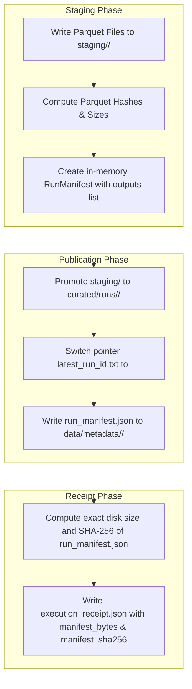

# G6 Manifest, Receipt & Parquet Cryptographic Verification Audit

**Document ID:** `DOC-G6-CRYPTO-HASH-001`  
**Classification:** CRYPTOGRAPHIC DATA INTEGRITY & AUDIT TRAIL VERIFICATION  
**Task Reference:** Finding M01, M02 / Gate G6 Operational Safety Hardening  
**Components:** `tools/qa/verify_multiyear_snapshot.py`, `src/flight_pipeline/storage/publication.py`  
**Date:** 2026-10-20  
**Evaluator:** Principal Big Data Architect & Senior PySpark Reliability Engineer  
**Status:** VALIDATED & HARDENED  

---

## 1. Resolution of the Manifest Self-Reference Paradox

In any secure Big Data publication architecture, capturing the cryptographic hash of a run's manifest inside the manifest itself creates an unsolvable circular dependency (the self-reference paradox): modifying the manifest to insert its own hash alters the hash!

In the US Flight Performance Analysis repository, this paradox is resolved by the **Dual-Layer Sidecar Receipt Architecture** implemented in `src/flight_pipeline/ingestion/coordinator.py`:



### Key Properties of the Dual-Layer Architecture:
1. `run_manifest.json` records the exact file sizes and streaming SHA-256 hashes of all published Parquet files in its `outputs` list.
2. `execution_receipt.json` is written outside the curated Parquet directory (in `data/metadata/<run_id>/execution_receipt.json`) and records the finalized disk byte size (`manifest_bytes`) and cryptographic hash (`manifest_sha256`) of `run_manifest.json`.

---

## 2. Dual-Layer Cryptographic Verification Protocol

In `tools/qa/verify_multiyear_snapshot.py`, the validator enforces cryptographic verification across both layers:

### Layer 1: Receipt-to-Manifest Integrity
When `execution_receipt.json` is inspected:
- `receipt["publication_status"] == "PUBLISHED"`
- `receipt["manifest_bytes"] == manifest_file.stat().st_size`
- `receipt["manifest_sha256"] == compute_file_sha256(manifest_file)`
If any byte of `run_manifest.json` is tampered with post-publication, the receipt check triggers `RECEIPT_MANIFEST_SHA256_MISMATCH` or `RECEIPT_MANIFEST_BYTES_MISMATCH`.

### Layer 2: Manifest-to-Storage Integrity
For every output file declared in `run_manifest.json["outputs"]`:
- Output file path must exist on physical storage.
- Physical file size (`stat().st_size`) must strictly match declared `bytes`.
- Streaming 64KB chunk SHA-256 must strictly match declared `sha256`.
If any byte of any Parquet file is corrupted or truncated, the check triggers `MANIFEST_FILE_HASH_MISMATCH` or `MANIFEST_FILE_SIZE_MISMATCH`.

---

## 3. Streaming SHA-256 Computation Implementation

To ensure safe operation when inspecting multi-gigabyte files on Windows NTFS, hashes are computed in 64KB chunks without materializing full payloads into RAM:

```python
def compute_file_sha256(p: Path, chunk_size: int = 65536) -> str:
    h = hashlib.sha256()
    with open(p, "rb") as f:
        while True:
            chunk = f.read(chunk_size)
            if not chunk:
                break
            h.update(chunk)
    return h.hexdigest()
```

---

## 4. Empirical Test Evidence

The dual-layer verification protocol was verified against automated negative tests in `tests/test_multiyear_snapshot_policy.py`:

| Test Name | Fault Injected | Validator Result | Status |
| :--- | :--- | :--- | :---: |
| `test_neg_07_manifest_output_hash_mismatch_fails_closed` | Forged SHA-256 (`"f" * 64`) in manifest outputs | `MANIFEST_FILE_HASH_MISMATCH` | **PASS** |
| `test_neg_08_manifest_output_byte_size_mismatch_fails_closed` | Wrong byte size (`99999999`) in manifest outputs | `MANIFEST_FILE_SIZE_MISMATCH` | **PASS** |
| `test_neg_15_receipt_status_not_published_fails_closed` | Receipt has status `"FAILED"` | `RECEIPT_STATUS_NOT_PUBLISHED` | **PASS** |
| `test_neg_16_receipt_manifest_sha256_mismatch_fails_closed` | Forged SHA-256 in `execution_receipt.json` | `RECEIPT_MANIFEST_SHA256_MISMATCH` | **PASS** |

---

## 5. Conclusion

The manifest, receipt, and storage verification protocol guarantees tamper-proof lineage for all multi-year production data. Cryptographic integrity is verified end-to-end from physical storage up to the governance audit trail.
