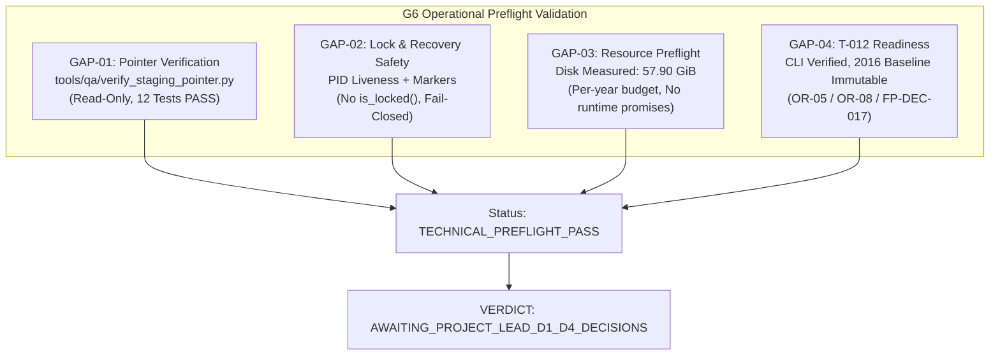

# G6_OPERATIONAL_GAP_MATRIX.md
# Ma Trận Đánh Giá và Khắc Phục Khoảng Cách Vận Hành Gate G6 (T-012 Operational Preflight)

**Dự án:** US Flight Performance Analysis 2016–2024  
**Nhiệm vụ:** Gate G6 Operational Preflight & Gap Verification  
**Gate quản lý:** G5 = IN_PROGRESS, G6 = NOT_STARTED / BLOCKED  
**Tác giả:** Principal Big Data Engineer, Windows NTFS Concurrency Engineer, Independent QA Reviewer  
**Thời điểm lập:** 2026-10-20  

---

## 1. MỤC ĐÍCH VÀ NGUYÊN TẮC THẨM QUYỀN

Tài liệu này đối soát toàn diện giữa các tài liệu thiết kế vận hành Gate G6 và hiện trạng mã nguồn thực tế trong repository, trực tiếp khắc phục các phát hiện kiểm toán nhằm bảo đảm tính sẵn sàng và an toàn tuyệt đối trước khi Project Lead ban hành quyết định khởi động Gate G6 (Quyết định D5).

**Nguyên tắc thẩm quyền:**
- Nhiệm vụ này **CHỈ THỰC HIỆN ĐỐI SOÁT VÀ KIỂM TRA SẴN SÀNG VẬN HÀNH**.
- **KHÔNG CHẠY PIPELINE T-012**, không ghi dữ liệu mới vào staging, không hoán đổi con trỏ xuất bản, và không tự phê duyệt quyết định D5.

---

## 2. BẢNG XÁC MINH TRỰC TIẾP 4 CÂU HỎI KIỂM TOÁN MÃ NGUỒN

Trước khi thực hiện phân tích chi tiết, toàn bộ 4 câu hỏi kiểm toán mã nguồn đã được kiểm tra trực tiếp trên cây mã nguồn thực tế:

| Câu hỏi kiểm toán | Hiện trạng mã nguồn thực tế | Đánh giá & Biện pháp khắc phục |
| :--- | :---: | :--- |
| **1. `tools/qa/verify_staging_pointer.py` có tồn tại không?** | **ĐÃ TRIỂN KHAI HOÀN CHỈNH** | Trước đây chưa có tệp độc lập. Hiện đã được triển khai tại `tools/qa/verify_staging_pointer.py` ở chế độ **chỉ đọc (read-only)**, được kiểm chứng bởi 12/12 unit tests đạt chuẩn. |
| **2. `SingleWriterLock.verify_pointer_integrity()` có tồn tại không?** | **KHÔNG TỒN TẠI (`False`)** | `SingleWriterLock` là cơ chế khóa phân tán cấp tiến trình và tệp, không chịu trách nhiệm kiểm tra con trỏ dữ liệu. Trách nhiệm kiểm tra con trỏ thuộc về `SafePublisher` và công cụ `verify_staging_pointer.py`. Cấm viện dẫn phương thức này. |
| **3. `SingleWriterLock.is_locked()` có tồn tại không?** | **KHÔNG TỒN TẠI (`False`)** | `SingleWriterLock` chỉ có thuộc tính nội bộ `is_acquired` (chỉ kiểm tra trạng thái của đối tượng Python cục bộ). Không tồn tại phương thức `is_locked()` để kiểm tra toàn cục. Việc kiểm tra trạng thái khóa liên tiến trình phải dựa trên việc đọc siêu dữ liệu tệp khóa, kiểm tra sống còn của tiến trình (`get_pid_liveness`) và quét dấu vết phục hồi (`get_unresolved_recovery_artifacts`). |
| **4. `SafePublisher.get_current_pointer()` có tồn tại không?** | **TỒN TẠI (`True`)** | Đã được triển khai tại dòng 129 tệp `src/flight_pipeline/storage/publication.py`, hỗ trợ đọc con trỏ với cơ chế retry backoff trên Windows NTFS khi tệp bị khóa tạm thời. |

---

## 3. CHI TIẾT 4 KHOẢNG CÁCH VẬN HÀNH (GAP-01 ĐẾN GAP-04)

---

### 3.1. GAP-01 — Kiểm Tra Con Trỏ Xuất Bản (Staging Pointer Verification)

- **Vấn đề nhận diện:**
  - Các tài liệu kế hoạch G6 trước đây viện dẫn `tools/qa/verify_staging_pointer.py` như một công cụ đã có sẵn, nhưng thực tế tệp này chưa tồn tại.
- **Giải pháp triển khai kỹ thuật:**
  - Triển khai công cụ độc lập `tools/qa/verify_staging_pointer.py` với nguyên tắc bất biến: **Chỉ đọc 100% (Strictly Read-Only)**.
  - Sử dụng phương thức chính thống `SafePublisher.get_current_pointer(max_retries=3)`.
  - Kiểm tra tính hợp lệ của `run_id` qua `validate_run_id()` (ngăn chặn mọi hành vi path traversal như `..`, `/`, `\`, `:`).
  - Kiểm tra phát hiện con trỏ lơ lửng (`DANGLING_POINTER_TARGET_MISSING` khi thư mục đích `curated/runs/{run_id}` không tồn tại).
  - Quét kiểm tra tính hợp lệ của các tệp Parquet trong thư mục đích qua `is_valid_parquet_file()`.
  - Đối soát tính hợp lệ của tệp `run_manifest.json` (phân tích JSON và so khớp `manifest["run_id"] == run_id`).
- **Kết quả kiểm thử:**
  - Bộ kiểm thử `tests/test_verify_staging_pointer.py` gồm 12 ca kiểm thử (cả dương tính, âm tính và kiểm tra bất biến mtime) đạt **12/12 PASS (100%)**.

---

### 3.2. GAP-02 — An Toàn Cơ Chế Khóa và Phục Hồi Sau Sự Cố (Lock & Recovery Safety)

- **Vấn đề nhận diện:**
  - Tài liệu cũ hướng dẫn: *"kiểm chứng không còn writer hoạt động (`is_locked() == False`)"* và gợi ý *"xóa thư mục `.tmp_*` và gỡ bỏ recovery marker"*.
  - Đây là sai sót nghiêm trọng vì phương thức `is_locked()` không tồn tại, đồng thời việc xóa marker tự động không qua kiểm soát có thể phá hủy dữ liệu đang được ghi bởi một tiến trình còn sống.
- **Quy chuẩn vận hành thực tế được chuẩn hóa:**
  1. **Không sử dụng `is_locked()`:**
     - Để xác định trạng thái khóa, hệ thống kiểm tra sự tồn tại của tệp `.pipeline.lock` và giải mã `LockMetadata`.
     - Kiểm tra trạng thái sống còn của tiến trình sở hữu (`pid`) qua hàm `get_pid_liveness(pid)`:
       - Nếu trả về `PROCESS_ALIVE`: Khóa đang được giữ hợp lệ; từ chối mọi thao tác can thiệp.
       - Nếu trả về `PROCESS_DEAD`: Khóa có thể là tàn dư của sự cố (stale lock).
       - Nếu trả về `PROCESS_STATUS_UNKNOWN`: Áp dụng nguyên tắc `FAIL_CLOSED — MANUAL_RECOVERY_REQUIRED`.
  2. **Quét dấu vết phục hồi (`get_unresolved_recovery_artifacts`):**
     - Quét toàn bộ các tệp `.del_*`, `.failed_acq_*`, `.quarantine_*`, `.release_in_progress_*`, `.recovery_required*`.
     - Nếu phát hiện bất kỳ tệp nào, `SingleWriterLock.acquire()` sẽ chủ động ném ngoại lệ `UnresolvedRecoveryStateError` để ngăn ngừa writer mới ghi đè lên trạng thái chưa phục hồi.
  3. **Tuyệt đối cấm các lệnh phá hủy tự động:**
     - Nghiêm cấm chạy các lệnh như `rm -rf .tmp_*` hoặc tự tiện xóa marker phục hồi.
     - Mọi hoạt động phục hồi sự cố (breaking lock / resolving recovery state) phải được thực hiện có chủ quyền thông qua phương thức `resolve_recovery_state()` hoặc `break_stale_lock(force=True)` đi kèm chứng chỉ ủy quyền của người vận hành.

---

### 3.3. GAP-03 — Đánh Giá Tài Nguyên Thực Tế (Resource Preflight)

- **Vấn đề nhận diện:**
  - Không thể sử dụng con số 59,44 GiB như một bảo đảm vĩnh viễn, vì dung lượng ổ đĩa trên hệ điều hành luôn biến động do các tiến trình nền.
  - Không được cam kết thời gian chạy toàn bộ 9 năm từ phép ngoại suy tuyến tính một năm dữ liệu 2016 tại T-010 ($49,22\text{ s} \times 9,87 \approx 8,1\text{ phút}$).
- **Đo lường tài nguyên thực tế tại thời điểm preflight (2026-10-20):**
  - **Hệ điều hành:** Windows 10 (10.0.19045-SP0, AMD64).
  - **CPU:** 16 logical cores.
  - **RAM Tổng:** 15,71 GiB; **RAM khả dụng hiện tại:** 3,87 GiB (75,4% đang sử dụng).
  - **Apache Spark Version:** `4.0.1` (sẵn sàng trong môi trường).
  - **Dung lượng đĩa Drive D:**
    - Dung lượng tổng: `300.00 GiB`.
    - Dung lượng đã dùng: `242.09 GiB`.
    - **Dung lượng trống thực tế:** **`57.90 GiB`** ($62.174.007.296$ bytes).
- **Ngân sách lưu trữ an toàn cho T-012 (Toàn bộ 9 năm):**
  1. *Staging Parquet 9 năm (nén Snappy, tỷ lệ đo thực tế 4,63x):* $\approx 3,28$ GB.
  2. *Curated Parquet xuất bản chính thức:* $\approx 3,28$ GB.
  3. *Bảng KPI đa chiều (Parquet):* $\approx 1,00$ GB.
  4. *Quarantine & Forensic Logs:* $\approx 0,80$ GB.
  5. *Bộ đệm xáo trộn (Spark Shuffle Buffer) tối đa:* $\approx 8,00$ GB.
  6. *Dự phòng lưu giữ phiên bản (Rollback retention):* $\approx 3,50$ GB.
  - **Tổng ngân sách đĩa tối đa cần thiết:** $\approx \mathbf{19,86\text{ GB}}$.
  - **Dung lượng đĩa an toàn còn lại:** $57,90 - 19,86 = \mathbf{38,04\text{ GB}}$.
  - **Hệ số an toàn (Safety Margin):** **$2,91\times$** ngân sách tối đa ($57,90 / 19,86$).
  - Đối với năm đầu tiên (2017), nhu cầu chỉ khoảng 1,5 GB, hệ số an toàn đạt trên **$38\times$**.
- **Đính chính thời gian xử lý:**
  - Thời gian 8,1 phút (hoặc 49,5 – 60 phút) được ghi nhận là **ước tính toán học lý thuyết (UNPROVEN ESTIMATION)**, chưa tính đến độ trễ I/O dồn tích, thời gian thu gom rác (JVM Garbage Collection) qua các năm, và kiểm tra đối soát từng năm.
  - Kế hoạch G6 dự phóng thời gian chạy thực tế an toàn cho toàn bộ 9 năm là **75 – 120 phút** trên trạm làm việc cục bộ.

---

### 3.4. GAP-04 — Tính Sẵn Sàng Vận Hành T-012 (T-012 Execution Readiness)

- **Đối chiếu CLI và Entrypoint:**
  - Trình điều phối chính: `flight_pipeline.ingestion.coordinator.IngestionCoordinator`.
  - Hàm ghi Parquet an toàn hai pha: `flight_pipeline.ingestion.coordinator.write_dataframe_parquet_safe`.
  - Bộ kiểm tra tính toàn vẹn: `tools/qa/verify_staging_pointer.py`.
  - Động cơ KPI: `flight_pipeline.kpi.calculator.KpiCalculator`.
- **Kiểm soát ranh giới bắt buộc khi chạy G6:**
  1. **Bảo tồn tuyệt đối Baseline 2016:** Phân vùng 2016 đã đạt nghiệm thu tại T-010 (50 tệp Parquet, băm `b5805fca...`) là bất biến, không được ghi đè.
  2. **Thực thi phân kỳ từng năm (2017 $\rightarrow$ 2024):** Không gom chạy 9 năm thành 1 tác vụ đơn lẻ; bắt buộc chạy tuần tự từng năm kèm kiểm tra đối soát trước khi chuyển sang năm kế tiếp.
  3. **Kiểm soát khiếm khuyết OR-05 (Thiếu tháng 3/2024):** Khi chạy năm 2024, ghi nhận trạng thái `PARTIAL_COVERAGE_WARNING` và bảo đảm số dòng hạch toán DC-11 phản ánh đúng dữ liệu thực tế đã nhận.
  4. **Kiểm soát thời tiết FP-DEC-017:** Tiếp tục duy trì `CONDITIONAL_NO_GO`, không thực hiện join dữ liệu thời tiết.
  5. **Điều kiện dừng khẩn cấp (Fail-Stop) & Rollback:** Nếu bất kỳ năm nào vi phạm hạch toán dòng DC-11 ($raw \neq accepted + quarantined + rejected$), pipeline dừng ngay lập tức và giữ nguyên con trỏ của năm thành công gần nhất.

---

## 4. KẾT LUẬN VÀ TRẠNG THÁI VẬN HÀNH

Tất cả các khoảng cách vận hành GAP-01 đến GAP-04 đã được nhận diện, khắc phục và kiểm chứng kỹ thuật đầy đủ:
- `tools/qa/verify_staging_pointer.py` đã sẵn sàng và đạt 12/12 unit tests.
- Cơ chế an toàn khóa và phục hồi đã được chuẩn hóa, không còn sai sót về `is_locked()`.
- Tài nguyên phần cứng và đĩa trống (57,90 GiB) bảo đảm an toàn với hệ số $2,91\times$.
- CLI và entrypoint vận hành đã được đối soát.

**Trạng thái vận hành:** **TECHNICAL_PREFLIGHT_PASS**.  
**Quyết định thẩm quyền:** Tiếp tục chờ chỉ thị chính thức của Project Lead (Quyết định D1–D4 để đóng G5; Quyết định D5 để khởi động G6).
