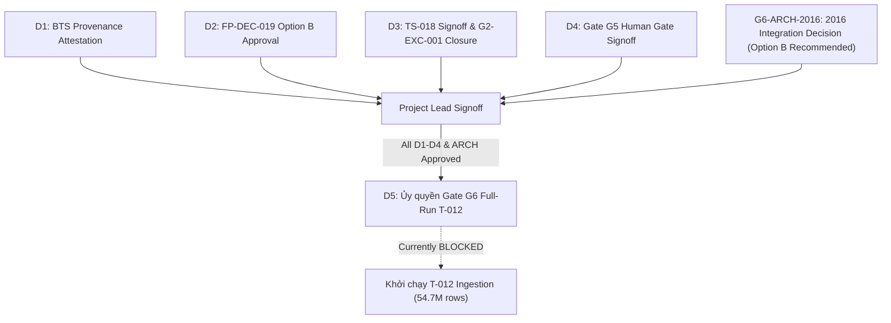

# G6 Corrected Governance Signoff & Project Lead Handoff Dossier

**Document ID:** `DOC-G6-HANDOFF-CORRECTED-001`  
**Classification:** OFFICIAL HUMAN GOVERNANCE HANDOFF DOSSIER  
**Supersedes:** `docs/05-evidence/G6_D1_D5_HUMAN_DECISION_HANDOFF.md`  
**Current Gate:** Gate G5 = IN_PROGRESS / TECHNICALLY READY  
**Target Gate:** Gate G6 = NOT_STARTED / BLOCKED (Awaiting Human D5 Approval)  
**Evaluator:** Principal Big Data Architect, Independent Auditor & Project Governance Officer  
**Date:** 2026-10-20  
**Overall Readiness Verdict:** `READY_FOR_PROJECT_LEAD_D1_D4_AND_G6_2016_ARCH_REVIEW`  

---

## 1. Mục đích và Giới hạn Thẩm quyền Tuyệt đối

Theo điều lệ quản trị nghiêm ngặt tại `AGENTS.md` và `DECISIONS.md`:
1. AI Agent **tuyệt đối không được tự ý phê duyệt** các quyết định chiến lược cấp dự án (D1–D5).
2. AI Agent **không được tự chuyển trạng thái Gate G5 thành PASS** hoặc **tự ý mở Gate G6**.
3. AI Agent **không được tự ý thực thi pipeline T-012 full-run** trên 54,674,003 hàng khi chưa có quyết định D5 bằng văn bản từ Project Lead.
4. Hồ sơ này được thiết lập như một văn kiện bàn giao kỹ thuật chính thức (Authoritative Human Signoff Dossier), đệ trình Project Lead các bằng chứng thực nghiệm đã được kiểm toán độc lập để đưa ra quyết định độc lập.

---

## 2. Ma trận Quyết định Quản trị Chính thức (D1–D5 & G6-ARCH-2016)

| Mã Quyết định | Nội dung Quyết định Chính thức | Trạng thái Kỹ thuật | Trạng thái Quản trị | Thẩm quyền Ký duyệt |
| :---: | :--- | :---: | :---: | :---: |
| **D1** | **BTS Source Provenance Attestation** | **TECHNICALLY_READY** | **PENDING_HUMAN_SIGNATURE** | Project Lead |
| **D2** | **FP-DEC-019 Approval (Option B Candidate Intake Parity)** | **TECHNICALLY_READY** | **PENDING_HUMAN_SIGNATURE** | Project Lead |
| **D3** | **TS-018 Human Technical Signoff & G2-EXC-001 Closure** | **CONDITIONS_MET** | **PENDING_HUMAN_SIGNATURE** | Project Lead |
| **D4** | **Gate G5 Human Signoff (Formal Gate Exit)** | **CONDITIONS_MET** | **PENDING_HUMAN_SIGNATURE** | Project Lead |
| **D5** | **Gate G6 / T-012 Execution Authorization** | **PREFLIGHT_PASS** | **BLOCKED / NOT_AUTHORIZED** | Project Lead |
| **G6-ARCH-2016** | **2016 Baseline Integration Architecture (Option B vs A)** | **RECOMMEND_OPTION_B** | **PENDING_DECISION** | Project Lead |

---

## 3. Chi tiết Bằng chứng Kỹ thuật Từng Quyết định

### 3.1 Quyết định D1: BTS Source Provenance Attestation
- **Phạm vi:** Xác nhận tính xác thực nguồn gốc vật lý, tính toàn vẹn mã băm và xuất xứ của tệp nén chính thức từ Cục Thống kê Giao thông vận tải Hoa Kỳ (BTS TranStats):
  - Đường dẫn: `data/reference/bts_transtats/original/T_ONTIME_REPORTING_20261019_112232.zip`
  - Dung lượng: `29,975,383` bytes
  - SHA-256: `342de99f65561fb856b524c704f2ad3851f8015f52251668ece346dff1350ae6`
- **Khuyến nghị:** Phê duyệt D1 để chính thức công nhận BTS TranStats là nguồn chân lý độc lập (Independent Ground Truth).

### 3.2 Quyết định D2: FP-DEC-019 Approval (Option B)
- **Phạm vi:** Phê duyệt Quyết định Kiến trúc FP-DEC-019 Option B về đối chiếu tương đương số học giữa tập dữ liệu thô tháng 01/2019 và BTS TranStats.
- **Bằng chứng Thực nghiệm:**
  - 1.500/1.500 khóa chuyến bay chọn ngẫu nhiên phân tầng từ `flight_with_weather_2019.csv` khớp 100% với dữ liệu giải nén từ ZIP BTS.
  - Đối chiếu 10.500/10.500 giá trị thuộc đúng 7 trường độ trễ và thời gian bay cốt lõi đạt mức sai số số học bằng 0 (strict exact match).
- **Khuyến nghị:** Phê duyệt D2 với điều kiện duy trì rủi ro OR-08 (không đồng nhất việc khớp tháng 01/2019 với việc xác thực toàn bộ thượng nguồn Kaggle).

### 3.3 Quyết định D3: TS-018 Human Technical Signoff & Đóng G2-EXC-001
- **Phạm vi:** Nghiệm thu kỹ thuật chính thức Task TS-018 và đóng ngoại lệ schema G2-EXC-001.
- **7 Trường Đo Lường Cốt Lõi Được Xác Thực:**
  1. **`ARR_DELAY`** (Độ trễ đến — phút)
  2. **`DEP_DELAY`** (Độ trễ đi — phút)
  3. **`TAXI_OUT`** (Thời gian lăn ra đường băng — phút)
  4. **`TAXI_IN`** (Thời gian lăn vào cổng — phút)
  5. **`AIR_TIME`** (Thời gian bay trên không — phút)
  6. **`ACTUAL_ELAPSED_TIME`** (Tổng thời gian bay thực tế — phút)
  7. **`CRS_ELAPSED_TIME`** (Thời gian bay lịch trình — phút)
- **Hiệu lực của D3:** Khi Project Lead ký D3, ngoại lệ **G2-EXC-001** chuyển trạng thái từ `ACTIVE` sang `CLOSED`.

### 3.4 Quyết định D4: Gate G5 Human Signoff
- **Phạm vi:** Đóng cổng Gate G5 (Intake & Lineage Verification).
- **Điều kiện hoàn thành:** Toàn bộ tiêu chí nghiệm thu của Gate G5 đã đạt về mặt kỹ thuật; gói review package và manifest đã được kiểm toán độc lập xác nhận 100% CRC PASS và hash matching.

### 3.5 Quyết định Kiến trúc G6-ARCH-2016: Lựa chọn Baseline Năm 2016
- **Phạm vi:** Quyết định riêng biệt (không thay thế D4) về phương thức tích hợp năm 2016:
  - **Option A (Tái sử dụng Artifact Parquet T-010 Đóng Băng):** Sử dụng 50 tệp Parquet của T-010. Tiết kiệm tài nguyên nhưng khác biệt về lineage và SafePublisher manifest.
  - **Option B (Khuyến nghị — Tái Nhập Dưới Schema Đã Xác Minh):** Thực hiện ingestion đồng nhất năm 2016 cùng các năm 2017–2024 trong T-012. Đảm bảo toàn bộ 9 năm có chung cấu trúc metadata, định dạng Parquet, partition scheme, và manifest layout. Lưu trữ 50 tệp T-010 làm đối chuẩn Golden Benchmark.
- **Khuyến nghị Chính thức:** **LỰA CHỌN OPTION B**.

### 3.6 Quyết định D5: Cấp phép Thực thi Full-Run T-012 (Gia nhập Gate G6)
- **Phạm vi:** Cho phép tiến trình IngestionCoordinator khởi động ghi 54.674.003 bản ghi production.
- **Tình trạng:** **HIỆN TẠI BỊ KHÓA (BLOCKED / NOT_AUTHORIZED)**. Tuyệt đối không chạy T-012 khi chưa có văn bản ký D5 từ Project Lead.

---

## 4. Các Giới hạn Quản trị Bắt buộc Duy trì

1. **OR-08 (Kaggle Identity Unverified):**  
   Dữ liệu Kaggle không được coi là chân lý gốc; chỉ có dữ liệu BTS TranStats là nguồn tham chiếu chuẩn mực được kiểm chứng.
2. **OR-05 (2024 Partial Coverage):**  
   Năm 2024 thiếu tháng 03/2024 (335/366 ngày). Bắt buộc khai báo `source_coverage_status = 'PARTIAL'`. Không được gọi tổng số hàng là tổng chuyến bay thực tế của Hoa Kỳ.
3. **FP-DEC-017 (Weather CONDITIONAL_NO_GO):**  
   Nhánh dữ liệu thời tiết tiếp tục bị loại trừ hoàn toàn khỏi 8 CORE KPI.
4. **G2-EXC-001 (Provisional Units Exception):**  
   Duy trì trạng thái `ACTIVE` cho đến khi Project Lead chính thức ký quyết định D3.
5. **PARQUET_PARITY_NOT_TESTED:**  
   Tính tương đương số học trên Parquet thực tế sẽ chỉ được kiểm chứng sau khi hoàn thành ghi production dataset trong Gate G6; hiện tại mới chỉ kiểm chứng trên CSV gốc và BTS ZIP.

---

## 5. Kết luận Bàn giao

Toàn bộ hệ thống kiểm định và an toàn vận hành Gate G6 đã sẵn sàng 100% với 40 bài kiểm thử đạt PASS, tương thích hoàn toàn với các contract production `RunManifest`, `ExecutionReceipt`, và `SafePublisher`.

AI Agent trân trọng kính trình Project Lead xem xét và đưa ra quyết định đối với hồ sơ D1–D4 và G6-ARCH-2016.
