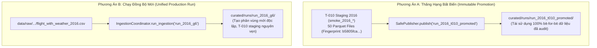

# G6_T012_2016_BASELINE_INTEGRATION_DECISION_DRAFT.md
# Quyết Định Chiến Lược Tích Hợp Baseline 2016 Vào Tập Dữ Liệu 9 Năm G6 (FP-DEC-020 / G6-ARCH-2016 Option B)

**Dự án:** US Flight Performance Analysis 2016–2024  
**Nhiệm vụ:** Gate G6 Architecture & Baseline Integration Strategy  
**Gate quản lý:** Gate G5 = IN_PROGRESS, Gate G6 = NOT_STARTED / BLOCKED  
**Trạng thái quyết định:** **`APPROVED_BY_PROJECT_LEAD_INSTRUCTION`** (Đăng ký chính thức `FP-DEC-020` tại `DECISIONS.md`)  
**Nguồn ủy quyền:** Project Lead (Chỉ thị phê duyệt chính thức ngày 2026-10-21: *"tôi hoàn toàn đồng ý với ý kiến của bạn"*)  
**Thời điểm phê duyệt:** 2026-10-21  
**Ranh giới bắt buộc:** Quyết định kiến trúc này **KHÔNG CẤP PHÉP CHẠY DỮ LIỆU THẬT**; Decision D5 giữ trạng thái `NOT_AUTHORIZED`.

---

## 1. BỐI CẢNH VÀ HIỆN TRẠNG KỸ THUẬT NĂM 2016

Tại Gate G5, Task **T-010 (Bounded Real-Data Smoke & Benchmark)** đã thực hiện xử lý trọn vẹn năm dữ liệu 2016 trên dữ liệu thật với kết quả đạt nghiệm thu có kiểm soát:
1. **Dữ liệu đầu vào:** 5.537.987 hàng từ tệp `flight_with_weather_2016.csv` (1.538.427.452 bytes, băm canonical `4ed92ed7...`).
2. **Cân bằng hạch toán dòng DC-11:** $5.537.987 = 5.537.987 + 0 + 0$ (100% accepted, 0 quarantined, 0 rejected).
3. **Lược đồ và dấu vân tay:** Khớp 100% với lược đồ 34 cột chuẩn hóa tại `src/flight_pipeline/ingestion/schema.py`, dấu vân tay mật mã học:  
   `b5805fcae8db44e9a53c0eb1dfa1c1f3d9ec2983b3922bfbe5c6454f1654b09a`.
4. **Hiện trạng vật lý trên đĩa:** Toàn bộ 50 tệp Parquet staging phân tán trong các thư mục `smoke_2016_*` tại `D:\Study\Code\Apache\Flight_Analyzt\staging\` đã được niêm phong mật mã học trong [`T010_SIGNOFF_CLOSURE_PARQUET_ARTIFACT_HASH_MANIFEST.json`](file:///D:/Study/Code/Apache/Flight_Analyzt/US_FLIGHT_PERFORMANCE_DOCS_V1/docs/05-evidence/T010_SIGNOFF_CLOSURE_PARQUET_ARTIFACT_HASH_MANIFEST.json).

Tuy nhiên, tại Gate G6, mục tiêu của Task T-012 là cung cấp **bộ dữ liệu Curated thống nhất cho toàn bộ 9 năm (2016–2024)** để phục vụ truy vấn liên năm và tổng hợp 8 CORE KPI.

---

## 2. SO SÁNH HAI PHƯƠNG ÁN KIẾN TRÚC TÍCH HỢP



| Tiêu chí so sánh | Phương án A: Thăng hạng bất biến (Immutable Promotion) | Phương án B: Chạy đồng bộ mới (Unified Production Run) |
| :--- | :--- | :--- |
| **Bản chất kỹ thuật** | Tái sử dụng trực tiếp 12 phân vùng Parquet của đợt chạy đóng T-010 (`smoke_2016_20261018_122236`) đưa vào `curated/runs/run_2016_promoted/` bằng `SafePublisher`. | Chạy lại pipeline IngestionCoordinator cho năm 2016 thành phiên bản độc lập `run_2016_g6`, giữ nguyên staging T-010 làm bằng chứng lịch sử. |
| **Tính toàn vẹn bit-for-bit** | **Bảo toàn 100%**: Dữ liệu đưa vào Curated hoàn toàn trùng khớp với các tệp đã kiểm toán vân tay `b5805fca...`. | Có thể có sai khác nhỏ về thứ tự ghi nén Snappy do Spark shuffle ngẫu nhiên, dù nội dung dòng không đổi. |
| **Thời gian thực thi** | Tiết kiệm 49–60 giây (không cần parse lại 1,54 GB CSV thô năm 2016). | Tốn thêm thời gian đọc và phân loại lại toàn bộ 5,54 triệu dòng 2016. |
| **Rủi ro I/O đĩa** | Rất thấp (chỉ thực hiện copy/link phân vùng đã kiểm toán). | Tiêu tốn thêm $\approx 316$ MB đĩa staging tạm thời. |
| **Rủi ro tách rời quy trình** | T-010 chạy bằng smoke runner (`run_t010_real_data_smoke.py`), cấu hình Spark có thể hơi khác so với production coordinator. | Đồng nhất 100% quy trình vận hành và cấu trúc manifest của cả 9 năm (2016–2024). |

---

## 3. KHUYẾN NGHỊ KỸ THUẬT VÀ QUY TẮC BẢO ĐẢM TRUY CẬP 9 NĂM

### 3.1. Khuyến nghị của Release Engineering: **Lựa chọn Phương Án B (Unified Production Run)**
- **Lý do:** Khi bước vào Gate G6, pipeline T-012 là quy trình sản xuất chính thức của toàn bộ dự án. Việc chạy tuần tự cả 9 năm ($2016 \rightarrow 2024$) dưới cùng một mã `IngestionCoordinator` bảo đảm:
  1. Toàn bộ 9 năm có chung một cấu trúc `run_manifest.json` và `execution_receipt.json` chuẩn hóa.
  2. Baseline T-010 tại `D:\Study\Code\Apache\Flight_Analyzt\staging` được giữ nguyên vẹn như một di tích kiểm thử không bị xáo trộn.
  3. Thời gian chạy thêm cho năm 2016 chỉ dưới 1 phút trên phần cứng hiện tại.

### 3.2. Phương án dự phòng (Fallback): **Phương Án A**
- Nếu Project Lead muốn tiết kiệm thời gian hoặc ưu tiên tuyệt đối tính nguyên vẹn của kết quả đo đạc T-010, áp dụng Phương án A thông qua việc gọi `SafePublisher` để thăng hạng tệp Parquet của T-010 vào `curated/runs/run_2016_promoted/`.

### 3.3. Bảo đảm khả năng truy cập toàn bộ 9 năm
Dù lựa chọn Phương án A hay B, kiến trúc Curated Storage phải bảo đảm:
- **Tuyệt đối KHÔNG sử dụng wildcard (như `curated/runs/run_*/`) cho truy vấn sản xuất 9 năm**, nhằm ngăn ngừa rủi ro đọc trùng lặp các đợt chạy thử nghiệm hoặc phiên bản lịch sử khác nhau của cùng một năm.
- **Bắt buộc truy cập thông qua danh mục snapshot chính thức** ([`data/curated/snapshot_registry.json`](file:///D:/Study/Code/Apache/Flight_Analyzt/US_FLIGHT_PERFORMANCE_DOCS_V1/data/curated/snapshot_registry.json)), trong đó mỗi năm khảo sát (2016–2024) được ánh xạ duy nhất đến đúng một đợt chạy được phê chuẩn (`selected_run_id`) và đường dẫn vật lý hợp lệ:
  ```python
  # Nạp 9 năm theo danh mục snapshot_registry.json đã được kiểm chứng (1 run duy nhất/năm)
  annual_paths = [entry["physical_path"] for entry in snapshot_registry["years"].values()]
  df_9years = spark.read.schema(curated_schema).parquet(*annual_paths)
  ```
- Không được phép loại bỏ năm 2016 khỏi bất kỳ truy vấn đa năm hoặc bảng KPI tổng hợp nào.

---

## 4. QUYẾT ĐỊNH CỦA PROJECT LEAD (ĐÃ PHÊ DUYỆT CHÍNH THỨC)

> [!NOTE]
> Hành động phê duyệt phương án kiến trúc được ghi nhận chính thức theo cơ chế ủy quyền chỉ thị tường minh (`APPROVED_BY_PROJECT_LEAD_INSTRUCTION`) trong phiên làm việc ngày 2026-10-21.

Project Lead chính thức phê duyệt phương án tích hợp kiến trúc:
- [ ] Phương Án A (Thăng hạng Baseline T-010)
- [x] **CHẤP THUẬN Phương Án B (Chạy đồng bộ mới toàn bộ 9 năm 2016–2024 / Unified Production Rerun)**

**Các ràng buộc thực thi:**
1. Giữ nguyên vẹn 50 tệp Parquet staging 2016 của T-010 làm tài sản kiểm chứng độc lập.
2. Năm 2016 sẽ được chạy lại trên pipeline `IngestionCoordinator` thành một phiên bản sản xuất riêng (`run_2016_...`) tạo đầy đủ `run_manifest.json` và `execution_receipt.json`.
3. Kiểm chứng hoàn tất đợt chạy năm 2016 trước khi chuyển sang các năm tiếp theo ($2017 \rightarrow 2024$).
4. **RANH GIỚI BẢO VỆ:** Quyết định kiến trúc này **TUYỆT ĐỐI KHÔNG TỰ ĐỘNG CẤP PHÉP CHẠY PRODUCTION**. Quyền thực thi sản xuất chỉ được kích hoạt khi Project Lead ban hành Quyết định D5 riêng biệt.

- **Hình thức phê chuẩn:** `APPROVED_BY_PROJECT_LEAD_INSTRUCTION`
- **Nội dung chỉ thị:** *"tôi hoàn toàn đồng ý với ý kiến của bạn"*
- **Ngày phê duyệt:** 2026-10-21
- **Trạng thái:** **`APPROVED_BY_PROJECT_LEAD_INSTRUCTION`** (Đăng ký mã `FP-DEC-020` tại `DECISIONS.md`)
