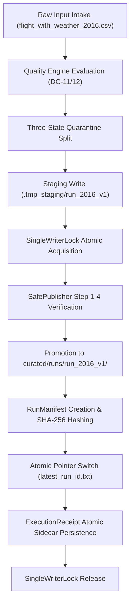

# G6_T012_FIRST_YEAR_EXECUTION_READINESS.md
## Controlled Operational Preflight Checklist for Year 2016 Annual Execution (NO RUN)

**Project:** US Flight Performance Analysis 2016–2024  
**Date:** 2026-10-21  
**Gate Status:** Gate G5 = IN_PROGRESS (TECHNICALLY READY), Gate G6 = NOT_STARTED / BLOCKED  
**Author:** Principal Big Data Engineer & Release Reliability Engineer  
**Execution Status:** **PLANNING & PREFLIGHT ONLY — EXECUTION STRICTLY PROHIBITED**

---

## 1. Strict Operational Policy & Stop Conditions

> [!CAUTION]
> **ABSOLUTE RULE:** This document is an operational preparation protocol. **NO Spark pipeline execution, staging write, or publication pointer update may be executed under this turn.**
> Commencing T-012 execution without explicit human authorization of Decision D5 violates `AGENTS.md` core governance.

The operational strategy follows an annual checkpoint model:
- **Batch 1 (First Annual Run):** Year 2016 only.
- Continuous 9-year execution is strictly prohibited. Each year must be executed, verified, and certified independently before commencing the subsequent year.
- Wildcard globs (`run_*`) are strictly forbidden for downstream KPI consumption; all consumption must resolve through the audited `snapshot_registry.json`.

---

## 2. Pre-Execution Prerequisites (Gate Checkpoints)

Before issuing the `START` command for the 2016 annual run, all of the following conditions must be met:

1. **Governance Approvals:**
   - [ ] Decision D1 signed by Project Lead (BTS Provenance).
   - [ ] Decision D2 ratified by Project Lead (FP-DEC-019 Option B).
   - [ ] Decision D3 signed by Project Lead (TS-018 Signoff, resolving G2-EXC-001).
   - [ ] Decision D4 signed by Project Lead (Gate G5 PASS).
   - [ ] Decision D5 signed by Project Lead (Gate G6 Ingestion Authorization).
   - [ ] Decision G6-ARCH-2016 ratified as Option B (Versioned Rerun).

2. **Storage & Environment Preflight:**
   - [ ] Available NTFS disk capacity on `D:` drive $\ge 25\text{ GiB}$ free (measured $57.83\text{ GiB}$; historical uncalibrated threshold cited $60\text{ GiB}$).
   - [ ] Available physical RAM $\ge 3.0\text{ GiB}$ operational headroom (measured $3.27\text{ GiB}$; recommended driver heap threshold $4.0\text{ GiB}$; historical uncalibrated threshold cited $8\text{ GiB}$).
   - [ ] Source raw files for 2016 (`data/raw/tabular/2016/flight_with_weather_2016.csv`) verified intact against audited source inventory (**5,537,987 raw rows**; supersedes legacy typo 5,617,658).
   - [ ] Baseline T-010 benchmark files in `data/curated/` verified read-only and immutable.
   - [ ] Target run directory strictly assigned to: `data/curated/runs/run_2016_v1/`.
   - [ ] Lock root at `data/locks/` and pointer root at `data/curated/`.
   - [ ] Verify no active lock (`data/locks/.pipeline.lock`) or recovery marker exists.

---

## 3. Execution Pipeline Architecture (Year 2016)

The 2016 annual ingestion follows the hardened 7-step publication sequence:



### Key Invariants During Ingestion:
1. **Three-State Conservation:** Every row must be accounted for as accepted, quarantined, or rejected: `5,537,987 == accepted + quarantined + rejected`.
2. **Schema Compliance:** Parquet output must strictly contain the 7 core measures, core flight identifiers, and ZERO forbidden columns.
3. **Cryptographic Lineage:** Physical Parquet files are recursively scanned, byte-counted, and hashed (streaming SHA-256) directly into `run_manifest.json`.
4. **ExecutionReceipt Sidecar:** `execution_receipt.json` records manifest disk bytes, manifest SHA-256, published path, and row accounting.

---

## 4. Post-Execution Verification Checklist (Single-Year Gate)

Immediately upon completion of the 2016 batch, before updating the snapshot registry:
1. [ ] Check that `data/curated/runs/run_2016_v1/` contains non-empty Parquet files.
2. [ ] Check that `run_manifest.json` status is strictly `"PUBLISHED"`.
3. [ ] Check that `execution_receipt.json` exists in `data/metadata/run_2016_v1/` or `data/curated/runs/run_2016_v1/`.
4. [ ] Run `tools/qa/verify_multiyear_snapshot.py` single-year verification mode:
   ```powershell
   python tools/qa/verify_multiyear_snapshot.py --single-run-year 2016 --run-id run_2016_v1 --base-dir data
   ```
5. [ ] Verify that physical Parquet row count matches `accepted_row_count`.
6. [ ] Reconcile row counts against audited baseline: RAW = 5,537,987 rows.

---

## 5. Rollback & Emergency Abort Procedure

If a failure occurs prior to Step 5 (Pointer Switch):
1. SafePublisher automatically executes non-destructive rollback.
2. Staging temporary directory `.tmp_staging/run_2016_v1` is isolated or preserved for forensic analysis.
3. Lock is released. Previous pointer remains unchanged.
4. Target directory `curated/runs/run_2016_v1` is deleted or quarantined.
5. Project Lead is immediately notified with forensic log.

---

## 6. Planned Operational Commands (Deferred until D5 Authorization)

```powershell
# PREFLIGHT RESOURCE CHECK
python -c "import shutil, psutil; print(f'Free Disk: {shutil.disk_usage(\"data\").free / (1024**3):.2f} GB, Free RAM: {psutil.virtual_memory().available / (1024**3):.2f} GB')"

# LOCK PREFLIGHT CHECK
python tools/qa/check_writer_preflight_safety.py --base-dir data

# ANNUAL INGESTION RUN (YEAR 2016 ONLY) - DEFERRED
# python -m flight_pipeline.ingestion.coordinator --years 2016 --run-id run_2016_v1 --base-data-dir data
```

**Status:** ALL SYSTEMS PREFLIGHT READY. AWAITING HUMAN AUTHORIZATION (D5).
