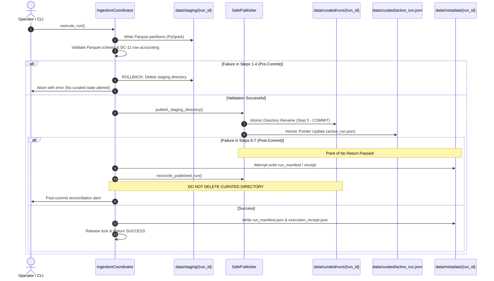

# G6_T012_LOCK_POINTER_RECOVERY_ALIGNMENT.md
## Storage Root, Lock Architecture, and Recovery Reconciliation Alignment (Finding E04)

**Project:** US Flight Performance Analysis 2016–2024  
**Date:** 2026-10-21  
**Gate Status:** G5 = IN_PROGRESS (TECHNICALLY READY) | G6 = NOT_STARTED / BLOCKED  
**Auditor:** Principal Big Data Engineer & Windows NTFS Storage Reliability Engineer  
**Component:** `src/flight_pipeline/ingestion/coordinator.py`, `src/flight_pipeline/storage/locking.py`, `src/flight_pipeline/storage/publication.py`  
**Finding Classification:** E04 (Lock Path Discrepancy & Recovery Sequence Ambiguity)

---

## 1. Forensic Audit of Lock Path and Storage Roots

An independent audit of the codebase revealed that historical documentation and diagnostic scripts referenced divergent lock paths. Specifically, certain documents cited `data/curated/.single_writer.lock`, whereas the actual production pipeline coordinator implements:

```python
# IngestionCoordinator.__init__() in coordinator.py:
self.lock_dir = self.base_data_dir / "locks"
self.lock = SingleWriterLock(lock_dir=self.lock_dir)
```

Within `SingleWriterLock` (`src/flight_pipeline/storage/locking.py`), the lock file name defaults to:
```python
DEFAULT_LOCK_FILE_NAME = ".pipeline.lock"
```
Therefore, for `--base-data-dir data`, the canonical physical lock file is:
$$\mathbf{data/locks/.pipeline.lock}$$

### Authoritative Storage Root Directory Map

All production pipeline components are strictly anchored under `--base-data-dir` (`data`):

| Component Root | Physical Path Relative to Workspace | Purpose & Invariant |
|---|---|---|
| **Lock Directory** | `data/locks/` | Hosts `.pipeline.lock` mutex file with process ID metadata |
| **Staging Root** | `data/staging/{run_id}/` | Ephemeral scratch directory for uncommitted PySpark writes |
| **Curated Runs Root** | `data/curated/runs/{run_id}/` | Immutable published Parquet datasets |
| **Active Pointer File** | `data/curated/active_run.json` | Atomic pointer to certified active run (`SafePublisher`) |
| **Metadata Audit Root** | `data/metadata/{run_id}/` | Sidecar receipts (`run_manifest.json`, `execution_receipt.json`) |
| **Raw Tabular Source** | `data/raw/tabular/{year}/` | Immutable, read-only BTS/weather raw CSV files |

---

## 2. Preflight Tool Path Alignment

To ensure that preflight safety checks inspect the exact directory structure utilized by `IngestionCoordinator`, `tools/qa/check_writer_preflight_safety.py` and `tools/qa/verify_staging_pointer.py` enforce:
1. **Unified `--base-data-dir`:** Both tools accept `--base-data-dir` (default: `data`) and derive `lock_dir = base_data_dir / "locks"`.
2. **Lock Liveness & UNKNOWN State Handling:** `check_writer_preflight_safety.py` reads PID metadata from `data/locks/.pipeline.lock`. If the process is alive on Windows, it fails closed (`ACTIVE_WRITER_RUNNING`). If the PID state cannot be verified, it treats it as fail-closed (`UNKNOWN_LOCK_STATE`).
3. **Pointer-Lock Orthogonality:** Clean pointer state (`data/curated/active_run.json`) does NOT imply clean lock state. Both must be verified independently prior to pipeline acquisition.

---

## 3. Two-Phase Commit & Recovery Failure Modes

The execution lifecycle of `IngestionCoordinator` is structured into two distinct failure regimes:



### Pre-Commit vs. Post-Commit Recovery Protocol

1. **Pre-Commit Failure (Steps 1–4):**
   - **Trigger:** Spark partition write failure, schema validation error, forbidden column detection, or DC-11 row accounting imbalance.
   - **Action:** Full rollback. Staging directory `data/staging/{run_id}/` is completely purged.
   - **Catalog Impact:** Zero. `data/curated/` and `data/curated/active_run.json` remain untouched.
2. **Post-Commit Failure (Steps 5–7):**
   - **Trigger:** Atomic directory rename has succeeded, but subsequent disk write for `run_manifest.json` or `execution_receipt.json` fails.
   - **Critical Rule:** **DO NOT DELETE `data/curated/runs/{run_id}/`**. Because `active_run.json` has already been updated to point to `{run_id}`, wiping the directory would result in a broken, dangling pointer.
   - **Action:** Trigger `SafePublisher.reconcile_published_run()`. Re-synthesizes manifest and receipt directly from physical Parquet inspection and locks catalog until metadata is consistent.

---

## 4. Preflight Verification Commands

To verify lock, pointer, and storage root consistency prior to T-012 execution:

```powershell
# 1. Inspect lock, pointer, and staging safety
python tools/qa/check_writer_preflight_safety.py --base-data-dir data

# 2. Inspect active pointer resolution and target directory existence
python tools/qa/verify_staging_pointer.py --base-data-dir data
```

Both tools must report 0 errors and complete cleanly.
