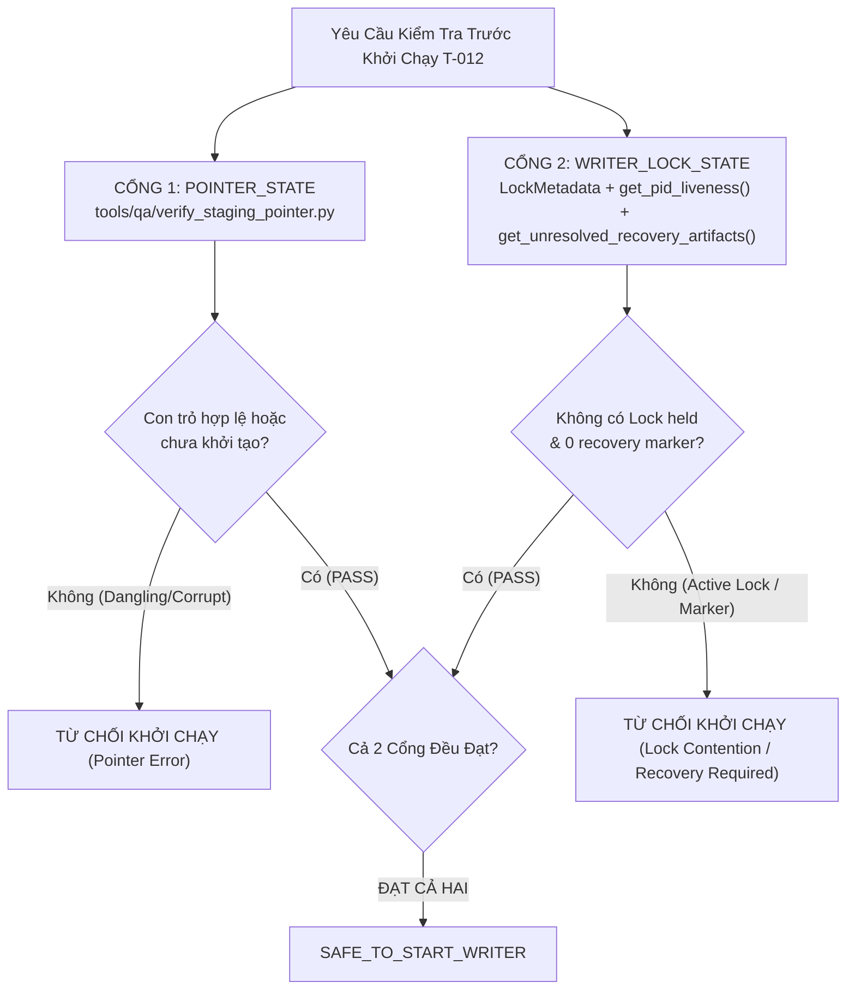

# G6_T012_POINTER_AND_LOCK_CONTRACT_AUDIT.md
# Kiểm Toán Hợp Đồng Kỹ Thuật Giữa Con Trỏ Xuất Bản và Cơ Chế Khóa Độc Quyền (Finding P02)

**Dự án:** US Flight Performance Analysis 2016–2024  
**Nhiệm vụ:** Forensic Concurrency Audit & Contract Decoupling  
**Module phân tích:** `src/flight_pipeline/storage/publication.py` & `src/flight_pipeline/storage/locking.py`  
**Bộ kiểm thử chứng minh:** `tests/test_lock_state_vs_pointer_state.py`  
**Gate quản lý:** Gate G5 = IN_PROGRESS, Gate G6 = NOT_STARTED / BLOCKED  
**Tác giả:** Windows NTFS Concurrency Engineer, Independent Forensic Auditor  
**Thời điểm lập:** 2026-10-20  

---

## 1. MỤC ĐÍCH VÀ BẢN CHẤT SAI LỆCH KIỂM TOÁN (FINDING P02)

Trong tài liệu chuẩn bị vận hành G6 trước đây ([`G6_T012_READINESS_CHECKLIST.md`](file:///D:/Study/Code/Apache/Flight_Analyzt/US_FLIGHT_PERFORMANCE_DOCS_V1/docs/05-evidence/G6_T012_READINESS_CHECKLIST.md)), mục P-06 đã hướng dẫn kiểm tra trạng thái khóa bằng lệnh:
```bash
python tools/qa/verify_staging_pointer.py --allow-uninitialized
```
và kết luận hệ thống "sạch" (`CLEAN (PASS)`) để bắt đầu ghi.

**Phát hiện kiểm toán độc lập:**
- Đây là lỗi gộp trạng thái (conflation) nguy hiểm:
  * Lệnh trên chỉ kiểm tra xem tệp con trỏ `latest_run_id.txt` có tồn tại hay không.
  * Khi con trỏ chưa được tạo, công cụ trả về `UNINITIALIZED_POINTER_ALLOWED`.
  * **TUY NHIÊN**, việc con trỏ chưa tồn tại **hoàn toàn không đồng nghĩa** với việc không có writer nào đang hoạt động! Nếu một writer khác vừa khởi động, đang ghi dữ liệu vào staging và đang giữ tệp `.pipeline.lock`, lệnh kiểm tra con trỏ vẫn trả về `UNINITIALIZED_POINTER_ALLOWED`.
  * Nếu dựa vào kết quả này để cấp phép khởi chạy writer mới, hai tiến trình ghi sẽ xung đột dữ liệu trên cùng một thư mục staging (Race Condition và Data Corruption).

---

## 2. MA TRẬN PHÂN ĐỊNH RANH GIỚI HỢP ĐỒNG (DUAL-GATE CONTRACT)

Để bảo đảm an toàn vận hành, hệ thống thiết lập hai cổng kiểm soát hoàn toàn độc lập và song song:



| Đặc tính kỹ thuật | Cổng 1: Trạng thái con trỏ (`POINTER_STATE`) | Cổng 2: Trạng thái khóa (`WRITER_LOCK_STATE`) |
| :--- | :--- | :--- |
| **Module phụ trách** | `flight_pipeline.storage.publication.SafePublisher` | `flight_pipeline.storage.locking.SingleWriterLock` |
| **Vị trí tệp tin** | `<base_dir>/curated/latest_run_id.txt` | `<base_dir>/locks/.pipeline.lock` |
| **Đối tượng phục vụ** | Người đọc dữ liệu (Reader) và công cụ đối soát | Tiến trình ghi dữ liệu (Writer) |
| **Ý nghĩa khi tệp không tồn tại** | Chưa có phiên bản nào được xuất bản (Uninitialized) | Không có writer nào đang giữ tài nguyên (Clean lock state) |
| **Ý nghĩa khi tệp tồn tại** | Chỉ đến phiên bản xuất bản mới nhất (`run_id`) | Có một phiên writer đang chiếm giữ độc quyền |
| **Chế độ kiểm tra** | Chỉ đọc (`verify_staging_pointer.py`) | Đọc siêu dữ liệu và kiểm tra liveness qua hệ điều hành |

---

## 3. PHÂN TÍCH QUY TRÌNH KIỂM TRA LIVENESS VÀ RECOVERY MARKER

### 3.1. Phân loại trạng thái sống còn của tiến trình (`get_pid_liveness`)
Khi phát hiện tệp khóa `.pipeline.lock` trên đĩa:
1. Đọc nội dung tệp JSON `LockMetadata` để lấy `pid`, `owner_token`, `hostname`, `created_at`.
2. Kiểm tra liveness qua hàm `get_pid_liveness(metadata.pid)`:
   - **`PROCESS_ALIVE`:** Tiến trình sở hữu khóa vẫn đang chạy bình thường trên hệ điều hành. **Tuyệt đối cấm khởi chạy writer mới**. Báo lỗi `LockContentionError`.
   - **`PROCESS_DEAD`:** Tiến trình sở hữu khóa đã kết thúc đột ngột mà không kịp giải phóng khóa (stale lock). **LƯU Ý:** Việc PID đã chết **KHÔNG TỰ ĐỘNG CẤP QUYỀN** cho hệ thống tự ý xóa tệp khóa. Khóa phải được giữ nguyên để điều tra nguyên nhân sự cố và yêu cầu người vận hành thực thi lệnh phá khóa có kiểm soát qua `break_stale_lock(force=True)`.
   - **`PROCESS_STATUS_UNKNOWN` / `INVALID_PID`:** Không thể xác minh trạng thái tiến trình (do khác biệt nền tảng, quyền hạn hoặc lỗi truy vấn hệ thống). Áp dụng triệt để nguyên tắc **`FAIL_CLOSED — MANUAL_RECOVERY_REQUIRED`**, từ chối khởi chạy writer mới.

### 3.2. Quét các tệp đánh dấu phục hồi chưa giải quyết (`get_unresolved_recovery_artifacts`)
Cơ chế khóa quét tìm các mẫu tệp:
- `*.del_*`: Tệp tạm đang xóa dở dang do sự cố I/O.
- `*.failed_acq_*`: Tệp ghi siêu dữ liệu thất bại khi chiếm khóa.
- `*.quarantine_*`: Tệp bị cách ly do xung đột token hoặc can thiệp trái phép.
- `*.release_in_progress_*`: Tệp đánh dấu đang giải phóng khóa.
- `*.recovery_required*`: Tệp đánh dấu sự cố bền vững sau khi giải phóng thất bại.

Nếu phát hiện **bất kỳ một tệp nào** thuộc danh sách trên, `SingleWriterLock.acquire()` sẽ chủ động ném ngoại lệ `UnresolvedRecoveryStateError` và chặn đứng mọi hoạt động ghi mới cho đến khi có can thiệp có chủ quyền của người vận hành qua `resolve_recovery_state()`.

---

## 4. KẾT QUẢ KIỂM THỬ HỒI QUY CHỨNG MINH ĐỘC LẬP

Bộ kiểm thử hồi quy chuyên dụng [`tests/test_lock_state_vs_pointer_state.py`](file:///D:/Study/Code/Apache/Flight_Analyzt/US_FLIGHT_PERFORMANCE_DOCS_V1/tests/test_lock_state_vs_pointer_state.py) đã được thực thi và đạt **3/3 PASS (100%)**:

```
tests/test_lock_state_vs_pointer_state.py::TestLockStateVsPointerStateRegression::test_p02_negative_uninitialized_pointer_with_active_lock_is_not_safe ... ok
tests/test_lock_state_vs_pointer_state.py::TestLockStateVsPointerStateRegression::test_p02_negative_uninitialized_pointer_with_recovery_artifact_is_not_safe ... ok
tests/test_lock_state_vs_pointer_state.py::TestLockStateVsPointerStateRegression::test_p02_dead_pid_does_not_authorize_auto_deletion ... ok

----------------------------------------------------------------------
Ran 3 tests in 0.062s

OK
```

### Chứng minh thực nghiệm:
1. Trong ca kiểm thử `test_p02_negative_uninitialized_pointer_with_active_lock_is_not_safe`: Con trỏ xuất bản hoàn toàn vắng mặt, hàm kiểm tra con trỏ trả về `UNINITIALIZED_POINTER_ALLOWED`. Tuy nhiên, vì có một tệp lock đang được giữ bởi PID đang sống, bộ đánh giá kép đã chặn đứng và từ chối cấp phép `safe_to_start_writer = False`, ném lỗi `LockContentionError`.
2. Trong ca kiểm thử `test_p02_dead_pid_does_not_authorize_auto_deletion`: Khi PID đã chết, tệp khóa `.pipeline.lock` vẫn được giữ nguyên vẹn trên đĩa, không bị xóa tự động.

---

## 5. KẾT LUẬN VẬN HÀNH

- Việc suy diễn trạng thái khóa từ con trỏ xuất bản đã được loại bỏ hoàn toàn khỏi toàn bộ tài liệu và checklist của Gate G6.
- Tiêu chí P-06b trong [`G6_T012_READINESS_CHECKLIST.md`](file:///D:/Study/Code/Apache/Flight_Analyzt/US_FLIGHT_PERFORMANCE_DOCS_V1/docs/05-evidence/G6_T012_READINESS_CHECKLIST.md) hiện được ghi nhận là `PENDING_OPERATIONAL_VERIFICATION` cho đến thời điểm bấm nút khởi chạy từng mẻ dữ liệu trong Gate G6.
