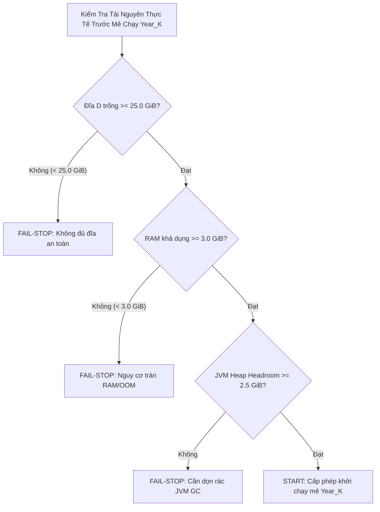

# G6_T012_RESOURCE_PRESTART_POLICY.md
# Chính Sách Ngưỡng An Toàn Tài Nguyên Trước Khởi Chạy T-012 (Resource Pre-Start Policy)

**Dự án:** US Flight Performance Analysis 2016–2024  
**Nhiệm vụ:** T-012 — Operational Resource Governance & Dynamic Thresholds  
**Gate quản lý:** Gate G5 = IN_PROGRESS, Gate G6 = NOT_STARTED / BLOCKED  
**Tác giả:** Principal Storage Reliability Engineer & Apache Spark Architect  
**Thời điểm lập:** 2026-10-20  

---

## 1. MỤC ĐÍCH VÀ NGUYÊN TẮC BẢO VỆ TÀI NGUYÊN

Xử lý toàn bộ 9 năm dữ liệu bay Hoa Kỳ (54,67 triệu bản ghi, 15,20 GB CSV thô) trên môi trường máy trạm đơn nốt chạy Windows NTFS đòi hỏi kiểm soát tài nguyên nghiêm ngặt trước và trong từng mẻ chạy hàng năm.

**Nguyên tắc bảo vệ tài nguyên:**
1. **Dung lượng đĩa khả dụng cao không đồng nghĩa đủ bộ nhớ RAM:** Dung lượng đĩa trống chỉ bảo đảm không gian lưu trữ và bộ đệm shuffle; việc ngăn ngừa lỗi tràn bộ nhớ (OutOfMemoryError) phụ thuộc vào RAM khả dụng của hệ điều hành và dung lượng heap của JVM.
2. **Không cam kết thời gian chạy từ phép ngoại suy một năm:** Con số 8,1 phút (từ T-010 benchmark $49,22\text{ s} \times 9,87$) hoặc 75–120 phút là các **ước tính toán học lý thuyết (UNPROVEN ESTIMATION)**. Thời gian thực tế có thể biến động tùy thuộc vào hoạt động thu gom rác (JVM Garbage Collection), độ trễ bộ nhớ đệm hệ điều hành và tải ứng dụng nền.
3. **Kiểm tra động ngay trước từng mẻ chạy (Dynamic Pre-Batch Check):** Mọi ngưỡng an toàn tài nguyên phải được đo lường thực tế ngay trước khi bấm nút khởi chạy từng năm, không dựa vào các ảnh chụp tài nguyên cũ.

---

## 2. BẢNG PHÂN BỔ NGÂN SÁCH LƯU TRỮ VÀ HỆ SỐ AN TOÀN

Dựa trên số đo thực tế tại phiên preflight (2026-10-20):
- **Dung lượng đĩa Drive D trống đo thực tế:** `62,174,007,296` bytes.
  * Đơn vị nhị phân: **`57.90 GiB`**.
  * Đơn vị thập phân: **`62.17 GB`**.

### Bảng phân bổ ngân sách lưu trữ tối đa cho T-012:

| Thành phần lưu trữ | Ngân sách (Thập phân GB) | Ngân sách (Nhị phân GiB) | Căn cứ định lượng từ Benchmark T-010 |
| :--- | :---: | :---: | :--- |
| **1. Curated Parquet 9 năm (Snappy)** | `3.28 GB` | `3.05 GiB` | Tỷ lệ nén đo tại T-010: $4,63\times$ ($15,20\text{ GB} / 4,63$). |
| **2. Staging Parquet tạm thời** | `3.28 GB` | `3.05 GiB` | Bộ đệm staging 2 pha trước khi thăng hạng. |
| **3. Bảng KPI tổng hợp (Parquet)** | `1.00 GB` | `0.93 GiB` | Bảng 17 cột trên 4 chiều phân tích. |
| **4. Quarantine & Forensic Audit Logs** | `0.80 GB` | `0.75 GiB` | Lưu vết bản ghi bất thường và nhật ký kiểm toán. |
| **5. Bộ đệm xáo trộn (Spark Shuffle Buffer)** | `8.00 GB` | `7.45 GiB` | Bộ đệm tạm thời khi nhóm và sắp xếp dữ liệu. |
| **6. Dự phòng lưu giữ phiên bản (Rollback)** | `3.50 GB` | `3.26 GiB` | Lưu giữ phiên bản cũ trong trường hợp rollback. |
| **TỔNG NGÂN SÁCH ĐĨA TỐI ĐA** | **`19.86 GB`** | **`18.50 GiB`** | Tổng nhu cầu không gian đĩa cực đại của full-run. |

### Tính toán hệ số an toàn (Safety Multiplier) nhất quán:
- Theo đơn vị nhị phân: $\text{Safety Multiplier} = \frac{57.90\text{ GiB}}{18.50\text{ GiB}} = \mathbf{3.13\times}$.
- Theo đơn vị thập phân: $\text{Safety Multiplier} = \frac{62.17\text{ GB}}{19.86\text{ GB}} = \mathbf{3.13\times}$.
- Đối với năm đầu tiên (2017), nhu cầu thực tế chỉ $\approx 1,5$ GB, hệ số an toàn đạt trên **$38\times$**.

---

## 3. CHÍNH SÁCH NGƯỠNG ĐỘNG TRƯỚC TỪNG MẺ CHẠY (DYNAMIC START/STOP THRESHOLDS)

Trước khi thực hiện khởi chạy mẻ dữ liệu của từng năm ($Year_K$), hệ thống phải chạy kiểm tra động và tuân thủ các ngưỡng sau:

| Tài nguyên | Chỉ số kiểm tra | Ngưỡng bắt buộc (START Condition) | Hành động khi dưới ngưỡng (STOP Condition) |
| :--- | :--- | :--- | :--- |
| **Dung lượng đĩa Drive D** | `shutil.disk_usage('D:').free` | **$\ge 25.0\text{ GiB}$** ($26.84\times 10^9$ bytes) | **DỪNG HỆ THỐNG (FAIL-STOP)**. Dọn dẹp thư mục tạm `.tmp_*` cũ ngoài vùng găng, giải phóng không gian đĩa. |
| **Bộ nhớ RAM vật lý khả dụng** | `psutil.virtual_memory().available` | **$\ge 3.0\text{ GiB}$** ($3.22\times 10^9$ bytes) | **TẠM DỪNG (HOLD)**. Đóng các ứng dụng đồ họa/trình duyệt nền, chờ bộ nhớ RAM được giải phóng. |
| **Khoảng trống Driver JVM Heap** | `Runtime.getRuntime().freeMemory()` | **$\ge 2.5\text{ GiB}$** (trên ngân sách heap 4g) | **KÍCH HOẠT GC**. Kích hoạt dọn rác JVM trước khi nạp tệp CSV mới; nếu không tăng, khởi động lại Spark Session. |
| **Trạng thái thư mục tạm Spark** | `D:\Study\Code\Apache\Flight_Analyzt\tmp_spark\` | Đĩa chứa scratch directory trống $\ge 15.0$ GiB | **DỌN DẸP SCRATCH**. Xóa tệp shuffle cũ từ các phiên đã kết thúc hợp lệ. |

---

## 4. QUY ĐỊNH VỀ THỜI GIAN THỰC THI

1. Không sử dụng mốc thời gian 8,1 phút như một cam kết hiệu năng với người dùng hay hội đồng nghiệm thu.
2. Thiết lập thời gian chờ tối đa (Timeout Guard) cho mỗi năm dữ liệu là **15 phút**. Nếu một năm vượt quá 15 phút mà chưa hoàn tất ghi Parquet, hệ thống kích hoạt cảnh báo suy giảm hiệu năng I/O hoặc nghẽn khóa để người vận hành kiểm tra.
3. Tổng thời gian ước tính toàn bộ 9 năm được ghi nhận thận trọng là **75 – 120 phút**.
