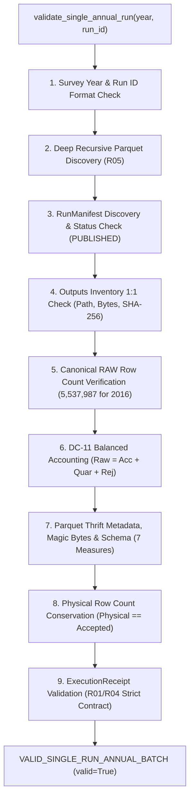

# G6_T012_SINGLE_RUN_VALIDATION_CONTRACT.md
## Specification and Verification Contract for Single Annual Execution Batches (Finding E02)

**Project:** US Flight Performance Analysis 2016–2024  
**Date:** 2026-10-21  
**Gate Status:** G5 = IN_PROGRESS (TECHNICALLY READY) | G6 = NOT_STARTED / BLOCKED  
**Component:** `tools/qa/verify_multiyear_snapshot.py` (`validate_single_annual_run`)  
**Specification Owner:** Principal Big Data QA Engineer & PySpark Release Architect  
**Contract ID:** G6-E02-SINGLE-RUN-CONTRACT-V1

---

## 1. Problem Statement & Finding E02 Context

The legacy validation harness in `tools/qa/verify_multiyear_snapshot.py` was exclusively designed to evaluate multi-year snapshot registries (`multi_year_dataset_registry.json`). By construction, Invariant 1 mandated that all nine survey years (2016–2024) be present simultaneously:
```python
# Legacy Invariant 1:
if set(declared_years) != set(CANONICAL_YEARS):
    return SnapshotValidationResult(valid=False, status="MISSING_SURVEY_YEARS", ...)
```

When designing the operational runbook for Year 2016 execution (`T-012`), prior drafts instructed operators to execute:
```powershell
python tools/qa/verify_multiyear_snapshot.py --registry-path data/curated/snapshot_registry_2016_candidate.json
```
This instruction was physically impossible without creating nine synthetic dummy runs or bypassing Invariant 1. Such artificial workarounds directly violate repository governance policies against fabricating non-existent execution runs.

---

## 2. Single-Run Verification Architecture (`validate_single_annual_run`)

To enable rigorous, fail-closed verification of annual execution batches immediately following their completion, `validate_single_annual_run` was implemented in `tools/qa/verify_multiyear_snapshot.py`.

### Architectural Invariants Evaluated



### Detailed Invariant Specifications

1. **Run ID & Directory Confinement:**
   - Validates `run_id` matches `^[a-zA-Z0-9_.-]+$`.
   - Resolves target directory strictly inside `<base_data_dir>/curated/runs/<run_id>/`.
   - Fails closed if directory does not exist or is a symlink/reparse point.
2. **Deep Recursive Parquet Discovery (R05):**
   - Employs `discover_physical_parquet_files()` to find all `.parquet` files at any folder depth.
   - Enforces fail-closed detection of symlinks or NTFS junctions.
   - Deterministically sorts files by canonical POSIX relative path.
3. **Run Manifest Integrity:**
   - Discovers `run_manifest.json` in candidate directories (`curated/runs/{run_id}/` or `metadata/{run_id}/`).
   - Requires `status == "PUBLISHED"`.
   - Requires `configuration.years` contains the target survey year.
4. **Outputs Inventory 1:1 Verification (R02, R03):**
   - Every declared output must exist on disk, match byte size, and match 64-character hex SHA-256.
   - Any physical file on disk not declared in `outputs` triggers `UNLISTED_PHYSICAL_PARQUET_DETECTED`.
   - Any declared output missing from disk triggers `MANIFEST_FILE_NOT_FOUND`.
5. **Canonical Source Baseline (E01):**
   - Manifest `raw_row_count` must strictly match `AUDITED_SOURCE_INVENTORY[year].audited_row_count`.
   - For 2016, this strictly enforces 5,537,987 rows (rejecting 5,617,658).
6. **DC-11 Balanced Accounting:**
   - Manifest `row_accounting` must satisfy:
     $$\text{raw\_row\_count} = \text{accepted\_row\_count} + \text{quarantined\_row\_count} + \text{rejected\_row\_count}$$
   - All accounting values must be valid non-negative integers.
7. **Parquet Schema & Thrift Metadata:**
   - Validates Parquet magic bytes (`PAR1`), Thrift metadata footers, and physical schema.
   - Must contain all 7 CORE measures (`DEP_DELAY`, `ARR_DELAY`, `TAXI_OUT`, `TAXI_IN`, `CRS_ELAPSED_TIME`, `ACTUAL_ELAPSED_TIME`, `AIR_TIME`).
   - Must contain zero forbidden columns (`CRS_ARR_TIME_CANONICAL`, derived weather causes, etc.).
8. **Physical Row Count Conservation:**
   - Sum of physical row counts across all discovered Parquet files must strictly equal `accepted_row_count`.
9. **ExecutionReceipt Strict Validation (R01, R04):**
   - `execution_receipt.json` is mandatory for production releases.
   - Validates `run_id`, `task_id`, `pipeline_state == "PUBLISHED"`, `publication_status == "PUBLISHED"`.
   - Validates `manifest_bytes` and `manifest_sha256` match disk manifest.
   - Validates receipt row accounting matches manifest row accounting.
10. **Special Scope Invariant (OR-05):**
    - If year is 2024, manifest must declare `source_coverage_status = "PARTIAL"`.

---

## 3. CLI Invocation Interface

The verifier can be invoked directly from PowerShell or bash:

```powershell
python tools/qa/verify_multiyear_snapshot.py --single-run-year 2016 --run-id run_2016_v1 --base-data-dir data
```

### Exit Codes & Machine-Readable Output

- **Exit Code 0:** Validation succeeded. Returns JSON payload with `valid: true`, `status: "VALID_SINGLE_RUN_ANNUAL_BATCH"`, total row metrics, and selected path.
- **Exit Code 1:** Validation failed. Returns JSON payload with `valid: false`, specific fail-closed error status, and detailed diagnostics.

---

## 4. Verification Evidence

The single-run verification contract was validated via automated tests in `tests/test_multiyear_snapshot_policy.py`:
- `test_pos_e02a_valid_single_annual_run_passes`: **PASS**
- `test_neg_e02b_single_annual_run_row_mismatch_fails_closed`: **PASS**
- `test_neg_e02c_single_annual_run_missing_receipt_fails_closed`: **PASS**
- `test_neg_e02d_single_annual_run_unlisted_deep_parquet_fails_closed`: **PASS**
