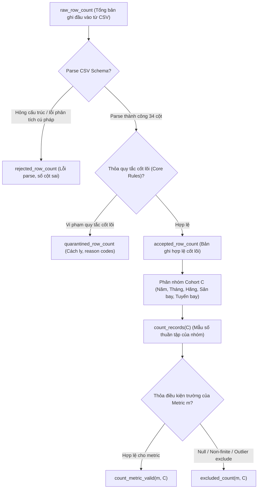

# T-002: ĐỀ XUẤT QUY TẮC MẪU SỐ VÀ HẠCH TOÁN BẢN GHI (DENOMINATOR & ROW ACCOUNTING RECOMMENDATION)

- **Mã nhiệm vụ:** `T-002` (Denominator & Row Accounting Strategy)
- **Gate:** `G2` (Data Quality, Cohort & Metric Contracts)
- **Ngày thực hiện:** 2026-10-14
- **Vai trò:** AI Data Engineer
- **Trạng thái:** **`PROPOSED_AND_CONTRACT_ALIGNED (Ready for G2 Review)`**
- **Văn bản quy định tuân thủ:** [`AGENTS.md`](../../AGENTS.md), [`DATA_CONTRACT.md`](../02-design/DATA_CONTRACT.md), [`KPI_SPEC.md`](../02-design/KPI_SPEC.md), [`BACKLOG.md`](../01-planning/BACKLOG.md).

---

## 1. Mục tiêu và Nguyên tắc cốt lõi

Nhiệm vụ **T-002.4** thiết lập các quy tắc chính thức về mẫu số phân tích (*analysis denominator*) và hạch toán bản ghi (*row accounting*) nhằm bảo đảm:
1. **Tuân thủ tuyệt đối Hợp đồng Dữ liệu:** Không làm thay đổi định nghĩa đã thống nhất tại [`DATA_CONTRACT.md`](../02-design/DATA_CONTRACT.md) DC-11 và DC-12, cùng các công thức tại [`KPI_SPEC.md`](../02-design/KPI_SPEC.md).
2. **Loại trừ lẫn nhau (Mutually Exclusive Accounting):** Mỗi bản ghi đầu vào thuộc đúng một trạng thái duy nhất: `accepted`, `quarantined`, hoặc `rejected`.
3. **Phân định rạch ròi giữa Mẫu số thuần tập (Cohort Denominator) và Mẫu số hợp lệ của từng chỉ số (Metric-Specific Valid Denominator).**
4. **Không nhầm lẫn tỷ lệ hợp lệ dữ liệu với mức độ bao phủ thị trường hàng không Hoa Kỳ.**

---

## 2. Quy tắc Hạch toán Bản ghi cấp Hệ thống (System-Level Row Accounting — DC-11)

Tại mỗi năm nguồn dữ liệu (`source_year`) và mỗi lần thực thi pipeline (`run_id`), toàn bộ các dòng dữ liệu đầu vào (loại trừ dòng tiêu đề CSV) được phân loại vào đúng một trong ba trạng thái:

### 2.1. Định nghĩa chi tiết 3 trạng thái bản ghi
1. **`raw_row_count`:**
   - Tổng số dòng dữ liệu đọc được từ tệp CSV (không tính header).
   - Với dữ liệu hiện hữu: $\sum_{y=2016}^{2024} \text{raw\_row\_count}(y) = 54,674,003$ dòng.
2. **`rejected_row_count`:**
   - Các dòng bị lỗi cú pháp nghiêm trọng không thể đọc được theo định dạng CSV, dòng bị cắt cụt (*truncated*), dòng thiếu/thừa số lượng cột ($ \ne 34 $ cột), hoặc mã hóa ký tự bị hỏng không thể phục hồi.
   - Các bản ghi này được đếm số lượng, ghi nhận mã lỗi chẩn đoán (*diagnostic log*), và hoàn toàn bị loại khỏi các bước tính toán tiếp theo.
3. **`quarantined_row_count`:**
   - Các bản ghi parse được thành 34 trường nhưng vi phạm **quy tắc hợp lệ cốt lõi (Core Ingestion Rules)**, bao gồm:
     - `FL_DATE` bị null, rỗng, hoặc không parse được ngày hợp lệ; năm trong `FL_DATE` không khớp với `source_year`.
     - `OP_CARRIER` không thuộc danh mục mã hãng hàng không hợp lệ.
     - `ORIGIN` hoặc `DEST` không phải mã sân bay 3 ký tự hợp lệ.
     - `CRS_DEP_TIME` hoặc `CRS_ARR_TIME` không parse được chuỗi thời gian.
   - Các bản ghi này được lưu trữ riêng tại bảng cách ly (*quarantine storage*) kèm lý do cách ly (*reason code*), không đưa vào tập `accepted`.
4. **`accepted_row_count`:**
   - Các bản ghi đáp ứng đầy đủ các quy tắc hợp lệ cốt lõi.
   - **Lưu ý quan trọng (F04 Resolution):** Việc một bản ghi bị thiếu giá trị thời tiết (6 cột `O_*`, `D_*`) **KHÔNG** làm bản ghi bị cách ly hay từ chối; bản ghi vẫn được chấp nhận vào `accepted_row_count` vì các trường vận hành bay vẫn đầy đủ.
   - **Phân định rõ ràng giữa Thiết kế và Thực thi:** Số lượng $54,674,003$ bản ghi là tổng số bản ghi thô (`raw_row_count`) đã được kiểm toán từ CSV. Số lượng thực tế của `accepted_row_count`, `quarantined_row_count`, `rejected_row_count` là kết quả vận hành runtime của pipeline nạp dữ liệu PySpark tại G4/G5 (T-007, T-008). Tuyệt đối **không khẳng định toàn bộ 54.67 triệu bản ghi thô đều là `accepted` trước khi pipeline chạy và kiểm chứng core-rule validation**.

### 2.2. Bất biến hạch toán bắt buộc (Accounting Invariant)
Bắt buộc thỏa mãn phương trình bảo toàn trên mọi lần chạy:
$$\mathbf{raw\_row\_count = accepted\_row\_count + quarantined\_row\_count + rejected\_row\_count}$$
- Không tồn tại trạng thái thứ tư.
- Tỷ lệ chấp nhận nạp dữ liệu:
  $$\text{ingest\_acceptance\_rate} = \frac{\text{accepted\_row\_count}}{\text{raw\_row\_count}} \quad (\text{khi } \text{raw\_row\_count} > 0)$$

---

## 3. Quy tắc Mẫu số của Chỉ số KPI (Metric Denominator Rules — DC-12)

Mọi bảng tổng hợp và phép tính KPI trong đồ án chỉ được thực hiện trên tập các bản ghi **`accepted`**. Khi tính toán cho một thuần tập $C$ (xác định bởi bộ lọc chiều phân tích: năm, tháng, hãng, sân bay đi/đến, tuyến bay) và một chỉ số phụ $m$:

### 3.1. Các tham số mẫu số chuẩn hóa
1. **`count_records` (Mẫu số thuần tập):**
   $$\text{count\_records}(C) = \text{accepted\_row\_count}(C)$$
   - Là số bản ghi hợp lệ được chấp nhận thuộc thuần tập $C$.
   - **Quy tắc ngôn ngữ:** Tuyệt đối **không gọi `count_records` là "tổng số chuyến bay của Mỹ"**; chỉ gọi là *"số bản ghi hợp lệ trong tập dữ liệu đã kiểm toán"*.
2. **`count_metric_valid` (Mẫu số hợp lệ của chỉ số):**
   $$\text{count\_metric\_valid}(m, C) = \text{metric\_eligible\_count}(m, C)$$
   - Là số bản ghi trong thuần tập $C$ có trường phục vụ chỉ số $m$ mang giá trị hợp lệ (hữu hạn `finite`, thỏa miền giá trị `domain` và không thuộc diện bị loại trừ có chủ đích).
   - Ví dụ: Đối với `KPI-02` và `KPI-03`, `count_metric_valid` là số bản ghi có `ARR_DELAY` là số thực hữu hạn (`finite float`).
3. **`excluded_count` (Số bản ghi bị loại trừ):**
   $$\text{excluded\_count}(m, C) = \text{count\_records}(C) - \text{count\_metric\_valid}(m, C)$$
   - Ghi nhận số lượng bản ghi trong nhóm bị bỏ qua đối với riêng chỉ số $m$ kèm theo tóm tắt nguyên nhân (ví dụ: `NULL_OR_NONFINITE`).
4. **`metric_valid_rate` (Tỷ lệ hợp lệ của chỉ số):**
   $$\text{metric\_valid\_rate}(m, C) = \frac{\text{count\_metric\_valid}(m, C)}{\text{count\_records}(C)} \quad (\text{khi } \text{count\_records} > 0)$$
   - **Nghiêm cấm dùng nhãn `coverage_rate` chung chung:** `metric_valid_rate` chỉ đo lường tính đầy đủ của trường dữ liệu trong mẫu accepted, không phản ánh mức độ bao phủ thị trường hàng không.

### 3.2. Độc lập mẫu số giữa các chỉ số con (Submetric Independence)
Tuân thủ nghiêm ngặt quy định tại [`TEST_PLAN.md`](../03-quality/TEST_PLAN.md) TS-008 và TS-017:
- Đối với các chỉ số có nhiều submetric (như `KPI-07`: `TAXI_OUT` và `TAXI_IN`; `KPI-08`: `AIR_TIME`, `ACTUAL_ELAPSED_TIME`, `CRS_ELAPSED_TIME`):
  - **Mỗi submetric phải có `count_metric_valid` và `metric_valid_rate` hoàn toàn độc lập.**
  - Tuyệt đối không sao chép mẫu số hợp lệ của trường này sang trường khác (ví dụ: không dùng mẫu số của `TAXI_OUT` cho `TAXI_IN`).

---

## 4. Xử lý Mẫu số bằng 0 (Zero Denominator Handling)

Để tránh hoàn toàn các lỗi chia cho 0 (*division-by-zero exception*) và không làm sai lệch ý nghĩa thống kê:
1. **Khi thuần tập rỗng (`count_records = 0`):**
   - Giá trị chỉ số (tỷ lệ trễ, trung bình, phân vị): gán bằng **`null`**.
   - `metric_valid_rate`: gán bằng **`null`**.
   - Cột cảnh báo gắn cờ: **`ZERO_DENOMINATOR`**.
   - **Tuyệt đối không xuất `0` hoặc `0.0%`** khi không có bản ghi nào trong nhóm.
2. **Khi thuần tập có bản ghi nhưng không có bản ghi hợp lệ cho chỉ số (`count_records > 0` nhưng `count_metric_valid = 0`):**
   - Giá trị chỉ số: gán bằng **`null`**.
   - `metric_valid_rate`: gán bằng **`0.0`**.
   - Cột cảnh báo gắn cờ: **`ZERO_METRIC_DENOMINATOR`**.

---

## 5. Rào chắn bảo vệ trường `FLIGHTS` và các chỉ số bị chặn

1. **Rào chắn `FLIGHTS`:**
   - Kết quả kiểm toán T-002.1 đã chứng minh 100% bản ghi có `FLIGHTS = 1.0`.
   - Cấm sử dụng `sum(FLIGHTS)` làm mẫu số cho bất kỳ phép tính nào. Mẫu số hợp lệ chỉ là `count_records` hoặc `count_metric_valid`.
   - Đề xuất Reviewer chính thức phê duyệt việc khóa `KPI-12` (`BLOCKED / REDUNDANT`).
2. **Rào chắn Tỷ lệ Hủy/Chuyển hướng:**
   - Do thiếu cột `CANCELLED` và `DIVERTED`, `KPI-11` được phân loại là **`NOT_COMPUTABLE`**, không xuất bản.
3. **Rào chắn Dữ liệu Thời tiết:**
   - `KPI-10` giữ trạng thái **`CONDITIONAL_PENDING`** cho đến khi có quyết định tại T-005.

---

## 6. Tổng kết Đề xuất bàn giao cho T-003

Quy tắc mẫu số và hạch toán bản ghi trên đây đã hoàn toàn đồng nhất với các điều khoản của [`DATA_CONTRACT.md`](../02-design/DATA_CONTRACT.md) và sẵn sàng làm nền tảng cho nhiệm vụ **T-003 (Core KPI Lock & Unit Verification)**.
