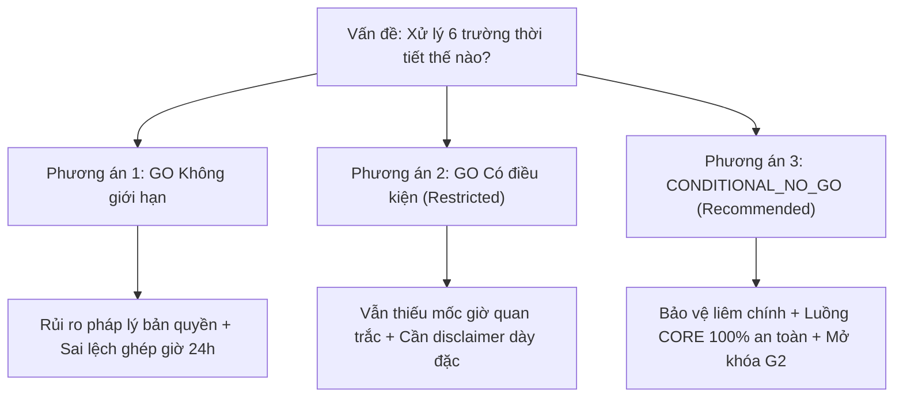

# T-005 R2: ĐỀ XUẤT QUYẾT ĐỊNH KIẾN TRÚC — CONDITIONAL_NO_GO CHO DỮ LIỆU THỜI TIẾT
## (T-005 R2 ARCHITECTURAL DECISION PROPOSAL: CONDITIONAL_NO_GO FOR OPTIONAL WEATHER ANALYSIS)

> **CẢNH BÁO QUẢN TRỊ (GOVERNANCE NOTICE):**  
> Đây là **VĂN BẢN ĐỀ XUẤT KỸ THUẬT (DECISION PROPOSAL)**, **KHÔNG PHẢI LÀ MỘT QUYẾT ĐỊNH ADR ĐÃ ĐƯỢC PHÊ DUYỆT (NOT AN APPROVED ADR)**.  
> Tài liệu này được tạo ra để cung cấp cơ sở lập luận và bằng chứng thực nghiệm đầy đủ cho Người phụ trách Dự án (Project Lead / Human Reviewer).  
> **TUYỆT ĐỐI KHÔNG TỰ Ý SỬA ĐỔI [`docs/02-design/DECISIONS.md`](../02-design/DECISIONS.md)** cho đến khi có chữ ký phê duyệt chính thức bằng văn bản.

- **Mã đề xuất:** `FP-DEC-PROP-015` (Disposition of Optional Weather Analysis RQ-06 / KPI-10)
- **Gate kiểm soát:** `Gate G2` (Data Quality & Contracts Review)
- **Ngày đệ trình:** 2026-10-16
- **Người đề xuất:** Senior Big Data Engineer & Independent Technical Reviewer
- **Người có thẩm quyền duyệt:** Project Lead / Human Technical Reviewer
- **Trạng thái đề xuất:** **`PROPOSAL_PENDING_REVIEW`**
- **Văn bản liên quan:** [`DECISIONS.md`](../02-design/DECISIONS.md) ([`FP-DEC-009`](../02-design/DECISIONS.md#L15), [`FP-DEC-013`](../02-design/DECISIONS.md#L19)), [`BACKLOG.md`](../01-planning/BACKLOG.md) (T-005, T-015), [`KPI_SPEC.md`](../02-design/KPI_SPEC.md) (KPI-10), [`TEST_PLAN.md`](../03-quality/TEST_PLAN.md) (`TS-011`), [`DATA_CONTRACT.md`](../02-design/DATA_CONTRACT.md) ([`DC-07`](../02-design/DATA_CONTRACT.md#L21), [`DC-11`](../02-design/DATA_CONTRACT.md#L26-L34), [`DC-12`](../02-design/DATA_CONTRACT.md#L35-L45)).

---

## 1. BỐI CẢNH VÀ VẤN ĐỀ QUYẾT ĐỊNH (DECISION PROBLEM)

Trong tập dữ liệu gốc 34 cột (`flight_with_weather_YYYY.csv`, 54,674,003 dòng giai đoạn 2016–2024), có sự hiện diện của 6 trường dữ liệu thời tiết bề mặt:
- Nơi khởi hành (Origin): `O_TEMP`, `O_PRCP`, `O_WSPD`.
- Nơi hạ cánh (Destination): `D_TEMP`, `D_PRCP`, `D_WSPD`.

Theo lộ trình thiết kế ban đầu, dữ liệu thời tiết được dự kiến phục vụ câu hỏi nghiên cứu mở rộng tùy chọn **RQ-06** và chỉ số **KPI-10** (*Weather-conditioned delay*). Tuy nhiên, theo các quyết định kiến trúc [`FP-DEC-009`](../02-design/DECISIONS.md#L15) và [`FP-DEC-013`](../02-design/DECISIONS.md#L19), dữ liệu thời tiết là một **nhánh điều kiện (Should/Conditional)**, chỉ được phép đưa vào phân tích nếu có đầy đủ bằng chứng khoa học và bản quyền.

**Vấn đề Quyết định Đặt ra:**  
Liệu dự án có nên chính thức cấp phép sử dụng 6 trường thời tiết này cho phân tích mô tả (`GO`), hay nên ban hành quyết định **`CONDITIONAL_NO_GO`** để loại bỏ nhánh thời tiết ra khỏi phạm vi bắt buộc của đồ án, qua đó bảo vệ tính liêm chính học thuật và mở khóa Gate G2?

---

## 2. PHÂN TÍCH BA PHƯƠNG ÁN LỰA CHỌN (AVAILABLE OPTIONS)



### Phương án 1: Phê duyệt GO Toàn diện (Unrestricted GO)
*   *Mô tả:* Chấp nhận sử dụng 6 trường thời tiết trên toàn bộ 9 năm cho RQ-06/KPI-10; mặc định thừa nhận các đơn vị là $^\circ\text{C}$, $\text{mm}$, $\text{km/h}$.
*   *Đánh giá:* **BÁC BỎ HOÀN TOÀN (REJECTED)**. Phương án này vi phạm nghiêm trọng các nguyên tắc của [`AGENTS.md`](../../AGENTS.md) và [`DATA_CONTRACT.md DC-07`](../02-design/DATA_CONTRACT.md#L21) vì thiếu chứng chỉ nguồn gốc, thiếu mốc thời gian quan trắc, và có nguy cơ vi phạm bản quyền dữ liệu bên thứ ba.

### Phương án 2: Phê duyệt GO Có Hạn chế (Restricted / Caveated GO)
*   *Mô tả:* Chỉ sử dụng dữ liệu thời tiết ở cấp độ tổng hợp rất thô (ví dụ: trung bình mùa hoặc năm) và đính kèm danh sách cảnh báo dày đặc về việc thiếu trạm đo và mốc giờ.
*   *Đánh giá:* **KHÔNG KHẢ THI & LÃNG PHÍ TÀI NGUYÊN (REJECTED)**. Phân tích thời tiết ở cấp độ mùa/năm không mang lại giá trị thực tiễn cho việc giải thích độ trễ chuyến bay (vốn xảy ra theo giờ và phút). Nguy cơ người đọc ngộ nhận tương quan thời tiết vĩ mô là nguyên nhân gây chậm chuyến vẫn tồn tại.

### Phương án 3: Ban hành Quyết định CONDITIONAL_NO_GO (RECOMMENDED)
*   *Mô tả:* Chính thức ghi nhận phán quyết `CONDITIONAL_NO_GO` cho Task T-005 và T-015; đóng lại nhánh thời tiết RQ-06 / KPI-10; cách ly hoàn toàn 6 cột thời tiết khỏi các bảng phân tích sản xuất; bảo vệ nguyên vẹn 8 CORE KPIs và mở khóa chuyển Gate G2 sang G3.
*   *Đánh giá:* **LỰA CHỌN TỐI ƯU DUY NHẤT (RECOMMENDED)**. Phù hợp tuyệt đối với thiết kế phòng vệ của đồ án.

---

## 3. ĐỐI CHIẾU BẰNG CHỨNG ỦNG HỘ VS PHẢN ĐỐI GO (EVIDENCE COMPARISON)

| Hạng mục Tiêu chí | Bằng chứng Ủng hộ `GO` | Bằng chứng Phản đối `GO` (Căn cứ Bắt buộc `NO-GO`) | Cân nhắc Trọng số Kỹ thuật |
|---|---|---|---|
| **Cấu trúc & Định dạng Schema** | Cả 6 cột đều hiện diện đầy đủ trên 9 năm schema audit; kiểu dữ liệu `float64` đồng nhất. | Tên cột chuẩn hóa không đồng nghĩa với ngữ nghĩa và nguồn gốc dữ liệu được chứng minh. | Ủng hộ tính sẵn sàng kỹ thuật, nhưng không bù đắp được sự thiếu hụt ngữ nghĩa. |
| **Độ Đầy đủ Dữ liệu (Completeness)** | Tỷ lệ có mặt dữ liệu rất cao: $> 99.97\%$ bản ghi có giá trị số (chỉ khuyết $0.0246\%$ nơi đi và $0.0275\%$ nơi đến). | Tỷ lệ không null cao không đồng nghĩa với dữ liệu chính xác; có thể là kết quả của việc nội suy hoặc fill tĩnh không rõ ràng. | Dữ liệu đầy đủ nhưng "rác vào thì rác ra" (*Garbage In, Garbage Out*). |
| **Tính Hợp lý Đơn vị (Unit Plausibility)** | Phân bố số học thực nghiệm rất khớp với chuẩn Metric của Meteostat: MSP rét $-28.3^\circ\text{C}$, LAS sa mạc $+41.7^\circ\text{C} / +45.6^\circ\text{C}$. | Hoàn toàn thiếu tài liệu nguồn xác nhận đơn vị; vi phạm lệnh cấm gán nhãn đơn vị từ tên cột của [`DC-07`](../02-design/DATA_CONTRACT.md#L21). | Thiếu giá trị pháp lý học thuật. |
| **Mốc Giờ Quan trắc (Temporal Alignment)** | Không có bằng chứng nào ủng hộ. | **Hoàn toàn không có cột timestamp khí tượng**. Mẫu thực nghiệm YX 3624 (`task-112`) cho thấy hai chuyến bay cách nhau 10 tiếng có giá trị thời tiết y hệt nhau. | **Yếu tố loại trừ chí tử (Showstopper)**. |
| **Trạm Khí tượng (Spatial Alignment)** | Có tọa độ kinh/vĩ độ của sân bay. | **Hoàn toàn không có mã trạm khí tượng (`STATION_ID`)**; bán kính ghép nối sân bay là ẩn số. | Không thể kiểm chứng tính đại diện thực tế của trạm đo. |
| **Bản quyền Phân phối (Licensing)** | Dữ liệu được đóng gói sẵn trong tệp CSV của bài báo lịch sử. | **Không có tệp cấp phép hoặc thỏa thuận chia sẻ dữ liệu** cho phần dữ liệu thời tiết đã merge. | Nguy cơ pháp lý bản quyền khi công bố. |
| **Phương pháp Khoa học (Methodology)** | Có thể vẽ biểu đồ trễ theo các nhóm mưa/gió. | **Nguy cơ ngụy biện tương quan thành nhân quả (Correlation $\ne$ Causation)** vi phạm [`ANALYSIS_PROTOCOL.md`](../02-design/ANALYSIS_PROTOCOL.md). | Vi phạm chuẩn mực phương pháp nghiên cứu Big Data. |

---

## 4. BỐN LÝ DO CỐT LÕI BUỘC PHẢI ÁP DỤNG CONDITIONAL_NO_GO

1.  **Tính Bất khả Thi về Ghép nối Thời gian (The Temporal Join Impossibility):**  
    Độ trễ máy bay là một biến cố động xảy ra theo từng phút. Việc thiếu mốc giờ quan trắc khí tượng khiến hệ thống không thể biết thời tiết được ghi nhận vào lúc nào. Bằng chứng thực nghiệm trên chuyến bay YX 3624 cho thấy máy bay cất cánh lúc 10:44 sáng hôm sau nhưng vẫn mang thông số thời tiết giống hệt chuyến bay cất cánh lúc 20:27 tối hôm trước. Phân tích độ trễ dựa trên các mốc thời tiết sai lệch từ vài giờ đến cả ngày là hành vi phi khoa học.
2.  **Khoảng trống Pháp lý Bản quyền (Licensing Void):**  
    Dự án không có quyền sở hữu hoặc văn bản cấp phép tái phân phối cho phần dữ liệu phái sinh từ Meteostat. Việc chính thức xuất bản các báo cáo học thuật dựa trên dữ liệu chưa rõ bản quyền đặt dự án vào rủi ro pháp lý không cần thiết.
3.  **Bảo vệ Tính Toàn vẹn Phương pháp Luận (Academic Integrity):**  
    Trong ngành hàng không, chậm trễ chuyến bay là hệ quả phức tạp của luồng không lưu quốc gia (NAS), sự điều tiết của FAA, quay vòng tàu bay và giới hạn giờ làm việc của phi hành đoàn. Việc sử dụng dữ liệu thời tiết bề mặt đơn lẻ để suy luận tác động gây trễ mà không có mô hình kiểm soát đa biến sẽ tạo ra các kết luận sai lầm nghiêm trọng.
4.  **Tối ưu Hóa Nguồn lực Tính toán (Computational Resource Optimization):**  
    Việc loại bỏ luồng thời tiết giúp đường ống PySpark tinh giản lược đồ dữ liệu, giảm thiểu dung lượng xáo trộn bộ nhớ (*shuffle memory*), và tập trung $100\%$ tài nguyên tính toán vào 8 CORE KPIs phục vụ 5 câu hỏi nghiên cứu cốt lõi (RQ-01..05).

---

## 5. PHÂN TÍCH TÁC ĐỘNG VÀ ĐIỀU KIỆN MỞ LẠI DỮ LIỆU (IMPACT & REOPENING CONDITIONS)

### 5.1. Phân tích Tác động Toàn diện (Impact Analysis)
*   **Đối với Luồng CORE (KPI-01..KPI-08 & RQ-01..RQ-05):** **HOÀN TOÀN KHÔNG BỊ TÁC ĐỘNG (ZERO IMPACT)**.  
    Tất cả 8 chỉ số cốt lõi chỉ dựa trên các trường vận hành chuyến bay (`ARR_DELAY`, `DEP_DELAY`, `TAXI_OUT`, `TAXI_IN`, `AIR_TIME`, `ACTUAL_ELAPSED_TIME`, `CRS_ELAPSED_TIME`, `FL_DATE`). Công thức toán học và mẫu số của luồng CORE hoàn toàn độc lập với thời tiết.
*   **Đối với Luồng Tùy chọn (KPI-10 & RQ-06):** Chuyển trạng thái chính thức sang **`SHELVED / DESELECTED`**. Không đưa vào phạm vi nghiệm thu cuối cùng của đồ án.
*   **Đối với Cổng Kiểm soát Gate G2:** **MỞ KHÓA HOÀN TOÀN GATE G2**.  
    Theo [`FP-DEC-013`](../02-design/DECISIONS.md#L19), phán quyết `CONDITIONAL_NO_GO` cho thời tiết được công nhận là một phương án hoàn thành hợp lệ của Task T-005. Gate G2 đủ điều kiện đóng lại để chuyển sang Gate G3.

### 5.2. Điều kiện Cực kỳ Nghiêm ngặt để Tái mở rộng Thời tiết (Reopening Conditions)
Nhánh dữ liệu thời tiết chỉ được phép xem xét mở lại trong tương lai nếu nhóm nghiên cứu đáp ứng đầy đủ **toàn bộ 5 điều kiện tiên quyết sau**:
1. Có văn bản chứng minh quyền cấp phép hoặc sử dụng hợp pháp bộ dữ liệu thời tiết bên thứ ba.
2. Dữ liệu thời tiết được nạp từ nguồn quan trắc chính thức (ví dụ: NOAA Local Climatological Data / ASOS) có kèm mã trạm định danh chuẩn (`WBAN` hoặc `ICAO`).
3. Mọi bản ghi thời tiết đều có trường mốc giờ quan trắc thực tế (`OBSERVATION_TIME`) lưu theo chuẩn giờ quốc tế UTC.
4. Cung cấp mã nguồn ETL minh bạch chứng minh thuật toán join thời gian và join không gian (có kiểm soát khoảng cách trạm $\le 25\text{ km}$ và bù trừ múi giờ chính xác).
5. Được thông qua một đề xuất kiến trúc ADR mới có chữ ký duyệt của Project Lead.

---

## 6. MẪU PHÊ DUYỆT CỦA NGƯỜI PHỤ TRÁCH DỰ ÁN (HUMAN REVIEWER SIGN-OFF FORM)

*(Phần dành riêng cho Project Lead / Human Technical Reviewer)*

```markdown
### VĂN BẢN PHÊ DUYỆT QUYẾT ĐỊNH KIẾN TRÚC FP-DEC-015

Căn cứ vào Hồ sơ Kiểm toán T-005 R2 và Đề xuất Kiến trúc FP-DEC-PROP-015:
Tôi, với tư cách là Project Lead / Human Technical Reviewer, đưa ra quyết định:

[ ] CHẤP THUẬN (APPROVED) — Ban hành chính thức phán quyết CONDITIONAL_NO_GO cho dữ liệu thời tiết.
    - Loại bỏ RQ-06 và KPI-10 khỏi phạm vi thực thi bắt buộc của đồ án.
    - Cho phép cập nhật DECISIONS.md và chuyển trạng thái T-005 thành CONDITIONAL_NO_GO.
    - Cho phép nghiệm thu đóng Gate G2 sau khi hoàn tất các thủ tục quản trị T-004.

[ ] TỪ CHỐI (REJECTED) — Yêu cầu tiếp tục điều tra bổ sung (Ghi rõ lý do bên dưới).

Chữ ký Reviewer: ____________________________________
Ngày phê duyệt:  ____ / ____ / ________
```
