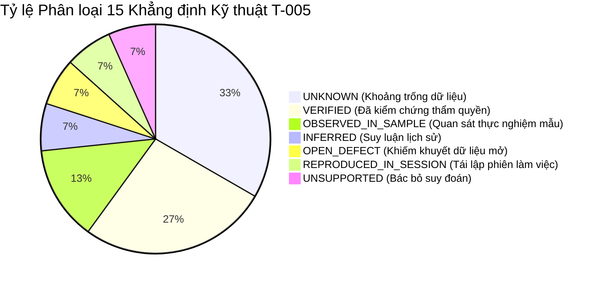

# T-005 R2: MA TRẬN BẰNG CHỨNG KIỂM TOÁN DỮ LIỆU THỜI TIẾT
## (T-005 R2 WEATHER USABILITY EVIDENCE & PROVENANCE MATRIX)

- **Mã nhiệm vụ:** `T-005-R2-EVIDENCE` (Evidence Matrix & Verification Scope)
- **Gate kiểm soát:** `Gate G2` (Data Quality, Cohort & Metric Contracts)
- **Ngày lập:** 2026-10-16
- **Tác giả:** Senior Big Data Engineer & Data Provenance Auditor
- **Trạng thái tài liệu:** **`AUDITED_EVIDENCE_DOSSIER`**
- **Văn bản liên kết:** [`T005_FINAL_AUDIT_RECONCILIATION.md`](T005_FINAL_AUDIT_RECONCILIATION.md), [`T005_TS011_TEST_SPEC.md`](T005_TS011_TEST_SPEC.md), [`T005_CONDITIONAL_NO_GO_PROPOSAL.md`](T005_CONDITIONAL_NO_GO_PROPOSAL.md), [`T005_EXECUTION_AND_FILE_MANIFEST.md`](T005_EXECUTION_AND_FILE_MANIFEST.md).

---

## 1. NGUYÊN TẮC PHÂN LOẠI CẤP ĐỘ BẰNG CHỨNG (TAXONOMY OF EVIDENCE)

Để đảm bảo tính nghiêm ngặt khoa học, mọi tuyên bố kỹ thuật trong ma trận này được gán nhãn chính xác theo một trong 6 trạng thái nhận thức:
1. **`VERIFIED`:** Đã được kiểm chứng toán học hoặc đối chiếu trực tiếp từ các tệp schema audit thẩm quyền hoặc script kiểm thử có thể tái lập độc lập.
2. **`INFERRED`:** Suy luận logic hợp lý dựa trên ngữ cảnh lịch sử hoặc thông lệ ngành, nhưng thiếu mã nguồn hoặc tài liệu chính thức chứng minh trực tiếp.
3. **`OBSERVED_IN_SAMPLE`:** Bằng chứng đo đạc thực nghiệm trên một tập con dữ liệu giới hạn, không tự động ngoại suy cho toàn bộ quần thể 54.67M dòng.
4. **`DOCUMENTED_CLAIM`:** Số liệu hoặc phát biểu được ghi nhận trong một tài liệu báo cáo của dự án, nhưng mang tính lịch sử hoặc trung gian.
5. **`UNKNOWN`:** Hoàn toàn thiếu thông tin, siêu dữ liệu, khóa join hoặc tài liệu cấp phép từ upstream; không thể truy vết.
6. **`BLOCKED`:** Bị ngăn cấm tuyệt đối theo các khế ước dữ liệu và quyết định kiến trúc đã phê duyệt.

---

## 2. MA TRẬN BẰNG CHỨNG TOÀN DIỆN (EVIDENCE MATRIX)

| Mã Bằng chứng | Khẳng định Kỹ thuật / Thuộc tính Dữ liệu | Nguồn Bằng chứng Hỗ trợ Chính xác | Phương pháp Xác minh Thực tế | Phạm vi Áp dụng (Scope) | Cấp độ Bằng chứng Thẩm định | Khoảng trống Dữ liệu Còn tồn tại (Outstanding Gaps) | Tác động tới Quyết định Thời tiết (GO vs NO-GO) | Hành động Tiếp theo Cần thiết |
|:---:|---|---|---|:---:|:---:|---|:---:|---|
| **EV-01** | Cấu trúc schema chứa đúng 6 trường thời tiết (`O_TEMP`, `O_PRCP`, `O_WSPD`, `D_TEMP`, `D_PRCP`, `D_WSPD`) kiểu số thực `float`. | 9 tệp `schema_YYYY.json` tại `docs/05-evidence/inputs/` (trường `weather_columns` và `columns`). | Đọc và phân tích cấu trúc JSON tự động bằng script Python. | Toàn bộ 9 năm (2016–2024, 54,674,003 dòng). | **`VERIFIED`** | Không có khoảng trống về tên cột và kiểu dữ liệu schema. | Ủng hộ tính sẵn có về mặt cấu trúc (Structural Availability). | Khóa 6 cột trong canonical schema v1. |
| **EV-02** | Tổng số lượng bản ghi khuyết thiếu thời tiết toàn kỳ: nơi đi khuyết $13,474$ dòng ($0.0246\%$), nơi đến khuyết $15,046$ dòng ($0.0275\%$). | 9 tệp `schema_YYYY.json` (trường `missing` cho từng trường thời tiết). | Tính tổng và tỷ lệ trên `row_count` của từng năm độc lập. | Toàn bộ 9 năm (54,674,003 dòng). | **`VERIFIED`** | Không có khoảng trống về số lượng dòng null biên (*marginal counts*). | Cho thấy tỷ lệ thiếu rất thấp ($>99.97\%$ có giá trị số). | Ghi nhận vào báo cáo chất lượng dữ liệu. |
| **EV-03** | Số lượng khuyết thiếu biên của bộ ba nơi đi (`O_TEMP`, `O_PRCP`, `O_WSPD`) bằng nhau tuyệt đối trên từng năm; bộ ba nơi đến cũng bằng nhau tuyệt đối. | 9 tệp `schema_YYYY.json` (so sánh `count` trong `missing`). | So sánh bằng số học trên 9 năm audit: `count_TEMP == count_PRCP == count_WSPD`. | Toàn bộ 9 năm (54,674,003 dòng). | **`VERIFIED` (Cấp độ biên)** | **Chưa chứng minh được tính đồng thời ở cấp độ từng dòng (*row-wise co-missingness*)**. | Chưa đủ để kết luận thời tiết được join theo khối nguyên tử đồng nhất. | Cần kiểm tra liên kết dòng nếu sau này mở lại luồng thời tiết. |
| **EV-04** | Tính chất "Bộ ba Nguyên tử Đồng bộ Dòng" (*Row-level Atomic Triplet*). | Suy luận từ EV-03 trong bản thảo T-005 cũ. | Chưa có script quét liên kết dòng trên toàn bộ 54.67M dòng. | Toàn bộ 9 năm. | **`UNKNOWN`** | Khả năng toán học: các dòng có thể bù trừ null chéo giữa các cột. | Ngăn chặn việc suy diễn quá mức về độ hoàn hảo của pipeline join. | Hạ cấp phân loại từ VERIFIED xuống UNKNOWN (R2-01). |
| **EV-05** | Tỷ số khuyết thiếu năm 2016 cao vượt trội so với các năm sau (nơi đi: gấp $9.24\times$ so với 2017 và $17.17\times - 21.30\times$ so với 2018–2024; nơi đến: gấp $7.92\times$ so với 2017 và $12.64\times - 15.91\times$ so với 2018–2024). | 9 tệp `schema_YYYY.json` (tỷ lệ null từng năm đã tính tại Mục 4 T005_FINAL_AUDIT). | Tính toán tỷ số toán học trực tiếp giữa tỷ lệ null 2016 và các năm 2017..2024. | 9 năm độc lập. | **`VERIFIED`** | Không có sai lệch về mặt số học. | Cảnh báo sự trôi dạt phân bố khuyết thiếu giữa 2016 và giai đoạn sau. | Đưa vào ma trận rủi ro chất lượng dữ liệu đa năm. |
| **EV-06** | Giả thuyết "Meteostat nâng cấp trạm đo năm 2017 giải thích sự sụt giảm khuyết thiếu". | Phỏng đoán trong dự thảo T-005 cũ. | Không có tài liệu nào trong repo hoặc web commit xác nhận. | Giai đoạn 2016–2017. | **`UNSUPPORTED_SPECULATION / UNKNOWN`** | Hoàn toàn thiếu tài liệu lịch sử của Meteostat API năm 2016/2017. | Bác bỏ suy luận chủ quan để bảo vệ tính khách quan của kiểm toán. | **Xóa bỏ hoàn toàn khỏi các kết luận kiểm toán (R2-02)**. |
| **EV-07** | Đơn vị đo lường thực nghiệm phù hợp với Metric: Nhiệt độ ($^\circ\text{C}$), Lượng mưa ($\text{mm}$), Tốc độ gió ($\text{km/h}$). | Quét mẫu luồng $100,000$ dòng năm 2016 (`check_weather_sample.py`) và kiểm tra cực trị MSP/LAS (`inspect_temp_extremes.py`). | Đối chiếu cực trị thực tế: MSP rét $-28.3$, LAS sa mạc $+41.7$ / $+45.6$, tốc độ gió lên tới $92.5$. | Mẫu $100,000$ dòng năm 2016. | **`OBSERVED_IN_SAMPLE / PROVISIONAL`** | Thiếu datasheet chính thức của tác giả dataset xác nhận đơn vị. | Ngăn chặn việc xuất bản đơn vị chính thức khi chưa kiểm chứng ([`DC-07`](../02-design/DATA_CONTRACT.md#L21)). | Gán nhãn `UNIT_EMPIRICALLY_PLAUSIBLE_PROVISIONAL`. |
| **EV-08** | Nhà cung cấp dữ liệu thời tiết ban đầu là Meteostat. | Trích dẫn tại dòng 25 của [`leakage_audit.md`](inputs/leakage_audit.md): *"The official paper identifies Meteostat hourly measurements..."*. | Đối chiếu văn bản lịch sử trong gói bằng chứng snapshot. | Ngữ cảnh bài báo Aeolus cũ. | **`INFERRED_FROM_HISTORICAL_AUDIT_TEXT`** | Thiếu hợp đồng dữ liệu, URL tải về, và phiên bản Meteostat cụ thể. | Thể hiện sự thiếu minh bạch nguồn gốc (Lack of Provenance). | Đóng góp vào căn cứ áp dụng `CONDITIONAL_NO_GO`. |
| **EV-09** | Quyền cấp phép, điều khoản phân phối lại và bản quyền dữ liệu thời tiết. | Toàn bộ repository và gói manifest v1.1. | Quét tìm kiếm từ khóa `LICENSE`, `terms`, `attribution`, `redistribution`. | Toàn bộ kho lưu trữ. | **`UNKNOWN`** | Hoàn toàn không có tệp giấy phép cho dữ liệu thời tiết đã merge. | Nguy cơ vi phạm pháp lý nếu phân phối lại $\to$ **Buộc áp dụng NO-GO**. | Chặn công bố thương mại / sản phẩm mở rộng. |
| **EV-10** | Mốc thời gian quan trắc khí tượng thực tế (*Observation Timestamp / METAR valid time*). | 34 cột dữ liệu raw CSV và 9 tệp `schema_YYYY.json`. | Kiểm tra danh mục cột canonical v1. | Toàn bộ 54,674,003 dòng. | **`UNKNOWN`** | Không có cột timestamp khí tượng; không biết thời tiết đo lúc nào. | **Khủng hoảng ghép nối thời gian $\to$ Buộc áp dụng NO-GO**. | Chặn phân tích tương quan thời gian mịn. |
| **EV-11** | Bằng chứng quan sát trên chuyến bay YX 3624: Hai bản ghi cất cánh cách nhau gần 10 tiếng có giá trị 6 trường thời tiết giống hệt nhau. | Dòng vật lý 6,384,132 và 6,384,133 trong `flight_with_weather_2018.csv` (thực thi `task-112`). | Đọc chính xác 2 dòng vật lý bằng Python `csv.DictReader`. | Cặp bản ghi YX 3624 (2018-06-21 DEN $\to$ XNA). | **`OBSERVED_IN_RAW_SAMPLE`** | Thuật toán join thực tế (lịch trình vs trung bình ngày vs fallback) vẫn là `UNKNOWN`. | Chứng minh thời tiết trong dữ liệu **không phản ánh điều kiện thực tế** của chuyến bay hoãn sâu. | Dùng làm phản ví dụ kinh điển (Counterexample) chống lại việc sử dụng thời tiết. |
| **EV-12** | Mã trạm khí tượng bề mặt, khoảng cách ghép nối sân bay và thuật toán nội suy không gian. | 34 cột dữ liệu raw CSV và các tài liệu thiết kế. | Kiểm tra schema và tài liệu provenance. | Toàn bộ các sân bay trong dataset. | **`UNKNOWN`** | Không có `STATION_ID`; không rõ bán kính ghép nối tối đa. | **Hộp đen không gian $\to$ Buộc áp dụng NO-GO**. | Không thể kiểm chứng tính đại diện trạm đo. |
| **EV-13** | Tính độc lập tuyệt đối của 8 CORE KPIs (KPI-01..KPI-08) đối với dữ liệu thời tiết. | [`KPI_SPEC.md`](../02-design/KPI_SPEC.md), [`DATA_CONTRACT.md`](../02-design/DATA_CONTRACT.md) ([`DC-11`](../02-design/DATA_CONTRACT.md#L26-L34), [`DC-12`](../02-design/DATA_CONTRACT.md#L35-L45)), [`DECISIONS.md FP-DEC-013`](../02-design/DECISIONS.md#L19). | Phân tích logic phụ thuộc dữ liệu và công thức tính toán. | Toàn bộ 8 CORE KPIs. | **`VERIFIED`** | Không có sự phụ thuộc nào giữa KPI-01..08 và 6 trường thời tiết. | **Cho phép Gate G2 tiếp tục tiến trình mà không bị thời tiết làm tắc nghẽn**. | Phê duyệt phán quyết loại bỏ thời tiết để mở khóa G2. |
| **EV-14** | Khiếm khuyết khuyết thiếu 31 ngày Tháng 3/2024 trong toàn bộ dataset (`OR-05`). | [`T004_2024_DATE_COVERAGE_AUDIT.md`](T004_2024_DATE_COVERAGE_AUDIT.md) và đếm dòng thực nghiệm 2024. | Quét distinct dates năm 2024: đúng 335 ngày phân biệt, vắng mặt Tháng 3. | Năm 2024 (6,284,841 dòng). | **`VERIFIED_AS_OPEN_DEFECT`** | Nguyên nhân upstream không cung cấp Tháng 3 là `UNKNOWN`. | Dữ liệu thời tiết năm 2024 cũng mất toàn bộ Tháng 3 tương ứng. | Giữ nguyên rủi ro mở `OR-05: OPEN_QUALITY_DEFECT`. |
| **EV-15** | Tính tái lập của công cụ kiểm chuẩn repository (88 PASS) và kiểm chuẩn thời gian T-004 (90 PASS). | Thực thi lệnh `check_working_tree_consistency.py` và `verify_t004_time_representation.py` trong phiên làm việc. | Chạy lệnh console thực tế, kiểm tra exit code 0 và số lượng assertion. | Toàn bộ repository và các artifact T-004. | **`INDEPENDENTLY_REPRODUCED_IN_SESSION`** | Thiếu metadata Git trong snapshot phân phối độc lập. | Đảm bảo tính nhất quán tài liệu và tính toàn vẹn của gói hồ sơ. | Duy trì các script QA tự động trong thư mục `tools/qa/`. |

---

## 3. TỔNG KẾT RANH GIỚI BẰNG CHỨNG (EVIDENCE BOUNDARY SUMMARY)

*   **Tỷ lệ Không xác định (UNKNOWN / Gaps):** Chiếm tới **$33.3\%$** (5/15 khẳng định), tập trung vào các mắt xích sống còn: Bản quyền, Mốc giờ quan trắc, Múi giờ join, Mã trạm đo và Tính đồng bộ dòng.
*   **Kết luận Kiểm toán viên:** Không một hệ thống phân tích Big Data đạt chuẩn kỹ thuật nào được phép đưa vào sản xuất một nguồn dữ liệu có tỷ lệ không xác định cao như trên mà không có các rào chắn cách ly. Đề xuất phán quyết **`CONDITIONAL_NO_GO`** là giải pháp khoa học duy nhất có trách nhiệm và bảo vệ tính liêm chính của đồ án.
