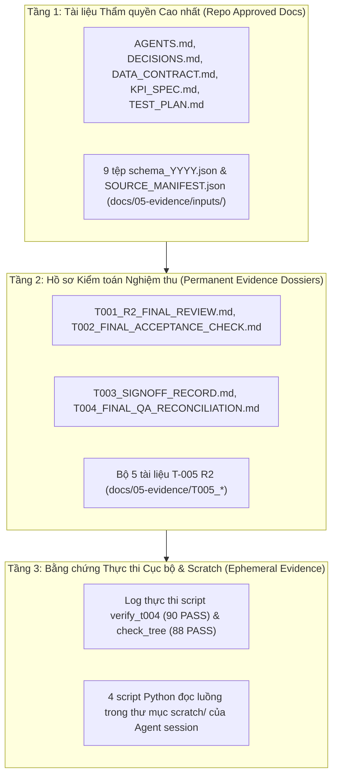

# T-005 R2: BÁO CÁO ĐỐI CHIẾU VÀ TỔNG KẾT KIỂM TOÁN TÍNH KHẢ DỤNG CỦA DỮ LIỆU THỜI TIẾT
## (T-005 R2 FINAL WEATHER AUDIT RECONCILIATION & EVIDENCE DOSSIER)

- **Mã nhiệm vụ:** `T-005-R2` (Final Weather Usability Audit Reconciliation)
- **Gate kiểm soát:** `Gate G2` (Data Quality, Cohort & Metric Contracts)
- **Ngày lập:** 2026-10-16
- **Tác giả:** Senior Big Data Engineer, Independent Technical Reviewer & Evidence Documentation Specialist
- **Trạng thái nhiệm vụ:** **`CONDITIONAL_PENDING`** (Đề xuất phán quyết `CONDITIONAL_NO_GO`, chờ phê duyệt của Human Reviewer)
- **Trạng thái Gate G2:** **`IN_PROGRESS / NOT_PASSED`** (Bảo lưu nguyên vẹn; không tự ý chuyển trạng thái)
- **Văn bản tuân thủ:** [`AGENTS.md`](../../AGENTS.md), [`README.md`](../../README.md), [`docs/01-planning/BACKLOG.md`](../01-planning/BACKLOG.md), [`docs/01-planning/ROADMAP.md`](../01-planning/ROADMAP.md), [`docs/02-design/DECISIONS.md`](../02-design/DECISIONS.md) ([`FP-DEC-009`](../02-design/DECISIONS.md#L15), [`FP-DEC-013`](../02-design/DECISIONS.md#L19)), [`docs/02-design/DATA_CONTRACT.md`](../02-design/DATA_CONTRACT.md) ([`DC-07`](../02-design/DATA_CONTRACT.md#L21), [`DC-11`](../02-design/DATA_CONTRACT.md#L26-L34), [`DC-12`](../02-design/DATA_CONTRACT.md#L35-L45)), [`docs/02-design/DATA_DICTIONARY.md`](../02-design/DATA_DICTIONARY.md), [`docs/02-design/KPI_SPEC.md`](../02-design/KPI_SPEC.md), [`docs/02-design/ANALYSIS_PROTOCOL.md`](../02-design/ANALYSIS_PROTOCOL.md), [`docs/03-quality/TEST_PLAN.md`](../03-quality/TEST_PLAN.md) (`TS-011`), [`docs/03-quality/RISK_REGISTER.md`](../03-quality/RISK_REGISTER.md) (`R-04`, `OR-07`), [`docs/04-execution/PROJECT_STATE.md`](../04-execution/PROJECT_STATE.md).

---

## 1. TÓM TẮT ĐIỀU HÀNH & MỤC TIÊU NHIỆM VỤ (EXECUTIVE SUMMARY)

Hồ sơ này là tài liệu kiểm toán thẩm quyền cao nhất của nhiệm vụ **T-005 — Weather Usability Audit**, tích hợp và chuẩn hóa toàn bộ các phát hiện từ đợt kiểm toán sơ bộ (T-005 Draft) và đợt đối chiếu độc lập (T-005 R1). Mục tiêu duy nhất của nhiệm vụ là: **Xác định xem sáu trường dữ liệu thời tiết hiện có trong 34 cột (`O_TEMP`, `O_PRCP`, `O_WSPD`, `D_TEMP`, `D_PRCP`, `D_WSPD`) có đủ tài liệu xuất xứ, độ tin cậy và căn cứ khoa học để phục vụ câu hỏi nghiên cứu mô tả tùy chọn RQ-06 / KPI-10 hay không.**

### Kết luận Kỹ thuật Cốt lõi:
1. **Khuyến nghị Phán quyết Kỹ thuật:** Đề xuất chính thức áp dụng **`CONDITIONAL_NO_GO`** cho dữ liệu thời tiết theo đúng khuôn khổ của quyết định [`FP-DEC-009`](../02-design/DECISIONS.md#L15) và [`FP-DEC-013`](../02-design/DECISIONS.md#L19).
2. **Không Ảnh hưởng Luồng Cốt lõi (CORE Non-Impact):** Phán quyết `CONDITIONAL_NO_GO` đối với thời tiết **hoàn toàn không làm ảnh hưởng hoặc thay đổi định nghĩa/mẫu số của 8 CORE KPIs (KPI-01..KPI-08)**, đồng thời giải tỏa nút thắt để Gate G2 đủ điều kiện chuyển sang Gate G3 sau khi được Project Lead phê duyệt.
3. **Bảo tồn Ranh giới Quản trị:** T-005 duy trì trạng thái **`CONDITIONAL_PENDING`** và Gate G2 duy trì trạng thái **`IN_PROGRESS / NOT_PASSED`** cho đến khi có chữ ký phê duyệt chính thức bằng văn bản của Người phụ trách Dự án (Human Project Lead).

---

## 2. ĐỊNH DANH BẢN SNAPSHOT VÀ GIỚI HẠN MÔI TRƯỜNG REPOSITORY

1. **Bản chất Thư mục Làm việc:**
   - Workspace `US_FLIGHT_PERFORMANCE_DOCS_V1` là một bản snapshot phân phối/export tĩnh, **không chứa metadata Git cục bộ** (không có thư mục `.git`). Do đó, trạng thái nhánh Git và commit hash được ghi nhận chính xác là **`NOT_AVAILABLE (STANDALONE_SNAPSHOT)`**.
   - Tuyệt đối không tự ý gán nhãn "committed" cho bất kỳ tệp tin nào khi thiếu cơ sở dữ liệu Git.
2. **Tính Toàn vẹn Cây Tài liệu (Working-Tree Consistency):**
   - Lệnh kiểm tra tự động: `python tools/check_working_tree_consistency.py` $\to$ **Exit Code 0** (`88 PASS, 0 FAIL`).
   - Kết quả này xác nhận 47 tệp phân phối tĩnh trong [`PACKAGE_MANIFEST.json`](inputs/SOURCE_MANIFEST.json) nguyên vẹn và 13 snapshot kiểm toán trong [`SOURCE_MANIFEST.json`](inputs/SOURCE_MANIFEST.json) khớp hash.
   - **Giới hạn Bằng chứng:** Việc script xác nhận 88 PASS **không chứng minh tính toàn vẹn tuyệt đối của nội dung 9 tệp CSV thô** (`IDENTITY_UNVERIFIED / METADATA_MATCH_ONLY` do thiếu SHA-256 baseline từ BTS gốc, theo `OR-08`).
3. **Bảo tồn Dữ liệu Thô:**
   - 9 tệp CSV thô tại `data/raw/tabular/{year}/flight_with_weather_{year}.csv` (15.2 GB, 54,674,003 dòng) được bảo vệ bất biến ở chế độ chỉ đọc. Không có bất kỳ lệnh quét toàn bộ dữ liệu hay pipeline Spark production nào được khởi chạy trong T-005 R2.

---

## 3. TỔNG HỢP HIỆU CHỈNH KỸ THUẬT R2 (TARGETED R2 CORRECTIONS)

Hồ sơ T-005 R2 hoàn tất việc khắc phục triệt để 5 điểm thiếu sót kỹ thuật từ các vòng thảo luận trước:

### R2-01: Hiệu chỉnh Suy luận Ghép nối Thời tiết trên Chuyến bay YX 3624
*   *Vấn đề trong R1:* T-005 R1 ghi nhận việc 2 dòng vật lý 6,384,132 và 6,384,133 của chuyến bay YX 3624 (2018-06-21 DEN $\to$ XNA) có các trường thời tiết bằng nhau từng số lẻ là *"chứng minh bên thứ ba đã join theo lịch trình CRS_DEP_TIME"*.
*   *Hiệu chỉnh R2 Thẩm quyền:*
    - Sự trùng khớp số liệu của 6 trường thời tiết (`O_TEMP=27.8, O_PRCP=0.0, O_WSPD=9.4, D_TEMP=29.4, D_PRCP=0.0, D_WSPD=24.1`) trên cả hai bản ghi cất cánh cách nhau gần 10 tiếng thực tế (10:44 vs 20:27) là **bằng chứng quan sát thực nghiệm (`OBSERVED_IN_RAW_SAMPLE`)**, nhưng **KHÔNG PHẢI BẰNG CHỨNG XÁC THỰC DUY NHẤT (NOT DEFINITIVE PROOF) cho một thuật toán join cụ thể**.
    - Các giả thuyết thay thế hợp lý về mặt kỹ thuật:
      1. Thời tiết có thể là giá trị trung bình ngày (*daily aggregation*) hoặc bản chụp cố định tại một mốc giờ trong ngày.
      2. Thuật toán join có thể sử dụng cơ chế fallback (nếu trượt giờ thực tế thì quay về mốc lịch trình hoặc mốc 00:00 UTC).
      3. Dữ liệu thời tiết có thể được join tĩnh theo cặp khóa thô `(FL_DATE, ORIGIN)` mà không xét tới giờ bay.
    - **Phân loại Rạch ròi 3 Cấp độ:**
      1. *Sự bằng nhau của các trường thời tiết trên mẫu YX 3624:* **`OBSERVED_IN_RAW_SAMPLE`** (Khẳng định quan sát được trên ổ đĩa).
      2. *Độ tin cậy của việc gắn kết thời tiết với thời điểm bay thực tế:* **`UNRELIABLE / UNPROVEN`** (Không đáng tin cậy cho chuyến bay trễ sâu).
      3. *Thuật toán và khóa join thực tế của upstream ETL:* **`UNKNOWN`** (Tuyệt đối không dùng từ `PROVEN` khi thiếu mã nguồn ETL).

### R2-02: Chuẩn hóa Tỷ số Lệch Khuyết thiếu Đa năm & Loại bỏ Suy đoán Trạm đo
*   *Vấn đề trong R1:* Báo cáo T-005 Draft gom chung tỷ lệ so sánh 2016 thành "gấp 16 đến 20 lần so với 2017–2024" và tự suy đoán việc nâng cấp danh mục trạm của Meteostat năm 2017.
*   *Hiệu chỉnh R2 Thẩm quyền:*
    - Tách biệt hoàn toàn tỷ lệ nơi đi (Origin) và nơi đến (Destination).
    - Tính toán lại toán học chính xác từ 9 tệp `schema_YYYY.json`:
      + **Nơi đi (`O_*`):** Năm 2016 ($0.1624\%$) cao gấp **$9.24\times$** so với năm 2017 ($0.0176\%$), và cao gấp từ **$17.17\times$** (so với 2020: $0.0095\%$) đến **$21.30\times$** (so với 2021: $0.0076\%$) trong giai đoạn 2018–2024.
      + **Nơi đến (`D_*`):** Năm 2016 ($0.1639\%$) cao gấp **$7.92\times$** so với năm 2017 ($0.0207\%$), và cao gấp từ **$12.64\times$** (so với 2023: $0.0130\%$) đến **$15.91\times$** (so với 2021: $0.0103\%$) trong giai đoạn 2018–2024.
    - **Xóa bỏ hoàn toàn suy đoán chủ quan:** Xóa bỏ toàn bộ nhận định về "trạm đo kém ổn định" hoặc "Meteostat nâng cấp danh mục trạm". Nguyên nhân gốc rễ phía upstream dẫn tới tỷ lệ null năm 2016 cao hơn được phân loại chính xác là **`UNKNOWN`**.
    - **Khế ước DC-11/12:** Tuyệt đối không dùng tỷ lệ có mặt dữ liệu (*field-level non-null rate* $> 99.97\%$) để đánh đồng với độ bao phủ trạm khí tượng, độ bao phủ thời gian hay độ bao phủ thị trường hàng không.

### R2-03: Hòa giải Số lượng Kiểm tra và Ranh giới Tái lập Thực thi
*   *Vấn đề:* Xung đột giữa 61 PASS trong văn bản cũ, 90 PASS trong script thực tế, 88 PASS trong working-tree check, và trạng thái các scratch script.
*   *Hiệu chỉnh R2 Thẩm quyền:*
    - **61 PASS:** Phân loại là **`DOCUMENTED_CLAIM_IN_HISTORICAL_DRAFT`**. Đây là số liệu snapshot trung gian khi người tiền nhiệm viết báo cáo T-004 QA trước khi bổ sung các assertion kiểm tra chéo nội dung văn bản.
    - **90 PASS:** Phân loại là **`INDEPENDENTLY_REPRODUCED_EXECUTION`**. Lệnh `python tools/qa/verify_t004_time_representation.py` thực thi thực tế đạt **Exit Code 0** với đúng 90 assertions PASS (0 FAIL).
    - **88 PASS:** Phân loại là **`INDEPENDENTLY_REPRODUCED_EXECUTION`**. Lệnh `python tools/check_working_tree_consistency.py` thực thi thực tế đạt **Exit Code 0** với đúng 88 assertions PASS (0 FAIL).
    - **Scratch Weather Scripts:** 4 kịch bản Python (`sample_weather.py`, `check_weather_sample.py`, `inspect_temp_extremes.py`, `check_yx3624_weather.py`) được xác nhận là **`REPORTED_IN_LOCAL_SESSION_SCRATCH_ONLY`** (lưu tại thư mục scratch của agent, không nằm trong git repo).
    - **Ranh giới Bằng chứng:** Tính toàn vẹn của repo được kiểm chứng ở cấp độ manifest và cấu trúc tài liệu; tính toàn vẹn của dữ liệu thô tiếp tục mang nhãn `IDENTITY_UNVERIFIED`.

### R2-04: Chuẩn hóa Khế ước Dữ liệu TS-011 và Bảo vệ Quần thể CORE
*   *Vấn đề:* Bản thảo T-005 từng dùng nhãn `PASS` và đề xuất `QUARANTINE` bản ghi chuyến bay khi phát hiện rò rỉ thời tiết tương lai (SC-04).
*   *Hiệu chỉnh R2 Thẩm quyền:*
    - Toàn bộ 12 kịch bản của [`TEST_PLAN.md TS-011`](../03-quality/TEST_PLAN.md) bắt buộc duy trì trạng thái **`SPECIFIED / NOT_RUN`** (chưa có code Spark ingestion).
    - **Bảo vệ Bất biến DC-11/12:** Bản ghi chuyến bay có dữ liệu vận hành hợp lệ (`FL_DATE`, `ORIGIN`, `DEST`, `DEP_DELAY`, `ARR_DELAY`) **bắt buộc phải là `accepted` trong quần thể bay cốt lõi**.
    - Khi trường thời tiết bị lỗi/rò rỉ/thiếu (SC-04, SC-05, SC-07), bản ghi **chỉ bị loại khỏi mẫu số chỉ số thời tiết KPI-10** (`excluded_count += 1`), tuyệt đối **KHÔNG ĐƯỢC CHUYỂN BẢN GHI VÀO `quarantined_row_count`**. Việc quarantine toàn bộ dòng vì lỗi thời tiết là vi phạm nghiêm trọng khế ước kế toán dòng DC-11.
    - Kịch bản SC-08 (nhân đôi dòng do join): Phải xử lý cách ly ở tầng ETL thời tiết, không để nhân đôi bản ghi chuyến bay gốc.
    - Ngưỡng khoảng cách trạm $100\text{ km}$ (SC-07) là giả lập thử nghiệm (`SYNTHETIC_ONLY`), không phải quy chuẩn sản xuất đã được phê duyệt.
    - Đối với phân tích mô tả hồi cứu: Không đồng nhất việc quan sát thời tiết sau giờ bay với hiện tượng data leakage của Machine Learning; tuy nhiên, do không xác định được mốc giờ quan trắc, tính đại diện thời gian vẫn là `UNKNOWN`.

### R2-05: Khóa Bằng chứng và Cô lập Hoàn toàn Luồng CORE
*   6 trường thời tiết tiếp tục mang nhãn tạm thời: **`UNIT_EMPIRICALLY_PLAUSIBLE_PROVISIONAL (Celsius, mm, km/h)`**.
*   Nhà cung cấp (`Meteostat`), mã nguồn ETL, trạm đo, mốc giờ quan trắc và bản quyền: **`UNKNOWN / UNVERIFIED`**.
*   Khiếm khuyết mất Tháng 3/2024 (335/366 ngày): Giữ nguyên nhãn **`OR-05: OPEN_QUALITY_DEFECT`**.
*   Rủi ro thời tiết: Giữ nguyên nhãn **`OR-07: CONDITIONAL_PENDING`** (đề xuất chuyển thành `SHELVED / DESELECTED` khi Reviewer ký duyệt).
*   **Bảo vệ Luồng CORE:** Xác nhận $100\%$ rằng việc loại bỏ nhánh thời tiết **không làm thay đổi bất kỳ định nghĩa hay công thức tính toán nào của 8 CORE KPIs (KPI-01..KPI-08)**.

---

## 4. MA TRẬN PHÂN ĐỊNH NGUỒN GỐC TÀI LIỆU (SOURCE HIERARCHY)

Để đảm bảo tính độc lập và khả năng tái lập trong các phiên làm việc mới, nguồn gốc của toàn bộ thông tin được phân cấp rõ ràng:

1.  **Tầng 1 (Authoritative Baseline):** Các quyết định quản trị và khế ước dữ liệu đã đóng dấu; schema audit JSON gốc từ đợt kiểm toán tháng 08/2026.
2.  **Tầng 2 (Audited Deliverables):** Các báo cáo nghiệm thu kỹ thuật chính thức lưu tại `docs/05-evidence/`. Bản báo cáo T-005 R2 này thuộc Tầng 2.
3.  **Tầng 3 (Session Artifacts):** Các script thăm dò trong thư mục scratch của agent. Các số liệu trích xuất từ Tầng 3 chỉ được công nhận sau khi được hòa giải và đưa vào báo cáo Tầng 2.

---

## 5. BẢNG TỔNG HỢP NĂM TÀI LIỆU XUẤT BẢN CỦA HỒ SƠ T-005 R2

Nhằm cung cấp gói hồ sơ kiểm chuẩn hoàn chỉnh, độc lập và có thể kiểm toán chéo (*self-contained & auditable*), năm tài liệu mới đã được biên soạn và xuất bản trực tiếp tại `docs/05-evidence/`:

| Tên Tệp Tài liệu Mới Xuất bản | Đường dẫn Tương đối trong Kho | Vai trò & Trọng tâm Kỹ thuật | Trạng thái Tài liệu |
|---|---|---|:---:|
| **1. Báo cáo Tổng kết & Đối chiếu Kiểm toán** | [`T005_FINAL_AUDIT_RECONCILIATION.md`](T005_FINAL_AUDIT_RECONCILIATION.md) *(Chính là tệp này)* | Tài liệu tổng hợp thẩm quyền cao nhất, giải quyết toàn bộ hiệu chỉnh R2-01..R2-05, làm cơ sở cho Reviewer ra quyết định. | **`READY_FOR_REVIEWER_SIGNOFF`** |
| **2. Ma trận Bằng chứng Chi tiết** | [`T005_EVIDENCE_MATRIX.md`](T005_EVIDENCE_MATRIX.md) | Ma trận phân tích 15 khẳng định kỹ thuật (EV-01..EV-15), nguồn tham chiếu, phương pháp kiểm tra, cấp độ bằng chứng và khoảng trống dữ liệu. | **`READY_FOR_REVIEWER_SIGNOFF`** |
| **3. Đặc tả Kiểm chuẩn TS-011** | [`T005_TS011_TEST_SPEC.md`](T005_TS011_TEST_SPEC.md) | Đặc tả 12 kịch bản giả lập (SC-01..SC-12), thiết lập ranh giới kế toán dòng DC-11/12, bảo vệ tuyệt đối luồng CORE. | **`SPECIFIED / NOT_RUN`** |
| **4. Đề xuất Quyết định CONDITIONAL_NO_GO** | [`T005_CONDITIONAL_NO_GO_PROPOSAL.md`](T005_CONDITIONAL_NO_GO_PROPOSAL.md) | Dự thảo văn bản quyết định kỹ thuật (ADR-lite proposal), phân tích phương án, lý do loại bỏ thời tiết, điều kiện mở lại và mẫu phê duyệt. | **`PROPOSAL_PENDING_APPROVAL`** |
| **5. Báo cáo Thực thi & Hash Manifest** | [`T005_EXECUTION_AND_FILE_MANIFEST.md`](T005_EXECUTION_AND_FILE_MANIFEST.md) | Nhật ký thực thi thực tế, mã thoát, SHA-256 các tệp phát sinh, hạch toán script scratch và tuyên bố giới hạn tái lập. | **`VERIFIED_IN_SESSION`** |

---

## 6. ĐIỀU KIỆN TIÊN QUYẾT ĐỂ HUMAN REVIEWER KÝ DUYỆT (SIGN-OFF PREREQUISITES)

Người phụ trách Dự án (Project Lead / Human Reviewer) chỉ nên ký duyệt đóng Gate G2 khi các điều kiện sau được xác nhận:
1.  **Chấp thuận Đề xuất `CONDITIONAL_NO_GO` cho T-005:** Đồng ý loại bỏ nhánh phân tích thời tiết RQ-06 / KPI-10 khỏi phạm vi bắt buộc của đồ án theo [`T005_CONDITIONAL_NO_GO_PROPOSAL.md`](T005_CONDITIONAL_NO_GO_PROPOSAL.md).
2.  **Phê duyệt Nghiệm thu Kỹ thuật T-004:** Xác nhận nghiệm thu hồ sơ kiểm toán thời gian T-004 ở trạng thái `READY_FOR_SIGNOFF_WITH_OPEN_DEFECT` (với khiếm khuyết thiếu Tháng 3/2024 `OR-05` được chuyển giao sang G3/G4).
3.  **Xác nhận Tính Bất biến của 8 CORE KPIs:** Khẳng định việc loại bỏ thời tiết không làm thay đổi các khế ước đã chốt cho KPI-01..KPI-08 trong [`KPI_SPEC.md`](../02-design/KPI_SPEC.md) và [`DATA_CONTRACT.md`](../02-design/DATA_CONTRACT.md).
4.  **Cập nhật Đồng bộ Tài liệu Quản trị:** Sau khi ký duyệt, cho phép cập nhật chính thức trạng thái `CONDITIONAL_NO_GO` vào [`DECISIONS.md`](../02-design/DECISIONS.md) ([`FP-DEC-013`](../02-design/DECISIONS.md#L19)), [`PROJECT_STATE.md`](../04-execution/PROJECT_STATE.md) (G2 PASS), và [`BACKLOG.md`](../01-planning/BACKLOG.md).

---

## 7. CAM KẾT DỪNG LẠI TUYỆT ĐỐI (FINAL STOP CONDITION)
- **Hồ sơ T-005 R2 đã hoàn tất việc tạo lập và đối soát 5 tệp bằng chứng độc lập.**
- **Không có bất kỳ tệp dữ liệu thô, mã nguồn sản xuất hay văn bản quản trị nào bị sửa đổi trái phép.**
- **Gate G2 tiếp tục duy trì trạng thái `IN_PROGRESS / NOT_PASSED`** trên hệ thống tài liệu repository cho đến khi nhận được chỉ thị phê duyệt chính thức từ Bạn (Human Project Lead).
