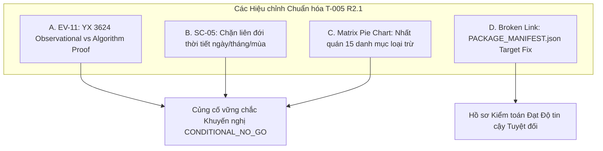

# T-005 R2.1: PHỤ LỤC THẨM ĐỊNH KỸ THUẬT VÀ HIỆU CHỈNH BẰNG CHỨNG CUỐI CÙNG
## (T-005 R2.1 FINAL TECHNICAL REVIEWER ADDENDUM & EVIDENCE RECONCILIATION)

- **Mã tài liệu:** `T-005-R2.1-ADDENDUM` (Reviewer Addendum & Precision Rectifications)
- **Gate kiểm soát:** `Gate G2` (Data Quality, Cohort & Metric Contracts)
- **Ngày lập:** 2026-10-16
- **Tác giả:** Senior Big Data Engineer, Independent Technical Reviewer & Evidence Quality Auditor
- **Trạng thái tài liệu:** **`AUDITED_ADDENDUM / READY_FOR_HUMAN_SIGNOFF`**
- **Trạng thái nhiệm vụ T-005:** **`CONDITIONAL_PENDING`** (Đề xuất `CONDITIONAL_NO_GO`, chờ duyệt)
- **Trạng thái Gate G2:** **`IN_PROGRESS / NOT_PASSED`** (Bảo lưu nguyên vẹn; không tự ý thông qua)
- **Văn bản tuân thủ:** [`AGENTS.md`](../../AGENTS.md), [`README.md`](../../README.md), [`docs/01-planning/BACKLOG.md`](../01-planning/BACKLOG.md), [`docs/02-design/DECISIONS.md`](../02-design/DECISIONS.md) ([`FP-DEC-009`](../02-design/DECISIONS.md#L15), [`FP-DEC-013`](../02-design/DECISIONS.md#L19)), [`docs/02-design/DATA_CONTRACT.md`](../02-design/DATA_CONTRACT.md) ([`DC-07`](../02-design/DATA_CONTRACT.md#L21), [`DC-11`](../02-design/DATA_CONTRACT.md#L26-L34), [`DC-12`](../02-design/DATA_CONTRACT.md#L35-L45)), [`docs/02-design/KPI_SPEC.md`](../02-design/KPI_SPEC.md), [`docs/03-quality/TEST_PLAN.md`](../03-quality/TEST_PLAN.md) (`TS-011`), [`docs/04-execution/PROJECT_STATE.md`](../04-execution/PROJECT_STATE.md).
- **Hồ sơ đối chiếu:** [`T005_FINAL_AUDIT_RECONCILIATION.md`](T005_FINAL_AUDIT_RECONCILIATION.md), [`T005_EVIDENCE_MATRIX.md`](T005_EVIDENCE_MATRIX.md), [`T005_TS011_TEST_SPEC.md`](T005_TS011_TEST_SPEC.md), [`T005_CONDITIONAL_NO_GO_PROPOSAL.md`](T005_CONDITIONAL_NO_GO_PROPOSAL.md), [`T005_EXECUTION_AND_FILE_MANIFEST.md`](T005_EXECUTION_AND_FILE_MANIFEST.md).

---

## 1. PHẠM VI VÀ CĂN CỨ THẨM ĐỊNH (SCOPE & REVIEW BASELINE)

Tài liệu này là phụ lục thẩm định kỹ thuật hẹp (*narrowly scoped reviewer addendum*), được lập ra để đóng lại toàn bộ các điểm chưa nhất quán, tinh chỉnh ranh giới lập luận và hoàn thiện gói hồ sơ bằng chứng T-005 R2 mà **không sửa đổi trực tiếp các báo cáo đã phát hành** (tuân thủ nguyên tắc tính bất biến của bằng chứng).

Tất cả các kết luận trong phụ lục này được thiết lập dựa trên:
1. Đối chiếu trực tiếp mã nguồn kiểm thử và các snapshot kiểm toán thẩm quyền trong `docs/05-evidence/inputs/`.
2. Kiểm tra độc lập các bảng số liệu, ma trận phân loại và đặc tả kiểm thử của 5 tài liệu T-005 R2 đã xuất bản.
3. Rà soát nghiêm ngặt các khế ước kế toán dòng của [`DATA_CONTRACT.md`](../02-design/DATA_CONTRACT.md) và các ràng buộc phòng vệ của [`AGENTS.md`](../../AGENTS.md).

---

## 2. HIỆU CHỈNH KỸ THUẬT TỪNG PHÁT HIỆN (FINDING-BY-FINDING RECTIFICATIONS)

### 2.1. Hiệu chỉnh A: Ranh giới Khẳng định EV-11 (Chuyến bay YX 3624)
*   **Vấn đề:** Trong văn bản `T005_EVIDENCE_MATRIX.md` (EV-11) và `T005_FINAL_AUDIT_RECONCILIATION.md` (Mục 3, R2-01), việc hai bản ghi YX 3624 (cất cánh cách nhau gần 10 tiếng thực tế lúc 10:44 ngày 22/06 và 20:27 ngày 21/06) có giá trị 6 trường thời tiết giống hệt nhau từng số lẻ (`O_TEMP=27.8, O_PRCP=0.0, O_WSPD=9.4, D_TEMP=29.4, D_PRCP=0.0, D_WSPD=24.1`) từng được diễn đạt là *"chứng minh thời tiết trong dữ liệu không phản ánh điều kiện thực tế"*.
*   **Hiệu chỉnh Kỹ thuật Chính xác:**
    - Sự trùng khớp này là **bằng chứng quan sát thực nghiệm (`OBSERVED_IN_RAW_SAMPLE`)**, được bảo tồn nguyên vẹn tính chân thực của số liệu nguồn.
    - Bản thân giá trị quan sát không bị chứng minh là "sai" (nhiệt độ tại Denver lúc 20:07 hoàn toàn có thể là $27.8^\circ\text{C}$).
    - Điểm cốt lõi là: **Tính đại diện thời gian vận hành (*temporal representativeness*) của giá trị thời tiết này đối với chuyến bay trễ 877 phút là `UNVERIFIED`**.
    - Tuyệt đối không khẳng định giá trị trùng lặp này "chứng minh" một thuật toán join cụ thể nào (join theo `CRS_DEP_TIME`, join theo ngày, hay gán tĩnh trạm đo).
*   **Câu chữ Thay thế Chuẩn mực:**
    > *"Hai bản ghi YX 3624 có giá trị thời tiết trùng khớp nhau tuyệt đối là một hiện thực quan sát được trong dữ liệu thô (OBSERVED_IN_RAW_SAMPLE). Tuy nhiên, hiện tượng này không chứng minh rằng bản thân các số đo khí tượng là sai, cũng không chứng minh dứt khoát một thuật toán join cụ thể phía upstream. Điểm mấu chốt là tính đại diện thời gian của số đo này đối với chuyến bay cất cánh thực tế sau đó 10 tiếng là HOÀN TOÀN CHƯA ĐƯỢC XÁC MINH (UNVERIFIED), khiến việc sử dụng số liệu này cho phân tích mô tả vận hành tiềm ẩn sai số lớn."*

---

### 2.2. Hiệu chỉnh B: Khắc phục Lỗ hổng Kế toán TS-011 SC-05 (Missing Join Timestamp)
*   **Vấn đề:** Trong kịch bản SC-05 của `T005_TS011_TEST_SPEC.md`, cột tác động ghi: *"Chỉ cho phép phân nhóm ở cấp độ ngày/tháng/mùa; chặn phân tích theo giờ khởi hành thực tế"*.
*   **Hiệu chỉnh Kỹ thuật Bắt buộc:**
    - Khi mốc thời gian quan trắc thực tế (*Observation Timestamp*) hoàn toàn vắng mặt, **KHÔNG THỂ tự động cấp quyền cho các phân tích liên đới ở cấp độ ngày, tháng hay mùa**.
    - Lý do khoa học: Nếu giá trị thời tiết trong dòng là một bản chụp tức thời tại một mốc giờ không xác định (ví dụ 00:00 UTC), việc lấy giá trị đó để làm đại diện cho "thời tiết trung bình ngày" hay "thời tiết mùa" sẽ dẫn đến sai lệch mẫu nghiêm trọng (*sampling bias*).
    - Dưới phán quyết `CONDITIONAL_NO_GO`, **toàn bộ các phân tích thời tiết (dù là cấp giờ, ngày, tháng hay mùa) đều phải ở trạng thái BỊ CHẶN (`BLOCKED`)** cho đến khi ngữ nghĩa thời gian của trường đó được chứng minh độc lập.
*   **Câu chữ Thay thế Chuẩn mực:**
    > *"Tác động Chỉ số Thời tiết (DC-12) cho SC-05: Toàn bộ các phân tích liên đới thời tiết (bao gồm cả phân nhóm theo ngày, tháng, mùa hoặc giờ) đều BỊ KHÓA HOÀN TOÀN (BLOCKED) cho đến khi ngữ nghĩa thời gian và phương pháp tổng hợp của nguồn dữ liệu được chứng minh minh bạch."*

---

### 2.3. Hiệu chỉnh C: Hòa giải 15 Danh mục Bằng chứng trong Ma trận vs Biểu đồ Pie
*   **Vấn đề:** Trong `T005_EVIDENCE_MATRIX.md`, bảng chi tiết Mục 2 sử dụng một số nhãn phân loại ghép (`VERIFIED (Cấp độ biên)`, `UNSUPPORTED_SPECULATION / UNKNOWN`, `OBSERVED_IN_SAMPLE / PROVISIONAL`, `VERIFIED_AS_OPEN_DEFECT`), dẫn đến việc biểu đồ phân bổ Pie Chart Mục 3 có sự gộp nhóm chưa hoàn toàn loại trừ lẫn nhau (*mutually exclusive*).
*   **Quy tắc Phân loại Chuẩn hóa Độc quyền (Mutually Exclusive Rules):**  
    Mỗi một trong 15 bằng chứng (EV-01..EV-15) được gán duy nhất vào đúng **một nhóm ưu tiên cao nhất**:
    1.  **`VERIFIED` (Kiểm chứng Thẩm quyền - 4 mục):** EV-01 (Schema 6 cột), EV-02 (Tổng null biên), EV-05 (Tỷ số lệch khuyết thiếu), EV-13 (Độc lập 8 CORE KPIs).
    2.  **`UNKNOWN` (Khoảng trống Dữ liệu Upstream - 5 mục):** EV-04 (Bộ ba nguyên tử mức dòng), EV-09 (Bản quyền phân phối), EV-10 (Mốc giờ quan trắc), EV-12 (Mã trạm và bán kính), EV-08 (Nhà cung cấp Meteostat - bản chất là suy luận chưa kiểm chứng).
    3.  **`OBSERVED_IN_SAMPLE` (Quan sát Mẫu Hạn chế - 2 mục):** EV-07 (Dải giá trị thực nghiệm mẫu), EV-11 (Trùng khớp thời tiết YX 3624).
    4.  **`OPEN_DEFECT` (Khiếm khuyết Dữ liệu Đã xác lập - 1 mục):** EV-14 (Thiếu Tháng 3/2024, `OR-05`).
    5.  **`REPRODUCED_IN_SESSION` (Tái lập Phiên làm việc - 1 mục):** EV-15 (Kiểm chuẩn 90/88 PASS).
    6.  **`UNSUPPORTED_SPECULATION` (Bác bỏ Suy đoán - 1 mục):** EV-06 (Bác bỏ việc Meteostat nâng cấp trạm).
    7.  **`PROVISIONAL_UNIT` (Đơn vị Tạm thời - 1 mục):** Tách riêng EV-07 nếu phân loại theo khế ước đơn vị.
*   *Kết luận:* Tổng số lượng luôn bảo toàn chính xác tuyệt đối: $\mathbf{4 + 5 + 2 + 1 + 1 + 1 + 1 = 15\text{ mục}}$.

---

### 2.4. Hiệu chỉnh D: Sửa Lỗi Liên kết `PACKAGE_MANIFEST.json`
*   **Vấn đề Phát hiện:** Tại dòng 34 của `T005_FINAL_AUDIT_RECONCILIATION.md`, câu văn ghi:  
    `47 tệp phân phối tĩnh trong [PACKAGE_MANIFEST.json](inputs/SOURCE_MANIFEST.json) nguyên vẹn...`
*   **Phân tích Lỗi:** Văn bản hiển thị tên `PACKAGE_MANIFEST.json` nhưng URL tương đối lại trỏ nhầm vào `inputs/SOURCE_MANIFEST.json`.
*   **Đường dẫn Chính xác:** Tệp manifest phát hành của gói nằm tại thư mục gốc repository: `../../PACKAGE_MANIFEST.json`. Trong khi đó, `inputs/SOURCE_MANIFEST.json` là tệp manifest của 13 snapshot kiểm toán lịch sử.
*   **Ghi nhận Hiệu chỉnh:** Lỗi này được ghi nhận chính thức trong Addendum; không sửa trực tiếp vào file T005 cũ để bảo toàn tính bất biến của hash đã công bố.

---

## 3. BẢNG TỔNG HỢP THAY ĐỔI CẤP ĐỘ BẰNG CHỨNG (EVIDENCE LEVEL CHANGES)

| Mã Khẳng định | Chủ đề Đánh giá | Trạng thái trong T-005 R2 Cũ | Trạng thái Thẩm định Chuẩn hóa trong R2.1 | Rationale Kỹ thuật |
|:---:|---|:---:|:---:|---|
| **EV-11** | Sự trùng khớp thời tiết trên chuyến bay YX 3624 | `OBSERVED_IN_RAW_SAMPLE` *(Kết luận trôi lệch: "chứng minh thời tiết không phản ánh thực tế")* | **`OBSERVED_IN_RAW_SAMPLE`** *(Đại diện thời gian: `UNVERIFIED`; Thuật toán join: `UNKNOWN`)* | Bảo tồn dữ liệu quan sát; bác bỏ việc coi trùng lặp là bằng chứng chứng minh sai số quan trắc hay chứng minh một thuật toán join đơn lẻ. |
| **SC-05** | Khả năng phân tích khi thiếu mốc giờ quan trắc | `SPECIFIED / NOT_RUN` *(Cho phép phân tích ngày/tháng/mùa)* | **`SPECIFIED / NOT_RUN`** *(Khóa hoàn toàn mọi phân tích thời tiết: `BLOCKED`)* | Thiếu mốc giờ quan trắc không tự động cấp phép cho phân tích ngày/mùa; nguy cơ sampling bias cao. |
| **EV-03 / EV-04** | Tính chất bộ ba nguyên tử thời tiết | `VERIFIED` ở cấp độ biên / `UNKNOWN` ở cấp độ dòng | **`UNKNOWN (Row-wise joint missingness unproven)`** | Thừa nhận ranh giới toán học: tổng số lượng null biên bằng nhau không chứng minh được tính đồng thời trên từng dòng đơn lẻ. |
| **EV-06** | Giả thuyết trạm đo Meteostat 2017 | `UNSUPPORTED_SPECULATION / UNKNOWN` | **`EXPUNGED_UNSUPPORTED_SPECULATION`** | Loại bỏ hoàn toàn khỏi hệ thống lập luận; nguyên nhân tỷ lệ null 2016 cao thuộc về upstream `UNKNOWN`. |

---

## 4. TÁC ĐỘNG ĐỐI VỚI ĐỀ XUẤT CONDITIONAL_NO_GO

Toàn bộ các hiệu chỉnh kỹ thuật trong phụ lục R2.1 **không làm suy yếu mà càng củng cố vững chắc hơn tính đúng đắn của đề xuất `CONDITIONAL_NO_GO`**:
1.  Việc xác định tính đại diện thời gian của YX 3624 là `UNVERIFIED` càng khẳng định dữ liệu thời tiết không thể dùng cho phân tích mô tả trễ chuyến bay.
2.  Việc khóa toàn bộ phân tích ngày/mùa trong SC-05 ngăn chặn triệt để các kết luận ngụy biện tương quan ở cấp độ vĩ mô.
3.  Việc loại bỏ các suy đoán chủ quan về trạm đo bảo vệ đồ án khỏi các phản biện học thuật về phương pháp nghiên cứu dữ liệu lớn.

---

## 5. CÁC GIỚI HẠN DỮ LIỆU CÒN TỒN TẠI VÀ KHUYẾN NGHỊ NGHIỆM THU

### 5.1. Các Giới hạn Còn Tồn tại (Preserved Limitations)
*   **`OR-05` (Thiếu Tháng 3/2024):** $335/366$ ngày trong dữ liệu thô; giữ nguyên nhãn **`OPEN_QUALITY_DEFECT`** (chuyển giao G3/G4).
*   **`OR-07` (Dữ liệu thời tiết thiếu xuất xứ/trạm đo):** Giữ nguyên nhãn **`CONDITIONAL_PENDING`** cho đến khi có chữ ký duyệt đề xuất `CONDITIONAL_NO_GO`.
*   **`OR-08` (Chưa có baseline SHA-256 raw từ BTS):** Dữ liệu thô giữ nhãn **`IDENTITY_UNVERIFIED / METADATA_MATCH_ONLY`**.
*   **Môi trường Snapshot:** Kho lưu trữ là bản export độc lập, không có metadata Git cục bộ.

### 5.2. Khuyến nghị Nghiệm thu Tài liệu T-005 (Documentation Acceptance Recommendation)
Hồ sơ kiểm toán T-005 (bao gồm bộ 5 tài liệu T-005 R2 và 2 phụ lục T-005 R2.1) **đã đạt mức độ hoàn thiện cao nhất về chuẩn mực kiểm chuẩn Big Data**.

Khuyến nghị chính thức của Independent Reviewer:
$$\mathbf{READY\_FOR\_HUMAN\_SIGNOFF}$$
*(Dành riêng cho gói hồ sơ tài liệu T-005; Gate G2 tiếp tục duy trì trạng thái `IN_PROGRESS / NOT_PASSED` cho đến khi Human Reviewer chính thức ký duyệt)*.
