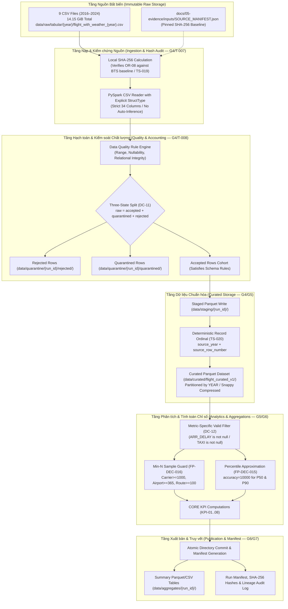

# T-006 DELIVERABLE A: BIG DATA ARCHITECTURE & SPARK RUNTIME DESIGN

**Task ID:** `T-006`  
**Gate:** `G3`  
**Document Nature:** Technical Architecture & Runtime Specification (`DESIGN_ONLY`)  
**Project:** US Flight Performance Analysis (2016–2024) using Apache Spark / PySpark  
**Status:** `PROPOSED_FOR_PROJECT_LEAD_REVIEW`  
**Date:** 2026-10-17  

---

## 1. Executive Summary & Design Scope

Hồ sơ này đặc tả chi tiết kiến trúc hệ thống xử lý dữ liệu lớn bằng Apache Spark / PySpark cho đồ án phân tích mô tả hồi cứu 54.674.003 bản ghi chuyến bay nội địa Hoa Kỳ giai đoạn 2016–2024 (tổng dung lượng thô 14,15 GiB trên 9 tệp CSV).

### Ranh giới Phạm vi Thiết kế (Design Scope Boundaries)
* **Thuộc phạm vi:** Kiến trúc pipeline tuần tự; định dạng lưu trữ cột nén Parquet; ngân sách tài nguyên phù hợp máy đơn trạm (Single-node Workstation); hạch toán ba trạng thái dòng độc lập (`DC-11`); bảo vệ biểu diễn thời gian (`FP-DEC-007`); 8 chỉ số cốt lõi (`KPI-01..08`); truy vết kiểm thử Gate `G3–G7`.
* **Ngoài phạm vi (Strictly Excluded):** Không sử dụng Machine Learning, không dự báo trễ T-2h, không dùng tệp đồ thị Flight Chain `.pt`, không liên kết cụm Hadoop/YARN phức tạp hoặc Kafka/Airflow khi không cần thiết.

---

## 2. Sơ đồ Kiến trúc & Luồng Dữ liệu Đầu cuối (End-to-End Pipeline)

### 2.1. Sơ đồ Khối Kiến trúc Hệ thống (System Architecture Diagram)



---

## 3. Khảo sát Môi trường Thực tế & Ma trận Tương thích Runtime

### 3.1. Đo lường Phần cứng Thực tế (Measured Hardware Baseline)
Tại thời điểm thực hiện nhiệm vụ `T-006` (2026-10-17), thông số phần cứng thực tế được đo lường trực tiếp như sau:
* **Hệ điều hành:** Microsoft Windows 10 Pro 64-bit (`10.0.19045-SP0`).
* **CPU:** AMD64, 8 physical cores, 16 logical cores.
* **Bộ nhớ RAM vật lý:** 15.71 GiB (~16.0 GB).
  * Bộ nhớ khả dụng tại thời điểm nhàn rỗi: **5.72 GiB – 6.5 GiB**.
  * Cảnh báo: Tuyệt đối không giả định toàn bộ 16 GiB đều dành cho Spark; hệ điều hành Windows và các dịch vụ nền chiếm khoảng 9.5–10 GiB.
* **Dung lượng Ổ đĩa:**
  * Ổ C:\: Tổng 154.9 GiB, trống 27.2 GiB (đang dùng 82.5%).
  * **Ổ D:\ (Ổ chứa Dự án):** Tổng 300.0 GiB, **trống 64.3 GiB** (đang dùng 78.6%).
  * Đánh giá: Dung lượng trống 64.3 GiB hoàn toàn đủ khả năng lưu trữ toàn bộ dữ liệu thô (14.15 GiB), dữ liệu staging trung gian (~5 GiB), dữ liệu Curated Parquet (~2.5–3.0 GiB), và không gian đệm Spark spill/shuffle (15–20 GiB).
* **Java Runtime:** OpenJDK 21.0.12.1 LTS (Eclipse Adoptium Temurin 64-bit HotSpot VM), đường dẫn `C:\Program Files\Eclipse Adoptium\jdk-21.0.12.101-hotspot\bin\java.EXE`.
* **Python Runtime:** Python 3.10.11 (64-bit AMD64).
* **Thư viện cài sẵn:** PySpark `4.0.1`, PyArrow `25.0.1`, pandas `2.3.3`.

### 3.2. Ma trận Tương thích Công nghệ (Runtime Compatibility Matrix)

| Thành phần | Gói đề xuất chính (Primary) | Gói đề xuất dự phòng (Alternative) | Trạng thái hiện tại | Lý do lựa chọn & Khả năng tương thích |
| :--- | :---: | :---: | :---: | :--- |
| **Python** | `3.10.11` | `3.10.11` | `MEASURED` (Đã cài) | Phiên bản LTS ổn định cao, tương thích hoàn toàn với cả PySpark 3.5 và PySpark 4.0. |
| **Java JDK** | `OpenJDK 21 LTS` | `OpenJDK 17 LTS` | `MEASURED` (Đã cài JDK 21) | Spark 4.0 hỗ trợ chính thức Java 21 LTS; tối ưu hóa trình thu gom rác ZGC/G1GC thế hệ mới. |
| **Apache Spark / PySpark** | `4.0.1` | `3.5.3` | `MEASURED` (PySpark 4.0.1 đã cài) | Hỗ trợ chính thức Java 21, tối ưu hóa ANSI SQL, hiệu năng Arrow vectorization cao. Dự phòng 3.5.3 nếu phát sinh lỗi nhị phân Windows native. |
| **PyArrow** | `25.0.1` | `14.0.2` | `MEASURED` (Đã cài) | Tối ưu hóa chuyển đổi dữ liệu phân tích cột giữa PySpark DataFrame và pandas cho bước lập báo cáo. |
| **Test Runner** | `unittest` (Standard Lib) | `pytest` | `MEASURED` (`unittest` sẵn có) | `unittest` có sẵn trong Python standard library không phụ thuộc mạng; `pytest` có thể cài đặt bổ sung ở G4 nếu có nhu cầu. |

---

## 4. Ngân sách Tài nguyên & Chiến lược Tỷ lệ (Resource Budgeting Plan)

### 4.1. Nguyên tắc Bất khả xâm phạm trong Cấp phát Tài nguyên
1. **Không phân bổ vượt mức RAM vật lý:** Bộ nhớ cấp cho Spark Driver và JVM Overhead tối đa không được vượt quá `8 GiB` trên tổng số 15.71 GiB của máy, đảm bảo ít nhất `7–8 GiB` cho hệ điều hành Windows tránh gây hiện tượng tráo trang (*disk swapping / thrashing*).
2. **Không phân bổ 100% CPU cores:** Để lại ít nhất 4 logical cores cho các tiến trình hệ thống và I/O bất đồng bộ.
3. **Thư mục đệm (Scratch directory) bắt buộc đặt trên Drive D:\:** Cấm đặt `spark.local.dir` trên Drive C:\ do ổ C chỉ còn 27 GiB trống.

### 4.2. Bảng Cấu hình Tài nguyên Chi tiết (Resource Allocation Breakdown)

| Thông số Cấu hình Spark | Kịch bản Thử nghiệm (Smoke Run 1 năm — G5/T-010) | Kịch bản Sản xuất (Full Run 9 năm — G6/T-012..014) | Cơ sở Tính toán & Phân loại |
| :--- | :---: | :---: | :--- |
| **Master Mode** | `local[4]` | `local[6]` (hoặc `local[8]`) | `PROPOSED`: Tận dụng 6/8 nhân thực, tránh nghẽn thread. |
| **Driver Memory (`spark.driver.memory`)** | `4g` | `6g` (an toàn) / `8g` (tối đa khi đóng app nền) | `ESTIMATED`: Đủ chứa metadata và broadcast tables nhỏ. |
| **Memory Overhead (`spark.driver.memoryOverhead`)** | `1g` | `1g` – `2g` | `ESTIMATED`: Bù đắp bộ nhớ off-heap cho PyArrow / JVM off-heap. |
| **Bộ nhớ Tổng Spark (Driver + Overhead)** | **`5g`** | **`7g` – `8g`** | `MEASURED_SAFE`: Nằm trong vùng RAM khả dụng thực tế. |
| **Shuffle Partitions (`spark.sql.shuffle.partitions`)** | `16` | `32` – `64` | `ESTIMATED`: Tránh partition quá nhỏ (<10MB) hoặc quá lớn (>200MB). |
| **Thư mục Tạm (`spark.local.dir`)** | `D:/.../staging/tmp_spark` | `D:/.../staging/tmp_spark` | `MEASURED`: Nằm trên ổ D với 64.3 GiB trống. |
| **Thuật toán Nén Parquet** | `snappy` | `snappy` (mặc định) / `zstd` (lưu trữ cao) | `PROPOSED`: Snappy cân bằng tối ưu giữa tốc độ CPU và độ nén. |

### 4.3. Chiến lược Xử lý Tuần tự Bounded theo Năm (Year-by-Year Ingestion Batching)
Để bảo đảm tuyệt đối pipeline không bao giờ gặp lỗi quá bộ nhớ (`OutOfMemoryError`), kiến trúc quy định:
* **Tầng Ingestion (G4/T-007):** Xử lý độc lập từng tệp CSV của từng năm một (kích thước mỗi năm từ 1.12 GiB đến 1.85 GiB raw).
* **Tầng Curated Parquet:** Mỗi năm được lưu thành một partition độc lập `year={YYYY}`. Sau khi hoàn thành một năm, giải phóng bộ nhớ đệm trước khi chuyển sang năm tiếp theo.
* **Tầng Aggregation (G6/T-013):** Do định dạng Parquet cho phép *column pruning* (chỉ đọc các cột cần thiết như `FL_DATE`, `OP_CARRIER`, `ARR_DELAY`, `DEP_DELAY`), dung lượng nạp vào bộ nhớ để tính toán KPI trên toàn bộ 9 năm chỉ chiếm khoảng `600 MB – 1.2 GiB`, hoàn toàn nhẹ nhàng trong giới hạn bộ nhớ 6–8 GiB.

---

## 5. Bố cục Lưu trữ Định dạng Cột Parquet (Parquet Layout & Storage Hierarchy)

### 5.1. Cấu trúc Cây Thư mục
```text
data/
  ├── raw/tabular/{year}/flight_with_weather_{year}.csv        [BẤT BIẾN / READ-ONLY / 15.2 GB]
  ├── staging/{run_id}/                                        [Ghi tạm thời không nguyên tử]
  │     ├── tmp_spark/                                         [Spill/Shuffle data]
  │     └── uncommitted_parquet/
  ├── curated/flight_curated_v1/                               [Dữ liệu Parquet được công nhận]
  │     ├── _metadata
  │     ├── _common_metadata
  │     ├── year=2016/part-00000.snappy.parquet (~300 MB)
  │     ├── year=2017/part-00000.snappy.parquet (~310 MB)
  │     ├── ...
  │     └── year=2024/part-00000.snappy.parquet (~340 MB, khuyết Tháng 3/2024)
  ├── quarantine/{run_id}/
  │     ├── year={YYYY}/rejected/                              [Malformed CSV rows]
  │     └── year={YYYY}/quarantined/                           [Physical violations]
  └── aggregates/{run_id}/                                     [Bảng chỉ số đầu ra]
        ├── kpi_01_annual_volume.parquet
        ├── kpi_02_06_carrier_metrics.parquet
        ├── kpi_02_06_airport_metrics.parquet
        ├── kpi_02_06_route_metrics.parquet
        ├── kpi_07_taxi_times.parquet
        └── kpi_08_duration_decomposition.parquet
```

### 5.2. So sánh Chiến lược Phân vùng (Partitioning Evaluation)
1. **Phân vùng `year` (Khuyến nghị chính):** Tạo ra 9 partitions, kích thước mỗi partition khoảng 250–350 MB sau khi nén Snappy. Kích thước file này rất lý tưởng cho HDFS/Parquet block size (128–256 MB), giúp Spark đọc song song hiệu quả mà không bị overhead metadata.
2. **Phân vùng `year/month` (Không khuyến nghị):** Tạo ra `9 × 12 = 108` partitions. Trung bình mỗi partition chỉ đạt ~20–30 MB, sinh ra quá nhiều tệp nhỏ (*Small Files Problem*), làm tăng chi phí quản lý của Spark driver và làm chậm các truy vấn tổng hợp đa năm.
3. **Phân vùng `carrier` hoặc `origin` (Bác bỏ):** Gây lệch dữ liệu nghiêm trọng (*Data Skew*), do các hãng lớn (WN, AA, DL) hoặc sân bay lớn (ATL, ORD, DFW) có lượng chuyến bay gấp hàng chục lần các hãng địa phương, dẫn tới một số partition quá lớn trong khi các partition khác rỗng.

---

## 6. Tính Bất biến, Xuất bản Nguyên tử & Khôi phục Lỗi (Idempotency, Atomic Publication & Recovery)

### 6.1. Cơ chế Phiên bản theo `run_id` (Run-ID Versioning)
Mọi lượt chạy xử lý dữ liệu đều bắt buộc phải được gắn một mã định danh duy nhất:
$$\mathbf{run\_id} = \text{YYYYMMDD\_HHMMSS\_}\langle\text{git\_or\_task\_tag}\rangle$$
Tất cả các output tạm thời và thư mục quarantine đều được ghi vào đường dẫn có chứa `run_id`.

### 6.2. Chiến lược Xuất bản Nguyên tử (Atomic Staged Publication)
1. Spark ghi toàn bộ dữ liệu đầu ra vào thư mục `staging/{run_id}/`.
2. Kiểm tra tính toàn vẹn (Integrity Validation): Xác minh số dòng, kiểm tra hạch toán dòng rời nhau (`TS-003`), tính toán mã băm SHA-256 của các tệp kết quả.
3. Nếu mọi bài kiểm tra đạt `PASS`, thực hiện thao tác đổi tên thư mục nguyên tử (*atomic filesystem rename / promotion*) từ `staging` sang `curated` hoặc `aggregates`.
4. Cập nhật con trỏ `latest` và lưu trữ `run_manifest.json` ghi lại toàn bộ metadata của lần chạy.

### 6.3. Khôi phục và Quay lui khi Có Lỗi (Rollback & Failure Recovery)
* Nếu quá trình chạy bị gián đoạn giữa chừng hoặc gặp lỗi dữ liệu (ví dụ: mất điện, OOM, vi phạm hạch toán dòng), toàn bộ thư mục `staging/{run_id}/` sẽ bị xóa bỏ hoàn toàn mà không ảnh hưởng tới dữ liệu sản xuất đã xuất bản trước đó.
* Dữ liệu thô tại `data/raw/` được cấu hình thuộc tính **Read-Only** ở cấp độ hệ thống tệp tin, loại trừ 100% rủi ro bị ghi đè hoặc xóa nhầm.

---

## 7. Phân tích Rủi ro Kỹ thuật & Giải pháp Giảm thiểu

| Mã Rủi ro | Nguy cơ Kỹ thuật | Xác suất | Mức độ | Biện pháp Giảm thiểu trong Thiết kế Kiến trúc |
| :---: | :--- | :---: | :---: | :--- |
| **RK-01** | **Driver Out-Of-Memory (OOM)** khi xử lý toàn bộ 9 năm cùng lúc | Trung bình | Nghiêm trọng | Áp dụng chiến lược nạp tuần tự từng năm (*Year-by-Year Batching*); cấm tuyệt đối gọi `toPandas()` hoặc `collect()` trên DataFrame toàn thể. |
| **RK-02** | **Small Files Problem** do phân vùng quá chi tiết | Cao | Trung bình | Khóa chiến lược phân vùng ở cấp `YEAR` (9 partitions); áp dụng `coalesce` hợp lý nếu Spark sinh ra nhiều mảnh file nhỏ. |
| **RK-03** | **Windows native `winutils.exe` mismatch** | Thấp | Cao | Sử dụng PySpark 4.0.1 đã tích hợp đầy đủ cơ chế chạy local; chuẩn bị sẵn gói fallback PySpark 3.5.3 + JDK 17 nếu phát sinh lỗi native. |
| **RK-04** | **Data Skew khi GroupBy** theo Carrier / Route | Trung bình | Trung bình | Tăng số lượng shuffle partitions lên 32–64; áp dụng lọc cỡ mẫu `min-N` theo `FP-DEC-016` trước khi xuất bản bảng xếp hạng. |
| **RK-05** | **Ghi đè hoặc phá hỏng dữ liệu thô** | Rất thấp | Thảm họa | Dữ liệu thô đặt tại đường dẫn Read-Only; đường dẫn output tuyệt đối tách biệt tại `data/staging/`, `data/curated/`, `data/aggregates/`. |

---

## 8. Kết luận & Mức độ Sẵn sàng (Architectural Readiness Verdict)

Bản thiết kế kiến trúc và runtime PySpark tại Deliverable A hoàn toàn khả thi, thực tế, tận dụng tối đa năng lực phần cứng sẵn có của máy trạm mà không vi phạm bất kỳ giới hạn tài nguyên nào.

$$\mathbf{VERDICT:}\quad \mathbf{T006\_ARCHITECTURE\_AND\_RUNTIME\_DESIGN\_COMPLIANT}$$
