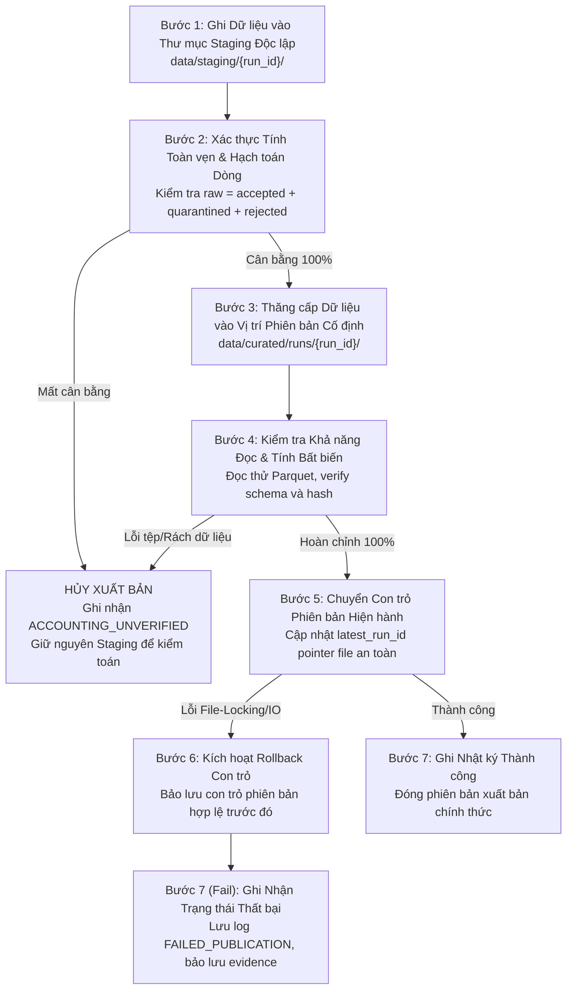

# T-006 FINAL CORRECTIONS ADDENDUM: BOUNDED IMPLEMENTATION-SAFETY SPECIFICATION

**Task ID:** `T-006` (Final Implementation-Safety Addendum)  
**Gate:** `G3`  
**Document Nature:** Authoritative Architecture & Data Contract Addendum (`DESIGN_ONLY`)  
**Project:** US Flight Performance Analysis (2016–2024) using Apache Spark / PySpark  
**Status:** `READY_FOR_T006_HUMAN_SIGNOFF`  
**Date:** 2026-10-17  
**Authority:** Direct Project Lead Instruction for Task `G3-T006-FINAL-CORRECTIONS`

---

## 1. Mục tiêu & Ranh giới Thẩm quyền (Authority & Objectives)

Văn bản này là **Phụ lục Kỹ thuật Chuẩn tắc Cuối cùng** bổ sung và đính chính các điểm ranh giới an toàn triển khai còn thiếu sót trong hồ sơ `T-006-R1`, nhằm hoàn thiện trọn vẹn thiết kế kiến trúc Gate G3 trước khi trình Project Lead ký duyệt đóng cổng:
1. Chuẩn hóa phân loại 3 trạng thái dòng theo `DC-11` và phân định rạch ròi tính hợp lệ cấp bản ghi (*Record Validity*) vs. tính hợp lệ cấp chỉ số (*Metric Validity*) theo `DC-12`.
2. Đặc tả vị từ số thực hữu hạn đầy đủ (*Complete Finite Numeric Predicates*) cho toàn bộ 7 trường đo CORE, xử lý triệt để các hành vi đặc thù của `NaN` và `Infinity` trong Apache Spark.
3. Chuẩn hóa quy trình xuất bản dữ liệu 7 bước an toàn trên hệ thống tệp Windows NTFS, giải quyết rủi ro file-locking và thiết kế ca tiêm lỗi `TS-013`.
4. Hủy bỏ và thay thế toàn diện các hướng dẫn hoàn nguyên mang tính hủy hoại trong `T006_R1_EXECUTION_MANIFEST.md`, thiết lập nguyên tắc hoàn nguyên không xóa bằng chứng.
5. Xác lập ranh giới an toàn nạp dữ liệu thô: bảo tồn tính nullable của các trường lịch theo `DATA_DICTIONARY.md`, kiểm tra ngày bằng regex neo chặt (anchored regex), và bảo vệ các token số hỏng.
6. Đính chính lỗi chính tả đường dẫn script kiểm thử hồi quy trong các biên bản R1 trước.

**Nguyên tắc Quản trị Bất biến:**
- Giữ nguyên `Gate G2 = PASS` (đã ký đóng).
- Giữ nguyên `Gate G3 = IN_PROGRESS / NOT_PASSED`.
- Giữ nguyên `Task T-006 = IN_PROGRESS` (chờ Project Lead nghiệm thu).
- Giữ nguyên `Tasks T-009, T-007, T-008 = NOT_STARTED`.
- Bảo toàn tuyệt đối mọi quyết định đã duyệt `FP-DEC-001..017`, ngoại lệ `G2-EXC-001`, `OR-05` (335/366 ngày, PARTIAL), và `OR-08` (IDENTITY_UNVERIFIED).

---

## 2. FIX-01 — Chuẩn hóa Hạch toán Dòng DC-11 & Phân định Mẫu số DC-12

### 2.1. Định nghĩa Chuẩn tắc Ba Trạng thái Dòng (Three-State Classification)
Trong mỗi năm nguồn và mỗi lần chạy (`run_id`), toàn bộ các dòng đầu vào được phân loại vào đúng một trong ba trạng thái rời nhau tuyệt đối:
$$\mathbf{raw\_row\_count} = \mathbf{accepted\_row\_count} + \mathbf{quarantined\_row\_count} + \mathbf{rejected\_row\_count}$$

1. **`REJECTED` (Loại bỏ Cú pháp CSV):**
   - **Định nghĩa:** Chỉ áp dụng cho các bản ghi đầu vào **không thể phân tích cú pháp (CSV parse failure)** hoặc không thể khôi phục theo cấu trúc CSV 34 cột đã phê duyệt.
   - **Bao gồm:** Dòng bị rách, số lượng cột khác 34 do thừa/thiếu dấu phẩy phân cách, dấu ngoặc kép không đóng hợp lệ, lỗi mã hóa nhị phân làm hỏng cấu trúc dòng.
   - **Chốt chặn hạch toán:** Nếu gặp dòng CSV hỏng nặng không thể đếm được một cách đáng tin cậy hoặc gây mất dấu vết dòng, hệ thống bắt buộc phải đánh dấu trạng thái **`ACCOUNTING_UNVERIFIED`** và **DỪNG XUẤT BẢN NGAY LẬP TỨC (`BLOCK_PUBLICATION`)**.
   - **Cấm kỵ:** Tuyệt đối không xếp một bản ghi đọc được đầy đủ 34 cột vào `REJECTED` chỉ vì một trường nghiệp vụ bị null hoặc sai miền giá trị.

2. **`QUARANTINED` (Cách ly Cấp Bản ghi Cốt lõi):**
   - **Định nghĩa:** Áp dụng cho các bản ghi có cấu trúc CSV đọc được đầy đủ 34 cột, nhưng **vi phạm các quy tắc hợp lệ cấp bản ghi cốt lõi (CORE Record-Level Rules)** khiến bản ghi không thể xác định danh tính thực thể hành trình.
   - **Các trường hợp QUARANTINED duy nhất được phê duyệt:**
     - *Khuyết mốc lịch duy nhất:* `FL_DATE` bị rỗng hoặc không thể trích xuất thành ngày lịch hợp lệ (Mã: `INVALID_FL_DATE_CORE_ANCHOR`).
     - *Khuyết mã hãng khai thác:* `OP_CARRIER` bị rỗng hoặc null (Mã: `MISSING_CARRIER_CORE_ANCHOR`).
     - *Khuyết sân bay hành trình:* `ORIGIN` hoặc `DEST` bị rỗng hoặc null (Mã: `MISSING_AIRPORT_CORE_ANCHOR`).
     - *Số hiệu chuyến bay không hợp lệ cấp định danh:* `OP_CARRIER_FL_NUM <= 0` (Mã: `INVALID_FLIGHT_NUM_CORE_ANCHOR`).
   - Các bản ghi này được lưu riêng tại `data/quarantine/{run_id}/` kèm mã lỗi phục vụ kiểm toán, không được nạp vào tầng Curated chung.

3. **`ACCEPTED` (Chấp nhận Tầng Curated):**
   - **Định nghĩa:** Bản ghi thỏa mãn cấu trúc cú pháp và vượt qua các quy tắc cấp bản ghi cốt lõi ở trên.
   - Bản ghi `ACCEPTED` được đưa vào `accepted_row_count` và đóng góp trực tiếp vào `KPI-01` (`count_records`).

### 2.2. Phân định Rạch ròi: Record Invalidity vs. Metric Invalidity
Hồ sơ thiết kế ban đầu đã nhầm lẫn nghiêm trọng khi đưa các bản ghi có chỉ số đo bị lỗi vào diện cách ly toàn bộ dòng (`QUARANTINED`). Nay đính chính chuẩn tắc:

| Trường Dữ liệu | Tình huống Dữ liệu Thực tế | Phân loại Chuẩn tắc | Tác động tới KPI-01 (`count_records`) | Tác động tới 8 CORE KPIs | Ghi chú Hợp đồng Dữ liệu |
| :--- | :--- | :---: | :---: | :--- | :--- |
| **`FL_DATE`** | Cú pháp CSV đọc được nhưng chuỗi ngày không hợp lệ (e.g. `"BAD_DATE"`) | **`QUARANTINED`** | Bị loại khỏi KPI-01 | Bị loại khỏi toàn bộ CORE KPIs | Vi phạm mốc lịch cốt lõi; mã `INVALID_FL_DATE_CORE_ANCHOR`. |
| **`OP_CARRIER`** | Cú pháp CSV đọc được nhưng mã hãng bị null/rỗng | **`QUARANTINED`** | Bị loại khỏi KPI-01 | Bị loại khỏi toàn bộ CORE KPIs | Vi phạm mốc quan hệ cốt lõi; mã `MISSING_CARRIER_CORE_ANCHOR`. |
| **`TAXI_OUT`** | Nhỏ hơn 0 (`TAXI_OUT < 0.0`) | **`ACCEPTED`** | **ĐƯỢC TÍNH** vào KPI-01 | Hợp lệ cho KPI-02..06; **chỉ bị loại khỏi mẫu số KPI-07 Sub 7a** | Lỗi miền chỉ số (Metric Invalidity), không phải lỗi cấp bản ghi. |
| **`TAXI_IN`** | Nhỏ hơn 0 (`TAXI_IN < 0.0`) | **`ACCEPTED`** | **ĐƯỢC TÍNH** vào KPI-01 | Hợp lệ cho KPI-02..06; **chỉ bị loại khỏi mẫu số KPI-07 Sub 7b** | Lỗi miền chỉ số, mẫu số Sub 7a/7b độc lập. |
| **`AIR_TIME`** | Bằng hoặc nhỏ hơn 0 (`AIR_TIME <= 0.0`) | **`ACCEPTED`** | **ĐƯỢC TÍNH** vào KPI-01 | Hợp lệ cho KPI-02..06; **chỉ bị loại khỏi mẫu số KPI-08 Sub 8a** | Lỗi miền chỉ số thời lượng bay. |
| **`ACTUAL_ELAPSED_TIME`** | Bằng hoặc nhỏ hơn 0 (`<= 0.0`) | **`ACCEPTED`** | **ĐƯỢC TÍNH** vào KPI-01 | Hợp lệ cho KPI-02..06; **chỉ bị loại khỏi mẫu số KPI-08 Sub 8b** | Lỗi miền chỉ số thời lượng bay. |
| **`CRS_ELAPSED_TIME`** | Bằng hoặc nhỏ hơn 0 (`<= 0.0`) | **`ACCEPTED`** | **ĐƯỢC TÍNH** vào KPI-01 | Hợp lệ cho KPI-02..06; **chỉ bị loại khỏi mẫu số KPI-08 Sub 8c** | Lỗi miền chỉ số thời lượng kế hoạch. |
| **`O_LATITUDE` / vĩ độ** | Ngoài phạm vi `[-90, 90]` | **`ACCEPTED`** | **ĐƯỢC TÍNH** vào KPI-01 | **Không ảnh hưởng tới 8 CORE KPIs** | Tọa độ là trường phụ trợ không gian (DC-09), cấm làm cách ly chuyến bay. |
| **`MONTH` / ngày** | Giá trị bị null trong raw | **`ACCEPTED`** | **ĐƯỢC TÍNH** vào KPI-01 | Hợp lệ cho CORE KPIs | `DATA_DICTIONARY.md` quy định nullable; trích xuất từ `FL_DATE`. |
| **6 Cột Weather** | Bị null hoặc sai giá trị | **`ACCEPTED`** | **ĐƯỢC TÍNH** vào KPI-01 | **Không ảnh hưởng tới 8 CORE KPIs** | Đã loại khỏi CORE theo `FP-DEC-017` (`CONDITIONAL_NO_GO`). |

---

## 3. FIX-02 — Vị Từ Số Thực Hữu Hạn Đầy Đủ (Complete Numeric Validity)

### 3.1. Hạn chế của So sánh Thông thường trong Apache Spark
- Trong chuẩn IEEE 754 và Spark SQL Catalyst Optimizer, biểu thức so sánh thông thường như `col >= 0` hoặc `col > 0` **không đảm bảo an toàn tuyệt đối trước `NaN` và `Infinity`**:
  1. So sánh boolean với `NaN` trả về `false`, nhưng trong các hàm tổng hợp phân vị (`percentile_approx`) hoặc sắp xếp (`sort`), Spark xử lý `NaN` như một giá trị đặc biệt lớn hơn mọi số thực dương. Nếu không lọc tường minh bằng hàm `isnan()`, `NaN` có thể làm sai lệch phân vị P90!
  2. Các giá trị vô cực dương (`+Infinity`) thỏa mãn biểu thức `col >= 0` (vì $+\infty \ge 0$ là đúng), dẫn đến việc đưa giá trị vô cực vào tổng làm hỏng kết quả trung bình (`avg = Infinity`)!
- Do đó, bắt buộc phải sử dụng **vị từ kiểm tra số thực hữu hạn tường minh**.

### 3.2. Đặc tả Vị từ Số thực Hữu hạn Chuẩn tắc (Exact Finite Predicate)
```python
from pyspark.sql import functions as F

def is_finite_numeric(col_name: str):
    """Vị từ kiểm tra số thực hữu hạn an toàn, tương thích mọi phiên bản PySpark.
    Điều kiện: Không NULL, không NaN, và không vô cực (+/- Infinity).
    """
    c = F.col(col_name)
    return c.isNotNull() & ~F.isnan(c) & ~c.isin(float("inf"), float("-inf"))
```

### 3.3. Vị từ Đủ điều kiện Hợp lệ cho 7 Trường đo CORE
Áp dụng trên từng bản ghi thuộc cohort `ACCEPTED`:
1. **`ARR_DELAY` (KPI-02, KPI-03, KPI-06):**
   `is_finite_numeric("ARR_DELAY")`  
   *(Bảo toàn toàn bộ các giá trị âm biểu thị chuyến bay đến sớm; cấm tự động cắt về 0).*
2. **`DEP_DELAY` (KPI-04, KPI-05):**
   `is_finite_numeric("DEP_DELAY")`  
   *(Bảo toàn toàn bộ các giá trị âm biểu thị chuyến bay khởi hành sớm).*
3. **`TAXI_OUT` (KPI-07 Sub 7a):**
   `is_finite_numeric("TAXI_OUT") & (F.col("TAXI_OUT") >= 0.0)`
4. **`TAXI_IN` (KPI-07 Sub 7b):**
   `is_finite_numeric("TAXI_IN") & (F.col("TAXI_IN") >= 0.0)`
5. **`AIR_TIME` (KPI-08 Sub 8a):**
   `is_finite_numeric("AIR_TIME") & (F.col("AIR_TIME") > 0.0)`
6. **`ACTUAL_ELAPSED_TIME` (KPI-08 Sub 8b):**
   `is_finite_numeric("ACTUAL_ELAPSED_TIME") & (F.col("ACTUAL_ELAPSED_TIME") > 0.0)`
7. **`CRS_ELAPSED_TIME` (KPI-08 Sub 8c):**
   `is_finite_numeric("CRS_ELAPSED_TIME") & (F.col("CRS_ELAPSED_TIME") > 0.0)`

### 3.4. Ma trận Synthetic Fixtures Kiểm thử Tính Hợp lệ Số thực

| Tình huống Fixture | Giá trị Kiểm thử | `ARR_DELAY` Valid? | `TAXI_OUT` Valid? | `AIR_TIME` Valid? | Mã Lý do Loại trừ (`excluded_count`) |
| :--- | :---: | :---: | :---: | :---: | :--- |
| **Giá trị Null** | `null` | KHÔNG | KHÔNG | KHÔNG | `METRIC_VALUE_NULL` |
| **Giá trị NaN** | `float('nan')` | KHÔNG | KHÔNG | KHÔNG | `METRIC_VALUE_NAN` |
| **Dương Vô cực** | `float('inf')` | KHÔNG | KHÔNG | KHÔNG | `METRIC_VALUE_POS_INF` |
| **Âm Vô cực** | `float('-inf')`| KHÔNG | KHÔNG | KHÔNG | `METRIC_VALUE_NEG_INF` |
| **Số Không Hợp lệ** | `0.0` | **HỢP LỆ** | **HỢP LỆ** | KHÔNG (bay phải > 0) | `DOMAIN_NONPOSITIVE_DURATION` (chỉ cho Air) |
| **Delay Âm Hợp lệ** | `-15.0` | **HỢP LỆ** | KHÔNG | KHÔNG | `DOMAIN_NEGATIVE_TAXI` (chỉ cho Taxi/Air) |
| **Thời lượng Âm** | `-5.0` | **HỢP LỆ** | KHÔNG | KHÔNG | `DOMAIN_NEGATIVE_DURATION` |
| **Mẫu số Độc lập** | `TAXI_OUT=10.0, TAXI_IN=null` | N/A | **HỢP LỆ** | N/A | Sub 7a hợp lệ, Sub 7b bị loại trừ |
| **Mẫu số Bằng 0** | Toàn bộ cohort rỗng hoặc null | **NULL** | **NULL** | **NULL** | Xuất `NULL` kèm `ZERO_METRIC_DENOMINATOR` |

Đẳng thức bảo toàn bắt buộc cho mọi chỉ số:
$$\mathbf{count\_records}(C) = \mathbf{count\_metric\_valid}(m, C) + \mathbf{excluded\_count}(m, C)$$

---

## 4. FIX-03 — Quy Trình Xuất Bản Dữ Liệu 7 Bước An Toàn Trên Windows NTFS

### 4.1. Quy trình Thực thi Chuẩn tắc
Để ngăn chặn hoàn toàn việc để lộ dữ liệu lỗi hoặc dữ liệu bán phần, quy trình xuất bản dữ liệu tầng Curated và Aggregates phải tuân thủ nghiêm ngặt 7 bước:



### 4.2. Rủi ro Khóa Tệp trên Windows NTFS & Biện pháp Phòng ngừa
- **Hiện tượng:** Trên Windows NTFS, thao tác đổi tên thư mục (*directory rename*) sẽ ném lỗi `AccessDeniedException` nếu các tiến trình nền (Spark JVM worker threads, Windows Search Indexer, Antivirus) đang mở file handle trên các tệp `.parquet`.
- **Yêu cầu Thiết kế An toàn:**
  - Không giả định cơ chế đổi tên nguyên tử POSIX trên Windows.
  - Sau khi ghi xong Parquet, Spark context phải đóng toàn bộ writer stream trước khi kích hoạt quy trình thăng cấp.
  - Sử dụng cơ chế cập nhật con trỏ bằng tệp văn bản nhỏ nguyên tử (`pointer file` chứa chuỗi `run_id`), thay vì di chuyển vật lý các cây thư mục lớn.
  - Thiết lập cơ chế thử lại (*retry with exponential backoff*) tối đa 5 lần nếu gặp lỗi khóa tệp.
  - Kiểm chứng thực nghiệm toàn bộ cơ chế này tại Gate G4 (`T-009`) và Gate G5 (`T-010`).

### 4.3. Đề xuất Ca Tiêm Lỗi Xuất bản Thuộc `TS-013` (Fault-Injection Proposal)
- **Mục tiêu:** Chứng minh hệ thống không bao giờ công bố dữ liệu bán phần hoặc làm hỏng phiên bản trước khi bước xuất bản gặp sự cố.
- **Kịch bản Tiêm lỗi:**
  1. Trong quá trình chạy smoke test G5/T-011, thiết lập một hook tiêm lỗi cưỡng bức (*forced permission denied*) tại thời điểm Bước 5 (chuyển con trỏ).
  2. **Tiêu chuẩn Đạt (`PASS Condition`):**
     - Con trỏ `latest_run_id` vẫn giữ nguyên giá trị của lần chạy thành công trước đó (hoặc `NONE` nếu là lần chạy đầu).
     - Không có bảng kết quả bán phần nào xuất hiện trong thư mục xuất bản chính thức.
     - Toàn bộ dữ liệu staging và nhật ký lỗi của lần chạy thất bại được bảo lưu nguyên vẹn để kiểm toán.

---

## 5. FIX-04 — Đính Chính Hoàn Nguyên An Toàn (Non-Destructive Rollback Addendum)

### 5.1. Tuyên bố Hủy bỏ Hướng dẫn Hoàn nguyên Cũ
Văn bản này **HỦY BỎ VÀ THAY THẾ TOÀN DIỆN** đoạn mã lệnh hoàn nguyên mang tính hủy hoại trong Mục 5 của tệp [`docs/05-evidence/T006_R1_EXECUTION_MANIFEST.md`](../05-evidence/T006_R1_EXECUTION_MANIFEST.md). Đoạn mã cũ chứa các lệnh xóa tệp bằng chứng (`Remove-Item -Force` trên các báo cáo Markdown và thư mục sao lưu), vi phạm trực tiếp chính sách bảo tồn bằng chứng bất biến của repository.

### 5.2. Các Nguyên tắc Hoàn nguyên Chuẩn tắc
1. **Bảo tồn Bằng chứng Bất biến:** Tuyệt đối không xóa bất kỳ báo cáo kiểm toán, manifest, tệp bằng chứng hay thư mục sao lưu nào khỏi repository. Mọi artifact đã tạo ra đều là bằng chứng lịch sử phục vụ kiểm toán tiến trình.
2. **Khôi phục Có chọn lọc & Khả nghịch:** Nếu cần hoàn nguyên một tài liệu sống (ví dụ: `ARCHITECTURE.md`), chỉ thực hiện sao chép đè từ bản sao lưu trùng khớp đã được kiểm chứng tính toàn vẹn (xác thực mã băm SHA-256).
3. **Đồng bộ Sổ Đăng ký:** Sau khi khôi phục tài liệu sống, cập nhật lại trường `current_bytes` và `current_sha256` trong `EVIDENCE_DELIVERABLE_REGISTER.json` để bộ kiểm tra tính nhất quán (`check_working_tree_consistency.py`) tiếp tục đạt PASS mà không cần xóa bất kỳ tệp nào.
4. **Không Giả định Lịch sử Git:** Không sử dụng các lệnh `git checkout` hoặc `git reset` khi repository chưa được khởi tạo Git.
5. **Ủy quyền Bắt buộc:** Mọi hành động hoàn nguyên thực tế phải có văn bản phê duyệt từ Project Lead. Trong nhiệm vụ hiện tại, **không có lệnh hoàn nguyên nào được phép thực thi**.

---

## 6. FIX-05 — Ranh Giới An Toàn Dữ Liệu Thô & Giả Định Schema

### 6.1. Thẩm quyền Duy nhất của `DATA_DICTIONARY.md`
- [`docs/02-design/DATA_DICTIONARY.md`](../02-design/DATA_DICTIONARY.md) là nguồn thẩm quyền duy nhất xác lập danh mục 34 cột, thứ tự vật lý và kiểu dữ liệu logic.
- **Bảo vệ Token Số Hỏng:** Khi nạp dữ liệu từ CSV thô sang Spark DataFrame, nghiêm cấm việc ép kiểu ngầm định (*silent casting*) làm biến đổi các chuỗi ký tự hỏng (ví dụ: `"NaN"`, `"N/A"`, `"NULL"`, chuỗi rác) thành `null` mà không kiểm soát được số lượng. Pipeline nạp tại G4 phải phân biệt được ô trống tự nhiên trong CSV và ô chứa ký tự lỗi.

### 6.2. Tính Nullable của Các Trường Lịch Thô
- Trong `DATA_DICTIONARY.md`, các trường `MONTH`, `DAY_OF_MONTH`, `DAY_OF_WEEK` được định nghĩa là **`Int64 nullable`**.
- Do đó, việc áp đặt ràng buộc cứng `NOT_NULL` trong tầng nạp là không có căn cứ pháp lý. Nếu một chuyến bay có `MONTH` bị thiếu nhưng `FL_DATE` có giá trị ngày hợp lệ, bản ghi vẫn hoàn toàn hợp lệ và tháng được trích xuất an toàn từ `FL_DATE`.

### 6.3. Kiểm Tra Định dạng Ngày bằng Anchored Regex
- Chuỗi ngày `FL_DATE` chỉ được chấp nhận nếu khớp hoàn toàn với một trong các định dạng chuẩn đã kiểm toán:
  - Định dạng chuẩn ngày: `^\d{4}-\d{2}-\d{2}$`
  - Định dạng timestamp đã kiểm toán: `^\d{4}-\d{2}-\d{2} 00:00:00$`
  - Biểu thức gộp neo chặt: `^(?:\d{4}-\d{2}-\d{2}|\d{4}-\d{2}-\d{2} 00:00:00)$`
- **Nghiêm cấm:** Không sử dụng biểu thức tiền tố mở `^\d{4}-\d{2}-\d{2}` không có neo đuôi `$`, vì biểu thức này sẽ chấp nhận nhầm các chuỗi dữ liệu hỏng có chứa phần đuôi rác không mong muốn (ví dụ: `"2016-06-01INVALID_DATA"`).

### 6.4. Tái khẳng định Rủi ro `OR-08`
- Việc trùng khớp kích thước và thời gian sửa đổi (`mtime`) trong `source_signature` không phải là bằng chứng xác nhận dữ liệu đã được đối chiếu khớp từng byte với BTS TranStats.
- Mã băm SHA-256 cục bộ được tính tại Gate G4/T-007 đóng vai trò là mốc đối soát bất biến nội bộ của repository, không thay thế chứng thực từ thượng nguồn. Giữ nguyên nhãn rủi ro `OR-08 = IDENTITY_UNVERIFIED`.

---

## 7. Đính Chính Lỗi Đánh Máy Đường Dẫn Script trong Manifest Cũ

Trong các báo cáo `T006_R1_EXECUTION_MANIFEST.md` và `T006_R1_VERIFICATION_AND_GATE_REPORT.md`, dòng lệnh thực thi bài test hồi quy sổ đăng ký đã bị ghi nhầm thành:
`python tools/qa/test_working_tree_regression.py`
**Đính chính:** Đường dẫn tệp kiểm thử thực tế trên đĩa là:
[`tools/qa/test_working_tree_registry_regression.py`](../../tools/qa/test_working_tree_registry_regression.py)
Bản sửa đổi này đính chính văn bản thông qua Addendum, bảo toàn nguyên vẹn các tệp manifest R1 cũ làm bằng chứng lịch sử.

---

## 8. Thứ Tự Ưu Tiên Kế Thừa Chuẩn Tắc (Precedence Hierarchy)

Khi phát sinh bất kỳ sự khác biệt nào giữa các tài liệu kỹ thuật, thứ tự ưu tiên pháp lý cao nhất được áp dụng như sau:
$$\mathbf{DATA\_DICTIONARY.md} \equiv \mathbf{KPI\_SPEC.md} \equiv \mathbf{DATA\_CONTRACT.md}$$
$$> \mathbf{T006\_FINAL\_CORRECTIONS\_ADDENDUM.md}$$
$$> \mathbf{T006\_R1\_*} \ (\text{Reports 1–5})$$
$$> \mathbf{ARCHITECTURE.md}$$
$$> \mathbf{T006\_(Initial \ Deliverables)}$$

---

## 9. Kết luận & Chốt Chặn Sẵn Sàng (Readiness Sign-Off)

Phụ lục này đã giải quyết triệt để toàn bộ 6 phát hiện ranh giới triển khai an toàn. Thiết kế kiến trúc Gate G3 đã hoàn toàn chặt chẽ, an toàn và sẵn sàng cho Project Lead xem xét ký duyệt chính thức:
$$\mathbf{READY\_FOR\_T006\_HUMAN\_SIGNOFF}$$
