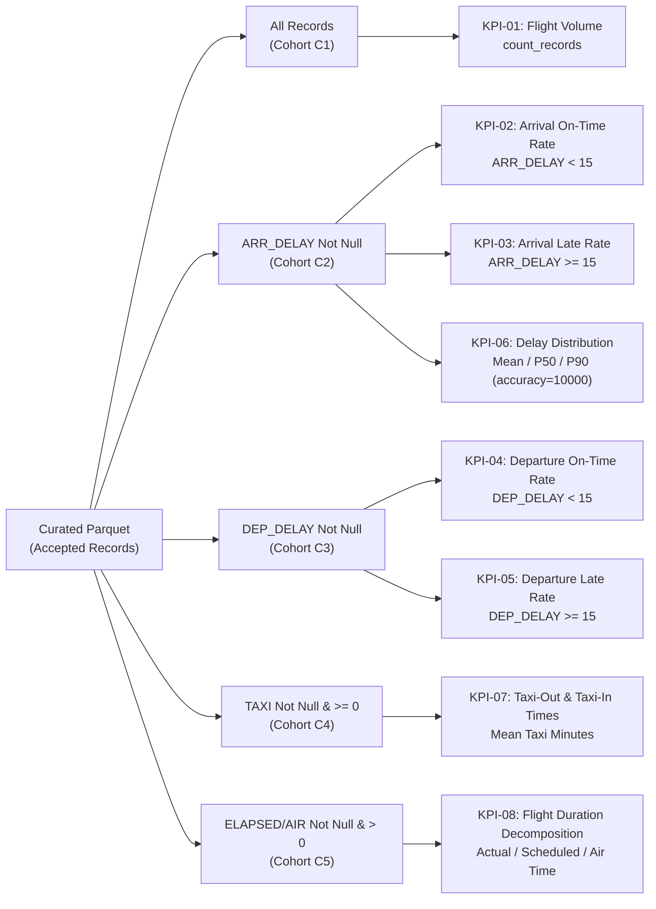

# T-006 DELIVERABLE C: KPI IMPLEMENTATION & TEST TRACEABILITY BLUEPRINT

**Task ID:** `T-006`  
**Gate:** `G3`  
**Document Nature:** Technical KPI Blueprint & Test Traceability Matrix (`DESIGN_ONLY`)  
**Project:** US Flight Performance Analysis (2016–2024) using Apache Spark / PySpark  
**Status:** `PROPOSED_FOR_PROJECT_LEAD_REVIEW`  
**Date:** 2026-10-17  

---

## 1. Mục tiêu & Ranh giới Pháp lý Thiết kế (Design Authority)

Hồ sơ này đóng vai trò là bản vẽ kỹ thuật chi tiết (`Implementation Blueprint`) cho việc hiện thực hóa:
1. **Đúng 8 chỉ số cốt lõi (`KPI-01..KPI-08`)** theo hợp đồng đặc tả toán học duy nhất tại [`docs/02-design/KPI_SPEC.md`](../02-design/KPI_SPEC.md).
2. Quy tắc lọc mẫu số hợp lệ riêng biệt (`DC-12`), thuật toán phân vị (`FP-DEC-015`), và ngưỡng lọc cỡ mẫu tối thiểu (`FP-DEC-016`).
3. Ma trận kiểm thử đầu cuối bao phủ toàn bộ 20 bài test chuẩn tắc (`TS-001..TS-020`) theo [`docs/03-quality/TEST_PLAN.md`](../03-quality/TEST_PLAN.md).

---

## 2. Đặc tả Kỹ thuật Chi tiết 8 Chỉ số Cốt lõi (CORE KPI-01..08)

---

### KPI-01: Tổng Khối lượng Chuyến bay (Total Scheduled Flight Leg Volume)
1. **KPI ID:** `KPI-01`
2. **Câu hỏi Nghiên cứu:** `RQ-01`, `RQ-04`
3. **Cột Dữ liệu Nguồn:** `FL_DATE`, `OP_CARRIER`, `ORIGIN`, `DEST`, `record_status`
4. **Bộ lọc Hợp lệ (Metric-Valid Filter):** `record_status = 'ACCEPTED'`
5. **Mẫu số (Denominator):** Không áp dụng (phép đếm tuyệt đối)
6. **Công thức Toán học:**
   $$\mathbf{KPI\text{-}01} = \sum_{r \in \text{Accepted}} 1 = \mathbf{count\_records}$$
   *(Cấm tuyệt đối dùng cột `FLIGHTS` làm trọng số nhân; mẫu số là số đếm bản ghi theo `FP-DEC-010`).*
7. **Chiều Phân tích (Grouping Dimensions):**
   * Theo năm (`YEAR`)
   * Theo năm-tháng (`YEAR`, `MONTH`)
   * Theo hãng khai thác (`YEAR`, `OP_CARRIER`)
   * Theo sân bay (`YEAR`, `ORIGIN`), (`YEAR`, `DEST`)
   * Theo đường bay (`YEAR`, `ROUTE`)
8. **Schema Đầu ra:** `[dim..., count_records: Long, source_coverage_status: String]`
9. **Xử lý Null/Invalid:** Dòng bị `REJECTED` hoặc `QUARANTINED` không được tính vào `KPI-01`.
10. **Ngưỡng Cỡ mẫu (Min-N):** Không áp dụng điều kiện áp chế (*Suppression*) cho tổng thể volume; áp dụng ngưỡng khi xếp hạng.
11. **Ghi chú Độ phủ:** Năm 2024 xuất nhãn `source_coverage_status = PARTIAL` kèm chú thích thiếu Tháng 3.
12. **Mã Kiểm thử Liên quan:** `TS-001`, `TS-003`, `TS-004`, `TS-009`, `TS-012`, `TS-017`
13. **Gate Triển khai:** `G6 / T-013`
14. **Nghĩa vụ Xác minh Mở:** Đảm bảo tổng số dòng accepted khớp với phương trình hạch toán dòng `DC-11`.

---

### KPI-02: Tỷ lệ Chuyến bay Đến Đúng giờ (Arrival On-Time Rate)
1. **KPI ID:** `KPI-02`
2. **Câu hỏi Nghiên cứu:** `RQ-02`, `RQ-03`, `RQ-04`
3. **Cột Dữ liệu Nguồn:** `ARR_DELAY`, `CANCELLED`, `DIVERTED`, `record_status`
4. **Bộ lọc Hợp lệ (Metric-Valid Filter):** `record_status = 'ACCEPTED' AND CANCELLED = 0.0 AND DIVERTED = 0.0 AND ARR_DELAY IS NOT NULL`
5. **Mẫu số (Denominator):** $\mathbf{N_{valid}} = \mathbf{count\_metric\_valid}$ (số chuyến bay có giờ đến thực tế hợp lệ)
6. **Công thức Toán học:**
   $$\mathbf{KPI\text{-}02} = \frac{\sum \mathbb{I}(\mathbf{ARR\_DELAY} < 15.0)}{\mathbf{count\_metric\_valid}}$$
   *(Tuân thủ ngưỡng trễ chính thức `< 15` phút theo chuẩn BTS và `FP-DEC-008`).*
7. **Chiều Phân tích:** Theo `YEAR`, `OP_CARRIER`, `ORIGIN`, `DEST`, `ROUTE`
8. **Schema Đầu ra:** `[dim..., count_records: Long, count_metric_valid: Long, on_time_flights: Long, on_time_rate: Double, metric_valid_rate: Double, min_n_status: String]`
9. **Xử lý Null/Invalid:** Nếu $N_{valid} = 0$, trả về `NULL` và gán nhãn `ZERO_DENOMINATOR` (`TS-017`).
10. **Ngưỡng Cỡ mẫu (Min-N per FP-DEC-016):**
    * Carrier-year: $N_{valid} \ge 1000 \implies \mathbf{SUFFICIENT}$; ngược lại $\implies \mathbf{LOW\_SAMPLE\_CAUTION}$ hoặc $\mathbf{SUPPRESSED}$.
    * Airport-year: $N_{valid} \ge 365$.
    * Route-year: $N_{valid} \ge 100$.
11. **Ghi chú Độ phủ:** `source_coverage_status` đi kèm từng bảng tổng hợp.
12. **Mã Kiểm thử Liên quan:** `TS-005`, `TS-008`, `TS-016`, `TS-017`
13. **Gate Triển khai:** `G5 / T-011` (Smoke/Sample) $\to$ `G6 / T-013` (Full Run)
14. **Nghĩa vụ Xác minh Mở:** `G2-EXC-001` — Đơn vị `ARR_DELAY` giữ nhãn `PROVISIONAL`, bắt buộc `TS-018` PASS tại G5.

---

### KPI-03: Tỷ lệ Chuyến bay Đến Trễ (Arrival Late Rate)
1. **KPI ID:** `KPI-03`
2. **Câu hỏi Nghiên cứu:** `RQ-02`, `RQ-03`, `RQ-04`
3. **Cột Dữ liệu Nguồn:** `ARR_DELAY`, `CANCELLED`, `DIVERTED`, `record_status`
4. **Bộ lọc Hợp lệ:** `record_status = 'ACCEPTED' AND CANCELLED = 0.0 AND DIVERTED = 0.0 AND ARR_DELAY IS NOT NULL`
5. **Mẫu số (Denominator):** $\mathbf{N_{valid}} = \mathbf{count\_metric\_valid}$
6. **Công thức Toán học:**
   $$\mathbf{KPI\text{-}03} = \frac{\sum \mathbb{I}(\mathbf{ARR\_DELAY} \ge 15.0)}{\mathbf{count\_metric\_valid}}$$
   *Tính chất bù trừ bắt buộc:* $\mathbf{KPI\text{-}02} + \mathbf{KPI\text{-}03} = 1.0$ (chính xác tuyệt đối trên cùng một mẫu số $N_{valid}$).
7. **Chiều Phân tích:** Theo `YEAR`, `OP_CARRIER`, `ORIGIN`, `DEST`, `ROUTE`
8. **Schema Đầu ra:** `[dim..., count_records: Long, count_metric_valid: Long, late_flights: Long, late_rate: Double, min_n_status: String]`
9. **Xử lý Null/Invalid:** Tương tự KPI-02.
10. **Ngưỡng Cỡ mẫu (Min-N):** Áp dụng đồng bộ theo `FP-DEC-016` (1000 / 365 / 100).
11. **Ghi chú Độ phủ:** Kèm nhãn `PARTIAL` cho dữ liệu 2024.
12. **Mã Kiểm thử Liên quan:** `TS-005`, `TS-006`, `TS-008`, `TS-016`
13. **Gate Triển khai:** `G5 / T-011` $\to$ `G6 / T-013`
14. **Nghĩa vụ Xác minh Mở:** Ràng buộc ngoại lệ `G2-EXC-001` / `TS-018`.

---

### KPI-04: Tỷ lệ Chuyến bay Khởi hành Đúng giờ (Departure On-Time Rate)
1. **KPI ID:** `KPI-04`
2. **Câu hỏi Nghiên cứu:** `RQ-02`, `RQ-03`
3. **Cột Dữ liệu Nguồn:** `DEP_DELAY`, `CANCELLED`, `record_status`
4. **Bộ lọc Hợp lệ:** `record_status = 'ACCEPTED' AND CANCELLED = 0.0 AND DEP_DELAY IS NOT NULL`
5. **Mẫu số (Denominator):** $\mathbf{N_{valid}} = \mathbf{count\_metric\_valid}$ (độc lập với mẫu số của KPI-02/03)
6. **Công thức Toán học:**
   $$\mathbf{KPI\text{-}04} = \frac{\sum \mathbb{I}(\mathbf{DEP\_DELAY} < 15.0)}{\mathbf{count\_metric\_valid}}$$
7. **Chiều Phân tích:** Theo `YEAR`, `OP_CARRIER`, `ORIGIN`
8. **Schema Đầu ra:** `[dim..., count_records: Long, count_metric_valid: Long, dep_on_time_rate: Double, min_n_status: String]`
9. **Xử lý Null/Invalid:** Xử lý mẫu số 0 đúng theo `TS-017`.
10. **Ngưỡng Cỡ mẫu (Min-N):** Áp dụng đồng bộ theo `FP-DEC-016`.
11. **Mã Kiểm thử Liên quan:** `TS-005`, `TS-008`, `TS-016`
12. **Gate Triển khai:** `G5 / T-011` $\to$ `G6 / T-013`
13. **Nghĩa vụ Xác minh Mở:** Ràng buộc ngoại lệ `G2-EXC-001` / `TS-018`.

---

### KPI-05: Tỷ lệ Chuyến bay Khởi hành Trễ (Departure Late Rate)
1. **KPI ID:** `KPI-05`
2. **Câu hỏi Nghiên cứu:** `RQ-02`, `RQ-03`
3. **Cột Dữ liệu Nguồn:** `DEP_DELAY`, `CANCELLED`, `record_status`
4. **Bộ lọc Hợp lệ:** `record_status = 'ACCEPTED' AND CANCELLED = 0.0 AND DEP_DELAY IS NOT NULL`
5. **Mẫu số (Denominator):** $\mathbf{N_{valid}} = \mathbf{count\_metric\_valid}$
6. **Công thức Toán học:**
   $$\mathbf{KPI\text{-}05} = \frac{\sum \mathbb{I}(\mathbf{DEP\_DELAY} \ge 15.0)}{\mathbf{count\_metric\_valid}}$$
   *Tính chất bù trừ bắt buộc:* $\mathbf{KPI\text{-}04} + \mathbf{KPI\text{-}05} = 1.0$.
7. **Chiều Phân tích:** Theo `YEAR`, `OP_CARRIER`, `ORIGIN`
8. **Schema Đầu ra:** `[dim..., count_records: Long, count_metric_valid: Long, dep_late_rate: Double, min_n_status: String]`
9. **Mã Kiểm thử Liên quan:** `TS-005`, `TS-006`, `TS-008`
10. **Gate Triển khai:** `G5 / T-011` $\to$ `G6 / T-013`
11. **Nghĩa vụ Xác minh Mở:** Ràng buộc ngoại lệ `G2-EXC-001` / `TS-018`.

---

### KPI-06: Phân bố Độ trễ Chuyến bay Đến (Delay Distribution & Percentiles)
1. **KPI ID:** `KPI-06` (gồm 2 tiểu chỉ số `Sub-6a` và `Sub-6b`)
2. **Câu hỏi Nghiên cứu:** `RQ-02`, `RQ-03`
3. **Cột Dữ liệu Nguồn:** `ARR_DELAY`, `CANCELLED`, `DIVERTED`, `record_status`
4. **Bộ lọc Hợp lệ:** `record_status = 'ACCEPTED' AND CANCELLED = 0.0 AND DIVERTED = 0.0 AND ARR_DELAY IS NOT NULL`
5. **Mẫu số (Denominator):** $\mathbf{N_{valid}} = \mathbf{count\_metric\_valid}$
6. **Công thức Toán học:**
   * **Sub-6a (Mean Arrival Delay - Signed):**
     $$\mathbf{mean\_arr\_delay} = \frac{\sum \mathbf{ARR\_DELAY}}{\mathbf{count\_metric\_valid}}$$
     *(Giữ nguyên dấu âm của các chuyến bay đến sớm theo `FP-DEC-008`).*
   * **Sub-6b (Median & 90th Percentile per FP-DEC-015):**
     $$[\mathbf{p50\_arr\_delay},\ \mathbf{p90\_arr\_delay}] = \mathbf{percentile\_approx}(\mathbf{ARR\_DELAY},\ [0.5,\ 0.9],\ \mathbf{accuracy}=10000)$$
     *(Độ chính xác thứ hạng $\le 0.01\%$; phân biệt với sai số phút tuyệt đối).*
7. **Chiều Phân tích:** Theo `YEAR`, `OP_CARRIER`, `ORIGIN`, `DEST`, `ROUTE`
8. **Schema Đầu ra:** `[dim..., count_metric_valid: Long, mean_arr_delay: Double, p50_arr_delay: Double, p90_arr_delay: Double, min_n_status: String]`
9. **Xử lý Null/Invalid:** Nếu $N_{valid} = 0$, trả về Null.
10. **Ngưỡng Cỡ mẫu (Min-N per FP-DEC-016):**
    * Carrier: $\ge 1000$; Airport: $\ge 365$; Route: $\ge 100$.
    * Nếu không đủ mẫu: Cấm đưa vào bảng xếp hạng Top/Bottom (`SUPPRESSED`).
11. **Mã Kiểm thử Liên quan:** `TS-006`, `TS-008`, `TS-016`
12. **Gate Triển khai:** `G5 / T-011` (Smoke/Synthetic) $\to$ `G6 / T-013` (Full Run)
13. **Nghĩa vụ Xác minh Mở:** Kiểm chứng độ chính xác phân vị qua `TS-008` tại G5; ràng buộc `G2-EXC-001` / `TS-018`.

---

### KPI-07: Hiệu suất Thời gian Lăn Bánh (Taxi Time Performance)
1. **KPI ID:** `KPI-07` (gồm 2 tiểu chỉ số `Sub-7a` và `Sub-7b`)
2. **Câu hỏi Nghiên cứu:** `RQ-05`
3. **Cột Dữ liệu Nguồn:** `TAXI_OUT`, `TAXI_IN`, `CANCELLED`, `record_status`
4. **Bộ lọc Hợp lệ (Mẫu số Riêng biệt từng Submetric):**
   * Cho Taxi-Out: `record_status = 'ACCEPTED' AND CANCELLED = 0.0 AND TAXI_OUT IS NOT NULL AND TAXI_OUT >= 0`
   * Cho Taxi-In: `record_status = 'ACCEPTED' AND CANCELLED = 0.0 AND TAXI_IN IS NOT NULL AND TAXI_IN >= 0`
5. **Mẫu số (Denominator):** $N_{valid\_taxi\_out}$ và $N_{valid\_taxi\_in}$ tính độc lập.
6. **Công thức Toán học:**
   $$\mathbf{mean\_taxi\_out} = \frac{\sum \mathbf{TAXI\_OUT}}{N_{valid\_taxi\_out}},\quad \mathbf{mean\_taxi\_in} = \frac{\sum \mathbf{TAXI\_IN}}{N_{valid\_taxi\_in}}$$
7. **Chiều Phân tích:** Theo `YEAR`, `ORIGIN` (cho Taxi-Out), `DEST` (cho Taxi-In), `OP_CARRIER`
8. **Schema Đầu ra:** `[airport: String, year: Int, valid_taxi_out_count: Long, mean_taxi_out: Double, valid_taxi_in_count: Long, mean_taxi_in: Double, min_n_status: String]`
9. **Mã Kiểm thử Liên quan:** `TS-006`, `TS-008`, `TS-016`
10. **Gate Triển khai:** `G5 / T-011` $\to$ `G6 / T-013`
11. **Nghĩa vụ Xác minh Mở:** Ràng buộc ngoại lệ `G2-EXC-001` / `TS-018`.

---

### KPI-08: Phân rã Thời lượng Chuyến bay & Thời gian Bay Thực tế (Flight Duration Decomposition)
1. **KPI ID:** `KPI-08` (gồm 3 tiểu chỉ số `Sub-8a`, `Sub-8b`, `Sub-8c`)
2. **Câu hỏi Nghiên cứu:** `RQ-05`
3. **Cột Dữ liệu Nguồn:** `ACTUAL_ELAPSED_TIME`, `CRS_ELAPSED_TIME`, `AIR_TIME`, `CANCELLED`, `DIVERTED`, `record_status`
4. **Bộ lọc Hợp lệ (Mẫu số Riêng biệt từng Submetric):**
   * Cho Actual Elapsed: `record_status = 'ACCEPTED' AND CANCELLED = 0.0 AND DIVERTED = 0.0 AND ACTUAL_ELAPSED_TIME > 0`
   * Cho CRS Elapsed: `record_status = 'ACCEPTED' AND CRS_ELAPSED_TIME > 0`
   * Cho Air Time: `record_status = 'ACCEPTED' AND CANCELLED = 0.0 AND DIVERTED = 0.0 AND AIR_TIME > 0`
5. **Công thức Toán học:**
   $$\mathbf{mean\_actual\_elapsed} = \frac{\sum \mathbf{ACTUAL\_ELAPSED\_TIME}}{N_{actual}},\quad \mathbf{mean\_crs\_elapsed} = \frac{\sum \mathbf{CRS\_ELAPSED\_TIME}}{N_{crs}},\quad \mathbf{mean\_air\_time} = \frac{\sum \mathbf{AIR\_TIME}}{N_{air}}$$
   *Bất biến vật lý kỳ vọng:* Trên cùng một bản ghi chuyến bay hoàn thành bình thường, $\mathbf{ACTUAL\_ELAPSED\_TIME} \approx \mathbf{AIR\_TIME} + \mathbf{TAXI\_OUT} + \mathbf{TAXI\_IN}$.
6. **Chiều Phân tích:** Theo `YEAR`, `ROUTE`, `OP_CARRIER`
7. **Schema Đầu ra:** `[route: String, year: Int, mean_actual_elapsed: Double, mean_crs_elapsed: Double, mean_air_time: Double, min_n_status: String]`
8. **Mã Kiểm thử Liên quan:** `TS-006`, `TS-008`, `TS-010`, `TS-018`
9. **Gate Triển khai:** `G5 / T-011` $\to$ `G6 / T-013`
10. **Nghĩa vụ Xác minh Mở:** Ràng buộc ngoại lệ `G2-EXC-001` / `TS-018`.

---

## 3. Trạng thái Các Chỉ số Ngoài Phạm vi CORE (KPI-09 đến KPI-12)

* **`KPI-09` (`OPTIONAL_DRAFT`):** Trung bình số phút trễ dương trên mỗi chuyến bay hợp lệ ($\sum \max(\mathbf{ARR\_DELAY}, 0) / N_{valid}$). Không triển khai trong pipeline sản xuất CORE trừ khi Project Lead yêu cầu riêng.
* **`KPI-10` (`CONDITIONAL_NO_GO`):** Chỉ số tương quan thời tiết (`RQ-06`). Đã chính thức loại bỏ khỏi pipeline sản xuất theo phê duyệt `FP-DEC-017`.
* **`KPI-11` (`NOT_COMPUTABLE`):** Tỷ lệ hủy/chuyển hướng chi tiết theo nguyên nhân BTS. Không thể tính toán đầy đủ và chính xác từ schema 34 cột hiện có (`FP-DEC-006`, `OR-04`).
* **`KPI-12` (`BLOCKED`):** Trọng số chuyến bay dựa trên `FLIGHTS`. Bị cấm tuyệt đối theo `FP-DEC-010` do cột `FLIGHTS` có giá trị 1.0 trên 100% dòng, không phản ánh quy mô tải khách hay trọng số khai thác thực tế.

---

## 4. Ma trận Truy vết Kiểm thử Toàn diện (Test Traceability Matrix TS-001..TS-020)

Dưới đây là ma trận ánh xạ toàn bộ 20 bài kiểm thử chuẩn tắc theo [`docs/03-quality/TEST_PLAN.md`](../03-quality/TEST_PLAN.md):

| Test ID | Tên bài kiểm thử & Phạm vi kỹ thuật | Gate & Task Phụ trách | Loại Test | Trạng thái Hiện tại (G3/T-006) | Điều kiện Tiên quyết & Ràng buộc Chặn |
| :---: | :--- | :---: | :---: | :---: | :--- |
| **TS-001** | Raw Ingestion Integrity & Mismatch Fail-Closed | `G4 / T-007` | Synthetic / Integration | `SYNTHETIC_PLANNED` | Fail-closed nếu cấu trúc schema bị trôi lệch hoặc thiếu cột. |
| **TS-002** | Domain & Range Validation for Delay & Operational Times | `G4 / T-008` | Unit / Synthetic | `SYNTHETIC_PLANNED` | Kiểm tra miền giá trị hợp lệ của 34 cột; cô lập dữ liệu bất thường. |
| **TS-003** | Mutually Exclusive Three-State Row Accounting (`DC-11`) | `G4 / T-008` | Unit / Balance Check | `SYNTHETIC_PLANNED` | Bắt buộc $\mathbf{raw = accepted + quarantined + rejected}$ 100%. |
| **TS-004** | Calendar Date Coverage & 2024 Partial Acceptance | `G4 / T-008` & `G6 / T-012` | Audit / Verification | `NOT_RUN` | Kiểm tra sớm tại T-008; nghiệm thu chính thức tại T-012 (335/366 ngày). |
| **TS-005** | Arrival Delay Threshold ($<15$ vs $\ge 15$) & Denominator | `G5 / T-011` | Synthetic / Unit | `SYNTHETIC_PLANNED` | Kiểm chứng trên bộ fixture `FIX-01..14`; mẫu số $N_{valid}$ hữu hạn. |
| **TS-006** | Signed Mean Delay & Taxi/Elapsed Decomposition | `G5 / T-011` | Synthetic / Unit | `SYNTHETIC_PLANNED` | Giữ nguyên dấu âm chuyến bay đến sớm; kiểm tra bảo toàn thời gian. |
| **TS-007** | Multi-Year Temporal Aggregation & Monotonicity | `G6 / T-013` | Integration / Multi-Year | `FULL_RUN_PLANNED` | Tổng hợp theo năm/tháng không làm thất thoát bản ghi. |
| **TS-008** | Percentile Approximation & Min-N Sample Enforcement | `G5 / T-011` & `G6 / T-013` | Algorithm / Policy | `SYNTHETIC_PLANNED` | `percentile_approx` accuracy=10000; min-N 1000/365/100 (`FP-DEC-015/016`). |
| **TS-009** | Scope Exclusion & Weighting Policy Compliance | `G5 / T-011` & `G7` | Policy Audit | `DESIGN_ONLY` | Cấm dùng FLIGHTS làm trọng số; loại bỏ ML/.pt/Weather khỏi CORE. |
| **TS-010** | Temporal Representation Safety & Overnight Counterexamples | `G4 / T-008` & `G5 / T-011` | Unit / Synthetic | `SYNTHETIC_PLANNED` | Cấm trừ chuỗi timestamp; cấm tự cộng 24h; kiểm thử trên `TF-01..09`. |
| **TS-011** | Weather CONDITIONAL_NO_GO Compliance Verification | `G5 / T-011` & `G6 / T-015` | Policy Audit | `DESIGN_ONLY` | Kiểm tra không xuất bản báo cáo Weather; không gây lỗi CORE. |
| **TS-012** | Deterministic Pipeline Idempotency | `G4 / T-007` & `G5 / T-010` | Regression / Rerun | `SMOKE_PLANNED` | Chạy lại cùng một input phải sinh ra output trùng khớp byte-for-byte. |
| **TS-013** | Run Artifact & Manifest Reproducibility | `G5 / T-010` & `G6 / T-012` | Audit / Manifest | `SMOKE_PLANNED` | Ghi nhận đầy đủ mã băm SHA-256, runtime config trong run manifest. |
| **TS-014** | Resource Budget & Performance Benchmarking | `G5 / T-010` & `G6 / T-012` | Benchmark / Monitor | `SMOKE_PLANNED` | Đo đạc thực tế CPU, RAM, disk I/O trên dữ liệu 1 năm trước khi full run. |
| **TS-015** | End-to-End Pipeline Audit & Integrity Check | `G6 / T-014` & `G7 / T-017` | End-to-End Audit | `FULL_RUN_PLANNED` | Kiểm toán chéo kết quả RQ-01..05 với tài liệu hợp đồng và sổ đăng ký. |
| **TS-016** | Grouping Cardinality & Output Schema Conformance | `G5 / T-011` & `G6 / T-013` | Schema Conformance | `SYNTHETIC_PLANNED` | Đảm bảo đúng schema và các nhãn `min_n_status` được phê duyệt. |
| **TS-017** | Zero Denominator Guard & Glossary Alignment | `G4 / T-008` & `G5 / T-011` | Unit / Security | `SYNTHETIC_PLANNED` | Bảo vệ chia cho 0; phân biệt rõ `metric_valid_rate` vs `coverage_rate`. |
| **TS-018** | **External BTS Unit Reconciliation (Delay & Elapsed Measures)** | **`G5 / T-011`** | **External Audit / Empirical** | **`BLOCKED_PRE_G5`** | **ĐIỀU KIỆN CHẶN BẮT BUỘC (`G2-EXC-001`): Nếu không PASS $\implies$ BLOCK G6.** |
| **TS-019** | Raw Source Content Identity Baseline (Local SHA-256) | `G4 / T-007` & `G5 / T-010` | Cryptographic Audit | `SMOKE_PLANNED` | Tính mã băm SHA-256 cục bộ cho 9 file CSV thô (`OR-08`). |
| **TS-020** | Stable Lineage & Record Disambiguation (YX 3624 Pair) | `G4 / T-007` & `G5 / T-011` | Lineage Verification | `OPEN_DESIGN_VERIFICATION` | Bảo toàn cả 2 dòng `YX 3624` mà không deduplicate; định danh ổn định. |

---

## 5. Trình tự Triển khai Bắt buộc giữa các Gate (Mandatory Gate Execution Sequence)

Theo quy định quản trị tại `AGENTS.md` và `PROJECT_STATE.md`, thứ tự triển khai bắt buộc là:

$$\mathbf{G3/T\text{-}006} \longrightarrow \mathbf{G4/T\text{-}009} \longrightarrow \mathbf{G4/T\text{-}007} \longrightarrow \mathbf{G4/T\text{-}008} \longrightarrow \mathbf{G5/T\text{-}010} \longrightarrow \mathbf{G5/T\text{-}011\ (TS\text{-}018)} \stackrel{\text{TS-018 PASS}}{\scalebox{1.5}{$\longrightarrow$}} \mathbf{G6}$$

* **Gate G4:** Phải khởi tạo môi trường `T-009` trước khi viết code nạp dữ liệu `T-007` và kiểm tra chất lượng `T-008`.
* **Gate G5:** Bài kiểm tra đối chiếu đơn vị BTS `TS-018` là **CHỐT CHẶN BẮT BUỘC**. Nếu `TS-018` không đạt `PASS` tại G5, toàn bộ Gate G6 (Production Full Run) bị **ĐÓNG BĂNG HOÀN TOÀN (`BLOCKED`)**.

---

## 6. Kết luận & Mức độ Sẵn sàng (KPI & Test Blueprint Verdict)

Toàn bộ 8 CORE KPIs và 20 bài kiểm thử đã được thiết kế hoàn chỉnh, tường minh, không để lại bất kỳ khoảng trống kỹ thuật nào.

$$\mathbf{VERDICT:}\quad \mathbf{T006\_KPI\_AND\_TEST\_BLUEPRINT\_COMPLIANT}$$
