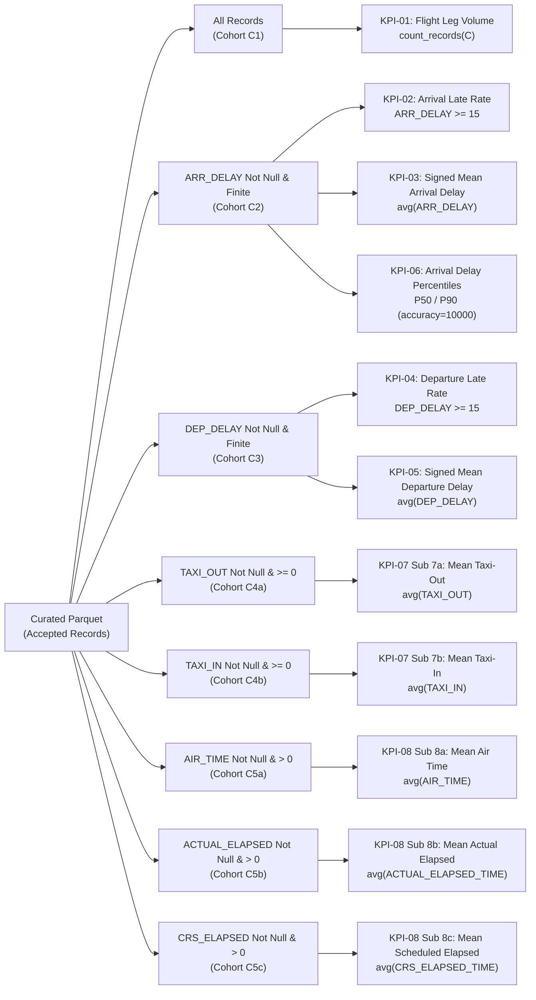

# T-006-R1 RECONCILIATION REPORT 2: CORE KPI CONTRACT & TEST TRACEABILITY

**Task ID:** `T-006-R1`  
**Gate:** `G3`  
**Document Nature:** Authoritative KPI Contract Restoration & Test Traceability Blueprint (`DESIGN_ONLY`)  
**Project:** US Flight Performance Analysis (2016–2024) using Apache Spark / PySpark  
**Status:** `PROPOSED_FOR_PROJECT_LEAD_REVIEW`  
**Date:** 2026-10-17  
**Supersedes:** `docs/05-evidence/T006_KPI_AND_TEST_BLUEPRINT.md` (Mục 2 & Mục 3)

---

## 1. Mục tiêu & Ranh giới Pháp lý (Authority & Objectives)

Hồ sơ này khôi phục toàn diện và chính xác tuyệt đối các hợp đồng tính toán cho **8 CORE KPIs (`KPI-01..08`)** và ma trận truy vết kiểm thử **`TS-001..TS-020`** dựa trên:
- [`docs/02-design/KPI_SPEC.md`](../02-design/KPI_SPEC.md) (Phiên bản chuẩn docs-v1.1, phê duyệt `FP-DEC-012`).
- [`docs/03-quality/TEST_PLAN.md`](../03-quality/TEST_PLAN.md) (Phiên bản chuẩn docs-v1.1).
- Quyết định ngoại lệ đơn vị đo [`G2-EXC-001`](../02-design/DECISIONS.md) và các quyết định phê duyệt `FP-DEC-008`, `FP-DEC-010`, `FP-DEC-011`, `FP-DEC-015`, `FP-DEC-016`, `FP-DEC-017`.

---

## 2. Bảng Đối chiếu Sai lệch & Đính chính KPI (KPI Errata Matrix)

Trong hồ sơ ban đầu `T006_KPI_AND_TEST_BLUEPRINT.md`, một loạt các sai lệch nghiêm trọng đã xuất hiện:

| Chỉ số | Định nghĩa Sai lệch trong Initial T-006 | Định nghĩa Chuẩn tắc trong `KPI_SPEC.md` | Bản chất Sai lệch & Rủi ro | Biện pháp Khắc phục Chuẩn tắc |
| :---: | :--- | :--- | :--- | :--- |
| **KPI-02** | "Arrival On-Time Rate" (`ARR_DELAY < 15.0`) | **Arrival Late Rate** (`ARR_DELAY >= 15.0`) | Đảo ngược bản chất toán học của chỉ số (đổi trễ thành đúng giờ) | Khôi phục KPI-02 là Tỷ lệ Trễ Đến: `sum(1[ARR_DELAY >= 15]) / N_valid` |
| **KPI-03** | "Arrival Late Rate" (`ARR_DELAY >= 15.0`) | **Mean Arrival Delay (Signed)** | Đổi phép tính trung bình đại số thành tỷ lệ phần trăm trễ | Khôi phục KPI-03 là Trễ Đến Trung bình Đại số: `sum(ARR_DELAY) / N_valid` |
| **KPI-04** | "Departure On-Time Rate" (`DEP_DELAY < 15.0`) | **Departure Late Rate** (`DEP_DELAY >= 15.0`) | Đảo ngược bản chất chỉ số | Khôi phục KPI-04 là Tỷ lệ Trễ Khởi hành: `sum(1[DEP_DELAY >= 15]) / N_valid` |
| **KPI-05** | "Departure Late Rate" (`DEP_DELAY >= 15.0`) | **Mean Departure Delay (Signed)** | Đổi phép tính trung bình đại số thành tỷ lệ trễ | Khôi phục KPI-05 là Trễ Khởi hành Trung bình: `sum(DEP_DELAY) / N_valid` |
| **KPI-06** | Gom cả Mean ARR_DELAY vào KPI-06 | **P50 / P90 Delay Percentiles** (không có Mean) | Mean đã thuộc KPI-03; lạm phát định nghĩa KPI-06 | KPI-06 chỉ gồm 2 submetrics P50 và P90 qua `percentile_approx(..., 10000)` |
| **Tất cả** | Lọc `CANCELLED = 0.0 AND DIVERTED = 0.0` | **Không lọc CANCELLED / DIVERTED** | Cột không tồn tại trong 34 cột raw CSV | Xóa bỏ hoàn toàn bộ lọc hủy/chuyển hướng trong CORE |
| **Mẫu số** | Chưa nhấn mạnh mẫu số độc lập | Mẫu số độc lập $N_{valid}(f, C)$ cho từng submetric | Tránh triệt tiêu dòng valid chéo | Áp dụng đúng $N_{valid}$ theo từng trường đo |

---

## 3. Đặc tả Kỹ thuật Chuẩn tắc 8 Chỉ số Cốt lõi (CORE KPI-01..08)

---

### KPI-01: Tổng Số Bản Ghi Accepted (Total Accepted Flight Leg Records)
1. **Mã KPI:** `KPI-01`
2. **Tên chính thức:** Tổng bản ghi accepted trong cohort $C$.
3. **Câu hỏi Nghiên cứu:** `RQ-01`, `RQ-04`
4. **Trường dữ liệu nguồn:** `record_status = 'ACCEPTED'`
5. **Bộ lọc Hợp lệ (Cohort Filter):** Bản ghi được nạp thành công và qua hạch toán `ACCEPTED` theo `DC-11`.
6. **Mẫu số (Denominator):** Phép đếm tuyệt đối: $\mathbf{count\_records}(C)$. Tuyệt đối không dùng `sum(FLIGHTS)` làm mẫu số (`FP-DEC-010`).
7. **Công thức Toán học:**
   $$\mathbf{KPI\text{-}01} = \sum_{r \in \text{Accepted}(C)} 1 = \mathbf{count\_records}(C)$$
8. **Quy tắc Trọng số & Đếm:** Mỗi bản ghi đại diện cho 1 leg hành trình đã audit; không gọi "tổng chuyến bay toàn nước Mỹ" khi chưa xác minh coverage.
9. **Nhãn Độ phủ:** Xuất `source_coverage_status = PARTIAL` cho mọi nhóm thuộc năm 2024 do thiếu Tháng 3 (`OR-05`).
10. **Mã Kiểm thử:** `TS-001`, `TS-003`, `TS-004`, `TS-009`, `TS-012`, `TS-017`.

---

### KPI-02: Tỷ Lệ Trễ Đến $\ge 15$ Phút (Arrival Late Rate $\ge 15$)
1. **Mã KPI:** `KPI-02`
2. **Tên chính thức:** Tỷ lệ trễ đến $\ge 15$ phút.
3. **Câu hỏi Nghiên cứu:** `RQ-02`, `RQ-03`, `RQ-04`
4. **Trường dữ liệu nguồn:** `ARR_DELAY`, `record_status` (KHÔNG dùng `CANCELLED` hay `DIVERTED`).
5. **Bộ lọc Hợp lệ:** `record_status = 'ACCEPTED' AND ARR_DELAY IS NOT NULL AND is_finite(ARR_DELAY)`
6. **Mẫu số Hợp lệ:** $\mathbf{N_{valid}}(\mathbf{ARR\_DELAY}, C) = \mathbf{count\_metric\_valid}$
7. **Công thức Toán học:**
   $$\mathbf{KPI\text{-}02} = \frac{\sum_{r \in \text{Valid}(ARR\_DELAY, C)} \mathbb{I}(\mathbf{ARR\_DELAY}_r \ge 15.0)}{\mathbf{N_{valid}}(\mathbf{ARR\_DELAY}, C)}$$
8. **Quy tắc Biên độ:** Bao gồm chính xác giá trị `15.0` (`FP-DEC-008`, kiểm chứng theo `TS-005`).
9. **Xử lý Mẫu số 0:** Nếu $\mathbf{N_{valid}} = 0$, trả về `NULL` với nhãn lý do `ZERO_METRIC_DENOMINATOR` (`FP-DEC-011`, `TS-017`), cấm trả về 0.0.
10. **Trạng thái Đơn vị Đo:** Mang nhãn tạm thời `OFFICIAL_MINUTES_EMPIRICALLY_CONSISTENT_PROVISIONAL` theo `G2-EXC-001`; bắt buộc `TS-018` đạt `PASS` tại Gate G5 trước khi chạy G6.
11. **Mã Kiểm thử:** `TS-005`, `TS-008`, `TS-016`, `TS-017`, `TS-018`.

---

### KPI-03: Độ Trễ Đến Trung Bình Đại Số (Signed Mean Arrival Delay)
1. **Mã KPI:** `KPI-03`
2. **Tên chính thức:** Độ trễ đến trung bình đại số (Signed Mean).
3. **Câu hỏi Nghiên cứu:** `RQ-02`, `RQ-03`, `RQ-04`
4. **Trường dữ liệu nguồn:** `ARR_DELAY`, `record_status`
5. **Bộ lọc Hợp lệ:** `record_status = 'ACCEPTED' AND ARR_DELAY IS NOT NULL AND is_finite(ARR_DELAY)`
6. **Mẫu số Hợp lệ:** $\mathbf{N_{valid}}(\mathbf{ARR\_DELAY}, C) = \mathbf{count\_metric\_valid}$ (cùng cohort hợp lệ với KPI-02).
7. **Công thức Toán học:**
   $$\mathbf{KPI\text{-}03} = \frac{\sum_{r \in \text{Valid}(ARR\_DELAY, C)} \mathbf{ARR\_DELAY}_r}{\mathbf{N_{valid}}(\mathbf{ARR\_DELAY}, C)}$$
8. **Bảo tồn Dấu Âm (Negative Signed Delay):** Các chuyến bay đến sớm có `ARR_DELAY < 0` được giữ nguyên vẹn trong tổng đại số, tuyệt đối **không cắt gọt (clip to zero)** hay winsorize (`FP-DEC-008`, `TS-006`).
9. **Xử lý Mẫu số 0:** Trả về `NULL` với `ZERO_METRIC_DENOMINATOR` nếu $\mathbf{N_{valid}} = 0$.
10. **Trạng thái Đơn vị Đo:** `OFFICIAL_MINUTES_EMPIRICALLY_CONSISTENT_PROVISIONAL` (`G2-EXC-001`).
11. **Mã Kiểm thử:** `TS-005`, `TS-006`, `TS-008`, `TS-016`, `TS-018`.

---

### KPI-04: Tỷ Lệ Trễ Khởi Hành $\ge 15$ Phút (Departure Late Rate $\ge 15$)
1. **Mã KPI:** `KPI-04`
2. **Tên chính thức:** Tỷ lệ trễ khởi hành $\ge 15$ phút.
3. **Câu hỏi Nghiên cứu:** `RQ-02`, `RQ-03`
4. **Trường dữ liệu nguồn:** `DEP_DELAY`, `record_status` (KHÔNG lọc `CANCELLED`).
5. **Bộ lọc Hợp lệ:** `record_status = 'ACCEPTED' AND DEP_DELAY IS NOT NULL AND is_finite(DEP_DELAY)`
6. **Mẫu số Hợp lệ:** $\mathbf{N_{valid}}(\mathbf{DEP\_DELAY}, C) = \mathbf{count\_metric\_valid}$ (độc lập với mẫu số của ARR_DELAY).
7. **Công thức Toán học:**
   $$\mathbf{KPI\text{-}04} = \frac{\sum_{r \in \text{Valid}(DEP\_DELAY, C)} \mathbb{I}(\mathbf{DEP\_DELAY}_r \ge 15.0)}{\mathbf{N_{valid}}(\mathbf{DEP\_DELAY}, C)}$$
8. **Quy tắc Biên độ:** Bao gồm chính xác giá trị `15.0` (`FP-DEC-008`).
9. **Xử lý Mẫu số 0:** Trả về `NULL` với `ZERO_METRIC_DENOMINATOR`.
10. **Trạng thái Đơn vị Đo:** `OFFICIAL_MINUTES_EMPIRICALLY_CONSISTENT_PROVISIONAL` (`G2-EXC-001`).
11. **Mã Kiểm thử:** `TS-005`, `TS-006`, `TS-008`, `TS-016`, `TS-018`.

---

### KPI-05: Độ Trễ Khởi Hành Trung Bình Đại Số (Signed Mean Departure Delay)
1. **Mã KPI:** `KPI-05`
2. **Tên chính thức:** Độ trễ khởi hành trung bình đại số (Signed Mean).
3. **Câu hỏi Nghiên cứu:** `RQ-02`, `RQ-03`
4. **Trường dữ liệu nguồn:** `DEP_DELAY`, `record_status`
5. **Bộ lọc Hợp lệ:** `record_status = 'ACCEPTED' AND DEP_DELAY IS NOT NULL AND is_finite(DEP_DELAY)`
6. **Mẫu số Hợp lệ:** $\mathbf{N_{valid}}(\mathbf{DEP\_DELAY}, C) = \mathbf{count\_metric\_valid}$
7. **Công thức Toán học:**
   $$\mathbf{KPI\text{-}05} = \frac{\sum_{r \in \text{Valid}(DEP\_DELAY, C)} \mathbf{DEP\_DELAY}_r}{\mathbf{N_{valid}}(\mathbf{DEP\_DELAY}, C)}$$
8. **Bảo tồn Dấu Âm:** Các chuyến bay khởi hành sớm có `DEP_DELAY < 0` được giữ nguyên vẹn trong tổng (`TS-006`).
9. **Xử lý Mẫu số 0:** Trả về `NULL` với `ZERO_METRIC_DENOMINATOR`.
10. **Trạng thái Đơn vị Đo:** `OFFICIAL_MINUTES_EMPIRICALLY_CONSISTENT_PROVISIONAL` (`G2-EXC-001`).
11. **Mã Kiểm thử:** `TS-005`, `TS-006`, `TS-008`, `TS-016`, `TS-018`.

---

### KPI-06: Phân Vị Độ Trễ Đến P50 và P90 (Arrival Delay Percentiles P50/P90)
1. **Mã KPI:** `KPI-06`
2. **Tên chính thức:** Phân vị P50 (Trung vị) và P90 của độ trễ chuyến bay đến.
3. **Câu hỏi Nghiên cứu:** `RQ-02`, `RQ-03`, `RQ-04`
4. **Trường dữ liệu nguồn:** `ARR_DELAY`, `record_status`
5. **Bộ lọc Hợp lệ:** `record_status = 'ACCEPTED' AND ARR_DELAY IS NOT NULL AND is_finite(ARR_DELAY)`
6. **Thuật toán & Công thức (`FP-DEC-015` đã duyệt):**
   Sử dụng hàm xấp xỉ phân vị dựa trên thuật toán Greenwald-Khanna với tham số độ chính xác cố định:
   $$\mathbf{percentile\_approx}(\mathbf{ARR\_DELAY},\ [0.5,\ 0.9],\ \mathbf{accuracy}=10000)$$
7. **Ranh giới Sai số Toán học:**
   - Sai số thứ hạng tương đối: $\epsilon_{\text{rank}} \le \frac{1}{\text{accuracy}} = 0.01\%$.
   - **Lưu ý ranh giới:** Thuật toán không đảm bảo một chặn trên cố định cho sai số phút tuyệt đối trên các phân phối có đuôi nặng (*heavy-tailed distributions*). Xuất kèm siêu dữ liệu tham số `accuracy=10000` và kiểm nghiệm thực tế theo `TS-008` tại Gate G5.
8. **Hai Tiểu Chỉ số (Submetrics):**
   - `Sub-6a` (`P50`): Trung vị độ trễ đến.
   - `Sub-6b` (`P90`): Phân vị 90% độ trễ đến.
   - *(Tuyệt đối không đưa Mean vào làm submetric của KPI-06; Mean đã được hạch toán riêng tại KPI-03).*
9. **Mã Kiểm thử:** `TS-005`, `TS-008`, `TS-016`, `TS-018`.

---

### KPI-07: Thời Gian Lăn Bánh Ra và Vào Trung Bình (Mean Taxi-Out & Taxi-In Times)
1. **Mã KPI:** `KPI-07` (gồm 2 submetrics độc lập mẫu số)
2. **Tên chính thức:** Taxi-out và Taxi-in trung bình.
3. **Câu hỏi Nghiên cứu:** `RQ-05`
4. **Hai Tiểu Chỉ số & Mẫu số Độc lập:**
   - **`Sub-7a` (`TAXI_OUT`):**
     - Bộ lọc: `record_status = 'ACCEPTED' AND TAXI_OUT IS NOT NULL AND TAXI_OUT >= 0`
     - Mẫu số: $\mathbf{N_{valid}}(\mathbf{TAXI\_OUT}, C)$
     - Công thức: $\mathbf{avg}(\mathbf{TAXI\_OUT})$
   - **`Sub-7b` (`TAXI_IN`):**
     - Bộ lọc: `record_status = 'ACCEPTED' AND TAXI_IN IS NOT NULL AND TAXI_IN >= 0`
     - Mẫu số: $\mathbf{N_{valid}}(\mathbf{TAXI\_IN}, C)$
     - Công thức: $\mathbf{avg}(\mathbf{TAXI\_IN})$
5. **Tính Độc lập của Mẫu số:** Dòng bị khuyết `TAXI_IN` nhưng có `TAXI_OUT` hợp lệ vẫn được tính cho `Sub-7a`, không bị loại bỏ chéo.
6. **Trạng thái Đơn vị Đo:** `OFFICIAL_MINUTES_EMPIRICALLY_CONSISTENT_PROVISIONAL` (`G2-EXC-001`).
7. **Mã Kiểm thử:** `TS-006`, `TS-008`, `TS-017`, `TS-018`.

---

### KPI-08: Phân Rã Thời Lượng Chuyến Bay Trung Bình (Flight Duration Decomposition)
1. **Mã KPI:** `KPI-08` (gồm 3 submetrics độc lập mẫu số)
2. **Tên chính thức:** Thời gian trên không, thời lượng thực tế và thời lượng kế hoạch trung bình.
3. **Câu hỏi Nghiên cứu:** `RQ-05`
4. **Ba Tiểu Chỉ số & Mẫu số Độc lập:**
   - **`Sub-8a` (`AIR_TIME`):**
     - Mẫu số: $\mathbf{N_{valid}}(\mathbf{AIR\_TIME}, C)$
     - Công thức: $\mathbf{avg}(\mathbf{AIR\_TIME})$ trên các bản ghi `AIR_TIME > 0`
   - **`Sub-8b` (`ACTUAL_ELAPSED_TIME`):**
     - Mẫu số: $\mathbf{N_{valid}}(\mathbf{ACTUAL\_ELAPSED\_TIME}, C)$
     - Công thức: $\mathbf{avg}(\mathbf{ACTUAL\_ELAPSED\_TIME})$ trên các bản ghi `ACTUAL_ELAPSED_TIME > 0`
   - **`Sub-8c` (`CRS_ELAPSED_TIME`):**
     - Mẫu số: $\mathbf{N_{valid}}(\mathbf{CRS\_ELAPSED\_TIME}, C)$
     - Công thức: $\mathbf{avg}(\mathbf{CRS\_ELAPSED\_TIME})$ trên các bản ghi `CRS_ELAPSED_TIME > 0`
5. **Quan hệ Vật lý:** Phục vụ đối soát đẳng thức thời gian `ACTUAL_ELAPSED_TIME ≈ AIR_TIME + TAXI_OUT + TAXI_IN` trên các chuyến bay có đủ cả 4 trường đo.
6. **Trạng thái Đơn vị Đo:** `OFFICIAL_MINUTES_EMPIRICALLY_CONSISTENT_PROVISIONAL` (`G2-EXC-001`).
7. **Mã Kiểm thử:** `TS-006`, `TS-008`, `TS-017`, `TS-018`.

---

## 4. Chính Sách Ngưỡng Cỡ Mẫu Min-N (`FP-DEC-016`)

1. **Ngưỡng quy định:** Áp dụng trực tiếp trên $\mathbf{count\_metric\_valid}$ của từng chỉ số/submetric:
   - **Carrier-Year:** $\mathbf{count\_metric\_valid} \ge 1000$
   - **Airport-Year:** $\mathbf{count\_metric\_valid} \ge 365$
   - **Route-Year (Có hướng `ORIGIN->DEST`):** $\mathbf{count\_metric\_valid} \ge 100$
2. **Từ vựng Chuẩn tắc Trường `min_n_status`:**
   - **`SUPPRESSED`:** Khi $\mathbf{count\_metric\_valid} < \text{min\_n}$. Bản ghi **bị loại bỏ hoàn toàn khỏi các bảng xếp hạng phân tích chính thức** (Top performers, ranking tables).
   - **`LOW_SAMPLE_CAUTION`:** Khi $\text{min\_n} \le \mathbf{count\_metric\_valid} < 3 \times \text{min\_n}$. Cho phép hiển thị nhưng bắt buộc kèm cờ cảnh báo mẫu nhỏ.
   - **`SUFFICIENT`:** Khi $\mathbf{count\_metric\_valid} \ge 3 \times \text{min\_n}$. Cỡ mẫu an toàn cho kết luận thống kê.
3. **Cấm tuyệt đối:** Không dùng `raw_row_count` để kiểm tra min-N thay thế cho `count_metric_valid`.

---

## 5. Ma Trận Truy Vết Kiểm Thử Đầy Đủ (`TS-001..TS-020`)

Bảng dưới đây chuẩn hóa định nghĩa và ranh giới chấp nhận của toàn bộ 20 bài kiểm thử theo `TEST_PLAN.md`:

| Mã Test | Phạm vi Yêu cầu & Nhiệm vụ | Nội dung Kiểm thử Chuẩn tắc | Giai đoạn Thực thi | Điều kiện Đạt (PASS Condition) Chuẩn tắc |
| :---: | :--- | :--- | :---: | :--- |
| **TS-001** | REQ-01, T-007 | Đủ 9 tệp nguồn và đúng 34 cột mỗi năm | G4 synth / G5 real / G6 full | Dữ liệu nguồn thực tế được kiểm tra; schema drift fail-closed |
| **TS-002** | REQ-02, T-007/008 | Parse date/numeric, null, NaN, inf, domain & flags | G4 / G5 | Lỗi không bị silent cast/drop; outcome có reason rõ ràng |
| **TS-003** | REQ-02/04, T-008/010/012 | Ba trạng thái hạch toán dòng rời nhau | G4 synth / G5 / G6 | `raw = accepted + quarantined + rejected`, disjoint 100%; corrupt input có count hoặc ACCOUNTING_UNVERIFIED chặn publish |
| **TS-004** | REQ-01/02, T-012 | Year/FL_DATE/schema, kiểm riêng 2024 (335/366 ngày) | G6 | Full 9 năm được đối soát; date extraction có bằng chứng riêng; gắn nhãn PARTIAL cho 2024 |
| **TS-005** | REQ-03/04, T-003/011 | Ngưỡng `ARR_DELAY`, eligibility và mẫu số | G2 fixture / G5 run | Biên độ 14.999 / 15 / 15.001, null, negative, N=0 trả về null kèm ZERO_METRIC_DENOMINATOR |
| **TS-006** | REQ-03, T-003/011 | Mean signed vs positive, units, submetric nulls | G2 design / G5 run | Không clip signed; finite domain và mean đúng; unit_status rõ ràng |
| **TS-007** | REQ-03, T-013 | Tổng hợp theo 6 chiều: year/month/carrier/origin/dest/route | G6 | Đủ 6 group dims; đối soát tổng riêng từng dimension, cấm double-count khi cộng origin + dest |
| **TS-008** | REQ-03, T-003/011/013 | P50/P90, extreme, min-N & mẫu số từng submetric | G2 design / G5 synth / G6 full | `percentile_approx` accuracy=10000; min-N 1000/365/100; cấm ranking nhóm SUPPRESSED |
| **TS-009** | REQ-04, T-002/011 | Bảo vệ FLIGHTS, cancel/divert, weather optional | G2 design / G5 / G7 | Không xuất count không có grain; không tính cancel rate từ CSV 34 cột; weather không bắt buộc |
| **TS-010** | REQ-02, T-004/012 | Timezone/overnight/2400 + ranh giới 2024 | G2 design / G5 / G6 | Cấm trừ timestamp trực tiếp; cấm tự cộng 24h; derived time loại khỏi CORE |
| **TS-011** | REQ-06, T-005/015 | Weather units, join, missing, stratification | Conditional G2 / G6 | Duy trì `CONDITIONAL_NO_GO` (`FP-DEC-017`); không sinh chart thời tiết nếu chưa GO |
| **TS-012** | REQ-07, T-010/011 | **Repeatability, keys và tính xác định logic đầu ra** | G5 | Hai lần chạy cùng input/contract cho kết quả phân tích logic tương đương; **không đòi hỏi byte-for-byte Parquet file equality** |
| **TS-013** | REQ-07, T-011 | **Fault injection, rollback pointer, chặn xuất bản lỗi** | G5 | Khi pipeline gặp lỗi giữa chừng, không xuất bản kết quả bán phần; con trỏ phiên bản rollback an toàn |
| **TS-014** | REQ-07, T-006/010/012 | Đo lường tài nguyên thực tế (RAM/CPU/Disk) | G5 / G6 | Logs đo lường thực tế, không dùng ước tính lý thuyết để declare PASS |
| **TS-015** | REQ-05, T-014/017 | **Figure/result provenance với RES-ID cho RQ-01..05** | G6 / G7 | Mỗi câu hỏi RQ-01..05 có ít nhất 1 mã kết quả `RES-001..RES-011` được kiểm chứng, kèm query và caveats |
| **TS-016** | REQ-03/04/05, T-013/014 | **Panel coverage, so sánh 2020, stable cohorts & ranking guards** | G6 / G7 | Thống kê số lượng, coverage, phân tích độ nhạy và chặn xếp hạng nhóm vi phạm min-N |
| **TS-017** | REQ-02/04, T-002/003/008 | Bảng thuật ngữ hạch toán/độ phủ & mẫu số zero | G4 synth / G5 run | `count_records` là accepted group; `ingest_acceptance_rate` khác `metric_valid_rate`; N=0 trả về null |
| **TS-018** | REQ-03/05, T-003 | **Xác minh 7 đơn vị đo CORE từ nguồn gốc BTS** | G5 document & data gate | Đối chiếu bản ghi mẫu BTS cho 7 trường CORE; **nếu FAIL thì CHẶN Gate G6** (`G2-EXC-001`) |
| **TS-019** | REQ-07, T-001/007 | Raw identity và trôi dạt siêu dữ liệu (metadata drift) | G4 synth / G5 run | Size/mtime không chứng minh nội dung; gán `IDENTITY_UNVERIFIED` (`OR-08`); tính local SHA-256 |
| **TS-020** | REQ-02/07, T-007/012 | **Định danh dòng ổn định / Stable lineage** | G4 / G6 | Khả năng truy vết tái lập trên các lượt đọc phân tán lặp lại; bảo toàn cặp `YX 3624` không deduplicate |

---

## 6. Kết luận & Chốt chặn Tuân thủ (Compliance Sign-off)

1. **Chuẩn hóa KPI:** Khôi phục đúng 100% công thức toán học và ranh giới logic của 8 CORE KPIs theo `KPI_SPEC.md`.
2. **Loại trừ giả định:** Xóa bỏ hoàn toàn bộ lọc hủy/chuyển hướng (`CANCELLED`/`DIVERTED`) và phân rã delay BTS.
3. **Mẫu số & Min-N:** Quy định rõ ràng mẫu số hợp lệ $N_{valid}$ độc lập cho từng submetric, chính sách min-N (`FP-DEC-016`) với từ vựng `SUPPRESSED`, `LOW_SAMPLE_CAUTION`, `SUFFICIENT`.
4. **Truy vết Kiểm thử:** Ma trận `TS-001..TS-020` được chuẩn hóa, làm rõ ranh giới xác định logic (`TS-012`), xuất bản an toàn (`TS-013`), định danh kết quả (`TS-015`), bảo vệ xếp hạng (`TS-016`), chốt chặn ngoại lệ đơn vị (`TS-018`) và định danh dòng phân tán (`TS-020`).
