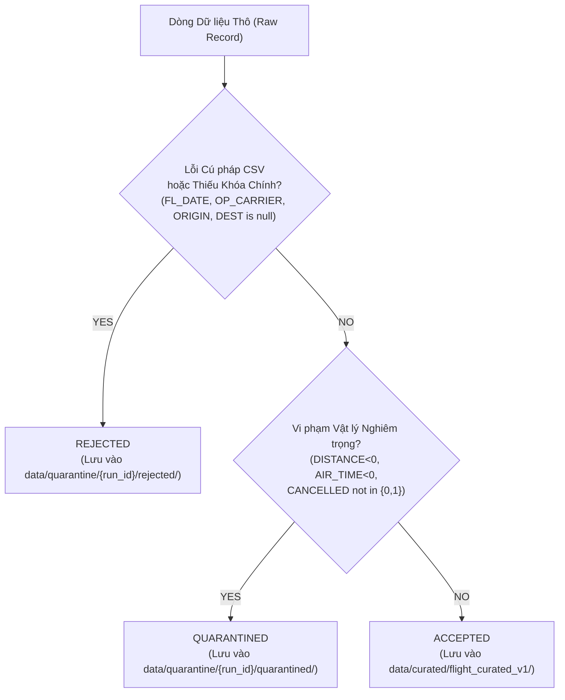

# T-006 DELIVERABLE B: SCHEMA, QUALITY & LINEAGE DESIGN

**Task ID:** `T-006`  
**Gate:** `G3`  
**Document Nature:** Technical Schema, Data Quality & Lineage Specification (`DESIGN_ONLY`)  
**Project:** US Flight Performance Analysis (2016–2024) using Apache Spark / PySpark  
**Status:** `PROPOSED_FOR_PROJECT_LEAD_REVIEW`  
**Date:** 2026-10-17  

---

## 1. Mục tiêu & Ranh giới Thiết kế (Objectives & Boundaries)

Hồ sơ này chuẩn hóa:
1. Ánh xạ chi tiết 34 cột vật lý trong tệp CSV nguồn sang kiểu dữ liệu PySpark an toàn.
2. Thiết kế schema tầng dữ liệu chuẩn hóa (Curated Storage Layer).
3. Cơ chế định danh dòng ổn định (*Stable Lineage / Row Identifier* — `TS-020`).
4. Mô hình hạch toán 3 trạng thái dòng rời nhau tuyệt đối (`DC-11`, `TS-003`).
5. Quy tắc bảo vệ biểu diễn thời gian an toàn (`FP-DEC-007`, `TS-010`).
6. Xử lý khuyết tật chất lượng độ phủ lịch năm 2024 (`OR-05`, `TS-004`).

---

## 2. Bảng Ánh xạ 34 Cột Dữ liệu Thô (Raw 34-Column Mapping Specification)

Dữ liệu nguồn gồm 9 tệp CSV với đúng 34 cột vật lý. Dưới đây là bảng ánh xạ chuẩn tắc:

| STT | Tên cột Vật lý | Kiểu thô | Kiểu PySpark đích | Null Policy | Cast Policy | Invalid Value Policy | Phụ thuộc KPI / Nhánh | Ghi chú & Ràng buộc Downstream |
| :---: | :--- | :---: | :---: | :---: | :---: | :---: | :---: | :--- |
| 1 | `FL_DATE` | String | `StringType` $\to$ `DateType` | `NOT_NULL` | Parse `yyyy-MM-dd` | Parse fail $\implies$ `REJECTED` | KPI-01..08 | Calendar anchor duy nhất đáng tin cậy. |
| 2 | `OP_CARRIER` | String | `StringType` | `NOT_NULL` | Giữ nguyên 2 ký tự IATA | Null/Empty $\implies$ `REJECTED` | KPI-01..08 | Mã hãng khai thác (Carrier Dimension). |
| 3 | `OP_CARRIER_FL_NUM` | Int/Str | `IntegerType` | `NOT_NULL` | Cast số nguyên dương | `<=0` $\implies$ `QUARANTINED` | KPI-01..08 | Số hiệu chuyến bay của hãng. |
| 4 | `ORIGIN` | String | `StringType` | `NOT_NULL` | Giữ nguyên 3 ký tự IATA | Không khớp regex `[A-Z]{3}` $\implies$ `QUAR` | KPI-01..08 | Sân bay khởi hành (Origin Dimension). |
| 5 | `DEST` | String | `StringType` | `NOT_NULL` | Giữ nguyên 3 ký tự IATA | Không khớp regex `[A-Z]{3}` $\implies$ `QUAR` | KPI-01..08 | Sân bay điểm đến (Destination Dimension). |
| 6 | `CRS_DEP_TIME` | Int/Str | `StringType` | `NOT_NULL` | Chuỗi 4 chữ số `HHmm` | Ngoài `0000..2400` $\implies$ `QUAR` | KPI-01..08 | Giờ khởi hành dự kiến theo lịch BTS. |
| 7 | `DEP_TIME` | Float/Str | `DoubleType` | `NULLABLE` | Cast Double/String | Chuyến bay hủy có thể null | KPI-01..08 | Giờ khởi hành thực tế (Clock representation). |
| 8 | `DEP_DELAY` | Float | `DoubleType` | `NULLABLE` | Cast Double | Null nếu cancelled; cực đoan $\implies$ `QUAR` | KPI-04, 05 | **`G2-EXC-001`**: Đơn vị mang nhãn `PROVISIONAL`. |
| 9 | `TAXI_OUT` | Float | `DoubleType` | `NULLABLE` | Cast Double | `<0` $\implies$ `QUAR` | KPI-07 (Sub 7a) | **`G2-EXC-001`**: Đơn vị mang nhãn `PROVISIONAL`. |
| 10 | `WHEELS_OFF` | Float | `DoubleType` | `NULLABLE` | Cast Double | Ngoài `0000..2400` $\implies$ `QUAR` | Audit/Lineage | Thời điểm cất cánh bánh rời mặt đất. |
| 11 | `WHEELS_ON` | Float | `DoubleType` | `NULLABLE` | Cast Double | Ngoài `0000..2400` $\implies$ `QUAR` | Audit/Lineage | Thời điểm hạ cánh bánh chạm mặt đất. |
| 12 | `TAXI_IN` | Float | `DoubleType` | `NULLABLE` | Cast Double | `<0` $\implies$ `QUAR` | KPI-07 (Sub 7b) | **`G2-EXC-001`**: Đơn vị mang nhãn `PROVISIONAL`. |
| 13 | `CRS_ARR_TIME` | Int/Str | `StringType` | `NOT_NULL` | Chuỗi 4 chữ số `HHmm` | Ngoài `0000..2400` $\implies$ `QUAR` | KPI-01..08 | Giờ đến dự kiến theo lịch BTS. |
| 14 | `ARR_TIME` | Float/Str | `DoubleType` | `NULLABLE` | Cast Double | Null nếu cancelled | KPI-01..08 | Giờ đến thực tế (Clock representation). |
| 15 | `ARR_DELAY` | Float | `DoubleType` | `NULLABLE` | Cast Double | Null nếu cancelled/diverted | KPI-02, 03, 06 | **`G2-EXC-001`**: Đơn vị mang nhãn `PROVISIONAL`. |
| 16 | `CANCELLED` | Float | `DoubleType` | `NOT_NULL` | 0.0 hoặc 1.0 | Khác 0.0/1.0 $\implies$ `QUAR` | KPI-01..08 Cohort | Cờ hủy chuyến bay. |
| 17 | `CANCELLATION_CODE` | String | `StringType` | `NULLABLE` | 'A','B','C','D' hoặc Null | Mã lạ $\implies$ `QUAR` | Metadata | Phân loại lý do hủy của BTS. |
| 18 | `DIVERTED` | Float | `DoubleType` | `NOT_NULL` | 0.0 hoặc 1.0 | Khác 0.0/1.0 $\implies$ `QUAR` | KPI-01..08 Cohort | Cờ chuyển hướng chuyến bay. |
| 19 | `CRS_ELAPSED_TIME` | Float | `DoubleType` | `NULLABLE` | Cast Double | `<=0` $\implies$ `QUAR` | KPI-08 (Sub 8b) | **`G2-EXC-001`**: Đơn vị mang nhãn `PROVISIONAL`. |
| 20 | `ACTUAL_ELAPSED_TIME`| Float | `DoubleType` | `NULLABLE` | Cast Double | `<=0` $\implies$ `QUAR` | KPI-08 (Sub 8a) | **`G2-EXC-001`**: Đơn vị mang nhãn `PROVISIONAL`. |
| 21 | `AIR_TIME` | Float | `DoubleType` | `NULLABLE` | Cast Double | `<=0` $\implies$ `QUAR` | KPI-08 (Sub 8c) | **`G2-EXC-001`**: Đơn vị mang nhãn `PROVISIONAL`. |
| 22 | `DISTANCE` | Float | `DoubleType` | `NOT_NULL` | Cast Double | `<=0` $\implies$ `QUAR` | Dimension/Route | Khoảng cách đường bay (miles). |
| 23 | `CARRIER_DELAY` | Float | `DoubleType` | `NULLABLE` | Cast Double | `<0` $\implies$ `QUAR` | Descriptive/Audit | Phân rã trễ do hãng (minutes). |
| 24 | `WEATHER_DELAY` | Float | `DoubleType` | `NULLABLE` | Cast Double | `<0` $\implies$ `QUAR` | Descriptive/Audit | Phân rã trễ do thời tiết (minutes). |
| 25 | `NAS_DELAY` | Float | `DoubleType` | `NULLABLE` | Cast Double | `<0` $\implies$ `QUAR` | Descriptive/Audit | Phân rã trễ do hệ thống hàng không quốc gia. |
| 26 | `SECURITY_DELAY` | Float | `DoubleType` | `NULLABLE` | Cast Double | `<0` $\implies$ `QUAR` | Descriptive/Audit | Phân rã trễ do an ninh. |
| 27 | `LATE_AIRCRAFT_DELAY`| Float | `DoubleType` | `NULLABLE` | Cast Double | `<0` $\implies$ `QUAR` | Descriptive/Audit | Phân rã trễ do máy bay đến muộn. |
| 28 | `O_TEMP` | Float | `DoubleType` | `NULLABLE` | Cast Double | Không ràng buộc CORE | Weather (`FP-DEC-017`) | **Bảo toàn ở tầng raw/ingest; loại khỏi CORE.** |
| 29 | `O_PRCP` | Float | `DoubleType` | `NULLABLE` | Cast Double | Không ràng buộc CORE | Weather (`FP-DEC-017`) | **Bảo toàn ở tầng raw/ingest; loại khỏi CORE.** |
| 30 | `O_WSPD` | Float | `DoubleType` | `NULLABLE` | Cast Double | Không ràng buộc CORE | Weather (`FP-DEC-017`) | **Bảo toàn ở tầng raw/ingest; loại khỏi CORE.** |
| 31 | `D_TEMP` | Float | `DoubleType` | `NULLABLE` | Cast Double | Không ràng buộc CORE | Weather (`FP-DEC-017`) | **Bảo toàn ở tầng raw/ingest; loại khỏi CORE.** |
| 32 | `D_PRCP` | Float | `DoubleType` | `NULLABLE` | Cast Double | Không ràng buộc CORE | Weather (`FP-DEC-017`) | **Bảo toàn ở tầng raw/ingest; loại khỏi CORE.** |
| 33 | `D_WSPD` | Float | `DoubleType` | `NULLABLE` | Cast Double | Không ràng buộc CORE | Weather (`FP-DEC-017`) | **Bảo toàn ở tầng raw/ingest; loại khỏi CORE.** |
| 34 | `FLIGHTS` | Float | `DoubleType` | `NOT_NULL` | Luôn là `1.0` | Khác `1.0` $\implies$ `QUAR` | Mẫu số (`FP-DEC-010`) | **Cấm dùng làm trọng số đếm; mẫu số là count_records.** |

### 2.1. Quy tắc Bảo toàn 6 Cột Thời tiết Thô (FP-DEC-017)
* Cả 6 cột thời tiết (`O_TEMP`, `O_PRCP`, `O_WSPD`, `D_TEMP`, `D_PRCP`, `D_WSPD`) được bảo tồn nguyên vẹn trong schema đọc CSV của tầng Ingestion (`DC-07`).
* Tuy nhiên, theo quyết định phê duyệt `FP-DEC-017` (`CONDITIONAL_NO_GO`), 6 cột này **bị loại bỏ hoàn toàn khỏi các biểu thức tính toán của 8 CORE KPIs (`KPI-01..08`)**.
* **Điều kiện cấm:** Tuyệt đối **KHÔNG** đưa dòng bản ghi CORE hợp lệ vào diện `quarantined` hoặc `rejected` chỉ vì giá trị thời tiết bị null, thiếu hoặc không xác minh được nguồn gốc.

---

## 3. Thiết kế Schema Tầng Dữ liệu Chuẩn hóa (Curated Schema Specification)

Tầng Curated lưu trữ dữ liệu đã qua kiểm tra chất lượng, được tối ưu hóa cho truy vấn phân tích cột.

### 3.1. Các Cột Dẫn xuất (Derived Partition & Analytical Dimensions)
1. **`YEAR` (`IntegerType`):** Trích xuất từ năm của `FL_DATE` (`year(FL_DATE)`). Dùng làm Partition Column chính.
2. **`QUARTER` (`IntegerType`):** Trích xuất từ quý của `FL_DATE` (`quarter(FL_DATE)`), giá trị từ 1 đến 4.
3. **`MONTH` (`IntegerType`):** Trích xuất từ tháng của `FL_DATE` (`month(FL_DATE)`), giá trị từ 1 đến 12.
4. **`ROUTE` (`StringType`):** Chuỗi định danh đường bay một chiều: `concat(ORIGIN, '-', DEST)` (ví dụ: `DEN-XNA`, `ATL-ORD`).

### 3.2. Các Cột Siêu dữ liệu & Chất lượng (Quality & Lineage Columns)
1. **`source_year` (`IntegerType`):** Năm của tệp nguồn CSV (2016..2024).
2. **`source_file` (`StringType`):** Tên tệp CSV gốc (ví dụ: `flight_with_weather_2018.csv`).
3. **`row_lineage_id` (`StringType`):** Định danh dòng ổn định tái lập 100% (xem Mục 4).
4. **`record_status` (`StringType`):** Trạng thái bản ghi theo `DC-11`: `ACCEPTED`, `QUARANTINED`, `REJECTED`.
5. **`quarantine_reason` (`StringType`):** Mã lý do vi phạm nếu bị cách ly (ví dụ: `INVALID_AIR_TIME`, `NEGATIVE_DISTANCE`).

---

## 4. Thiết kế Định danh Dòng Ổn định (Stable Lineage — TS-020)

### 4.1. Phân tích Các Giới hạn của Apache Spark
1. **Hàm `monotonically_increasing_id()`:** Tạo số nguyên 64-bit trong đó 31 bit cao là ID của Spark Partition. Nếu cấu hình số partition thay đổi giữa các lần chạy, giá trị ID của cùng một dòng sẽ bị thay đổi hoàn toàn $\implies$ Không tái lập.
2. **Hàm `spark_partition_id()`:** Phụ thuộc vào cách chia byte-split của CSV reader, không phản ánh số dòng vật lý trong file CSV.
3. **Business Key không duy nhất:** Khóa ứng viên nghiệp vụ thông thường (`FL_DATE`, `OP_CARRIER`, `OP_CARRIER_FL_NUM`, `ORIGIN`, `DEST`, `CRS_DEP_TIME`) **bị trùng hoàn toàn** tại cặp chuyến bay thực tế `YX 3624` ngày `2018-06-21` (`DEN -> XNA`, dòng 6.384.132 và 6.384.133 trong `schema_2018.json`). Nếu dùng business key làm định danh, cặp bản ghi này sẽ bị gộp nhầm hoặc gây lỗi khóa chính.

### 4.2. Phương án Kiến trúc Được Lựa chọn
Áp dụng cơ chế định danh dòng kết hợp số thứ tự bản ghi vật lý (*Deterministic Physical Record Ordinal*):
$$\mathbf{row\_lineage\_id} = \text{concat}(source\_year,\ '\_line\_',\ \text{lpad}(source\_row\_number,\ 8,\ '0'))$$
* Trong quá trình Ingestion tuần tự theo từng tệp CSV đơn năm tại Gate G4/T-007, Spark áp dụng hàm tạo chỉ số dòng liên tục dựa trên số thứ tự thực tế trong tệp CSV nguồn.
* Đối với cặp `YX 3624`, hai dòng sẽ nhận định danh phân biệt tuyệt đối:
  * Bản ghi 1: `2018_line_06384132`
  * Bản ghi 2: `2018_line_06384133`
* **Ghi nhận Trạng thái:** Gắn nhãn **`OPEN_DESIGN_VERIFICATION`**. Thí nghiệm kiểm chứng độ ổn định và tính tái lập phân tán sẽ được thực thi tại Gate G4 (`T-007`) và Gate G5 (`T-010`, `T-011`) dưới mã kiểm thử `TS-020`.

---

## 5. Hạch toán Ba Trạng thái Dòng Rời nhau Tuyệt đối (DC-11 / TS-003)

### 5.1. Phương trình Hạch toán Bắt buộc
Theo hợp đồng dữ liệu `DATA_CONTRACT.md` (DC-11) và bài kiểm tra `TS-003`:
$$\mathbf{raw\_row\_count}(Y) = \mathbf{accepted\_row\_count}(Y) + \mathbf{quarantined\_row\_count}(Y) + \mathbf{rejected\_row\_count}(Y)$$
Phương trình này bắt buộc phải cân bằng chính xác trên từng năm nguồn $Y \in [2016..2024]$ và trên toàn bộ tập dữ liệu 54.674.003 bản ghi.

### 5.2. Tiêu chí Phân loại Trạng thái Chi tiết

### 5.3. Phân biệt Tính Hợp lệ của Bản ghi vs. Tính Hợp lệ của Chỉ số (Record Validity vs. Metric Validity)
* **Tính hợp lệ cấp bản ghi (`record_status = ACCEPTED`):** Xác nhận dòng bản ghi thỏa mãn cấu trúc quan hệ để được lưu trữ vào kho phân tích chung.
* **Tính hợp lệ cấp chỉ số (`count_metric_valid` theo `DC-12`):** Một bản ghi đã được `ACCEPTED` vẫn có thể không hợp lệ cho một phép tính chỉ số cụ thể nếu trường đo đó bị thiếu.
  * *Ví dụ 1:* Một chuyến bay bị hủy (`CANCELLED = 1.0`) thì `ARR_DELAY` là `null`. Bản ghi này là `ACCEPTED` (đóng góp vào `KPI-01` đếm tổng chuyến bay theo lịch), nhưng **bị loại khỏi mẫu số tính trễ** của `KPI-02..06` vì không có thời gian đến thực tế.
  * *Ví dụ 2:* Một chuyến bay có `ARR_DELAY = 12.0` nhưng thiếu `TAXI_OUT`. Bản ghi này hợp lệ cho `KPI-02..06` nhưng bị loại khỏi phép tính `KPI-07a` (`TAXI_OUT`).
* Tỷ lệ hợp lệ của chỉ số được tính nghiêm ngặt theo công thức:
  $$\mathbf{metric\_valid\_rate} = \frac{\mathbf{count\_metric\_valid}}{\mathbf{count\_records}}$$

---

## 6. Quy tắc Bảo vệ Biểu diễn Thời gian An toàn (Temporal Safety — FP-DEC-007 / TS-010)

Tuân thủ nghiêm ngặt kết quả kiểm toán `T-004` và quyết định `FP-DEC-007`:
1. **Quy tắc Trừ Thời gian:** Tuyệt đối không trừ các trường giờ địa phương (ví dụ: `ARR_TIME - DEP_TIME`). Phép trừ này sẽ sinh ra sai số nghiêm trọng khi chuyến bay bay qua ranh giới múi giờ hoặc bay qua nửa đêm. Mọi phép đo thời lượng phải lấy trực tiếp từ `ACTUAL_ELAPSED_TIME` và `AIR_TIME`.
2. **Quy tắc Chuyến bay Qua đêm (Overnight Flights):** Trong dữ liệu gốc, các chuyến bay qua đêm có giờ đến thực tế nhỏ hơn giờ khởi hành thực tế (ví dụ: cất cánh lúc 23:30, hạ cánh lúc 01:15 ngày hôm sau). Cấm tự động cộng 1440 phút (+24h) vào giờ đến để "sửa" ngày đến khi không có ngày đến thực tế trong dữ liệu thô.
3. **Quy tắc Giá trị 2400:** Biểu diễn `2400` trong dữ liệu BTS đại diện cho thời điểm nửa đêm (24:00:00). Giữ nguyên biểu diễn này dưới dạng chuỗi phân loại, không tự ý chuyển thành `0000` của ngày tiếp theo.
4. **Loại bỏ Mốc giờ Phái sinh khỏi CORE:** Mọi trường thời gian có múi giờ phái sinh (`DEP_TIME_TZ`, `ARR_TIME_TZ`) chỉ được dùng trong synthetic fixtures (`TF-09`), hoàn toàn loại khỏi phạm vi dữ liệu sản xuất CORE.

---

## 7. Xử lý Khuyết tật Chất lượng Độ phủ Lịch Năm 2024 (OR-05 / TS-004)

### 7.1. Thực trạng Kiểm toán
* Năm 2024 chỉ có **335 / 366 ngày** lịch hợp lệ trong tập dữ liệu.
* **Toàn bộ 31 ngày của Tháng 3/2024 bị khuyết hoàn toàn.**
* Ngày nhuận `2024-02-29` có đầy đủ `18.642` bản ghi.

### 7.2. Các Ràng buộc Thiết kế Bắt buộc
1. **Cấm Nội suy Dữ liệu (Zero Synthetic Imputation):** Tuyệt đối không tạo dòng giả định có số chuyến bay bằng 0 cho 31 ngày Tháng 3/2024, và không sử dụng các phương pháp thống kê/ML để nội suy các chuyến bay bị thiếu.
2. **Gán Nhãn Độ phủ Chuẩn tắc:** Mọi bảng kết quả tổng hợp có chứa dữ liệu năm 2024 bắt buộc phải gắn kèm cột siêu dữ liệu:
   $$\mathbf{source\_coverage\_status} = \mathbf{PARTIAL}$$
3. **Cảnh báo So sánh Đa năm:** Khi thực hiện so sánh tổng thể lượng chuyến bay giữa các năm (phục vụ RQ-01, RQ-04), hệ thống phải tự động chèn cảnh báo chú thích: *"Năm 2024 chỉ bao gồm 335 ngày do khuyết toàn bộ dữ liệu Tháng 3/2024"*.

---

## 8. Kết luận & Mức độ Sẵn sàng (Schema & Quality Readiness Verdict)

Bản thiết kế schema, kiểm soát chất lượng và định danh dòng tại Deliverable B đáp ứng trọn vẹn mọi yêu cầu quản trị, bảo toàn tuyệt đối các quyết định G2 đã được phê duyệt.

$$\mathbf{VERDICT:}\quad \mathbf{T006\_SCHEMA\_QUALITY\_AND\_LINEAGE\_DESIGN\_COMPLIANT}$$
