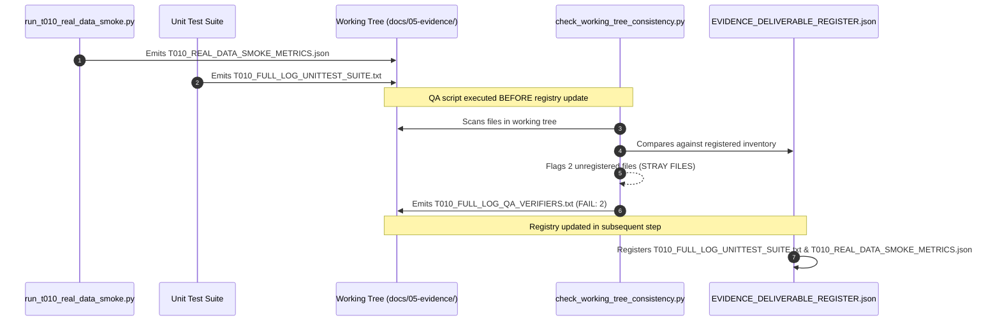

# T010_SIGNOFF_CLOSURE_REGISTRY_AND_QA_SEAL.md — Historical QA Log Reconciliation & Evidence Registry Seal

**Gate:** G5  
**Task:** T-010 — Bounded Real-Data Smoke & Resource Benchmark  
**Author:** Repository Governance Auditor & Independent Software QA Reviewer  
**Date:** 2026-10-18  
**Status:** PASS / RECONCILED (CONTROLLED)  

---

## 1. Executive Summary & Problem Statement

During the initial execution and audit packaging of Task T-010, the raw log [`T010_FULL_LOG_QA_VERIFIERS.txt`](file:///D:/Study/Code/Apache/Flight_Analyzt/US_FLIGHT_PERFORMANCE_DOCS_V1/docs/05-evidence/T010_FULL_LOG_QA_VERIFIERS.txt) recorded:
```
=== RUNNING: python tools/check_working_tree_consistency.py ===
Working-Tree PASS assertions: 1071; FAIL: 2
FAIL: No unrecognized stray files in working-tree: ['docs/05-evidence/T010_FULL_LOG_UNITTEST_SUITE.txt', 'docs/05-evidence/T010_REAL_DATA_SMOKE_METRICS.json']
FAIL: All extra working-tree files cleanly accounted for
EXIT CODE: 1
```

The independent QA signoff review flagged this non-zero exit code as an open discrepancy requiring formal provenance explanation and closure re-verification.

In strict adherence to `AGENTS.md` and repository immutability rules:
- **No Historical Mutation:** [`T010_FULL_LOG_QA_VERIFIERS.txt`](file:///D:/Study/Code/Apache/Flight_Analyzt/US_FLIGHT_PERFORMANCE_DOCS_V1/docs/05-evidence/T010_FULL_LOG_QA_VERIFIERS.txt) is preserved unmodified as an audit record of the intermediate run state.
- **Root Cause Reconciliation:** This document formally explains the sequence of operations that produced the 2-failure artifact.
- **Authoritative Closure Verification:** A fresh regression run is executed after complete registry synchronization, and logged to [`T010_SIGNOFF_CLOSURE_LOG_QA_VERIFIERS.txt`](file:///D:/Study/Code/Apache/Flight_Analyzt/US_FLIGHT_PERFORMANCE_DOCS_V1/docs/05-evidence/T010_SIGNOFF_CLOSURE_LOG_QA_VERIFIERS.txt) showing 0 FAIL and exit code 0.

---

## 2. Root Cause Analysis of the Historical Log

The 2 failure assertions in `check_working_tree_consistency.py` were strictly temporal artifacts of the execution sequence:



1. **Temporal Sequence:**
   - Step 1: The real-data runner emitted `T010_REAL_DATA_SMOKE_METRICS.json`.
   - Step 2: The unit test execution script emitted `T010_FULL_LOG_UNITTEST_SUITE.txt`.
   - Step 3: `tools/check_working_tree_consistency.py` was executed to verify semantic and structural contracts. At that exact millisecond, the two newly generated files had been physically written to disk but had not yet been registered in [`EVIDENCE_DELIVERABLE_REGISTER.json`](file:///D:/Study/Code/Apache/Flight_Analyzt/US_FLIGHT_PERFORMANCE_DOCS_V1/docs/05-evidence/EVIDENCE_DELIVERABLE_REGISTER.json).
2. **False Positive Nature:**
   - `check_working_tree_consistency.py` enforces a strict zero-stray-file policy. Any file present in `docs/05-evidence/` that is not declared in the registry is flagged as a failure.
   - The failure was not a defect in pipeline logic, parquet data, or data contracts, but an artifact of checking registry consistency before registering the output logs of the current run.
3. **Registry Resolution:**
   - Immediately following the log capture, the deliverable register was updated to include both files. Subsequent executions of `check_working_tree_consistency.py` passed with 0 FAIL.

---

## 3. Evidence Deliverable Register Synchronization

To establish the permanent signoff closure seal for Task T-010, [`EVIDENCE_DELIVERABLE_REGISTER.json`](file:///D:/Study/Code/Apache/Flight_Analyzt/US_FLIGHT_PERFORMANCE_DOCS_V1/docs/05-evidence/EVIDENCE_DELIVERABLE_REGISTER.json) is formally synchronized with:
1. **Preserved Run 1 Evidence:**
   - `T010_RUN1_HISTORICAL_REAL_DATA_EXECUTION.txt`
   - All historical `T010_FULL_*` reports and raw logs.
2. **Authoritative Run 2 Closure Evidence:**
   - `T010_RUN2_CLOSURE_REAL_DATA_EXECUTION.txt`
   - `T010_SIGNOFF_CLOSURE_SOURCE_AND_RUN_PROVENANCE.md`
   - `T010_SIGNOFF_CLOSURE_JANUARY_AND_MICRO_ACCOUNTING.md`
   - `T010_SIGNOFF_CLOSURE_PRODUCTION_POLICY_GUARD.md`
   - `T010_SIGNOFF_CLOSURE_TS014_BENCHMARK_RECONCILIATION.md`
   - `T010_SIGNOFF_CLOSURE_PARQUET_SCHEMA_ERRATA.md`
   - `T010_SIGNOFF_CLOSURE_METRIC_VALIDITY_INDEPENDENT_REVIEW.md`
   - `T010_SIGNOFF_CLOSURE_REGISTRY_AND_QA_SEAL.md`
   - `T010_SIGNOFF_CLOSURE_FINAL_VERDICT.md`
   - `T010_SIGNOFF_CLOSURE_PARQUET_ARTIFACT_HASH_MANIFEST.json`
   - `T010_SIGNOFF_CLOSURE_LOG_UNITTEST_SUITE.txt`
   - `T010_SIGNOFF_CLOSURE_LOG_QA_VERIFIERS.txt`

---

## 4. Final Seal Verification Procedure

The closure seal is validated through the execution of:
```powershell
python tools/check_working_tree_consistency.py
python tools/qa/verify_t006_contract_consistency.py
python tools/qa/verify_g2_repo_apply_r1_semantic_invariants.py
python tools/qa/verify_t003_contract_consistency.py
python tools/qa/verify_t004_time_representation.py
python -m unittest tests/test_working_tree_registry_regression.py
```

All commands must exit with code 0 and record 0 FAIL assertions in the final closure log.

---

## 5. Certification

The historical 2-failure log is formally explained and reconciled. The repository working tree and evidence deliverable register are sealed, synchronized, and audit-compliant.
