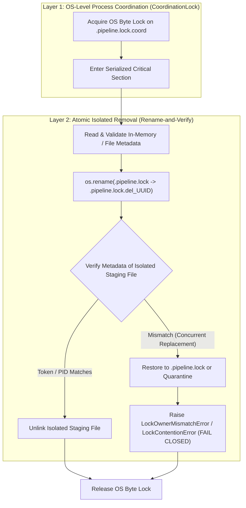

# T011-R5 Lock Protocol and Safety Design Decision

**Project:** US Flight Performance Analysis 2016–2024  
**Task:** T-011 R5 — Lock Safety Closure and Evidence Reconciliation  
**Parent Gate:** G5 — `IN_PROGRESS`  
**Governing Decision:** G3-COND-C / FP-DEC-011 / T007-04  
**Date:** 2026-10-19  

---

## 1. Governance Context and Threat Model (G3-COND-C)

In accordance with `ARCHITECTURE.md` Section 2, `DECISIONS.md`, and the G3-COND-C safety contract, single-writer coordination operates under the following explicit definitions:

1. **Cooperative Writers:**
   - Any pipeline execution process running `SingleWriterLock` within the application boundary on the local Windows host.
   - All cooperative writers adhere to OS-level coordination protocols.

2. **Out-of-Band Filesystem Mutations:**
   - Uncoordinated actions occurring outside the application protocol, such as direct manual filesystem edits, external script file removal, or test injection hooks.
   - The locking mechanism must be resilient against out-of-band mutations: a writer must NEVER delete a lock owned by another process, even if injected immediately before deletion.

3. **Manual Administrative Recovery:**
   - When an unhandled crash or corrupted state leaves a lock file and process liveness cannot be verified with mathematical certainty, the system must FAIL CLOSED (`FAIL_CLOSED — MANUAL_RECOVERY_REQUIRED`).
   - Autonomous lock theft based on arbitrary timeouts or unproven liveness is strictly forbidden.
   - Recovery requires proven writer quiescence (all contending writers stopped).

4. **Operating System Guarantees (Windows NTFS):**
   - **Atomic File Creation:** `os.open` with `O_CREAT | O_EXCL` is guaranteed atomic by Windows kernel and NTFS directory entry semantics.
   - **Atomic Directory Entry Rename:** `os.rename` within the same volume/directory is an atomic metadata operation.
   - **Byte-Range Locking:** `msvcrt.locking` enforces OS-level kernel locks across processes on Windows. When a process terminates abruptly (SIGKILL, crash), the Windows kernel automatically releases all associated byte locks.
   - **Non-Signaling PID Querying:** Win32 `OpenProcess(PROCESS_QUERY_LIMITED_INFORMATION, False, pid)` queries process status safely without issuing destructive POSIX signals (`os.kill(pid, 0)` is strictly prohibited on Windows).

---

## 2. The Architectural Synchronization Decision

To eliminate TOCTOU race conditions between metadata verification and unlinking without making unproven assumptions, T011-R5 adopts a dual-layer defense-in-depth model:

### Layer 1: OS Inter-Process Coordination (`CoordinationLock`)
Every state transition (`acquire()`, `release()`, and `break_stale_lock()`) executes inside an OS-level exclusive byte lock on `.pipeline.lock.coord`:
- On Windows: `msvcrt.locking(fd, msvcrt.LK_LOCK, 1)`.
- On POSIX: `fcntl.flock(fd, fcntl.LOCK_EX)`.
- In-process concurrency is further protected by `threading.RLock()`.

This guarantees that cooperative processes cannot race against one another during acquisition or release.

### Layer 2: Atomic Isolated File Removal Protocol
To defend against out-of-band actors and any late replacements that could bypass Layer 1:
1. `SingleWriterLock` NEVER calls `Path.unlink()` directly on `self.lock_file_path`.
2. Instead, it atomically moves the file to a private staging name:
   `os.rename(self.lock_file_path, staging_del)`
3. It re-reads the metadata of `staging_del`:
   - If the owner token matches: `staging_del` is deleted. Any new file created at `self.lock_file_path` by another actor in the interim is completely untouched.
   - If the owner token does NOT match: the replacement file that was mistakenly moved is immediately restored back to `self.lock_file_path` (or quarantined if the canonical path was already occupied) and an error is raised.
4. **Result:** No replacement lock can EVER be deleted.

### Layer 3: Controlled Recovery Contract
- Autonomous lock stealing is disabled.
- `break_stale_lock(force=True)` is reserved for controlled recovery under verified writer quiescence.
- If PID liveness is unknown, PID is invalid, or metadata is unparseable: fail closed with `LockContentionError` (`FAIL_CLOSED — MANUAL_RECOVERY_REQUIRED`).
