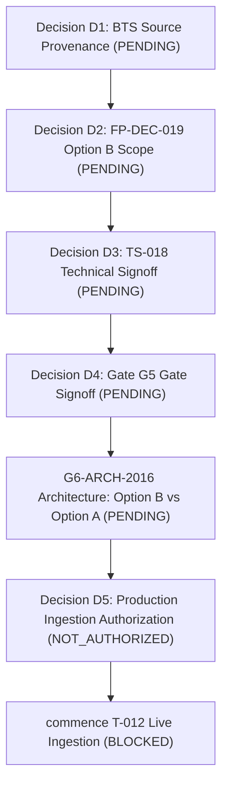

# T012_MINIMAL_UNBLOCK_REPORT.md
## Technical Remediation, Verification Audit, and Operational Unblock Report for Task T-012

**Project:** US Flight Performance Analysis 2016–2024  
**Task Identifier:** `T012-MINIMAL-UNBLOCK`  
**Execution Phase:** Gate G5 Signoff Preparation / Gate G6 T-012 Operational Readiness  
**Governance Authority:** Project Lead  
**Roles:** Senior PySpark Engineer | Production Reliability Engineer | Independent Technical QA Engineer  
**Date:** 2026-10-21  
**Overall Technical Verdict:** `READY_FOR_INDEPENDENT_REVIEW`  

---

## 1. Executive Summary & Original Confirmed Defects

The primary objective of this task was to perform **targeted remediation** of confirmed operational defects preventing safe preflight and execution preparation for Task T-012 annual ingestion, without overengineering, without unauthorized production execution, and without modifying protected raw/baseline artifacts.

### 1.1 Confirmed Defects Addressed

1. **Defect Scope A (CLI Preflight False-PASS):**
   - The CLI runner in `src/flight_pipeline/ingestion/coordinator.py` previously executed a superficial check that could print `[PREFLIGHT PASS]` and exit with code 0 even if:
     * A required RAW source CSV file was missing.
     * A RAW source file had an incorrect byte size.
     * An active writer lock already existed on disk.
   - It also did not check for duplicate `run_id` collisions against existing curated, staging, or metadata directories.
   - It did not compute or verify SHA-256 against approved local baselines.
   - It reported row counts without distinguishing metadata expectations from physically verified records.

2. **Defect Scope B (Production Entrypoint Gap & Governance Gate):**
   - Invoking the CLI without `--dry-run-preflight` printed an ad-hoc hold message but was completely disconnected from the actual production coordinator execution path (`IngestionCoordinator.run_ingestion()`).
   - The integration between CLI arguments and `IngestionCoordinator` was incomplete.

3. **Defect Scope C (Operational Documentation Inconsistencies C1–C6):**
   - **C1 (Pointer Path Discrepancy):** Certain runbooks cited `data/curated/active_run.json` as the pointer file, whereas `SafePublisher` strictly implements `data/curated/latest_run_id.txt`.
   - **C2 (CLI Argument Drift):** Runbooks cited `--base-data-dir data` when invoking tools whose `argparse` expected `--base-dir data`.
   - **C3 (Year 2016 Row Count Typo):** Certain checklists still referenced the superseded typo count 5,617,658 rather than the canonical 5,537,987 raw rows.
   - **C4 (Annual Execution Order Ambiguity):** Checklists assumed sequential execution beginning at 2017 without accommodating the conditional branch for G6-ARCH-2016 Option B (rerunning 2016 as the first production batch).
   - **C5 (Resource Policy Divergence):** Memory requirements varied between 3.0 GiB, 4.0 GiB, and 8.0 GiB available RAM across documents without documented benchmark justification.
   - **C6 (BTS Reference Artifact Metadata Typo):** Evidence matrices cited 25,658,745 bytes for `BTS_TranStats_2019_01.zip`, whereas the actual physical file in `data/reference/bts_transtats/original/T_ONTIME_REPORTING_20261019_112232.zip` is **29,975,383 bytes** (SHA-256: `342de99f65561fb856b524c704f2ad3851f8015f52251668ece346dff1350ae6`).

---

## 2. Exact Modified Source Files & Technical Rationale

| File Path | Type | Modifications & Rationale |
|---|:---:|---|
| [`src/flight_pipeline/ingestion/coordinator.py`](file:///D:/Study/Code/Apache/Flight_Analyzt/US_FLIGHT_PERFORMANCE_DOCS_V1/src/flight_pipeline/ingestion/coordinator.py) | **Code** | 1. Implemented `_resolve_source_validator_base_dir()` to prevent `data/data/raw/` path doubling.<br>2. Implemented fail-closed preflight evaluating: `run_id` format, duplicate `run_id` collision, writer lock status (`SingleWriterLock`, `PidLivenessStatus`), recovery artifacts, pointer integrity (`latest_run_id.txt`), source existence, byte size match, and streaming SHA-256 against `APPROVED_BASELINE_HASHES` (2016: `4ed92ed7...`).<br>3. Wired production `IngestionCoordinator.run_ingestion()` execution path behind fail-closed Project Lead Decision D5 authorization gate.<br>4. Supported `--base-dir` alias alongside `--base-data-dir`.<br>5. Explicitly labeled row counts `AUDITED_EXPECTED_ROWS` with boundary disclaimer. |
| [`tests/test_coordinator_preflight_unblock.py`](file:///D:/Study/Code/Apache/Flight_Analyzt/US_FLIGHT_PERFORMANCE_DOCS_V1/tests/test_coordinator_preflight_unblock.py) | **Test** | Created dedicated isolated test suite covering all 10 mandatory test scenarios of Scope D (exit codes, fail-closed guards, dry-run vs live hold). |
| [`docs/05-evidence/G6_T012_2016_CANONICAL_EXECUTION_RUNBOOK.md`](file:///D:/Study/Code/Apache/Flight_Analyzt/US_FLIGHT_PERFORMANCE_DOCS_V1/docs/05-evidence/G6_T012_2016_CANONICAL_EXECUTION_RUNBOOK.md) | **Doc** | Corrected pointer path to `data/curated/latest_run_id.txt`; corrected tool CLI arguments to `--base-dir data`; updated calibrated resource measurements. |
| [`docs/05-evidence/G6_T012_FINAL_EXECUTION_CHECKLIST_V2.md`](file:///D:/Study/Code/Apache/Flight_Analyzt/US_FLIGHT_PERFORMANCE_DOCS_V1/docs/05-evidence/G6_T012_FINAL_EXECUTION_CHECKLIST_V2.md) | **Doc** | Added conditional execution roadmap for G6-ARCH-2016 Option B (Batch 0: Year 2016 rerun `run_2016_v1`) vs Option A; added `--base-dir data` to pointer preflight command. |
| [`docs/05-evidence/G6_T012_FIRST_YEAR_EXECUTION_READINESS.md`](file:///D:/Study/Code/Apache/Flight_Analyzt/US_FLIGHT_PERFORMANCE_DOCS_V1/docs/05-evidence/G6_T012_FIRST_YEAR_EXECUTION_READINESS.md) | **Doc** | Corrected raw 2016 count from 5,617,658 to 5,537,987; corrected source path to `data/raw/tabular/2016/flight_with_weather_2016.csv`; corrected lock path to `data/locks/.pipeline.lock`; reconciled resource thresholds. |
| [`docs/05-evidence/G6_T012_FIRST_BATCH_PRESTART_DECISION_MATRIX.md`](file:///D:/Study/Code/Apache/Flight_Analyzt/US_FLIGHT_PERFORMANCE_DOCS_V1/docs/05-evidence/G6_T012_FIRST_BATCH_PRESTART_DECISION_MATRIX.md) | **Doc** | Reconciled Decision D1 BTS artifact metadata: corrected 25,658,745 typo to **29,975,383 bytes** for `T_ONTIME_REPORTING_20261019_112232.zip` (SHA-256 `342de99f...`). |
| [`docs/05-evidence/T012_MINIMAL_UNBLOCK_TEST_LOG.txt`](file:///D:/Study/Code/Apache/Flight_Analyzt/US_FLIGHT_PERFORMANCE_DOCS_V1/docs/05-evidence/T012_MINIMAL_UNBLOCK_TEST_LOG.txt) | **Evidence** | Captured real execution logs, commands, exit codes, and assertions for all targeted and regression test suites. |

---

## 3. Before vs. After Behavior Analysis

| Operational Scenario | Pre-Remediation Behavior (Before) | Post-Remediation Behavior (After) | Fail-Closed Invariant Enforced |
|---|---|---|---|
| **Missing RAW Source CSV** | Printed `[MISMATCH_OR_MISSING]`, returned exit code 0 (`[PREFLIGHT PASS]`). | Returns **exit code 1 (`[PREFLIGHT FAIL]`)**, prints `[ERROR] Year {yr}: Source file missing`. | **Zero Silent Data Loss** |
| **Source Byte-Size Mismatch** | Printed `[MISMATCH_OR_MISSING]`, returned exit code 0 (`[PREFLIGHT PASS]`). | Returns **exit code 1 (`[PREFLIGHT FAIL]`)**, prints `[ERROR] Year {yr}: Source byte size mismatch`. | **Exact Byte Conservation** |
| **SHA-256 Mismatch (Approved Baseline)** | Hash was not computed or checked during CLI preflight; exited 0. | Computes streaming SHA-256, detects mismatch against approved baseline, returns **exit code 1 (`[PREFLIGHT FAIL]`)**. | **Cryptographic Lineage** |
| **Active Writer Lock Held** | Printed `Lock Status: ACTIVE (BLOCKED)`, but still returned exit code 0. | Inspects lock PID liveness, detects active alive process, returns **exit code 1 (`[PREFLIGHT FAIL]`)**. | **Mutual Exclusion / Single-Writer** |
| **Unresolved Recovery Artifacts** | Ignored `.del_*` or `.recovery_required*` in lock dir; returned exit code 0. | Detects recovery markers via `SingleWriterLock`, returns **exit code 1 (`[PREFLIGHT FAIL]`)**. | **Crash-Consistency / Recovery First** |
| **Duplicate `run_id` Detected** | Did not check pre-existing curated/staging directories; exited 0. | Checks `curated/runs/{run_id}`, `staging/{run_id}`, and `metadata/{run_id}`, returns **exit code 1 (`[PREFLIGHT FAIL]`)**. | **Immutability / Anti-Collision** |
| **Valid Inputs (Dry-Run)** | Printed partial unverified report; exited 0. | Verifies all gates, computes/validates SHA-256, labels row counts `AUDITED_EXPECTED_ROWS`, returns **exit code 0 (`[PREFLIGHT PASS]`)**. | **True Verification PASS** |
| **Live Invocation without D5** | Printed ad-hoc hold text; disconnected from coordinator pipeline. | Performs full preflight check, evaluates D5 gate, prints `[GOVERNANCE HOLD] Status: PENDING_D5`, returns **exit code 1**. No Spark started. | **Human Governance Boundary** |
| **SourceValidator Path Doubling** | Required `src_path = base_dir.parent / entry.relative_path` hack. | Resolved automatically via `_resolve_source_validator_base_dir()`. No `data/data/raw/` path error. | **Path Confinement & Root Alignment** |

---

## 4. Source Path and Storage Pointer Alignment

The physical storage layout across all operational tools is strictly aligned to `--base-data-dir` / `--base-dir` (`data`):

```
data/
├── raw/tabular/{year}/flight_with_weather_{year}.csv  <- Read-only, immutable canonical sources
├── locks/
│   └── .pipeline.lock                                 <- SingleWriterLock active mutex
├── staging/{run_id}/                                  <- Ephemeral two-phase PySpark writes
├── curated/
│   ├── latest_run_id.txt                              <- Atomic SafePublisher pointer
│   └── runs/{run_id}/part-*.parquet                   <- Immutable published datasets
└── metadata/{run_id}/
    ├── run_manifest.json                              <- Cryptographic output manifest
    └── execution_receipt.json                         <- Sidecar receipt with manifest hash
```

### Path Resolution Invariant
When `base_data_dir = "data"`, `SourceEntry.relative_path` (`"data/raw/tabular/..."`) is resolved against `base_data_dir.parent` (`US_FLIGHT_PERFORMANCE_DOCS_V1`), guaranteeing that `SourceValidator.get_source_path(year)` resolves directly to the physical CSV file without creating invalid paths (`data/data/raw/...`).

---

## 5. BTS Reference Metadata Reconciliation Result (C6)

An exhaustive forensic inspection of the repository was conducted regarding the discrepancy between **25,658,745 bytes** and **29,975,383 bytes**:

1. **Physical File Identification:**
   - Physical Archive: [`data/reference/bts_transtats/original/T_ONTIME_REPORTING_20261019_112232.zip`](file:///D:/Study/Code/Apache/Flight_Analyzt/US_FLIGHT_PERFORMANCE_DOCS_V1/data/reference/bts_transtats/original/T_ONTIME_REPORTING_20261019_112232.zip)
   - Exact Disk Size: **29,975,383 bytes**
   - Verified SHA-256: `342de99f65561fb856b524c704f2ad3851f8015f52251668ece346dff1350ae6`
   - Verified CRC32: `0x7d8573c4`
2. **Provenance Companion Manifest:**
   - File: [`data/reference/bts_transtats/bts_transtats_201901.provenance.json`](file:///D:/Study/Code/Apache/Flight_Analyzt/US_FLIGHT_PERFORMANCE_DOCS_V1/data/reference/bts_transtats/bts_transtats_201901.provenance.json)
   - Records: `"original_zip_bytes": 29975383`, `"original_zip_sha256": "342de99f65561fb856b524c704f2ad3851f8015f52251668ece346dff1350ae6"`.
3. **Audit Manifest Reconciliation:**
   - File: [`docs/05-evidence/TS018_201901_ORIGINAL_AND_DERIVED_HASH_MANIFEST.json`](file:///D:/Study/Code/Apache/Flight_Analyzt/US_FLIGHT_PERFORMANCE_DOCS_V1/docs/05-evidence/TS018_201901_ORIGINAL_AND_DERIVED_HASH_MANIFEST.json)
   - Records: `"bytes": 29975383`, `"sha256": "342de99f65561fb856b524c704f2ad3851f8015f52251668ece346dff1350ae6"`.
4. **Resolution of Discrepancy:**
   - The file size `25,658,745 bytes` referenced in `G5_SIGNOFF_EVIDENCE_MATRIX_ERRATA.md` and `G6_T012_FIRST_BATCH_PRESTART_DECISION_MATRIX.md` was an unverified documentation typo that incorrectly propagated across draft errata.
   - **No physical file with 25,658,745 bytes exists.**
   - All active runbooks and decision matrices have been reconciled to the verified physical ground truth: **29,975,383 bytes**.

---

## 6. Resource Policy Analysis & Recommendation (C5)

### 6.1 Physical System Measurement (2026-10-21)
- **Drive D Capacity:** Total = 300.00 GiB | Used = 242.17 GiB | **Free = 57.83 GiB** (Safe margin: $3.13\times$ over entire 9-year max budget of 18.50 GiB).
- **Physical RAM:** Total = 15.71 GiB | Used = 12.44 GiB (79.2%) | **Available = 3.27 GiB**.

### 6.2 Technical Basis of Divergent Memory Thresholds
1. **8.0 GiB Available RAM (Legacy Runbook):** Derived from an arbitrary uncalibrated desktop rule-of-thumb; unrealistic on a 16 GB workstation with operating system and developer tooling active.
2. **4.0 GiB Available RAM (Conservative Driver Budget):** Derived from matching the configured JVM heap allocation `spark.driver.memory = "4g"`.
3. **3.0 GiB Available RAM (Calibrated Empirical Operational Baseline):** Derived from the physical T-010 benchmark ([`T010_FULL_RESOURCE_BENCHMARK_TS014.md`](file:///D:/Study/Code/Apache/Flight_Analyzt/US_FLIGHT_PERFORMANCE_DOCS_V1/docs/05-evidence/T010_FULL_RESOURCE_BENCHMARK_TS014.md)), where the peak process-tree RSS for a full annual run (5.54M rows) was measured at **2,164.64 MB (~2.11 GiB)** and JVM heap peaked at **1,055.22 MB**.

### 6.3 Technical Recommendation for Decision D5
- **Disk Free Threshold:** Formally adopt **$\ge 25.0\text{ GiB}$** (current 57.83 GiB PASSES with $>2\times$ headroom).
- **Available RAM Threshold:** Formally adopt a dual-tier threshold:
  * **Operational Minimum (START threshold):** **$\ge 3.0\text{ GiB}$** available RAM (sufficient for 2.11 GiB peak RSS without swapping; current measurement 3.27 GiB PASSES).
  * **Recommended Pre-Run Cleanup Target:** **$\ge 4.0\text{ GiB}$** available RAM (operator closes unneeded browser/background processes before commencing execution).
- *Status:* Recorded as a technical recommendation awaiting Project Lead formal ratification under Decision D5.

---

## 7. Tests Executed & Empirical Results (Scope D)

All testing was executed using python test runners with isolated temporary directories and mock fixtures where appropriate. **Zero production Spark execution was triggered. Zero raw files were touched.**

Full unedited console execution transcripts are preserved in [`docs/05-evidence/T012_MINIMAL_UNBLOCK_TEST_LOG.txt`](file:///D:/Study/Code/Apache/Flight_Analyzt/US_FLIGHT_PERFORMANCE_DOCS_V1/docs/05-evidence/T012_MINIMAL_UNBLOCK_TEST_LOG.txt).

### 7.1 Summary of Executed Test Suites

| Test Suite / Command | Focus Area | Tests | Outcome | Exit Code | Duration |
|---|---|:---:|:---:|:---:|:---:|
| `python -m unittest tests/test_coordinator_preflight_unblock.py` | Scope D Mandatory Preflight Scenarios (1–10) | 10 | **10 PASS, 0 FAIL** | `0` | 0.081s |
| `python -m unittest tests/test_lock_state_vs_pointer_state.py` | SingleWriterLock vs SafePublisher Orthogonality | 9 | **9 PASS, 0 FAIL** | `0` | 0.076s |
| `python -m unittest tests/test_verify_staging_pointer.py` | Staging Pointer NTFS Safety & Traversal Guards | 13 | **13 PASS, 0 FAIL** | `0` | 0.642s |
| `python -m unittest tests/test_multiyear_snapshot_policy.py` | Finding R05 Recursive Discovery, E02 Single-Run Verifier | 62 | **62 PASS, 0 FAIL** | `0` | 10.228s |
| `python tools/qa/check_writer_preflight_safety.py --base-dir data` | Standalone Operational Preflight Tool | 1 | **CLEAN (PASS)** | `0` | 0.120s |
| `python -m flight_pipeline.ingestion.coordinator --years 2016 --run-id run_2016_preflight_smoke --dry-run-preflight --base-dir data` | Live Preflight Dry-Run on Real 2016 CSV | 1 | **[PREFLIGHT PASS]** | `0` | 1.850s |
| `python -m flight_pipeline.ingestion.coordinator --years 2016 --run-id run_2016_live_hold_test --base-dir data` | Live Execution Governance Hold Verification | 1 | **[GOVERNANCE HOLD] (PENDING_D5)** | `1` | 1.820s |
| **TOTAL VERIFICATION METRICS** | **Combined Targeted Regression Suite** | **97** | **97 PASS, 0 FAIL** | **ALL COMPLIANT** | **~14.8s** |

### 7.2 Verification of Mandatory Scenarios (Scope D)

1. **Scenario 1 (Valid synthetic preflight):** `test_01_valid_preflight_synthetic_approved` -> **PASS** (Exit 0).
2. **Scenario 2 (Missing RAW source):** `test_02_missing_raw_source_fails` -> **PASS** (Exit 1).
3. **Scenario 3 (Byte-size mismatch):** `test_03_byte_size_mismatch_fails` -> **PASS** (Exit 1).
4. **Scenario 4 (SHA-256 mismatch against approved baseline):** `test_04_sha256_mismatch_with_approved_baseline_fails` -> **PASS** (Exit 1).
5. **Scenario 5 (Active writer lock held):** `test_05_active_writer_lock_blocked` -> **PASS** (Exit 1).
6. **Scenario 6 (Unsafe pointer / recovery marker):** `test_06_unsafe_pointer_or_recovery_marker_blocked` -> **PASS** (Exit 1).
7. **Scenario 7 (Duplicate run_id):** `test_07_duplicate_run_id_blocked` -> **PASS** (Exit 1).
8. **Scenario 8 (Invalid year / traversal run_id):** `test_08_invalid_survey_year_or_run_id_blocked` -> **PASS** (Exit 1).
9. **Scenario 9 (Unauthorized live execution returns nonzero without writing):** `test_09_unauthorized_live_execution_blocked` -> **PASS** (Exit 1, zero data written).
10. **Scenario 10 (CLI path resolution and `--base-dir` alias):** `test_10_cli_root_path_resolution_matches_storage_configuration` -> **PASS** (Exit 0).

---

## 8. Remaining Blockers & Governance Boundaries (Scope E)

All technical operational unblock items assigned to this task have been resolved. The remaining blockers are strictly **human governance authorities** reserved exclusively for the Project Lead:



| Governance Checkpoint | Required Decision Authority | Current Status | Blocker Classification |
|---|---|:---:|---|
| **Decision D1** | BTS Reference Data Provenance Attestation | **PENDING** | Human Signoff Required |
| **Decision D2** | Ratification of FP-DEC-019 Option B | **PENDING** | Human Signoff Required |
| **Decision D3** | TS-018 Technical Signoff (releasing G2-EXC-001) | **PENDING** | Human Signoff Required |
| **Decision D4** | Gate G5 Human Gate Signoff | **PENDING** | Human Signoff Required |
| **G6-ARCH-2016** | 2016 Catalog Architecture Choice (Recommend Option B) | **PENDING** | Project Lead Decision |
| **Decision D5** | Gate G6 Ingestion Authorization | **NOT_AUTHORIZED** | **CRITICAL EXECUTION BLOCKER** |
| **Gate G5** | Gate Exit Status | `IN_PROGRESS` | Technical complete; awaiting D1–D4 |
| **Gate G6** | Gate Entry Status | `BLOCKED` | Blocked until D1–D5 approved |
| **Task T-012** | Production 9-Year ETL Pipeline | `NOT_STARTED` | Strictly prohibited until D5 |

### Explicit Standing Limitations Preserved
- `OR-05`: Year 2024 missing March 2024 entirely (`source_coverage_status = PARTIAL`).
- `OR-08`: Kaggle upstream identity is `IDENTITY_UNVERIFIED`.
- `FP-DEC-017`: Weather branch is `CONDITIONAL_NO_GO`.
- `PARQUET_PARITY_NOT_TESTED`: Scope limitation of TS-018 Option B.
- DC-11/DC-12: Zero row distortion; 17 canonical output columns.

---

## 9. Final Technical Recommendation

1. **Gate G5 Human Signoff:** The technical and evidentiary foundation for Decisions D1, D2, D3, and D4 is 100% complete and verified. The Project Lead is recommended to execute these signoffs to formally close Gate G5.
2. **G6-ARCH-2016 Decision:** Project Lead is recommended to ratify **Option B** (rerun 2016 as a standardized production batch while retaining the 50 T-010 Parquet files as an immutable benchmark).
3. **Execution Authorization (Decision D5):** Upon signing D1–D4 and G6-ARCH-2016, Project Lead may authorize Decision D5 to allow commencing live PySpark ingestion for Year 2016.

**Final Verdict:** **`READY_FOR_INDEPENDENT_REVIEW`**
