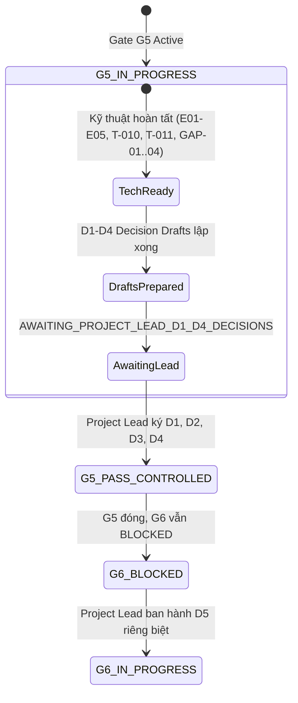

# TS018_G5_STATE_TRANSITION_REPORT.md
# Báo Cáo Chuyển Đổi Trạng Thái Quản Trị Nhiệm Vụ TS-018 và Gate G5

**Dự án:** US Flight Performance Analysis 2016–2024  
**Hạng mục:** Project Governance State Transition Analysis  
**Gate hiện tại:** Gate G5 — IN_PROGRESS  
**Gate tiếp theo:** Gate G6 — NOT_STARTED / BLOCKED  
**Tác giả:** Project Governance Officer, Release & Evidence Manager  
**Thời điểm lập:** 2026-10-20  

---

## 1. TỔNG QUAN VỊ THẾ QUẢN TRỊ DỰ ÁN

Báo cáo này phân định rõ ranh giới giữa tiến độ kỹ thuật đã hoàn thành và thẩm quyền phê duyệt chính thức của con người (Human Authority Boundary) theo quy định tại `AGENTS.md`.

---

## 2. MA TRẬN ĐỐI SOÁT NĂM QUYẾT ĐỊNH ĐỘC LẬP (D1 – D5)

| Mã | Tên quyết định | Tệp hồ sơ dự thảo tương ứng | Trạng thái kỹ thuật | Trạng thái thẩm quyền con người | Hành động tiếp theo |
| :---: | :--- | :--- | :---: | :---: | :--- |
| **D1** | BTS Provenance Attestation | `docs/05-evidence/G5_D1_BTS_PROVENANCE_ATTESTATION_DRAFT.md` | `READY_FOR_ATTESTATION` | **DRAFT / CHỜ KÝ** | Người tải BTS và Project Lead ký xác thực nguồn gốc tệp ZIP. |
| **D2** | FP-DEC-019 Option B Approval | `docs/05-evidence/G5_D2_FP_DEC_019_OPTION_B_APPROVAL_DRAFT.md` | `PROPOSED_FOR_APPROVAL` | **DRAFT / CHỜ KÝ** | Project Lead phê chuẩn chính sách chấp nhận RAW 2019 $\leftrightarrow$ BTS. |
| **D3** | TS-018 Human Technical Signoff | `docs/05-evidence/G5_D3_TS018_HUMAN_TECHNICAL_SIGNOFF_DRAFT.md` | `RECOMMENDED_FOR_SIGNOFF` | **DRAFT / CHỜ KÝ** | Project Lead ký nghiệm thu TS-018, chuyển G2-EXC-001 sang RESOLVED. |
| **D4** | G5 Human Gate Signoff | `docs/05-evidence/G5_D4_G5_HUMAN_GATE_SIGNOFF_DRAFT.md` | `READY_FOR_G5_CLOSEOUT` | **DRAFT / CHỜ KÝ** | Project Lead ký đóng Gate G5 (19 tiêu chí đạt, bảo lưu rủi ro tồn đọng). |
| **D5** | G6 / T-012 Authorization | `docs/05-evidence/G6_T012_READINESS_CHECKLIST.md` | `PREFLIGHT_PASS` | **PENDING / CẤM TỰ ĐỘNG** | Project Lead ban hành quyết định riêng biệt để cấp phép khởi động G6. |

---

## 3. BẢNG TRẠNG THÁI HIỆN THỜI VÀ DỰ PHÓNG CHUYỂN ĐỔI

| Hạng mục quản trị | Trạng thái hiện thời (Current Baseline) | Trạng thái sau khi Project Lead ký D1–D4 | Trạng thái sau khi Project Lead ký D5 |
| :--- | :---: | :---: | :---: |
| **Gate G2, G3, G4** | `PASS` | `PASS` | `PASS` |
| **Task T-010** | `PASS (CONTROLLED)` | `PASS (CONTROLLED)` | `PASS (CONTROLLED)` |
| **Task T-011 Implementation** | `PASS (CONTROLLED)` | `PASS (CONTROLLED)` | `PASS (CONTROLLED)` |
| **Task T-011 Contract Closeout**| `PENDING_TS018` | **`FULL_CONTRACT_PASS`** | `FULL_CONTRACT_PASS` |
| **Nhiệm vụ TS-018** | `OPEN / READY_FOR_SIGNOFF` | **`PASS (CONTROLLED)`** | `PASS (CONTROLLED)` |
| **Ngoại lệ G2-EXC-001** | `ACTIVE` | **`RESOLVED_BY_OPTION_B`** | `RESOLVED_BY_OPTION_B` |
| **Chính sách FP-DEC-019** | `PROPOSED` | **`APPROVED_OPTION_B`** | `APPROVED_OPTION_B` |
| **Gate G5** | **`IN_PROGRESS`** | **`PASS (CONTROLLED)`** | `PASS (CONTROLLED)` |
| **Gate G6** | **`NOT_STARTED / BLOCKED`** | **`NOT_STARTED / BLOCKED`** | **`IN_PROGRESS`** |
| **Khiếm khuyết OR-05** | `OPEN_QUALITY_DEFECT` | `OPEN_QUALITY_DEFECT` | `MANAGED_IN_T012` |
| **Rủi ro thượng nguồn OR-08** | `IDENTITY_UNVERIFIED` | `IDENTITY_UNVERIFIED` | `IDENTITY_UNVERIFIED` |
| **Thời tiết FP-DEC-017** | `CONDITIONAL_NO_GO` | `CONDITIONAL_NO_GO` | `CONDITIONAL_NO_GO` |

---

## 4. KẾT LUẬN QUẢN TRỊ

Do chưa có văn bản ký duyệt chính thức D1, D2, D3, D4 từ Project Lead, hệ thống tuân thủ nghiêm ngặt chỉ thị:
- **KHÔNG TỰ Ý CHUYỂN GATE G5 SANG PASS.**
- **KHÔNG TỰ Ý MỞ GATE G6.**
- **KẾT LUẬN KỸ THUẬT DUY NHẤT:** **`AWAITING_PROJECT_LEAD_D1_D4_DECISIONS`**.
